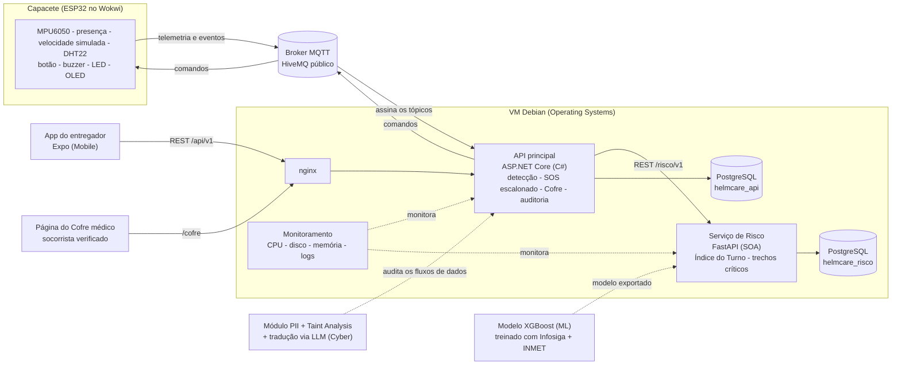
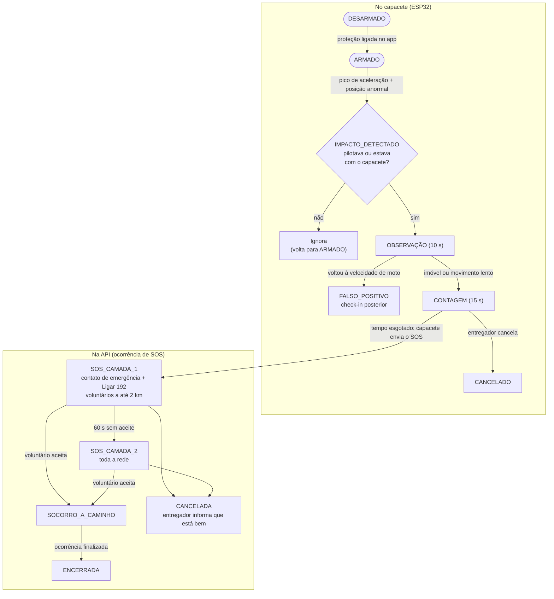

# HelmCare

> **Do risco ao resgate, cuidado em cada corrida.**

**Global Solution 2026.2 - CitizenTech - Engenharia de Software (3º ano) - FIAP Paulista**

**Integrante:** Renan Dias Utida - RM 558540 - Turma 3ESPW

---

## Entregas por disciplina

| Disciplina | Pasta | Links |
|---|---|---|
| Arquitetura Orientada a Serviços (SOA) e Web Services | [`servico-risco/`](servico-risco/) | *(a preencher)* |
| Cybersecurity | [`cyber/`](cyber/) | *(a preencher)* |
| C# Software Development | [`api/`](api/) | *(a preencher)* |
| Inteligência Artificial & Machine Learning | [`ml/`](ml/) | Vídeo: *(a preencher)* |
| Mobile Development & IoT | [`mobile/`](mobile/) | Vídeo: *(a preencher)* |
| Operating Systems | [`infra/`](infra/) | Vídeo: *(a preencher)* |
| Physical Computing: IoT & IoB | [`iot/`](iot/) | Wokwi: *(a preencher)* - Vídeo: *(a preencher)* |
| Testing, Compliance & Quality Assurance | [`docs/`](docs/) | Azure Boards: *(a preencher)* - Pitch: *(a preencher)* |

Contrato de integração entre as partes: [`docs/contrato-integracao.md`](docs/contrato-integracao.md)

---

## Ficha da CitizenTech

| Campo | Resposta |
|---|---|
| **Nome da CitizenTech** | HelmCare |
| **Slogan** | Do risco ao resgate, cuidado em cada corrida. |
| **Cidade e bairro** | São Paulo (SP). Território observado: região da Avenida Paulista (Bela Vista), no entorno da FIAP Paulista, e os bairros vizinhos onde rodam os entregadores entrevistados (Consolação, Liberdade e Pinheiros), com dados de sinistros de toda a capital. |
| **Cidadão beneficiado** | Motociclistas que trabalham com entregas por aplicativo (entregadores e motoboys) na cidade de São Paulo. |
| **Problema, em uma frase** | O entregador de moto é a principal vítima fatal do trânsito paulistano e, quando cai, depende da sorte de alguém ver e chamar ajuda, sem nunca ter sido avisado do risco antes de sair. |
| **Como funciona** | Um módulo no capacete detecta a queda, confirma que a pessoa estava pilotando e, se ela não cancelar, dispara um SOS para a rede de entregadores mais próxima, para o contato de emergência e com a orientação de ligar para o SAMU 192. Antes do turno, o app mostra um Índice de Risco que combina Machine Learning sobre sinistros reais com chuva e calor. Um QR Code no capacete libera a ficha médica apenas para socorristas verificados, apenas durante a emergência. |
| **O que cada parte faz** | Veja a seção [O que cada parte faz](#o-que-cada-parte-faz). |
| **Link do repositório** | https://github.com/renan-utida/helmcare |
| **Indicador de impacto** | Tempo entre a queda e o primeiro aceite humano de socorro. Meta: **menos de 2 minutos**. |
| **ODS conectados** | ODS 3, ODS 11, ODS 13, ODS 9 e ODS 10. Veja a seção [ODS conectados](#ods-conectados). |

---

## O problema

A cidade de São Paulo registrou **1.034 mortes no trânsito em 2025**, o maior número desde 2015. Os **motociclistas formam o maior grupo de vítimas, com 475 mortes** no ano. Entre janeiro e agosto de 2026, as motos estiveram envolvidas em **dois de cada três (67,3%)** dos acidentes graves ou fatais da cidade (dados do Infosiga SP, Detran-SP).

Por trás desses números está um trabalhador que:

- passa o dia inteiro exposto à chuva, ao calor e ao trânsito, sem nenhuma informação sobre o risco do seu turno;
- muitas vezes trabalha sozinho e, em caso de queda, depende de alguém passar, perceber e ligar para o socorro;
- não tem como garantir que, se estiver desacordado, quem o socorrer saiba seu tipo sanguíneo, suas alergias ou quem avisar.

**O HelmCare ataca os três momentos:** antes (prevenir), durante (socorrer) e depois da queda (proteger).

---

## Os três pilares

### 1. Prevenir
- **Índice de Risco do Turno (0 a 100):** antes de sair, o entregador vê o risco do seu turno, com a explicação em linguagem simples. Exemplo: *"Risco alto: chuva prevista às 18h e o seu horário tem histórico de sinistros graves."*
- **Alerta de calor:** o capacete mede a temperatura e a umidade, e o app sugere pausa e hidratação quando o índice de calor fica perigoso.
- **Trechos críticos:** uma lista ou mapa simples dos pontos com mais sinistros graves, pré-calculados a partir do Infosiga.

### 2. Socorrer
- **Detecção de queda inteligente:** só dispara se a pessoa estava pilotando **ou** com o capacete na cabeça antes do impacto.
- **Janela de observação e cancelamento:** 10 s de observação após o impacto e 15 s de contagem, com botão de cancelar no capacete e no app.
- **Rede de socorro escalonada:** voluntários próximos primeiro, depois a rede ampliada, com o contato de emergência avisado e a orientação de ligar para o SAMU 192 **desde o primeiro segundo do SOS**.

### 3. Proteger
- **Cofre médico no capacete:** o QR Code só libera a ficha médica para socorristas verificados, durante a emergência, com expiração automática e registro de auditoria.
- **Privacidade por padrão:** os voluntários nunca veem dados de saúde, e só veem a localização exata depois de aceitar o chamado.

---

## Arquitetura

O capacete fala com a API por MQTT. O app e a página do Cofre falam só com a API, que funciona como porta de entrada e consulta o Serviço de Risco. Tudo roda em uma VM Debian provisionada por Shell Script.



As Features e os Test Cases (Testing) ficam no Azure Boards e validam todo o fluxo acima. Os detalhes de cada conexão (tópicos, rotas e payloads) estão no [Contrato de Integração](docs/contrato-integracao.md).

---

## Como funciona, passo a passo

### Fluxo de detecção (máquina de estados)



`FALSO_POSITIVO` e `CANCELADO` também voltam para `ARMADO`: o capacete continua protegendo o turno.

### Regra de confirmação de pilotagem

O alerta continua se **pelo menos um** destes sinais for verdadeiro nos segundos **antes** do impacto:

1. **Contexto de pilotagem:** havia deslocamento em velocidade de moto.
2. **Presença na cabeça:** o sensor na espuma interna indicava o capacete vestido.

| Situação | Pilotando antes? | Capacete na cabeça? | Resultado |
|---|---|---|---|
| Capacete cai do armário em casa | Não | Não | Ignora |
| Moto parada, capacete cai do retrovisor | Não | Não | Ignora |
| Queda real com a jugular aberta | Sim | Sim | Dispara |
| Queda real com o capacete no cotovelo | Sim | Não | Dispara |
| Queda real com o capacete afivelado | Sim | Sim | Dispara |

### Linha do tempo do SOS

| Tempo | Evento |
|---|---|
| **T0** | Impacto detectado. Começa a janela de observação de 10 s. |
| **T+10 s** | Se a pessoa está imóvel ou em movimento lento, começa a contagem de 15 s (buzzer, LED e OLED no capacete, alerta no app). |
| **T+25 s** | SOS confirmado: o contato de emergência é avisado, o botão "Ligar 192" aparece para todos e a **Camada 1** é acionada (voluntários e vigias de moto a até 2 km). |
| **T+85 s** | Sem aceite em 60 s: a **Camada 2** amplia o raio e avisa toda a rede. |
| **Aceite** | O voluntário vê a localização exata, e o cronômetro do indicador de impacto para. |

### Índice de Risco do Turno

| Componente | Peso | Fonte |
|---|---|---|
| Risco de sinistro grave na faixa horária | 50% | Modelo de ML (Infosiga + INMET) |
| Chuva prevista no turno | 25% | Previsão do tempo (API pública ou mock) |
| Índice de calor | 25% | Previsão + DHT22 do capacete |

Faixas: **0 a 25** Baixo - **26 a 50** Moderado - **51 a 75** Alto - **76 a 100** Muito alto. Os pesos ficam documentados e são configuráveis.

### Cofre médico

| Situação | O que o QR Code mostra |
|---|---|
| Sem emergência ativa | "Ficha médica protegida." Nenhum dado. |
| SOS ativo + socorrista verificado autenticado | Somente o mínimo: tipo sanguíneo, alergias, condições críticas e contato de emergência. |
| SOS não enviado (capacete sem bateria ou sem sinal) | Um socorrista verificado abre uma **emergência manual** ao escanear o QR, com registro de auditoria. |
| Fim do SOS ou 60 min de acesso | O acesso expira automaticamente. |

Todo acesso fica registrado: quem acessou, quando e de onde.

---

## O que cada parte faz

```
helmcare/
├── README.md              ← esta Ficha no início
├── prompts.md             ← registro do uso de IA como copiloto
├── iot/                   ← Physical Computing: IoT & IoB
├── api/                   ← C# Software Development
├── servico-risco/         ← Arquitetura Orientada a Serviços (SOA) e Web Services
├── mobile/                ← Mobile Development & IoT
├── ml/                    ← Inteligência Artificial & Machine Learning
├── infra/                 ← Operating Systems
├── cyber/                 ← Cybersecurity
└── docs/                  ← Testing, Compliance & QA, arquitetura e pitch
```

### Physical Computing: IoT & IoB (`/iot`)
O **módulo do capacete**, simulado no Wokwi com ESP32.

| Componente | Função |
|---|---|
| MPU6050 (acelerômetro e giroscópio) | Detecta o impacto, a orientação anormal do capacete e a imobilidade após a queda |
| Slide switch (sensor IR de presença na espuma) | Indica se o capacete está vestido |
| Potenciômetro (velocidade simulada) | Representa o GPS do celular e indica se a pessoa estava pilotando antes do impacto |
| Botão | Cancela o alerta durante a contagem |
| Buzzer + LED | Sinalizam a contagem e o SOS |
| OLED SSD1306 | Mostra o status e a contagem regressiva |
| DHT22 | Mede temperatura e umidade para o alerta de calor |
| Potenciômetro *(se der tempo)* | Simula o nível da bateria, com reserva para o SOS |

Comunicação: o ESP32 publica eventos via **MQTT** (broker público) e a API assina os tópicos. Na solução real, o capacete usaria o celular via Bluetooth e teria um chip de IoT próprio como canal reserva.

### C# Software Development (`/api`)
O **núcleo do sistema**: ASP.NET Core Web API.

- **Domínio:** Entregador, Dispositivo (capacete), Turno, EventoImpacto, Ocorrência (com a máquina de estados do SOS), Voluntário, Socorrista, FichaMedica, AcessoCofre e ContatoEmergencia.
- **Recursos:** POO com interfaces e injeção de dependência, Entity Framework Core com migrations, LINQ, async/await, xUnit e documentação com Scalar/Swagger.
- **Funcionalidades:** recebe os eventos MQTT do capacete, orquestra o SOS escalonado, gerencia a rede de voluntários, mede o indicador de impacto e serve a página web do Cofre médico.

### Arquitetura Orientada a Serviços (SOA) e Web Services (`/servico-risco`)
O **Serviço de Risco**, um serviço independente em Python (FastAPI).

- Calcula o **Índice de Risco do Turno** usando o modelo treinado em `/ml`, a previsão de chuva e o calor.
- Fornece a lista de **trechos críticos** pré-calculados.
- Recursos: domínio estruturado, banco de dados com SQLAlchemy, migrações com Alembic, documentação automática (Swagger/OpenAPI) e testes automatizados com pytest.
- A API C# consome este serviço via REST, o que torna a arquitetura orientada a serviços de fato.

### Mobile Development & IoT (`/mobile`)
O **app do entregador**: React Native + TypeScript + Expo Router.

| Tela | O que faz |
|---|---|
| Cadastro e perfil | Dados pessoais, contatos de emergência e ficha médica (opcional) |
| Início do turno | Índice de Risco do Turno com a explicação |
| Turno ativo | Status do capacete, alertas de calor e trechos críticos |
| Alerta de queda | Contagem regressiva e botão de cancelar |
| Chamados próximos | Voluntário vê e aceita um SOS |
| Ocorrência | Cronômetro, botão "Ligar 192" e status do socorro |
| Histórico | Turnos, alertas e ocorrências (com SQLite local, funciona offline) |

Acessibilidade: fontes grandes, alto contraste, botões grandes, linguagem simples e suporte a leitor de tela.

### Inteligência Artificial & Machine Learning (`/ml`)
- **Pergunta de ML:** quantos sinistros graves envolvendo motocicletas são esperados em São Paulo em cada faixa horária, dadas as condições de tempo (chuva e temperatura)?
- **Dados reais e públicos:** Infosiga SP (Detran-SP), sinistros com motocicletas na capital, a partir de 2019 (quando a base passa a incluir os não fatais), cruzados com o INMET (estação automática A701, Mirante de Santana), hora a hora.
- **Modelo:** XGBoost, com pelo menos 10 combinações de 3 hiperparâmetros e validação cruzada apenas no treino.
- **Avaliação:** métricas de treino e teste lado a lado (MAE, RMSE), comparação com uma linha de base (média histórica por hora) e discussão de overfitting.
- **Leitura para o cidadão:** em quais horários e condições o risco aumenta, e o limite do modelo (sinistros também refletem o volume de motos circulando).
- **Entregáveis:** notebook executado, `dados/README.md`, `requirements.txt`, `RELATORIO_ML.md` (2 a 4 páginas) e vídeo de até 5 min.

### Operating Systems (`/infra`)
A **infraestrutura Linux** (VM Debian), provisionada por Shell Script.

- Provisionamento de infra: hostname, rede, IP e DNS.
- Provisionamento da aplicação: .NET, Python, banco de dados, variáveis de ambiente, API C#, Serviço de Risco e nginx.
- Serviços com systemd e reinício automático em caso de falha.
- Script de monitoramento com alertas de CPU, disco e memória, rodando como serviço tolerante a falhas.
- Logs de auditoria e de execução, além do teste de falha (derrubar o processo e mostrar a recuperação).

### Cybersecurity (`/cyber`)
A **proteção dos dados do entregador**.

- **Mapeamento de PII:** novas regras no motor de parsing para CPF, CNH, telefone, dados de saúde (tipo sanguíneo, alergias, condições, medicamentos), localização e senhas.
- **Taint Analysis:** rastreia esses dados desde a coleta e bloqueia vazamentos em saídas inseguras (logs, respostas da API, notificações push, payloads MQTT e chamados enviados aos voluntários). Os únicos canais autorizados são o Cofre médico (socorrista verificado, SOS ativo, tempo limitado) e o envio da localização ao contato de emergência.
- **Tradução via IA:** um LLM traduz as falhas técnicas em alertas claros para o cidadão. Exemplo: *"Sua ficha médica poderia aparecer no registro do sistema. Isso já foi bloqueado."*
- **Dashboard:** indicador **Risco Cidadão** atualizado.

### Testing, Compliance & QA (`/docs`)
- **Features no Azure Boards:** detecção de queda, cancelamento, SOS escalonado, rede de voluntários, Cofre médico, Índice de Risco do Turno, alerta de calor e cadastro, cada uma com descrição e critérios de aceite.
- **Test Cases funcionais caixa-preta,** positivos e negativos. Exemplos:
  - Capacete cai sem pilotagem e sem presença: o alerta **não** dispara.
  - Impacto seguido de velocidade de moto: o sistema cancela e envia o check-in.
  - Socorrista não verificado escaneia o QR: o acesso à ficha é **negado**.
  - Acesso ao Cofre após a expiração: o acesso é **negado** e registrado.
- **Pitch:** vídeo de até 4 minutos no YouTube.

---

## As seis perguntas do briefing

| # | Pergunta | Resposta do HelmCare |
|---|---|---|
| 01 | Quem é o cidadão beneficiado? | O entregador motociclista de São Paulo, a principal vítima fatal do trânsito da cidade. |
| 02 | Qual problema será resolvido? | O entregador sai para o turno sem saber o risco que corre e, quando cai, depende da sorte para ser socorrido e ter seus dados médicos conhecidos. |
| 03 | Como a solução funcionará? | Capacete inteligente + app + rede de socorro escalonada + Índice de Risco do Turno + Cofre médico protegido. |
| 04 | Quais tecnologias serão empregadas? | ESP32 (Wokwi) e MQTT; ASP.NET Core com EF Core; FastAPI com SQLAlchemy; React Native com Expo; XGBoost com dados do Infosiga e do INMET; Linux com Shell Script e systemd; módulo de PII com Taint Analysis e LLM; Azure Boards. |
| 05 | Quem participará do ecossistema? | Entregadores, voluntários e vigias de moto, contatos de emergência, socorristas verificados, fontes de dados públicas e parceiros futuros. Detalhes na seção [Ecossistema](#ecossistema). |
| 06 | Como o impacto poderá ser medido e ampliado? | Medido pelo tempo entre a queda e o primeiro aceite humano (meta: menos de 2 min). Ampliado com parcerias com plataformas de entrega, chip de IoT próprio no capacete e integração com o SAMU. Veja também as [Melhorias futuras](#melhorias-futuras). |

---

## Ecossistema

| Participante | Papel no HelmCare |
|---|---|
| **Entregadores** | Usuários principais e, ao mesmo tempo, voluntários da rede de socorro |
| **Vigias de moto de bairro e voluntários** | Primeira camada de resposta, por estarem mais perto de quem caiu |
| **Contatos de emergência** | Família ou pessoas indicadas pelo entregador, avisadas desde o primeiro segundo do SOS |
| **Socorristas verificados (SAMU 192 e bombeiros)** | Únicos com acesso ao Cofre médico, e só durante a emergência |
| **Fontes de dados públicas (Detran-SP/Infosiga e INMET)** | Base real para o modelo de risco e para os trechos críticos |
| **Poder público (Prefeitura, CET e Detran-SP)** | Possibilidade de receber dados agregados e anonimizados de quedas e trechos críticos para políticas de segurança viária |
| **Plataformas de entrega** *(parceria futura)* | Distribuição do capacete e integração com o turno do entregador |
| **Operadoras de conectividade IoT** *(parceria futura)* | Chip próprio no capacete, para o SOS funcionar sem o celular |

---

## Indicador de impacto

| Indicador | Como é medido | Meta |
|---|---|---|
| **Principal: tempo até o primeiro aceite humano** | Cronômetro do impacto (T0) até o aceite de um voluntário | Menos de 2 minutos |
| Linha de base | Tempo relatado na entrevista com os entregadores ("quanto tempo levou até alguém ajudar?") | De **10 a 35 minutos** até a primeira ajuda, e cerca de **1 hora** até chegar ao hospital em um dos casos (relato de 2 entregadores, seção [Validação com o cidadão real](#validação-com-o-cidadão-real)) |
| Apoio: taxa de falsos positivos resolvidos | Percentual de impactos encerrados como falso positivo ou cancelados, sem acionar a rede | Registrar no protótipo |
| Apoio: uso da prevenção | Percentual de turnos iniciados com o Índice de Risco consultado | Registrar no protótipo |

No vídeo, a medição aparece ao vivo: a queda é simulada no Wokwi, o alerta chega no app de outro "entregador" e o cronômetro aparece na tela.

---

## ODS conectados

| ODS | Meta | Como o HelmCare contribui |
|---|---|---|
| **ODS 3:** Saúde e bem-estar | 3.6: reduzir pela metade as mortes e os ferimentos por acidentes de trânsito | Socorro mais rápido após a queda e prevenção com o Índice de Risco do Turno |
| **ODS 11:** Cidades e comunidades sustentáveis | 11.2: transporte seguro para todos, com melhoria da segurança viária | Trechos críticos e alertas para quem trabalha no trânsito da cidade |
| **ODS 13:** Ação contra a mudança global do clima | 13.1: resiliência e adaptação a riscos relacionados ao clima | Alertas de chuva forte e de calor extremo integrados ao risco do turno |
| **ODS 9:** Indústria, inovação e infraestrutura | 9.c: ampliar o acesso às tecnologias de informação e comunicação | Capacete conectado e dispositivo de baixo custo para um trabalhador vulnerável |
| **ODS 10:** Redução das desigualdades | 10.2: promover a inclusão social e econômica de todos | Proteção para uma categoria de trabalhadores informais e expostos, sem custo para o entregador |

---

## Validação com o cidadão real

Em novembro de 2026, o autor conversou com dois entregadores de moto que rodam ou rodavam na região da Paulista, um familiar e um amigo. As conversas foram informais, fora da FIAP, e as respostas foram registradas de memória, sem citações literais. Os nomes ficam só nas iniciais.

| | LSU | RCD |
|---|---|---|
| **Idade** | 44 anos | 36 anos |
| **Situação** | Ex-entregador, trabalhou como autônomo | Entregador por aplicativos de entrega |
| **Onde rodava ou roda** | Paulista e Pinheiros | Paulista, Liberdade e Consolação |
| **Tempo como entregador** | 4 anos | 7 anos |
| **Horas por turno** | 8 h | De 10 a 12 h em alguns turnos, menos em outros |

**Respostas ao roteiro:**

| Pergunta | LSU | RCD |
|---|---|---|
| 1. Tempo de trabalho e horas por turno | 4 anos, turnos de 8 h | 7 anos, turnos de até 10 a 12 h |
| 2. Já caiu ou viu um colega cair? Quanto tempo até alguém ajudar? | Sim. A ajuda levou de 25 a 35 minutos, e a chegada ao hospital, cerca de 1 hora | Sim, várias vezes. Às vezes a ajuda veio em até 10 minutos, outras vezes levou mais de 30 minutos |
| 3. Chuva, calor e horários evitados | Na chuva, mais cautela por causa da pista escorregadia. No calor, para a cada corrida para se hidratar e não deixar a pressão cair. Evita os horários de pico, de manhã e perto das 17h e 18h | Na chuva e no calor, os mesmos cuidados. Evita o horário do almoço nos dias muito quentes e os horários com pouca demanda de pedidos |
| 4. Usaria um alerta de risco antes do turno? | Sim, seria muito bem-vindo na rotina e ajudaria muitos entregadores | Sim, principalmente por ser algo que o protege durante o turno |
| 5. Ajudaria um colega próximo que caiu, se o app avisasse? | Sim, se não estivesse com uma entrega muito urgente | Sim, com certeza |
| 6. Deixaria tipo sanguíneo e alergias num cofre que só o socorrista acessa? | Sim | Sim, desde que o cofre seja seguro |
| Crítica ou sugestão | A rotina de trabalho é exaustiva | É preciso algo que proteja os entregadores, embora muitos assumam riscos desnecessários |

**Principais aprendizados:**

1. **O socorro demora muito mais que a meta.** Os dois relataram de 10 a 35 minutos até a primeira ajuda, e um deles cerca de 1 hora até o hospital. Essa é a linha de base do [indicador de impacto](#indicador-de-impacto): a meta do HelmCare, menos de 2 minutos até o primeiro aceite, ataca exatamente esse intervalo.
2. **A rede de voluntários tem adesão, mas depende do momento.** Os dois ajudariam um colega, e um deles só se não estivesse com uma entrega urgente. Isso confirma o desenho do SOS escalonado: o aceite é voluntário, e a Camada 2 amplia a rede quando ninguém aceita em 60 s.
3. **O Cofre médico é aceito, com uma condição.** Os dois deixariam o tipo sanguíneo e as alergias no cofre, e um deles só se ele for seguro. Isso reforça as regras do Cofre: só socorrista verificado, só durante a emergência, com expiração e auditoria.
4. **Chuva e calor mudam o comportamento.** Na chuva, os dois redobram a cautela. No calor, param para se hidratar. Isso valida o alerta de calor com sugestão de pausa e ajuda a explicar por que a chuva aparece de dois jeitos no Índice de Risco: como exposição do entregador e, no modelo, pelo efeito que ela teve no histórico de sinistros graves.
5. **Os horários pesam.** Os dois evitam horários específicos (picos de trânsito, almoço nos dias quentes), o que confirma o valor de um risco calculado por faixa horária antes do turno.
6. **Jornada longa e risco assumido.** Turnos de 8 a 12 horas, a rotina exaustiva e os riscos desnecessários citados pelo RCD mostram que a prevenção precisa ser simples e rápida de consultar, sem atrapalhar o trabalho.

**Limitações:** foram só duas conversas, com pessoas próximas do autor, e um dos entrevistados já não trabalha como entregador. As respostas foram registradas de memória. Os resultados orientam o desenho do HelmCare, mas não representam todos os entregadores de São Paulo.

---

## Dados utilizados

| Dado | Fonte | Uso |
|---|---|---|
| Sinistros de trânsito com motocicletas (capital, a partir de 2019) | Infosiga SP / Detran-SP (dados abertos) | Treino do modelo e trechos críticos |
| Dados meteorológicos horários (chuva, temperatura, umidade) | INMET, estação A701, Mirante de Santana | Variáveis do modelo e índice de calor |
| Dados de usuários, voluntários, fichas médicas e ocorrências | **Simulados**, criados para o protótipo | Demonstração do app, da API e do módulo de Cyber |

Nenhum dado pessoal real é utilizado no protótipo.

---

## Melhorias futuras

- Chip de IoT e GPS próprios no capacete (funciona sem celular, por exemplo em caso de bateria descarregada ou roubo)
- Recarga solar complementar do módulo do capacete
- Botão de pânico silencioso para roubo (avisa só o contato de emergência, com orientação para o 190, sem enviar voluntários ao local)
- Sensor na jugular como alerta preventivo ("Afivele a jugular")
- Terceira camada da rede de socorro
- Integração real com o SAMU e com as plataformas de entrega
- Nível de bateria com reserva exclusiva para o SOS *(caso não entre no protótipo)*

---

## Uso de IA

A IA foi utilizada como copiloto para aprender, planejar e revisar. Todos os prompts estão registrados em [`prompts.md`](prompts.md), e cada linha do projeto pode ser explicada pelo integrante.

---

## Fontes

- Infosiga SP (Detran-SP): https://infosiga.detran.sp.gov.br/
- CNN Brasil, "São Paulo tem maior número de mortes em acidentes no trânsito desde 2015": https://www.cnnbrasil.com.br/nacional/sudeste/sp/sao-paulo-tem-maior-numero-de-mortes-em-acidentes-no-transito-desde-2015/
- Portal do Trânsito, "Capital paulista tem 2º maior número de mortes no trânsito em 2025": https://www.portaldotransito.com.br/noticias/fiscalizacao-e-legislacao/estatisticas/capital-paulista-tem-2o-maior-numero-de-mortes-no-transito-em-2025/
- Metrópoles, "Motos em 2 de cada 3 acidentes graves ou fatais em SP": https://metropoles.com/sao-paulo/motos-2-cada-3-acidentes-graves-ou-fatais-sp
- INMET, Instituto Nacional de Meteorologia: https://portal.inmet.gov.br/
- Resolução CONTRAN nº 940/2022 (uso do capacete): https://www.legisweb.com.br/legislacao/?id=429780