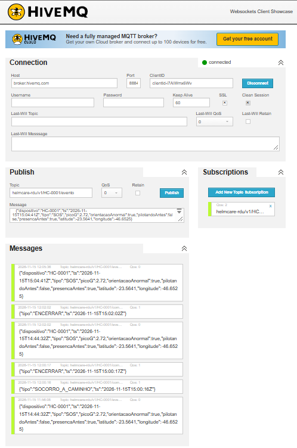

# HelmCare - API principal (C# Software Development)

O núcleo do sistema, em ASP.NET Core. Recebe os eventos do capacete via MQTT, orquestra o SOS escalonado, gerencia a rede de voluntários, mede o indicador de impacto e serve a página web do Cofre médico. Também funciona como porta de entrada do app, repassando as chamadas ao Serviço de Risco.

> Status: em construção.

## Tecnologias

ASP.NET Core - Entity Framework Core (com migrations) - LINQ - async/await - injeção de dependência - MSTest - Scalar/Swagger - PostgreSQL

## Como executar
*(a preencher)*

## Documentação dos endpoints
*(a preencher: link do Scalar/Swagger)*

## Evidências
*(a preencher)*

## Endpoints

Seção 7 do [contrato de integração](../docs/contrato-integracao.md). A documentação interativa fica em *(a preencher)*.

## Integração com o Serviço de Risco

A API é a porta de entrada do app: o app nunca chama o Serviço de Risco direto (seção 1 do contrato). A API chama duas rotas do serviço, por um HttpClient tipado (`ClienteServicoRisco`):

| Rota da API | Rota do Serviço de Risco | Sem o serviço |
|---|---|---|
| `POST /api/v1/turnos` | `POST /risco/v1/indice-turno` | O índice vem da versão simulada; o turno abre normalmente (201) |
| `GET /api/v1/trechos-criticos?limite=N` | `GET /risco/v1/trechos-criticos?limite=N` | `503` em ProblemDetails (não há versão simulada da lista) |

**Configuração** (seção `ServicoRisco` do `appsettings.json`, sem segredo):

| Chave | Padrão | Variável de ambiente |
|---|---|---|
| `UrlBase` | `http://127.0.0.1:8000/risco/v1/` (absoluta e terminada em barra) | `ServicoRisco__UrlBase` |
| `TempoLimiteS` | `3` (de 1 a 30) | `ServicoRisco__TempoLimiteS` |

O padrão usa `127.0.0.1`, e não `localhost`, porque o uvicorn sobe em `127.0.0.1` e, no Windows, o `localhost` tenta primeiro o IPv6 (`::1`). Na VM, a URL vem de `ServicoRisco__UrlBase`.

**Regra da reserva** (seção 8, "Degradação"): o `ServicoRiscoComReserva` tenta o serviço e, se ele falhar, devolve o resultado do `ServicoRiscoSimulado`. O turno nunca falha por causa do Serviço de Risco.

- `503`, qualquer outro `5xx`, erro de rede ou tempo esgotado: aviso no log e versão simulada.
- `4xx` ou resposta fora do formato: erro no log (é erro de integração) e versão simulada.
- O cancelamento da requisição pelo cliente não é falha do serviço e nunca cai na simulada.
- Os logs levam só o motivo, o status HTTP e o tempo, nunca o corpo da requisição ou da resposta.

A versão simulada usa a mesma regra do serviço: a média ponderada das horas do turno (pelos segundos de cada hora dentro dele), uma tabela de 7 dias × 24 horas gerada com o modelo real e o mesmo texto da explicação. Assim, o mesmo turno tem o mesmo índice com o serviço no ar ou não. Limitação: a tabela é a de novembro sem feriado, então em 15/11 e 20/11 a simulada pode diferir do serviço.

### Evidência (14/11/2026)

Passo 4: com o Serviço de Risco no ar (`/risco/v1/saude` = `200`), o turno do exemplo do contrato, sem proteção:

```
POST /api/v1/turnos
{"entregadorId":"01a1dcd8-a986-7d7e-93e5-afc24e4de4fd","inicio":"2026-11-12T20:00:00Z","fimPrevisto":"2026-11-13T00:00:00Z","protecaoAtiva":false}

HTTP/1.1 201 Created
Location: http://localhost:5000/api/v1/turnos/01a1dcd8-aef1-712a-996b-163c9ea7142a/risco
{"turnoId":"01a1dcd8-aef1-712a-996b-163c9ea7142a","indiceRisco":60,"faixaRisco":"ALTO","componentes":{"sinistro":84,"chuva":70,"calor":0},"explicacao":"Risco alto: chuva prevista no turno e o seu horário tem histórico de sinistros graves (pico às 19h)."}
```

```
info: HelmCare.Api.Integracoes.ServicoRisco.ServicoRiscoComReserva[600]
      Índice de Risco calculado pelo Serviço de Risco em 298 ms.
```

Passo 9: com o Serviço de Risco parado (`/risco/v1/saude` sem resposta, `000`), o mesmo pedido para o mesmo entregador:

```
HTTP/1.1 201 Created
Location: http://localhost:5000/api/v1/turnos/01a1dcde-27fb-7d1b-b24c-1bdf6dd7415b/risco
{"turnoId":"01a1dcde-27fb-7d1b-b24c-1bdf6dd7415b","indiceRisco":60,"faixaRisco":"ALTO","componentes":{"sinistro":84,"chuva":70,"calor":0},"explicacao":"Risco alto: chuva prevista no turno e o seu horário tem histórico de sinistros graves (pico às 19h)."}
```

```
warn: HelmCare.Api.Integracoes.ServicoRisco.ServicoRiscoComReserva[601]
      Serviço de Risco indisponível (motivo ErroDeRede, status sem resposta, 2154 ms). Índice de Risco calculado pela versão simulada.
```

Passo 10: ainda com o serviço parado, os trechos críticos respondem `503`, e o turno encerra normalmente:

```
GET /api/v1/trechos-criticos?limite=2

HTTP/1.1 503 Service Unavailable
Content-Type: application/problem+json
{"type":"https://tools.ietf.org/html/rfc9110#section-15.6.4","title":"Serviço de Risco indisponível","status":503,"detail":"Os trechos críticos não estão disponíveis agora; tente de novo.","instance":"/api/v1/trechos-criticos","traceId":"00-6571db4972bd470a253f83c8c226222f-053cf357843dbdaf-00"}
```

```
warn: HelmCare.Api.Servicos.TrechosCriticos.TrechosCriticosServico[611]
      Trechos críticos indisponíveis no Serviço de Risco (motivo ErroDeRede, status sem resposta, 2053 ms). A rota responde 503.
warn: HelmCare.Api.Configuracao.TratadorExcecoes[1]
      Exceção ServicoRiscoIndisponivelException respondida com 503 (traceId 00-6571db4972bd470a253f83c8c226222f-053cf357843dbdaf-00).
```

```
POST /api/v1/turnos/01a1dcde-27fb-7d1b-b24c-1bdf6dd7415b/encerrar

HTTP/1.1 200 OK
{"turnoId":"01a1dcde-27fb-7d1b-b24c-1bdf6dd7415b","entregadorId":"01a1dcd8-a986-7d7e-93e5-afc24e4de4fd","inicio":"2026-11-12T20:00:00Z","fimPrevisto":"2026-11-13T00:00:00Z","fim":"2026-11-15T01:41:56.9591454Z","protecaoAtiva":false,"indiceRisco":60,"faixaRisco":"ALTO","componentes":{"sinistro":84,"chuva":70,"calor":0},"explicacao":"Risco alto: chuva prevista no turno e o seu horário tem histórico de sinistros graves (pico às 19h)."}
```

## SOS escalonado

Quando o capacete publica o evento `SOS`, a API abre a ocorrência em `SOS_CAMADA_1`, avisa (de forma simulada) o contato de emergência e chama os voluntários por camadas (seções 5, 6.2 e 7 do contrato).

**Rede de voluntários.** Todo voluntário é um entregador cadastrado (`POST /api/v1/voluntarios`, que começa indisponível). A disponibilidade e a posição vêm do `PUT /api/v1/voluntarios/{id}/disponibilidade`; ficar indisponível apaga a posição. O `GET /api/v1/ocorrencias/proximas?voluntarioId=` devolve só o que o voluntário pode atender, pela regra única do `Voluntario.PodeAtender`:

- na camada 1, os chamados a até `RAIO_CAMADA_1_KM` (2 km, inclusivo), medidos até a posição exata da queda;
- na camada 2, todos;
- nunca o SOS do próprio entregador, e nada para o voluntário indisponível.

Antes do aceite, o voluntário só vê a localização aproximada (2 casas, cerca de 1 km), e a `distanciaKm` é calculada até ela, para não revelar a posição exata.

**Escalonamento.** O `ServicoEscalonamentoSos` (BackgroundService) roda uma vez na subida e depois a cada `IntervaloEscalonamentoS` (1 s), com um `PeriodicTimer` criado com o `TimeProvider` injetado. Toda ocorrência em `SOS_CAMADA_1` com 60 s ou mais (`TEMPO_ACEITE_CAMADA_1_S`, 60 s exatos já escalam) vai para `SOS_CAMADA_2`, sem depender de nenhuma requisição. Cada ocorrência é gravada sozinha, e um conflito com um aceite simultâneo não impede as outras.

**Aceite.** `POST /api/v1/ocorrencias/{id}/aceites` com `{ voluntarioId }`:

- Responde `201` com o corpo do `GET /ocorrencias/{id}?voluntarioId=` desse voluntário: localização exata, cronômetro parado e o `tempoAteAceiteSegundos` pela regra dos dois trechos.
- O voluntário que não pode atender, ou uma ocorrência fora da espera, dá `409` sem mudar nada.
- Se a gravação der conflito de concorrência, há uma única nova tentativa. O escalonamento também troca a versão da linha, e esse aceite não deve falhar por azar de tempo. Se a ocorrência relida já não aguarda aceite (outro voluntário aceitou antes), `409`.
- Depois de gravar, a API publica `SOCORRO_A_CAMINHO` no capacete da vítima.

**Fim da ocorrência.** `POST /api/v1/ocorrencias/{id}/cancelar` (só em `SOS_CAMADA_1` ou `SOS_CAMADA_2`) e `POST /api/v1/ocorrencias/{id}/encerrar` (também depois do aceite):

- Respondem `200` com o corpo do `GET /ocorrencias/{id}`, com a localização aproximada.
- Encerrar sem aceite deixa o indicador nulo.
- Uma ocorrência já `ENCERRADA` ou `CANCELADA` dá `409`.
- Os dois publicam `ENCERRAR` depois de gravar.

**Comandos sem bloquear e SOS repetido.** Os comandos da ocorrência passam por um único ponto, o `PublicadorComandosOcorrencia`. Se o broker falhar, o aviso vai para o log e a rota responde normalmente, porque o socorro não pode depender do capacete (os comandos do turno continuam com o `503`).

O comando perdido é refeito no próximo reenvio do `SOS`, que tem o mesmo `ts`. A duplicata não grava nada, mas, conforme a ocorrência mais recente do entregador, a API publica o comando de novo:

- `SOCORRO_A_CAMINHO`: publica `SOCORRO_A_CAMINHO` de novo;
- `ENCERRADA` ou `CANCELADA`: publica `ENCERRAR` de novo;
- ainda aguardando aceite: não publica nada.

**Aviso ao contato de emergência.** É simulado: só uma linha de log com o id da ocorrência e a quantidade de contatos, depois de gravar, e nunca numa duplicata.

### Evidência (15/11/2026)

Voluntários da rede (dados simulados), com a vítima no capacete HC-0001, na região da Av. Paulista:

| Voluntário | Região | Distância real até a queda |
|---|---|---|
| V1 | MASP | 0,46 km |
| V2 | Consolação | 1,3 km |
| V3 | Pinheiros | 4,1 km |

O entregador do HC-0001 também é voluntário.

Passo 1: limpeza da ocorrência de 12/11 pelas rotas. Sem aceite, o indicador fica nulo. Depois, o turno ativo do HC-0001, com a proteção ligada, foi encerrado (`200`):

```
POST /api/v1/ocorrencias/01a1d222-1dc9-7fbe-85f0-59599125ba4f/encerrar

HTTP/1.1 200 OK
{"id":"01a1d222-1dc9-7fbe-85f0-59599125ba4f","estado":"ENCERRADA","camada":2,"criadaEm":"2026-11-12T23:40:13.640762Z","aceitaEm":null,"encerradaEm":"2026-11-15T14:01:00.9573626Z","tempoAteAceiteSegundos":null,"latitude":-23.56,"longitude":-46.65,"localizacaoExata":false,"cronometro":{"segundosDesdeQueda":224473,"metaSegundos":120,"parado":true}}
```

```
info: HelmCare.Api.Servicos.Ocorrencias.AtendimentoOcorrenciaServico[742]
      Ocorrência 01a1d222-1dc9-7fbe-85f0-59599125ba4f terminada em ENCERRADA.
info: HelmCare.Api.Mensageria.PublicadorComandosMqtt[400]
      Comando ENCERRAR publicado para o capacete HC-0001.
info: HelmCare.Api.Mensageria.PublicadorComandosMqtt[400]
      Comando DESARMAR publicado para o capacete HC-0001.
```

Passos 2 e 3: SOS publicado no tópico `helmcare-rdu/v1/HC-0001/evento` (`ts` `2026-11-15T14:44:32Z`), sem `IMPACTO_DETECTADO` antes, por isso o impacto é estimado:

```
info: HelmCare.Api.Mensageria.Processadores.ProcessadorSos[220]
      SOS do capacete HC-0001: ocorrência 01a1dfb5-60b7-7b1f-8356-88f5132d6d5a aberta em SOS_CAMADA_1 (impacto estimado: True).
info: HelmCare.Api.Servicos.Ocorrencias.NotificadorContatoSimulado[730]
      Aviso simulado ao contato de emergência da ocorrência 01a1dfb5-60b7-7b1f-8356-88f5132d6d5a (1 contato(s)).
info: HelmCare.Api.Servicos.Ocorrencias.EscalonadorOcorrencias[720]
      Ocorrência 01a1dfb5-60b7-7b1f-8356-88f5132d6d5a escalada para SOS_CAMADA_2 (sem aceite no tempo da camada 1).
```

Passos 3 e 4 (camada 1 e depois camada 2), com um SOS extra (`ts` `2026-11-15T15:04:41Z`). Um laço consultou os chamados próximos assim que a ocorrência apareceu no banco e de novo 62 s depois do `criadaEm`.

Na camada 1, V1 e V2 estão dentro do raio e V3 não:

```
[15:05:37] ocorrência 01a1dfbe-0cff-71ef-80fc-f2b7b9f7d37e encontrada em SOS_CAMADA_1, criadaEm 15:05:36
[15:05:37] GET proximas V1:
[{"ocorrenciaId":"01a1dfbe-0cff-71ef-80fc-f2b7b9f7d37e","estado":"SOS_CAMADA_1","camada":1,"criadaEm":"2026-11-15T15:05:36.767115Z","latitude":-23.56,"longitude":-46.65,"distanciaKm":0.6,"cronometro":{"segundosDesdeQueda":25,"metaSegundos":120,"parado":false}}] HTTP 200
[15:05:37] GET proximas V2:
[{"ocorrenciaId":"01a1dfbe-0cff-71ef-80fc-f2b7b9f7d37e","estado":"SOS_CAMADA_1","camada":1,"criadaEm":"2026-11-15T15:05:36.767115Z","latitude":-23.56,"longitude":-46.65,"distanciaKm":1.3,"cronometro":{"segundosDesdeQueda":25,"metaSegundos":120,"parado":false}}] HTTP 200
[15:05:37] GET proximas V3:
[] HTTP 200
```

Depois dos 60 s, a ocorrência escalou e o V3 passou a ver o chamado:

```
[15:06:38] passaram 62 s do criadaEm
[15:06:38] GET proximas V3:
[{"ocorrenciaId":"01a1dfbe-0cff-71ef-80fc-f2b7b9f7d37e","estado":"SOS_CAMADA_2","camada":2,"criadaEm":"2026-11-15T15:05:36.767115Z","latitude":-23.56,"longitude":-46.65,"distanciaKm":4.5,"cronometro":{"segundosDesdeQueda":86,"metaSegundos":120,"parado":false}}] HTTP 200
```

O voluntário do HC-0001 recebe `[]`, porque é o próprio SOS. Esse SOS extra terminou pela rota de cancelar: `200`, `CANCELADA`, indicador nulo e `ENCERRAR` publicado.

Passo 5: V1 aceita a ocorrência `01a1dfb5-...`. O indicador é de 272 s: 25 s do trecho do capacete (impacto estimado) e 247,97 s do servidor, do SOS ao aceite, arredondados para baixo só na soma. Esta resposta, para quem aceitou, é a única com a localização exata:

```
POST /api/v1/ocorrencias/01a1dfb5-60b7-7b1f-8356-88f5132d6d5a/aceites
{"voluntarioId":"01a1df61-e6b2-7652-8580-2c6d26b7f04b"}

HTTP/1.1 201 Created
Location: http://localhost:5000/api/v1/ocorrencias/01a1dfb5-60b7-7b1f-8356-88f5132d6d5a?voluntarioId=01a1df61-e6b2-7652-8580-2c6d26b7f04b
{"id":"01a1dfb5-60b7-7b1f-8356-88f5132d6d5a","estado":"SOCORRO_A_CAMINHO","camada":2,"criadaEm":"2026-11-15T14:56:08.374013Z","aceitaEm":"2026-11-15T15:00:16.3441291Z","encerradaEm":null,"tempoAteAceiteSegundos":272,"latitude":-23.5641,"longitude":-46.6525,"localizacaoExata":true,"cronometro":{"segundosDesdeQueda":272,"metaSegundos":120,"parado":true}}
```

```
info: HelmCare.Api.Servicos.Ocorrencias.AtendimentoOcorrenciaServico[740]
      Ocorrência 01a1dfb5-60b7-7b1f-8356-88f5132d6d5a aceita pelo voluntário 01a1df61-e6b2-7652-8580-2c6d26b7f04b.
info: HelmCare.Api.Mensageria.PublicadorComandosMqtt[400]
      Comando SOCORRO_A_CAMINHO publicado para o capacete HC-0001.
```

O V2 tenta aceitar em seguida: `409`, "Não é possível aceitar uma ocorrência em SOCORRO_A_CAMINHO."

Passo 6: `GET /ocorrencias/01a1dfb5-...?voluntarioId=` do V2 traz `"latitude":-23.56,"longitude":-46.65,"localizacaoExata":false`. O do V1, que aceitou, traz a localização exata, com `"localizacaoExata":true`.

Passo 7: encerrar dá `200` (`ENCERRADA`, indicador 272 mantido, localização aproximada, `ENCERRAR` publicado). Cancelar depois dá `409`, "Não é possível cancelar uma ocorrência em ENCERRADA."

Passo 8: o mesmo SOS publicado de novo, com o mesmo `ts`. A duplicata não gravou nada: antes e depois, há 2 ocorrências, 2 impactos, 4 eventos processados e 1 aceite. O comando foi refeito:

```
info: HelmCare.Api.Mensageria.RoteadorMensagemMqtt[207]
      SOS repetido do capacete HC-0001 (duplicata, nada gravado): comando ENCERRAR refeito para a ocorrência 01a1dfb5-60b7-7b1f-8356-88f5132d6d5a.
info: HelmCare.Api.Mensageria.PublicadorComandosMqtt[400]
      Comando ENCERRAR publicado para o capacete HC-0001.
```

Nenhuma linha do log desta rodada tem coordenadas, nome ou telefone: os logs levam só ids, o código do capacete e o comando.

Do lado do broker, o cliente web do HiveMQ assinando `helmcare-rdu/v1/HC-0001/#` mostra a sequência inteira, no horário de Brasília e de baixo para cima: o SOS às 11:56:08, o `SOCORRO_A_CAMINHO` do aceite às 12:00:16, o `ENCERRAR` do encerramento às 12:00:17, o SOS repetido com o mesmo `ts` e o `ENCERRAR` refeito no mesmo segundo (12:02:02) e, no topo, o SOS extra da evidência da camada 1 (12:05:36).



## Decisões de projeto

- O indicador de impacto mede cada trecho no próprio relógio: o capacete mede da queda ao fim da contagem, e o servidor mede do SOS recebido até o aceite.
- Assim, um relógio atrasado no capacete não infla o indicador; no teste de 12/11, o Wokwi rodou a 47% da velocidade e o relógio dele atrasou 1 min 55 s em cerca de 2 min.
- O Índice de Risco passa por um decorador com reserva: a API tenta o Serviço de Risco e, se ele falhar, usa a versão simulada, com uma tabela gerada do modelo real e a mesma regra do serviço, que dá o mesmo índice com o serviço no ar ou não.
- O escalonamento para a camada 2 roda em segundo plano (BackgroundService com `PeriodicTimer` criado com o `TimeProvider` injetado): vale sem nenhuma requisição chegando, e os testes avançam o `FakeTimeProvider` em vez de esperar 60 s.
- O aceite faz uma única nova tentativa depois de um conflito de concorrência, porque o escalonamento em segundo plano também troca a versão da ocorrência; se a ocorrência relida já não aguarda aceite (outro voluntário aceitou antes), a resposta é `409`.
