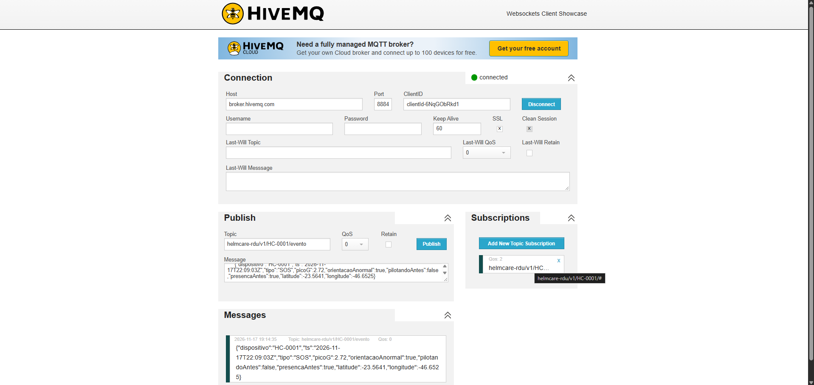

# HelmCare - API principal (C# Software Development)

O núcleo do sistema, em ASP.NET Core. Recebe os eventos do capacete via MQTT, orquestra o SOS escalonado, gerencia a rede de voluntários, mede o indicador de impacto e serve a página web do Cofre médico. Também funciona como porta de entrada do app, repassando as chamadas ao Serviço de Risco.

> Status: em construção.

## Tecnologias

ASP.NET Core - Entity Framework Core (com migrations) - LINQ - async/await - injeção de dependência - MSTest - Scalar/Swagger - PostgreSQL

## Como executar
*(a preencher)*

## Documentação dos endpoints
*(a preencher: link do Scalar/Swagger)*

## Evidências
*(a preencher)*

## Endpoints

Seção 7 do [contrato de integração](../docs/contrato-integracao.md). A documentação interativa fica em *(a preencher)*.

## Integração com o Serviço de Risco

A API é a porta de entrada do app: o app nunca chama o Serviço de Risco direto (seção 1 do contrato). A API chama duas rotas do serviço, por um HttpClient tipado (`ClienteServicoRisco`):

| Rota da API | Rota do Serviço de Risco | Sem o serviço |
|---|---|---|
| `POST /api/v1/turnos` | `POST /risco/v1/indice-turno` | O índice vem da versão simulada; o turno abre normalmente (201) |
| `GET /api/v1/trechos-criticos?limite=N` | `GET /risco/v1/trechos-criticos?limite=N` | `503` em ProblemDetails (não há versão simulada da lista) |

**Configuração** (seção `ServicoRisco` do `appsettings.json`, sem segredo):

| Chave | Padrão | Variável de ambiente |
|---|---|---|
| `UrlBase` | `http://127.0.0.1:8000/risco/v1/` (absoluta e terminada em barra) | `ServicoRisco__UrlBase` |
| `TempoLimiteS` | `3` (de 1 a 30) | `ServicoRisco__TempoLimiteS` |

O padrão usa `127.0.0.1`, e não `localhost`, porque o uvicorn sobe em `127.0.0.1` e, no Windows, o `localhost` tenta primeiro o IPv6 (`::1`). Na VM, a URL vem de `ServicoRisco__UrlBase`.

**Regra da reserva** (seção 8, "Degradação"): o `ServicoRiscoComReserva` tenta o serviço e, se ele falhar, devolve o resultado do `ServicoRiscoSimulado`. O turno nunca falha por causa do Serviço de Risco.

- `503`, qualquer outro `5xx`, erro de rede ou tempo esgotado: aviso no log e versão simulada.
- `4xx` ou resposta fora do formato: erro no log (é erro de integração) e versão simulada.
- O cancelamento da requisição pelo cliente não é falha do serviço e nunca cai na simulada.
- Os logs levam só o motivo, o status HTTP e o tempo, nunca o corpo da requisição ou da resposta.

A versão simulada usa a mesma regra do serviço: a média ponderada das horas do turno (pelos segundos de cada hora dentro dele), uma tabela de 7 dias × 24 horas gerada com o modelo real e o mesmo texto da explicação. Assim, o mesmo turno tem o mesmo índice com o serviço no ar ou não. Limitação: a tabela é a de novembro sem feriado, então em 15/11 e 20/11 a simulada pode diferir do serviço.

### Evidência (14/11/2026)

> Evidências anteriores à 1.15, feitas sem token; desde a 1.15, as rotas exigem login.

Passo 4: com o Serviço de Risco no ar (`/risco/v1/saude` = `200`), o turno do exemplo do contrato, sem proteção:

```
POST /api/v1/turnos
{"entregadorId":"01a1dcd8-a986-7d7e-93e5-afc24e4de4fd","inicio":"2026-11-12T20:00:00Z","fimPrevisto":"2026-11-13T00:00:00Z","protecaoAtiva":false}

HTTP/1.1 201 Created
Location: http://localhost:5000/api/v1/turnos/01a1dcd8-aef1-712a-996b-163c9ea7142a/risco
{"turnoId":"01a1dcd8-aef1-712a-996b-163c9ea7142a","indiceRisco":60,"faixaRisco":"ALTO","componentes":{"sinistro":84,"chuva":70,"calor":0},"explicacao":"Risco alto: chuva prevista no turno e o seu horário tem histórico de sinistros graves (pico às 19h)."}
```

```
info: HelmCare.Api.Integracoes.ServicoRisco.ServicoRiscoComReserva[600]
      Índice de Risco calculado pelo Serviço de Risco em 298 ms.
```

Passo 9: com o Serviço de Risco parado (`/risco/v1/saude` sem resposta, `000`), o mesmo pedido para o mesmo entregador:

```
HTTP/1.1 201 Created
Location: http://localhost:5000/api/v1/turnos/01a1dcde-27fb-7d1b-b24c-1bdf6dd7415b/risco
{"turnoId":"01a1dcde-27fb-7d1b-b24c-1bdf6dd7415b","indiceRisco":60,"faixaRisco":"ALTO","componentes":{"sinistro":84,"chuva":70,"calor":0},"explicacao":"Risco alto: chuva prevista no turno e o seu horário tem histórico de sinistros graves (pico às 19h)."}
```

```
warn: HelmCare.Api.Integracoes.ServicoRisco.ServicoRiscoComReserva[601]
      Serviço de Risco indisponível (motivo ErroDeRede, status sem resposta, 2154 ms). Índice de Risco calculado pela versão simulada.
```

Passo 10: ainda com o serviço parado, os trechos críticos respondem `503`, e o turno encerra normalmente:

```
GET /api/v1/trechos-criticos?limite=2

HTTP/1.1 503 Service Unavailable
Content-Type: application/problem+json
{"type":"https://tools.ietf.org/html/rfc9110#section-15.6.4","title":"Serviço de Risco indisponível","status":503,"detail":"Os trechos críticos não estão disponíveis agora; tente de novo.","instance":"/api/v1/trechos-criticos","traceId":"00-6571db4972bd470a253f83c8c226222f-053cf357843dbdaf-00"}
```

```
warn: HelmCare.Api.Servicos.TrechosCriticos.TrechosCriticosServico[611]
      Trechos críticos indisponíveis no Serviço de Risco (motivo ErroDeRede, status sem resposta, 2053 ms). A rota responde 503.
warn: HelmCare.Api.Configuracao.TratadorExcecoes[1]
      Exceção ServicoRiscoIndisponivelException respondida com 503 (traceId 00-6571db4972bd470a253f83c8c226222f-053cf357843dbdaf-00).
```

```
POST /api/v1/turnos/01a1dcde-27fb-7d1b-b24c-1bdf6dd7415b/encerrar

HTTP/1.1 200 OK
{"turnoId":"01a1dcde-27fb-7d1b-b24c-1bdf6dd7415b","entregadorId":"01a1dcd8-a986-7d7e-93e5-afc24e4de4fd","inicio":"2026-11-12T20:00:00Z","fimPrevisto":"2026-11-13T00:00:00Z","fim":"2026-11-15T01:41:56.9591454Z","protecaoAtiva":false,"indiceRisco":60,"faixaRisco":"ALTO","componentes":{"sinistro":84,"chuva":70,"calor":0},"explicacao":"Risco alto: chuva prevista no turno e o seu horário tem histórico de sinistros graves (pico às 19h)."}
```

## SOS escalonado

Quando o capacete publica o evento `SOS`, a API abre a ocorrência em `SOS_CAMADA_1`, avisa (de forma simulada) o contato de emergência e chama os voluntários por camadas (seções 5, 6.2 e 7 do contrato).

**Rede de voluntários.** Todo voluntário é um entregador cadastrado (`POST /api/v1/voluntarios`, que começa indisponível). A disponibilidade e a posição vêm do `PUT /api/v1/voluntarios/{id}/disponibilidade`; ficar indisponível apaga a posição. O `GET /api/v1/ocorrencias/proximas?voluntarioId=` devolve só o que o voluntário pode atender, pela regra única do `Voluntario.PodeAtender`:

- na camada 1, os chamados a até `RAIO_CAMADA_1_KM` (2 km, inclusivo), medidos até a posição exata da queda;
- na camada 2, todos;
- nunca o SOS do próprio entregador, e nada para o voluntário indisponível.

Antes do aceite, o voluntário só vê a localização aproximada (2 casas, cerca de 1 km), e a `distanciaKm` é calculada até ela, para não revelar a posição exata.

**Escalonamento.** O `ServicoEscalonamentoSos` (BackgroundService) roda uma vez na subida e depois a cada `IntervaloEscalonamentoS` (1 s), com um `PeriodicTimer` criado com o `TimeProvider` injetado. Toda ocorrência em `SOS_CAMADA_1` com 60 s ou mais (`TEMPO_ACEITE_CAMADA_1_S`, 60 s exatos já escalam) vai para `SOS_CAMADA_2`, sem depender de nenhuma requisição. Cada ocorrência é gravada sozinha, e um conflito com um aceite simultâneo não impede as outras.

**Aceite.** `POST /api/v1/ocorrencias/{id}/aceites` com `{ voluntarioId }`:

- Responde `201` com o corpo do `GET /ocorrencias/{id}?voluntarioId=` desse voluntário: localização exata, cronômetro parado e o `tempoAteAceiteSegundos` pela regra dos dois trechos.
- O voluntário que não pode atender, ou uma ocorrência fora da espera, dá `409` sem mudar nada.
- Se a gravação der conflito de concorrência, há uma única nova tentativa. O escalonamento também troca a versão da linha, e esse aceite não deve falhar por azar de tempo. Se a ocorrência relida já não aguarda aceite (outro voluntário aceitou antes), `409`.
- Depois de gravar, a API publica `SOCORRO_A_CAMINHO` no capacete da vítima.

**Fim da ocorrência.** `POST /api/v1/ocorrencias/{id}/cancelar` (só em `SOS_CAMADA_1` ou `SOS_CAMADA_2`) e `POST /api/v1/ocorrencias/{id}/encerrar` (também depois do aceite):

- Respondem `200` com o corpo do `GET /ocorrencias/{id}`, com a localização aproximada.
- Encerrar sem aceite deixa o indicador nulo.
- Uma ocorrência já `ENCERRADA` ou `CANCELADA` dá `409`.
- Os dois publicam `ENCERRAR` depois de gravar.

**Comandos sem bloquear e SOS repetido.** Os comandos da ocorrência passam por um único ponto, o `PublicadorComandosOcorrencia`. Se o broker falhar, o aviso vai para o log e a rota responde normalmente, porque o socorro não pode depender do capacete (os comandos do turno continuam com o `503`).

O comando perdido é refeito no próximo reenvio do `SOS`, que tem o mesmo `ts`. A duplicata não grava nada, mas, conforme a ocorrência mais recente do entregador, a API publica o comando de novo:

- `SOCORRO_A_CAMINHO`: publica `SOCORRO_A_CAMINHO` de novo;
- `ENCERRADA` ou `CANCELADA`: publica `ENCERRAR` de novo;
- ainda aguardando aceite: não publica nada.

**Aviso ao contato de emergência.** É simulado: só uma linha de log com o id da ocorrência e a quantidade de contatos, depois de gravar, e nunca numa duplicata.

### Evidência (15/11/2026)

> Evidências anteriores à 1.15, feitas sem token; desde a 1.15, as rotas exigem login.

Voluntários da rede (dados simulados), com a vítima no capacete HC-0001, na região da Av. Paulista:

| Voluntário | Região | Distância real até a queda |
|---|---|---|
| V1 | MASP | 0,46 km |
| V2 | Consolação | 1,3 km |
| V3 | Pinheiros | 4,1 km |

O entregador do HC-0001 também é voluntário.

Passo 1: limpeza da ocorrência de 12/11 pelas rotas. Sem aceite, o indicador fica nulo. Depois, o turno ativo do HC-0001, com a proteção ligada, foi encerrado (`200`):

```
POST /api/v1/ocorrencias/01a1d222-1dc9-7fbe-85f0-59599125ba4f/encerrar

HTTP/1.1 200 OK
{"id":"01a1d222-1dc9-7fbe-85f0-59599125ba4f","estado":"ENCERRADA","camada":2,"criadaEm":"2026-11-12T23:40:13.640762Z","aceitaEm":null,"encerradaEm":"2026-11-15T14:01:00.9573626Z","tempoAteAceiteSegundos":null,"latitude":-23.56,"longitude":-46.65,"localizacaoExata":false,"cronometro":{"segundosDesdeQueda":224473,"metaSegundos":120,"parado":true}}
```

```
info: HelmCare.Api.Servicos.Ocorrencias.AtendimentoOcorrenciaServico[742]
      Ocorrência 01a1d222-1dc9-7fbe-85f0-59599125ba4f terminada em ENCERRADA.
info: HelmCare.Api.Mensageria.PublicadorComandosMqtt[400]
      Comando ENCERRAR publicado para o capacete HC-0001.
info: HelmCare.Api.Mensageria.PublicadorComandosMqtt[400]
      Comando DESARMAR publicado para o capacete HC-0001.
```

Passos 2 e 3: SOS publicado no tópico `helmcare-rdu/v1/HC-0001/evento` (`ts` `2026-11-15T14:44:32Z`), sem `IMPACTO_DETECTADO` antes, por isso o impacto é estimado:

```
info: HelmCare.Api.Mensageria.Processadores.ProcessadorSos[220]
      SOS do capacete HC-0001: ocorrência 01a1dfb5-60b7-7b1f-8356-88f5132d6d5a aberta em SOS_CAMADA_1 (impacto estimado: True).
info: HelmCare.Api.Servicos.Ocorrencias.NotificadorContatoSimulado[730]
      Aviso simulado ao contato de emergência da ocorrência 01a1dfb5-60b7-7b1f-8356-88f5132d6d5a (1 contato(s)).
info: HelmCare.Api.Servicos.Ocorrencias.EscalonadorOcorrencias[720]
      Ocorrência 01a1dfb5-60b7-7b1f-8356-88f5132d6d5a escalada para SOS_CAMADA_2 (sem aceite no tempo da camada 1).
```

Passos 3 e 4 (camada 1 e depois camada 2), com um SOS extra (`ts` `2026-11-15T15:04:41Z`). Um laço consultou os chamados próximos assim que a ocorrência apareceu no banco e de novo 62 s depois do `criadaEm`.

Na camada 1, V1 e V2 estão dentro do raio e V3 não:

```
[15:05:37] ocorrência 01a1dfbe-0cff-71ef-80fc-f2b7b9f7d37e encontrada em SOS_CAMADA_1, criadaEm 15:05:36
[15:05:37] GET proximas V1:
[{"ocorrenciaId":"01a1dfbe-0cff-71ef-80fc-f2b7b9f7d37e","estado":"SOS_CAMADA_1","camada":1,"criadaEm":"2026-11-15T15:05:36.767115Z","latitude":-23.56,"longitude":-46.65,"distanciaKm":0.6,"cronometro":{"segundosDesdeQueda":25,"metaSegundos":120,"parado":false}}] HTTP 200
[15:05:37] GET proximas V2:
[{"ocorrenciaId":"01a1dfbe-0cff-71ef-80fc-f2b7b9f7d37e","estado":"SOS_CAMADA_1","camada":1,"criadaEm":"2026-11-15T15:05:36.767115Z","latitude":-23.56,"longitude":-46.65,"distanciaKm":1.3,"cronometro":{"segundosDesdeQueda":25,"metaSegundos":120,"parado":false}}] HTTP 200
[15:05:37] GET proximas V3:
[] HTTP 200
```

Depois dos 60 s, a ocorrência escalou e o V3 passou a ver o chamado:

```
[15:06:38] passaram 62 s do criadaEm
[15:06:38] GET proximas V3:
[{"ocorrenciaId":"01a1dfbe-0cff-71ef-80fc-f2b7b9f7d37e","estado":"SOS_CAMADA_2","camada":2,"criadaEm":"2026-11-15T15:05:36.767115Z","latitude":-23.56,"longitude":-46.65,"distanciaKm":4.5,"cronometro":{"segundosDesdeQueda":86,"metaSegundos":120,"parado":false}}] HTTP 200
```

O voluntário do HC-0001 recebe `[]`, porque é o próprio SOS. Esse SOS extra terminou pela rota de cancelar: `200`, `CANCELADA`, indicador nulo e `ENCERRAR` publicado.

Passo 5: V1 aceita a ocorrência `01a1dfb5-...`. O indicador é de 272 s: 25 s do trecho do capacete (impacto estimado) e 247,97 s do servidor, do SOS ao aceite, arredondados para baixo só na soma. Esta resposta, para quem aceitou, é a única com a localização exata:

```
POST /api/v1/ocorrencias/01a1dfb5-60b7-7b1f-8356-88f5132d6d5a/aceites
{"voluntarioId":"01a1df61-e6b2-7652-8580-2c6d26b7f04b"}

HTTP/1.1 201 Created
Location: http://localhost:5000/api/v1/ocorrencias/01a1dfb5-60b7-7b1f-8356-88f5132d6d5a?voluntarioId=01a1df61-e6b2-7652-8580-2c6d26b7f04b
{"id":"01a1dfb5-60b7-7b1f-8356-88f5132d6d5a","estado":"SOCORRO_A_CAMINHO","camada":2,"criadaEm":"2026-11-15T14:56:08.374013Z","aceitaEm":"2026-11-15T15:00:16.3441291Z","encerradaEm":null,"tempoAteAceiteSegundos":272,"latitude":-23.5641,"longitude":-46.6525,"localizacaoExata":true,"cronometro":{"segundosDesdeQueda":272,"metaSegundos":120,"parado":true}}
```

```
info: HelmCare.Api.Servicos.Ocorrencias.AtendimentoOcorrenciaServico[740]
      Ocorrência 01a1dfb5-60b7-7b1f-8356-88f5132d6d5a aceita pelo voluntário 01a1df61-e6b2-7652-8580-2c6d26b7f04b.
info: HelmCare.Api.Mensageria.PublicadorComandosMqtt[400]
      Comando SOCORRO_A_CAMINHO publicado para o capacete HC-0001.
```

O V2 tenta aceitar em seguida: `409`, "Não é possível aceitar uma ocorrência em SOCORRO_A_CAMINHO."

Passo 6: `GET /ocorrencias/01a1dfb5-...?voluntarioId=` do V2 traz `"latitude":-23.56,"longitude":-46.65,"localizacaoExata":false`. O do V1, que aceitou, traz a localização exata, com `"localizacaoExata":true`.

Passo 7: encerrar dá `200` (`ENCERRADA`, indicador 272 mantido, localização aproximada, `ENCERRAR` publicado). Cancelar depois dá `409`, "Não é possível cancelar uma ocorrência em ENCERRADA."

Passo 8: o mesmo SOS publicado de novo, com o mesmo `ts`. A duplicata não gravou nada: antes e depois, há 2 ocorrências, 2 impactos, 4 eventos processados e 1 aceite. O comando foi refeito:

```
info: HelmCare.Api.Mensageria.RoteadorMensagemMqtt[207]
      SOS repetido do capacete HC-0001 (duplicata, nada gravado): comando ENCERRAR refeito para a ocorrência 01a1dfb5-60b7-7b1f-8356-88f5132d6d5a.
info: HelmCare.Api.Mensageria.PublicadorComandosMqtt[400]
      Comando ENCERRAR publicado para o capacete HC-0001.
```

Nenhuma linha do log desta rodada tem coordenadas, nome ou telefone: os logs levam só ids, o código do capacete e o comando.

Do lado do broker, o cliente web do HiveMQ assinando `helmcare-rdu/v1/HC-0001/#` mostra a sequência inteira, no horário de Brasília e de baixo para cima: o SOS às 11:56:08, o `SOCORRO_A_CAMINHO` do aceite às 12:00:16, o `ENCERRAR` do encerramento às 12:00:17, o SOS repetido com o mesmo `ts` e o `ENCERRAR` refeito no mesmo segundo (12:02:02) e, no topo, o SOS extra da evidência da camada 1 (12:05:36).


## Identidade e autorização

Desde a versão 1.15 do contrato, as rotas exigem login (seção 7, "Identidade e autorização"). O login usa o ASP.NET Core Identity da própria API, com o token bearer do Identity (`AddIdentityApiEndpoints`). O token é opaco e protegido pelo Data Protection; não há JWT nem chave de assinatura em arquivo. As rotas de login são nossas, sem o `MapIdentityApi`, porque o corpo do contrato leva a sessão junto com os tokens.

**Contas e papéis.**

- O `POST /api/v1/entregadores` recebe o corpo de antes mais `email` e `senha`, e cria a conta (papel `ENTREGADOR`) e o entregador na mesma transação: se uma das gravações falhar, nada fica gravado. A resposta não traz token, e o app chama o login logo depois.
- Os papéis `ENTREGADOR` e `SOCORRISTA` nascem com a migration `Identidade`. O token leva o papel e o id do perfil (`entregadorId` ou `socorristaId`), e a mesma fábrica de claims vale no login e na renovação.
- Senha de 8 a 64 caracteres, com maiúscula, minúscula e dígito (símbolo não é exigido), guardada só como hash. E-mail com até 254 caracteres, sem repetir (sem diferenciar maiúsculas). CPF, CNH, telefone e e-mail repetidos dão `409`, inclusive na corrida de dois cadastros, pelos índices únicos.
- Cinco tentativas erradas bloqueiam a conta por 15 min, também nas contas novas.

**Login, renovação e sessão.**

- `POST /api/v1/entregadores/login` com `{ email, senha }` responde `200` com `tokenType`, `accessToken`, `expiresIn`, `refreshToken` e a sessão (`entregadorId`, `nome`, `voluntarioId`, `codigoDispositivo`, `turnoAtivoId` e `ocorrenciaAtivaId`, nulos quando não existem). E-mail ou senha errados, conta bloqueada e conta de socorrista dão o mesmo `401`, com o mesmo texto, para não revelar se o e-mail existe. Pelo mesmo motivo, um e-mail desconhecido passa pela mesma verificação de hash de uma senha errada (contra um hash de referência gerado na subida), e o tempo de resposta também não revela se o e-mail existe.
- O `accessToken` vale 60 min e o `refreshToken`, 14 dias (`HelmCare:ValidadeAccessTokenMin` e `HelmCare:ValidadeRefreshTokenDias`). No primeiro `401` de uma rota, o app chama uma vez o `POST /api/v1/entregadores/renovar-token` com `{ refreshToken }` e repete a chamada. Um `refreshToken` inválido ou vencido dá `401`, e o app volta para o login. A renovação confere o security stamp, como o `/refresh` do Identity: uma troca de senha invalida os tokens antigos. Também como o `/refresh` do Identity, o `refreshToken` antigo continua valendo até vencer, mesmo depois de usado numa renovação (não há revogação no protótipo).
- `GET /api/v1/entregadores/sessao` devolve o corpo do login sem os campos do token. Ela não colide com `GET /api/v1/entregadores/{id}`, porque todas as rotas com id usam a restrição `:guid` (há um teste de roteamento para isso).
- No máximo 10 requisições por minuto por IP do cliente no login e na renovação (a política também fica pronta para o `POST /socorristas/login` do Cofre). Acima disso, `429` em ProblemDetails.

**Quem pode o quê.** A conferência do dono fica num componente só (`AutorizacaoRecursos`, a partir do usuário do token), chamado pelos serviços depois de achar o recurso. Por isso a ordem é sempre `401` (sem token, inválido ou vencido), depois `404` (recurso inexistente) e por último `403` (recurso de outro usuário ou papel errado). Nunca há redirecionamento: o `401` e o `403` saem em ProblemDetails, com o mesmo formato dos outros erros.

| Rotas | Quem pode |
|---|---|
| `GET /entregadores/{id}`, ficha médica (`GET` e `PUT`), telefone e contatos | Só o próprio entregador |
| `POST /dispositivos`, `POST /voluntarios` e `POST /turnos` | Só o próprio entregador (o `entregadorId` do corpo precisa ser o do token) |
| `/turnos/{id}/...` | Só o dono do turno |
| Disponibilidade, chamados próximos e aceite | Só o voluntário do próprio entregador |
| `GET /ocorrencias/{id}` | A vítima ou qualquer entregador que seja voluntário |
| Cancelar a ocorrência | Só a vítima |
| Encerrar a ocorrência | A vítima ou o voluntário que aceitou |
| Cadastro, login, renovação, trechos críticos e saúde | Públicas |

Um token de socorrista em qualquer rota do entregador dá `403`. O roteador MQTT e o laço em segundo plano não passam pela autorização.

**Pedidos do app.**

- `GET /api/v1/entregadores/{id}/ficha-medica` devolve a ficha completa (sem ficha, `404`). As duas rotas da ficha respondem com `Cache-Control: no-store`.
- `PUT` e `DELETE /api/v1/entregadores/{id}/contatos/{contatoId}` editam (`200`, mesmo corpo do `POST`) e excluem (`204`) um contato. Contato inexistente ou de outro entregador dá `404`, e excluir o último é permitido.
- `PUT /api/v1/entregadores/{id}/telefone` troca o telefone e responde com o corpo do `GET /entregadores/{id}`; um telefone já usado por outro entregador dá `409`.
- O `GET /entregadores/{id}` e o `201` do cadastro trazem o e-mail mascarado (`e***@exemplo.com`).
- Depois do aceite, o corpo da ocorrência traz `distanciaVoluntarioKm` só para a vítima, da última posição do voluntário que aceitou até a localização exata. A posição do voluntário nunca sai da API. Todo corpo da ocorrência também traz `encerradaAutomaticamente`.
- O mesmo laço do escalonamento encerra sozinho a ocorrência ativa com `TEMPO_ENCERRAMENTO_AUTOMATICO_MIN` (120 min) ou mais desde o `criadaEm`, publica `ENCERRAR` sem bloquear e marca `encerradaAutomaticamente`.

**Logs.** E-mail, senha, `accessToken` e `refreshToken` nunca vão para o log. No login, o log leva só o id do entregador e o resultado (sucesso, falha ou bloqueio); com um e-mail desconhecido, a linha não leva nada do e-mail.

**Conta para os dados antigos.** Os entregadores cadastrados antes da 1.15 não têm conta. Em Development, a rota `POST /api/v1/dev/entregadores/{id}/conta` com `{ email, senha }` cria a conta com as regras do cadastro: `201`; entregador inexistente, `404`; entregador que já tem conta ou e-mail repetido, `409`. Fora de Development, a rota não é mapeada (`404`) nem aparece no Scalar. O `HelmCare.Api.http` tem o exemplo (I14).

**Configuração (regras de implantação da seção 1).**

- **Chaves do Data Protection:** ficam no diretório de `HelmCare:DiretorioChavesDataProtection` (variável `HelmCare__DiretorioChavesDataProtection`), que precisa ser persistente e ficar fora da pasta publicada; sem isso, cada reinício da API (inclusive o teste de falha do systemd) invalida todos os tokens. Em Development, o padrão é `%LOCALAPPDATA%\HelmCare\chaves-data-protection` no Windows (`~/.local/share/HelmCare/chaves-data-protection` no Linux), fora do repositório. Nos outros ambientes, o caminho é obrigatório e a API não sobe sem ele. As chaves ficam sem criptografia no disco (o Data Protection avisa isso no log da subida), por isso o diretório deve ter permissão só para o usuário do serviço. Sugestão para a VM: `/var/lib/helmcare-api/chaves`, com `chmod 700`.
- **Cabeçalhos encaminhados:** atrás do nginx, a API lê o IP do cliente pelo `X-Forwarded-For` (e o esquema pelo `X-Forwarded-Proto`), aceitos só dos proxies de `HelmCare:ProxiesConfiaveis` (padrão `127.0.0.1,::1`, o nginx na mesma VM). Isso roda antes do limite de logins; sem isso, o limite por IP valeria para todos os usuários juntos (o IP do nginx).

**Limitação.** O protótipo usa HTTP sem TLS. Em produção, o TLS ficaria no nginx da Infra, que encaminha para a API pela rede local.

### Evidência (17/11/2026)

Ponta a ponta com a migration `Identidade` aplicada e dados simulados. Os tokens aparecem omitidos (os dois têm 710 caracteres), os e-mails e os nomes, mascarados, e nenhuma senha é mostrada. As contas usam e-mails de `exemplo.com`.

**Passo 0 e subida.**

- Antes de subir, não havia nenhuma ocorrência ativa (0 com 120 min ou mais), então nada foi encerrado automaticamente na subida.
- `GET /api/v1/saude` sem token: `200 Healthy`.
- O log da subida tem só o aviso esperado do Data Protection (`No XML encryptor configured`) e nenhuma linha `fail`, `crit` ou `error`.

**Passo 2: contas dos dados antigos.** `POST /api/v1/dev/entregadores/{id}/conta` respondeu `201` para o entregador do HC-0001 (`h***@exemplo.com`) e para os 10 entregadores dos outros voluntários (`v***@exemplo.com`, de `voluntario1` a `voluntario10`, na ordem de cadastro do voluntário). Repetir a do HC-0001 deu `409`, "O entregador já tem uma conta.".

**Passo 3: login e sessão.**

```
POST /api/v1/entregadores/login (HC-0001): 200
{"tokenType":"Bearer","accessToken":"<accessToken omitido, 710 caracteres>","expiresIn":3600,"refreshToken":"<refreshToken omitido, 710 caracteres>","entregadorId":"01a1d1e8-f66c-7ad8-9854-b31db7792668","nome":"E***","voluntarioId":"01a1df61-e81a-76a0-a3da-0bf1df950cd9","codigoDispositivo":"HC-0001","turnoAtivoId":"01a1e71f-548f-7609-b29a-fbcc8312954a","ocorrenciaAtivaId":null}

GET /api/v1/entregadores/sessao: 200
{"entregadorId":"01a1d1e8-f66c-7ad8-9854-b31db7792668","nome":"E***","voluntarioId":"01a1df61-e81a-76a0-a3da-0bf1df950cd9","codigoDispositivo":"HC-0001","turnoAtivoId":"01a1e71f-548f-7609-b29a-fbcc8312954a","ocorrenciaAtivaId":null}
```

Os 10 voluntários entraram com `200`, cada um com o próprio `voluntarioId`. Os logins foram divididos em dois grupos, com 61 s entre eles, por causa do limite de 10 por minuto.

**Passos 4 e 5: 401, 404 e 403.**

| Requisição | Status |
|---|---|
| `GET /entregadores/{HC-0001}` sem token | `401`, `application/problem+json`, `WWW-Authenticate: Bearer`, sem `Location` (sem redirecionamento) |
| O mesmo com um token inventado | `401` |
| Token do HC-0001 com um id inexistente | `404` |
| Token do voluntário 1 no id do HC-0001 | `403` |
| `GET /trechos-criticos?limite=2` sem token | `200` (2 trechos) |
| `GET /entregadores/{HC-0001}` com o token dele | `200`, com `"email":"h***@exemplo.com"`, CPF `***.***.***-35`, CNH `*******8900`, telefone `(11) *****-5678` |

A primeira tentativa do `GET /trechos-criticos` sem token deu `401`, porque faltava o `[AllowAnonymous]` no controller. Com a correção (e um teste que fixa a lista de rotas públicas), a API foi reiniciada, e a rota passou a responder `200`.

**Passo 6: renovação e 401 do login.**

- `POST /entregadores/renovar-token` com o `refreshToken` do HC-0001 deu `200`, com os dois tokens trocados, e o token novo funcionou na sessão (`200`).
- Um `refreshToken` inventado deu `401`, "O refreshToken é inválido ou venceu. Faça o login de novo.".
- A senha errada (uma vez) e um e-mail inexistente deram o mesmo corpo:

```
401 {"title":"Não autenticado","status":401,"detail":"E-mail ou senha inválidos.","instance":"/api/v1/entregadores/login"}
401 {"title":"Não autenticado","status":401,"detail":"E-mail ou senha inválidos.","instance":"/api/v1/entregadores/login"}
```

**Passo 7: voluntários fantasmas.** Com o token de cada um, os 11 voluntários (o do HC-0001 e os 10 outros) ficaram indisponíveis (`200`, posição apagada). O token do voluntário 1 no voluntário 2 deu `403`.

**Passo 8: SOS com distância.**

1. O V1 ficou disponível na posição do MASP.
2. O SOS foi publicado no HiveMQ (`ts` `2026-11-17T22:09:03Z`) e abriu a ocorrência `01a1eb93-85b0-79d2-8420-55cec4426ba7`. O login do HC-0001 passou a trazer `"ocorrenciaAtivaId":"01a1eb93-85b0-79d2-8420-55cec4426ba7"`.
3. `GET /ocorrencias/proximas` do V1, com o token dele, deu `200`, com o chamado a `0.6` km (o SOS já tinha escalado para a camada 2). Sem token, deu `401`.
4. O aceite com o token do V2 e o `voluntarioId` do V1 deu `403`. O aceite do V1 com o token dele deu `201`, com `Location` `http://localhost:5000/api/v1/ocorrencias/01a1eb93-...?voluntarioId=01a1df61-e6b2-...`:

```
{"estado":"SOCORRO_A_CAMINHO","tempoAteAceiteSegundos":111,"encerradaAutomaticamente":false,"localizacaoExata":true,"distanciaVoluntarioKm":null,"cronometro":{"segundosDesdeQueda":111,"metaSegundos":120,"parado":true}}
```

5. A ocorrência vista por cada um:

```
GET /ocorrencias/{id} pela vítima (HC-0001): 200
{"latitude":-23.56,"longitude":-46.65,"localizacaoExata":false,"distanciaVoluntarioKm":0.5, ...}
GET /ocorrencias/{id}?voluntarioId={V1} pelo V1: 200
{"localizacaoExata":true,"distanciaVoluntarioKm":null, ...}
```

6. Cancelar com o token do V1 deu `403` (só a vítima cancela). Encerrar com o token do V1, que aceitou, deu `200`: `ENCERRADA`, com `"encerradaAutomaticamente":false`, `ENCERRAR` publicado e o indicador de 111 s mantido.
7. O V1 ficou indisponível de novo.

Do lado do broker, o cliente web do HiveMQ mostra o SOS (19:14:35), o SOCORRO_A_CAMINHO do aceite do voluntário (19:16:03) e o ENCERRAR do encerramento (19:16:11), no horário de Brasília.



**Passos 9 e 10: cadastro novo e pedidos do app.**

| Requisição | Status |
|---|---|
| `POST /entregadores` (`t***@exemplo.com`) | `201`, com o e-mail e a PII mascarados |
| O mesmo e-mail (com outra caixa) e outros documentos | `409`, "Já existe uma conta com este e-mail." |
| A mesma CNH com outros dados | `409`, "Já existe um entregador cadastrado com esta CNH." |
| O mesmo telefone com outros dados | `409`, "Já existe um entregador cadastrado com este telefone." |
| Senha `senha123` | `400` (erro no campo `senha`) |
| Login | `200`, com `voluntarioId`, `codigoDispositivo`, `turnoAtivoId` e `ocorrenciaAtivaId` nulos |
| `GET /entregadores/{id}/ficha-medica` sem ficha | `404` |
| `PUT` da ficha | `200`, com `Cache-Control: no-store` |
| `GET` da ficha | `200`, com `Cache-Control: no-store` |
| Contato: `POST`, `PUT`, `DELETE` e `DELETE` de novo | `201`, `200`, `204` e `404` |
| `PUT /telefone` com o telefone do HC-0001 | `409` |
| `PUT /telefone` com um novo | `200`, `(11) *****-0504` |
| `POST /turnos` e `POST /dispositivos` com o token do teste e o `entregadorId` do HC-0001 | `403` e `403` |
| 5 logins com a senha errada | `401` nos cinco |
| Login com a senha certa depois deles | `401`, com o mesmo texto |
| Banco | 1 conta com `LockoutEnd` no futuro |

**Passo 11: logs.**

- Nos dois logs da API (antes e depois do reinício), o CPF e os dois telefones do passo 9, `@`, `Senha` e os trechos dos tokens guardados aparecem 0 vezes.
- No primeiro log, "Bearer" aparecia 1 vez: era o nome do esquema (`Identity.BearerAndApplication`) numa linha informativa do Identity, sem token. Depois que esse log subiu para `Warning`, o segundo log tem 0 ocorrências.
- As linhas do login levam só o id do entregador e o resultado:

```
info: ...AutenticacaoEntregadorServico[800] Login do entregador 01a1d1e8-f66c-7ad8-9854-b31db7792668: sucesso.
info: ...AutenticacaoEntregadorServico[803] Token renovado para o entregador 01a1d1e8-f66c-7ad8-9854-b31db7792668.
warn: ...AutenticacaoEntregadorServico[804] Renovação de token recusada (token inválido, vencido ou de outro papel).
warn: ...AutenticacaoEntregadorServico[801] Login recusado: falha (entregador 01a1d1e8-f66c-7ad8-9854-b31db7792668).
warn: ...AutenticacaoEntregadorServico[801] Login recusado: falha (entregador (null)).
warn: ...AutenticacaoEntregadorServico[802] Login recusado: bloqueio (entregador 01a1eb95-f957-7d07-ac0c-34c35bceccd2).
```

As linhas do SOS seguem a mesma regra: só ids, o código do capacete e o comando.

```
info: ...ProcessadorSos[220] SOS do capacete HC-0001: ocorrência 01a1eb93-85b0-79d2-8420-55cec4426ba7 aberta em SOS_CAMADA_1 (impacto estimado: True).
info: ...NotificadorContatoSimulado[730] Aviso simulado ao contato de emergência da ocorrência 01a1eb93-85b0-79d2-8420-55cec4426ba7 (1 contato(s)).
info: ...EscalonadorOcorrencias[720] Ocorrência 01a1eb93-85b0-79d2-8420-55cec4426ba7 escalada para SOS_CAMADA_2 (sem aceite no tempo da camada 1).
info: ...AtendimentoOcorrenciaServico[740] Ocorrência 01a1eb93-85b0-79d2-8420-55cec4426ba7 aceita pelo voluntário 01a1df61-e6b2-7652-8580-2c6d26b7f04b.
info: ...PublicadorComandosMqtt[400] Comando SOCORRO_A_CAMINHO publicado para o capacete HC-0001.
info: ...AtendimentoOcorrenciaServico[742] Ocorrência 01a1eb93-85b0-79d2-8420-55cec4426ba7 terminada em ENCERRADA.
info: ...PublicadorComandosMqtt[400] Comando ENCERRAR publicado para o capacete HC-0001.
```

**Passo 12: limite de logins.** Depois de 61 s, foram 11 logins seguidos com um e-mail inexistente. Os 10 primeiros deram `401`, e o 11º deu `429`, em `application/problem+json`: "Muitas tentativas", "Limite de tentativas por minuto atingido. Espere um pouco e tente de novo.".

## Decisões de projeto

- O indicador de impacto mede cada trecho no próprio relógio: o capacete mede da queda ao fim da contagem, e o servidor mede do SOS recebido até o aceite.
- Assim, um relógio atrasado no capacete não infla o indicador; no teste de 12/11, o Wokwi rodou a 47% da velocidade e o relógio dele atrasou 1 min 55 s em cerca de 2 min.
- O Índice de Risco passa por um decorador com reserva: a API tenta o Serviço de Risco e, se ele falhar, usa a versão simulada, com uma tabela gerada do modelo real e a mesma regra do serviço, que dá o mesmo índice com o serviço no ar ou não.
- O escalonamento para a camada 2 roda em segundo plano (BackgroundService com `PeriodicTimer` criado com o `TimeProvider` injetado): vale sem nenhuma requisição chegando, e os testes avançam o `FakeTimeProvider` em vez de esperar 60 s.
- O aceite faz uma única nova tentativa depois de um conflito de concorrência, porque o escalonamento em segundo plano também troca a versão da ocorrência; se a ocorrência relida já não aguarda aceite (outro voluntário aceitou antes), a resposta é `409`.
- A conferência de quem pode o quê fica num componente só, chamado pelos serviços depois de achar o recurso: assim a ordem `401`, `404`, `403` vale em todas as rotas, e as regras são testadas sem subir a API.
- O login monta os tokens com os mesmos protetores do esquema bearer do Identity, e não pela resposta automática do `SignIn`, para devolver no mesmo corpo os tokens e a sessão do app.
