<div class="capa">
<p align="center"></p>
<h1>Relatório de Cybersecurity</h1>
<p class="subtitulo">Proteção dos dados do entregador: motor de PII, Taint Analysis, tradução por IA e Risco Cidadão</p>
<div class="faixa"></div>
<p><strong>Renan Dias Utida</strong></p>
<p>RM 558540, turma 3ESPW<br>Repositório do módulo: <a href="https://github.com/renan-utida/helmcare/tree/main/cyber">https://github.com/renan-utida/helmcare/tree/main/cyber</a><br>Vídeo do painel: <a href="https://youtu.be/PSRhGlnmjcI">https://youtu.be/PSRhGlnmjcI</a></p>
<p>Disciplina: Cybersecurity</p>
<p>Professor: Vitor Miguel Lasse Silva</p>
<p>FIAP, Global Solution 2026.2</p>
<p class="rodape-capa">19/11/2026</p>
</div>

# Relatório de Cybersecurity do HelmCare

## 1. Contexto

O HelmCare é um capacete inteligente para entregadores de moto. Ele detecta a queda, dispara um SOS para uma rede de entregadores voluntários e para o contato de emergência e, pelo QR Code do capacete, libera a ficha médica só para socorristas verificados, só durante a emergência. Antes do turno, o app mostra o Índice de Risco do Turno.

Para funcionar, o sistema guarda dados de quem está na rua trabalhando: CPF, CNH, telefone, e-mail, nome, ficha médica, a localização no momento de uma queda e as credenciais da conta. Pela Lei Geral de Proteção de Dados (Lei 13.709/2018), são dados pessoais, e os dados de saúde são **dados pessoais sensíveis** (art. 5, inciso II). A lei pede que o tratamento se limite ao mínimo necessário para a finalidade (princípio da necessidade, art. 6, inciso III) e que o controlador use medidas técnicas e administrativas para proteger os dados de acessos não autorizados e de situações acidentais ou ilícitas (princípio da segurança, art. 6, inciso VII, e art. 46).

O módulo de Cybersecurity existe para que esses dados só apareçam onde a seção 9 do Contrato de Integração permite, e nunca em logs, mensagens MQTT, respostas para terceiros ou chamadas a serviços externos. Ele tem quatro partes: o motor de parsing de PII, o Taint Analysis, a tradução dos alertas por IA com o indicador Risco Cidadão e a API com o painel executivo.

**Real e Simulado.** Todos os dados pessoais do módulo são simulados: nomes inventados, e-mails no domínio reservado `exemplo.com` e CPFs e CNHs inventados com dígitos verificadores válidos. Dos onze cenários de Taint Analysis, dez são simulações de erros de código que um desenvolvedor poderia cometer; o C11 reproduz um achado real da documentação do projeto (seção 6), com um token simulado no lugar do original.

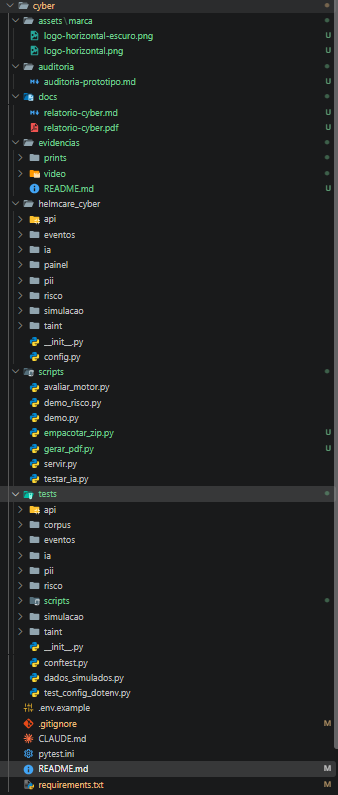

## 2. Parsing de PII

### 2.1 Arquitetura do motor

O motor (`helmcare_cyber/pii/`) recebe dict e list aninhados, JSON em texto ou texto livre e devolve uma lista de achados.

| Arquivo | Papel |
|---|---|
| `categorias.py` | Enums `Categoria`, `Confianca` (ALTA ou MEDIA) e `Metodo` (NOME_CAMPO ou VALOR) |
| `validadores.py` | Funções puras: dígitos verificadores de CPF e CNH, telefone com DDD oficial, tipo sanguíneo, coordenadas e casas decimais |
| `mascaras.py` | Máscaras da seção 9 do Contrato, marcador `[REDIGIDO:CATEGORIA]` e reconhecimento de valor já mascarado |
| `regras.py` | Catálogo de regras escrito como dados, nomes de campo e desempate dos 11 dígitos |
| `motor.py` | `MotorPII` (`varrer`, `mascarar` e `transformar`), `Achado` e `ValorProtegido` |

Decisões que tornam o motor confiável:

- **Duas famílias de regra.** Em dados estruturados, o nome do campo basta (`cpf`, `tipoSanguineo`, `latitude`), comparado sem acento, sem maiúsculas e sem separadores. Em texto livre, as regras de valor procuram o formato e pedem validador ou palavra de contexto.
- **Normalização NFKC** antes de casar padrões, para dígitos de largura total virarem dígitos comuns.
- **Zonas protegidas.** GUIDs, timestamps ISO 8601 e números de versão são neutralizados antes dos padrões numéricos, para um id ou uma data nunca virar CPF ou telefone.
- **Desempate dos 11 dígitos.** Com pontos e traço é CPF; senão, a palavra de contexto mais próxima decide (cpf, cnh, habilitação, telefone, celular); sem contexto, vale o dígito verificador do CPF, depois o da CNH, e por fim o formato de celular. Número colado em sequência maior de dígitos não é marcado.
- **O valor original nunca sai do motor.** O `Achado` guarda o original num `ValorProtegido`, que não aparece no `repr`, no `str` nem no JSON e bloqueia `pickle`. Os testes conferem isso.

As 13 categorias são: `CPF`, `CNH`, `RG`, `TELEFONE`, `EMAIL`, `NOME`, `SAUDE`, `LOCALIZACAO_EXATA`, `LOCALIZACAO_APROXIMADA`, `SENHA`, `TOKEN_ACESSO`, `QR_TOKEN` e `SEGREDO_API`.

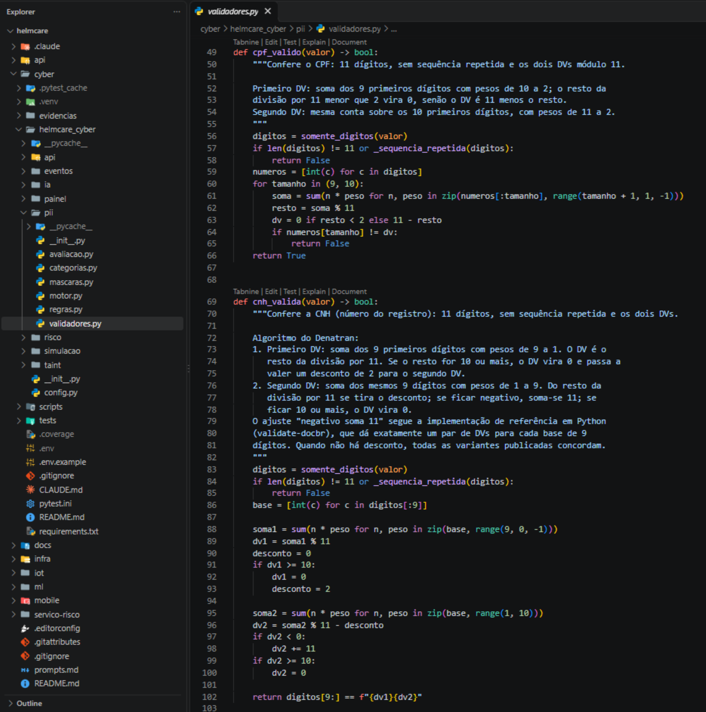

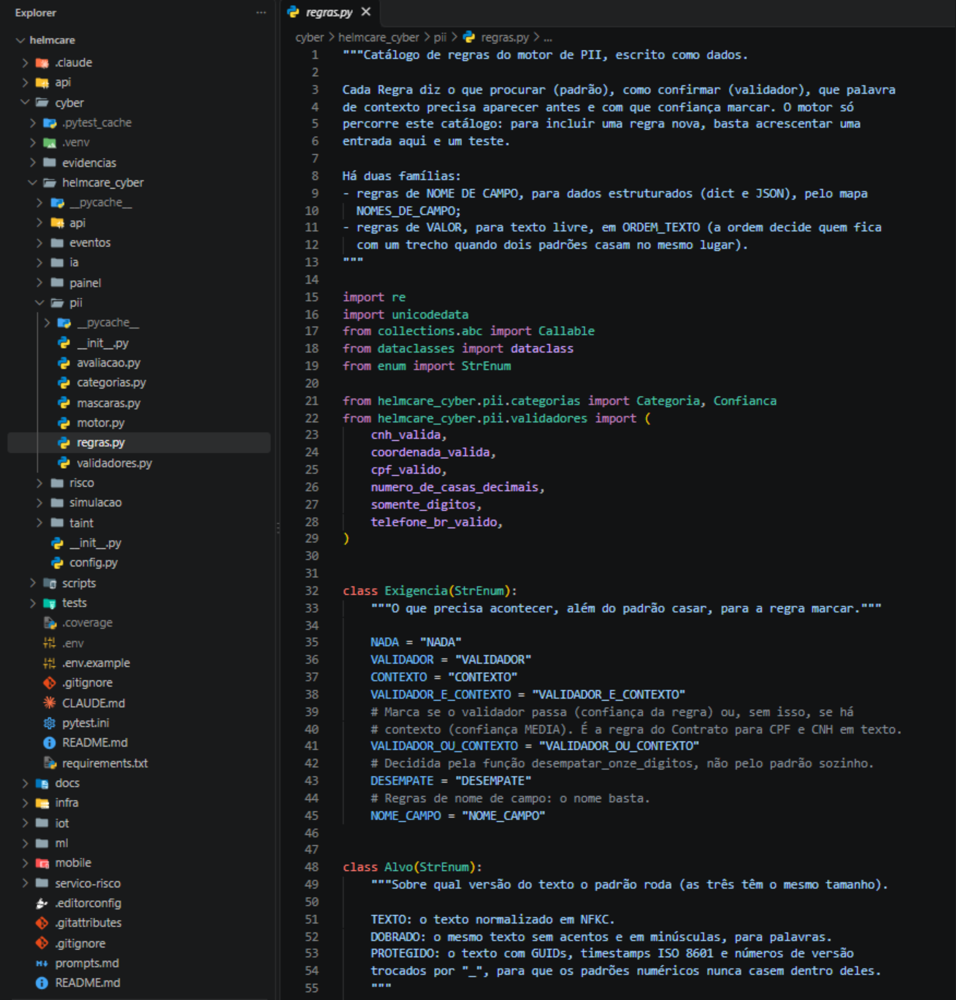

### 2.2 Tabela de regras

Gerada do catálogo `TODAS_AS_REGRAS` (35 regras). As regras `-01` (e a `PII-LOC-02`) valem pelo nome do campo; as demais valem pelo valor, em texto livre.

| Regra | Categoria | O que detecta | Exige | Confiança |
|---|---|---|---|---|
| PII-CNH-01 | CNH | Campo cnh | NOME_CAMPO | ALTA |
| PII-CNH-02 | CNH | CNH (11 dígitos) com cnh, habilitação ou carteira antes | DESEMPATE | ALTA |
| PII-CNH-03 | CNH | CNH (11 dígitos) sem contexto, pelo DV da CNH | DESEMPATE | MEDIA |
| PII-CPF-01 | CPF | Campo cpf | NOME_CAMPO | ALTA |
| PII-CPF-02 | CPF | CPF com pontos e traço | VALIDADOR_OU_CONTEXTO | ALTA |
| PII-CPF-03 | CPF | CPF só com dígitos: contexto cpf ou DV do CPF | DESEMPATE | ALTA |
| PII-EMAIL-01 | EMAIL | Campo email ou e-mail | NOME_CAMPO | ALTA |
| PII-EMAIL-02 | EMAIL | Endereço de e-mail | NADA | ALTA |
| PII-LOC-01 | LOCALIZACAO_EXATA | Campo de coordenada com 3 ou mais casas decimais | NOME_CAMPO | ALTA |
| PII-LOC-02 | LOCALIZACAO_APROXIMADA | Campo de coordenada com até 2 casas decimais | NOME_CAMPO | ALTA |
| PII-LOC-03 | LOCALIZACAO_EXATA | Par de coordenadas com 3 ou mais casas decimais | VALIDADOR | ALTA |
| PII-LOC-04 | LOCALIZACAO_APROXIMADA | Par de coordenadas com até 2 casas decimais | VALIDADOR | ALTA |
| PII-LOC-05 | LOCALIZACAO_EXATA | lat=, latitude:, lon= e afins com 3 ou mais casas | VALIDADOR | ALTA |
| PII-LOC-06 | LOCALIZACAO_APROXIMADA | lat=, latitude:, lon= e afins com até 2 casas | VALIDADOR | ALTA |
| PII-NOME-01 | NOME | Campo nome | NOME_CAMPO | ALTA |
| PII-QR-01 | QR_TOKEN | Campo qrToken ou urlCofre | NOME_CAMPO | ALTA |
| PII-QR-02 | QR_TOKEN | Caminho /cofre/{token} com 16 ou mais caracteres de URL | NADA | ALTA |
| PII-RG-01 | RG | Campo rg ou identidade | NOME_CAMPO | ALTA |
| PII-RG-02 | RG | RG com a palavra rg ou identidade antes | CONTEXTO | ALTA |
| PII-SAUDE-01 | SAUDE | Campos da FichaMedica e de saúde | NOME_CAMPO | ALTA |
| PII-SAUDE-02 | SAUDE | Tipo sanguíneo com sangue ou tipo sanguíneo antes | CONTEXTO | ALTA |
| PII-SAUDE-03 | SAUDE | Termos de saúde (alergia, diabetes, insulina, laudo, uso contínuo...) | NADA | MEDIA |
| PII-SAUDE-04 | SAUDE | Código CID (CID J45, CID-10 E11.9) | NADA | ALTA |
| PII-SEGREDO-01 | SEGREDO_API | Campo apiKey ou chaveApi | NOME_CAMPO | ALTA |
| PII-SEGREDO-02 | SEGREDO_API | Chave de API do Google (prefixo AIza e mais 35 caracteres) | NADA | ALTA |
| PII-SEGREDO-03 | SEGREDO_API | Chave genérica sk- (20 ou mais caracteres) | NADA | MEDIA |
| PII-SENHA-01 | SENHA | Campo senha, password, pwd ou secret | NOME_CAMPO | ALTA |
| PII-SENHA-02 | SENHA | senha=, senha:, password=, pwd= ou secret= seguido do valor | NADA | ALTA |
| PII-TEL-01 | TELEFONE | Campo telefone, celular ou fone | NOME_CAMPO | ALTA |
| PII-TEL-02 | TELEFONE | Telefone com DDD e separadores ou +55 | VALIDADOR | ALTA |
| PII-TEL-03 | TELEFONE | Telefone só com dígitos (10, 12 ou 13) com telefone, celular ou fone antes | VALIDADOR_E_CONTEXTO | ALTA |
| PII-TEL-04 | TELEFONE | Celular só com 11 dígitos, sem contexto e sem DV de CPF ou CNH | DESEMPATE | MEDIA |
| PII-TOKEN-01 | TOKEN_ACESSO | Campo accessToken, refreshToken ou authorization | NOME_CAMPO | ALTA |
| PII-TOKEN-02 | TOKEN_ACESSO | Bearer seguido de token (16 ou mais caracteres) | NADA | ALTA |
| PII-TOKEN-03 | TOKEN_ACESSO | JWT (três partes base64url, começando em eyJ) | NADA | ALTA |

### 2.3 Dígitos verificadores de CPF e CNH

O formato sozinho não basta: 11 dígitos quaisquer podem ser um CPF, uma CNH, um celular ou um número sem significado. Por isso o motor confere os dígitos verificadores.

- **CPF:** 11 dígitos, sem sequência repetida (11111111111 passa na conta, mas não é CPF), e dois DVs módulo 11. O primeiro usa os 9 primeiros dígitos com pesos de 10 a 2; o segundo, os 10 primeiros com pesos de 11 a 2; resto menor que 2 vira 0, senão o DV é 11 menos o resto.
- **CNH:** 11 dígitos, sem sequência repetida, e os dois DVs do algoritmo do Denatran: o primeiro com pesos de 9 a 1, com desconto de 2 no segundo quando o resto passa de 9; o segundo com pesos de 1 a 9.

Por nome de campo, o CPF e a CNH são sempre marcados (o Contrato só exige 11 dígitos) e o achado registra se o DV confere (`dv_confere`). Em texto livre, só são marcados com DV válido ou com palavra de contexto.

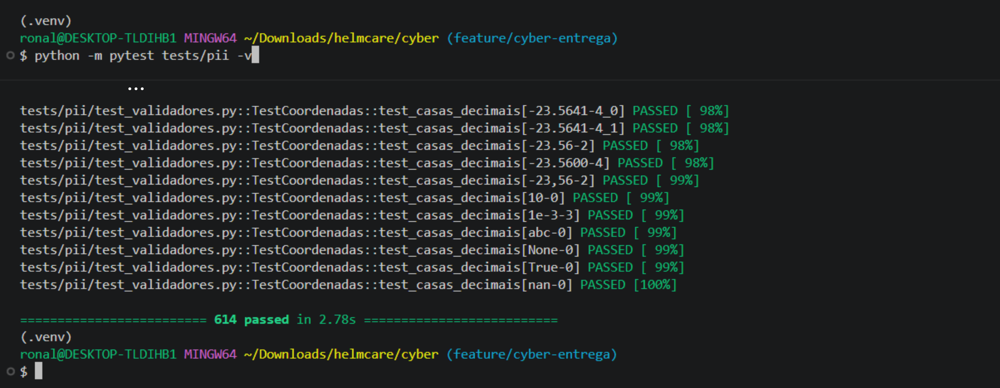

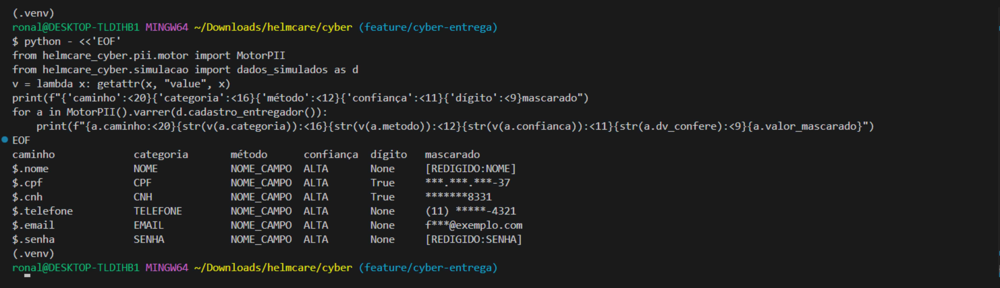

### 2.4 Máscaras do Contrato

| Categoria | Máscara |
|---|---|
| CPF | `***.***.***-12` |
| CNH | `*******8900` |
| Celular | `(11) *****-1234` |
| Telefone fixo | `(11) ****-4567` |
| E-mail | `r***@exemplo.com` |
| Localização exata | arredondada para 2 casas decimais, com 0,5 para cima |
| RG, nome, saúde, senha, tokens, qrToken e segredos | `[REDIGIDO:CATEGORIA]`, sem nenhum caractere do valor |

Quando o enunciado da disciplina sugere outro formato de máscara, vale a da seção 9 do Contrato de Integração. O Contrato é a fonte da verdade compartilhada: a API C#, o app e o painel mostram o mesmo dado mascarado da mesma forma, e o motor reconhece essas formas como "já mascaradas" (o `email` que o `GET /entregadores/{id}` devolve não é tratado como vazamento). Uma máscara diferente só no módulo de Cybersecurity faria o motor acusar como vazamento o que a API publica corretamente.

### 2.5 Interceptador de entrada

O `POST /cyber/v1/demo/entregadores` recebe o cadastro no formato do Contrato e passa por uma dependência do FastAPI, o interceptador: o motor marca cada campo pessoal, os valores entram no registro de taint (para serem reconhecidos mesmo concatenados num texto) e, em PROTEÇÃO, o handler recebe uma cópia com as máscaras do Contrato e a senha já como hash. O handler faz o que um código descuidado faria (loga o cadastro numa f-string, grava no banco e responde), e cada saída passa pelo guarda. A resposta HTTP ainda passa pelas máscaras do motor no fim, em qualquer modo.

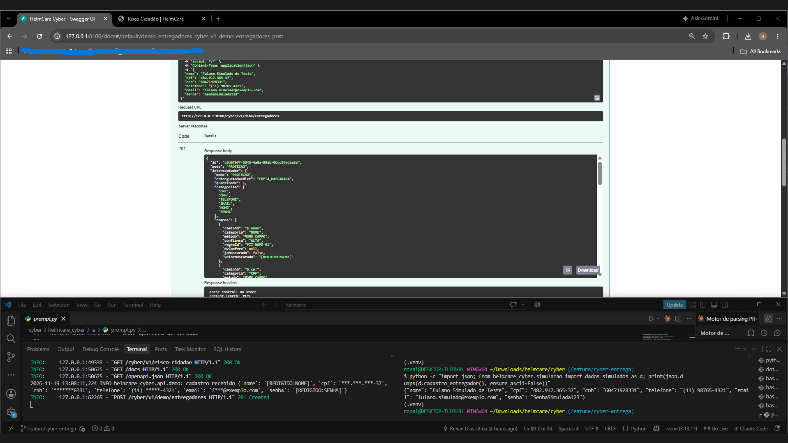

### 2.6 Métricas do corpus

O corpus `tests/corpus/corpus_pii.json` tem 77 casos, positivos e negativos, para todas as categorias. Resultado de `python scripts/avaliar_motor.py`:

| Categoria | VP | FP | FN | Precisão | Recall |
|---|---|---|---|---|---|
| CPF | 6 | 0 | 0 | 100,0% | 100,0% |
| CNH | 4 | 0 | 0 | 100,0% | 100,0% |
| RG | 2 | 0 | 0 | 100,0% | 100,0% |
| TELEFONE | 8 | 0 | 0 | 100,0% | 100,0% |
| EMAIL | 4 | 0 | 0 | 100,0% | 100,0% |
| NOME | 2 | 0 | 2 | 100,0% | 50,0% |
| SAUDE | 9 | 0 | 0 | 100,0% | 100,0% |
| LOCALIZACAO_EXATA | 7 | 0 | 0 | 100,0% | 100,0% |
| LOCALIZACAO_APROXIMADA | 3 | 0 | 0 | 100,0% | 100,0% |
| SENHA | 4 | 0 | 0 | 100,0% | 100,0% |
| TOKEN_ACESSO | 4 | 0 | 0 | 100,0% | 100,0% |
| QR_TOKEN | 3 | 0 | 0 | 100,0% | 100,0% |
| SEGREDO_API | 2 | 0 | 0 | 100,0% | 100,0% |
| **TOTAL** | **58** | **0** | **2** | **100,0%** | **96,7%** |

Os 13 negativos protegidos (GUID, telemetria, timestamp e versão) tiveram 0 falso positivo. As 2 divergências são conhecidas e estão marcadas no corpus como limitação (`nome-lim-01` e `nome-lim-02`): nome de pessoa em texto livre, que exige reconhecimento de entidades (NER), que o motor não usa. Não há nenhuma divergência fora dessas limitações.

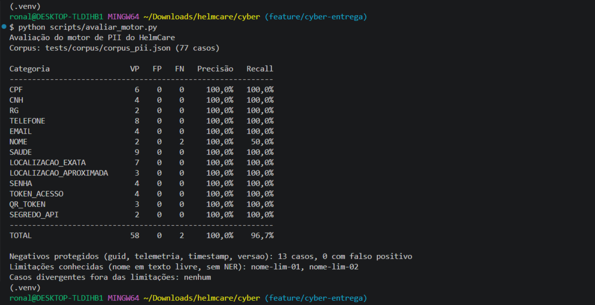

### 2.7 Limitações do motor

- Nome de pessoa em texto livre não é detectado; o nome só é marcado pelo campo `nome`. No Taint Analysis, o registro de taint cobre o caso mais comum: o nome que entrou por uma fonte é reconhecido pelo valor em qualquer saída.
- Nomes de campo são comparados por igualdade depois da normalização: `telefoneContato` não é reconhecido pelo nome (o valor ainda passa pelas regras de texto).
- Telefone com ponto entre todos os grupos (`11.98765.4321`) tem o formato de um número de versão e não é marcado.
- O léxico de saúde marca o termo com confiança MEDIA mesmo em uso técnico ("diagnóstico de rede").

## 3. Taint Analysis

O Taint Analysis segue o dado pessoal da fonte ao destino e decide, em cada saída, se ele pode passar. É uma verificação em tempo de execução: o guarda olha o que realmente está saindo, depois de todas as concatenações e f-strings do código.

### 3.1 Fontes, destinos e sanitizadores

| Elemento | Valores |
|---|---|
| Fontes | `CADASTRO_ENTREGADOR`, `FICHA_MEDICA`, `CONTATO_EMERGENCIA`, `OCORRENCIA_SOS`, `TELEMETRIA_MQTT`, `LOGIN`, `DISPOSITIVO` |
| Destinos | `LOG`, `RESPOSTA_API_PUBLICA`, `MENSAGEM_ERRO`, `NOTIFICACAO_PUSH`, `MQTT_PAYLOAD`, `CHAMADO_VOLUNTARIO`, `AUDITORIA`, `PERSISTENCIA`, `COFRE_SOCORRISTA`, `CONTATO_EMERGENCIA`, `RESPOSTA_PROPRIO_ENTREGADOR`, `DOCUMENTACAO_PUBLICA` |
| Sanitizadores | `mascarar`, `redigir`, `bloquear`, `arredondar_localizacao`, `hash_senha` (PBKDF2-HMAC-SHA256 com 600 mil iterações) e `projetar_campos` (lista branca de campos) |
| Ações | `PERMITIR`, `MASCARAR`, `ARREDONDAR`, `REDIGIR`, `BLOQUEAR` |

A detecção numa saída usa o motor de PII (formatos e nomes de campo) e o registro de taint (`TaintRegistry`), que guarda em memória os valores que entraram por uma fonte e os reconhece em qualquer saída, inclusive no meio de uma f-string. O registro nunca é gravado nem serializado.

### 3.2 Política com negação por padrão

A política (`taint/politica.py`) é uma tabela de dados. A ordem de avaliação é: valor já redigido (TA-MASCARADO-01), destinatário negado (TA-NEGADO-01), linha do destino com o destinatário, linha do destino para qualquer destinatário e, por fim, a negação por padrão (TA-PADRAO-01): toda combinação fora da tabela, e toda categoria que uma linha não cita, é bloqueada.

| Regra | Destino e destinatário | O que pode sair |
|---|---|---|
| TA-MASCARADO-01 | qualquer | Valor já redigido, porque não sobra nada do dado |
| TA-NEGADO-01 | qualquer destino, para socorrista não autorizado, anônimo ou outro usuário | Nada |
| TA-PROPRIO-01 | Resposta ao próprio entregador | Os próprios dados, com CPF, CNH, RG e e-mail mascarados; nenhuma credencial |
| TA-PROPRIO-02 | Resposta ao próprio entregador, com credencial autorizada | Token de acesso e qrToken, só no corpo do login, da renovação e do POST /dispositivos |
| TA-VOLUNT-01 | Chamado e push ao voluntário antes do aceite | Só a localização: a aproximada como está e a exata arredondada para 2 casas |
| TA-ACEITOU-01 | Chamado e push ao voluntário que aceitou | Só a localização, inclusive a exata |
| TA-CONTATO-01 | Contato de emergência | Só a localização, exata ou aproximada |
| TA-COFRE-01 | Cofre ao socorrista verificado na janela | `tipoSanguineo`, `alergias` e `condicoesCriticas` |
| TA-COFRE-02 | Cofre ao socorrista verificado na janela | Nome e telefone dos contatos de emergência |
| TA-COFRE-03 | Cofre ao socorrista verificado na janela | Nada além das duas regras acima (medicamentos, nome, CPF, CNH, localização e credenciais do entregador) |
| TA-LOG-01 | Log | Nada: todo dado pessoal é redigido, inclusive a localização aproximada |
| TA-MQTT-01 | MQTT sem identificação pessoal | A coordenada, junto com o código do dispositivo |
| TA-MQTT-02 | MQTT com identificação pessoal | Nada: o dado e a coordenada são bloqueados |
| TA-PUBLICO-01 | Resposta pública, mensagem de erro, auditoria e documentação pública | Nada |
| TA-PERS-01 | Persistência | Tudo, menos senha em texto puro, token de acesso e segredo de API |
| TA-PERS-02 | Persistência | Senha no formato de hash |
| TA-PADRAO-01 | combinação fora da tabela | Nada (negação por padrão) |

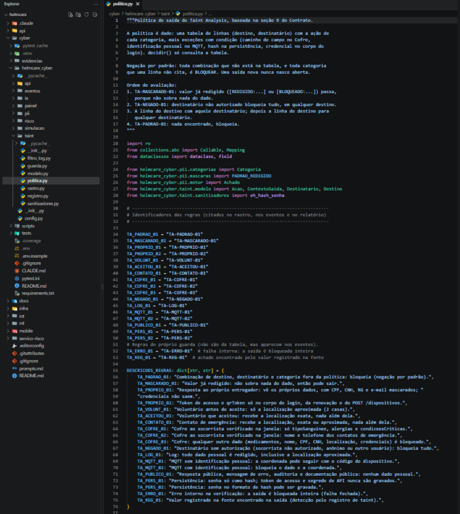

**Canais autorizados.** São os usos legítimos que a política deixa passar, e que também geram evento (estado PERMITIDO) como prova do uso correto: a localização exata para o voluntário que aceitou e para o contato de emergência, a ficha mínima e os contatos no Cofre para o socorrista verificado na janela, a coordenada no MQTT sem identificação pessoal, os tokens no corpo do login e o `qrToken` no `POST /dispositivos`, os próprios dados para o entregador e a senha como hash na persistência.

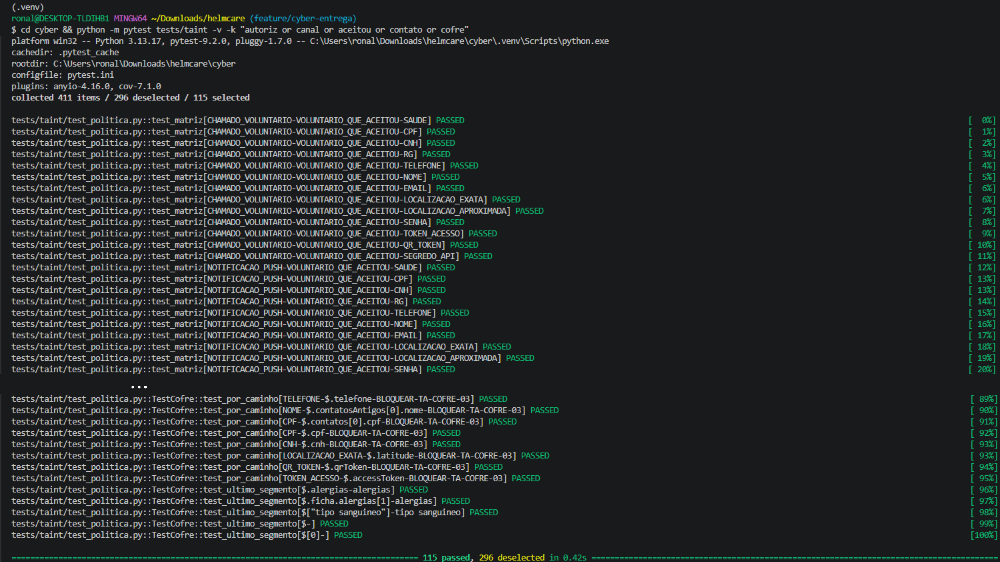

### 3.3 Modos, antes e depois

No modo **AUDITORIA**, o guarda deixa a saída passar intacta e registra o dado como EXPOSTO; no modo **PROTEÇÃO**, aplica a ação numa cópia do payload antes de ele sair, e o dado fica NEUTRALIZADO. Um dado que a política deixa passar fica PERMITIDO nos dois modos. No cenário C1 (cadastro inteiro numa f-string de log), a linha de log em AUDITORIA sai com os valores simulados como foram digitados (Figura 10). Em PROTEÇÃO, a mesma linha sai assim:

```text
INFO helmcare.api.cadastro: cadastro {'nome': '[REDIGIDO:NOME]', 'cpf': '[REDIGIDO:CPF]', 'cnh': '[REDIGIDO:CNH]', 'telefone': '[REDIGIDO:TELEFONE]', 'email': '[REDIGIDO:EMAIL]', 'senha': '[REDIGIDO:SENHA]'}
```

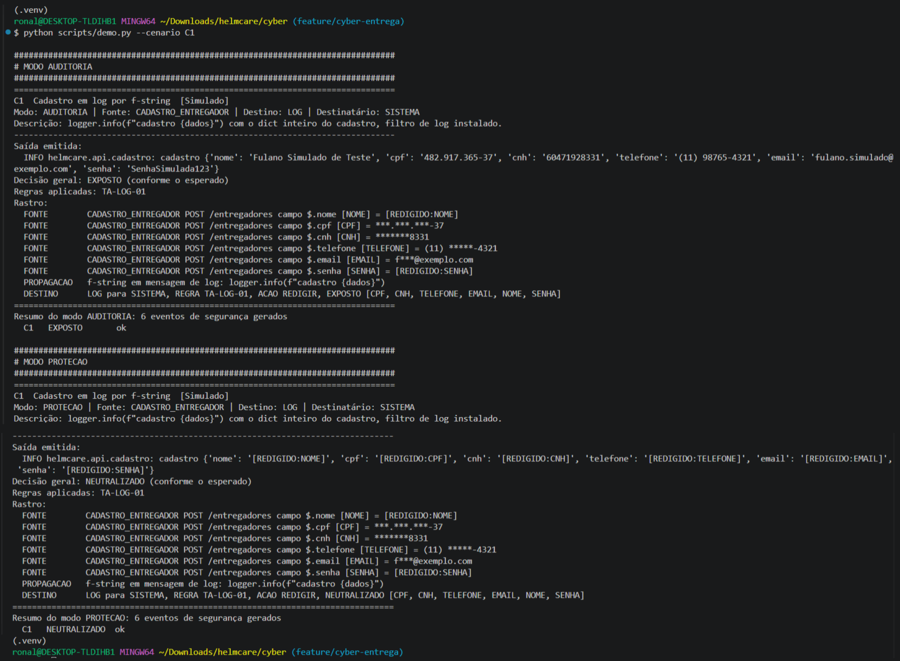

### 3.4 Rastro e filtro de log

Cada decisão vira um evento de segurança com um rastro explicável, só com valores mascarados:

```text
FONTE        CADASTRO_ENTREGADOR POST /entregadores campo $.cpf [CPF] = ***.***.***-37
FONTE        CADASTRO_ENTREGADOR POST /entregadores campo $.telefone [TELEFONE] = (11) *****-4321
PROPAGACAO   f-string em mensagem de log: logger.info(f"cadastro {dados}")
DESTINO      LOG para SISTEMA, REGRA TA-LOG-01, ACAO REDIGIR, NEUTRALIZADO [CPF, CNH, TELEFONE, EMAIL, NOME, SENHA]
```

O filtro de log (`FiltroLogGuarda`) é um `logging.Filter`: formata a mensagem, passa o texto pelo guarda com destino LOG e troca a mensagem pela versão segura. A `SaidaProtegida` faz o mesmo com `print`. Os dois falham fechando: se algo der errado, a linha vira `[LOG BLOQUEADO: erro no filtro]`.

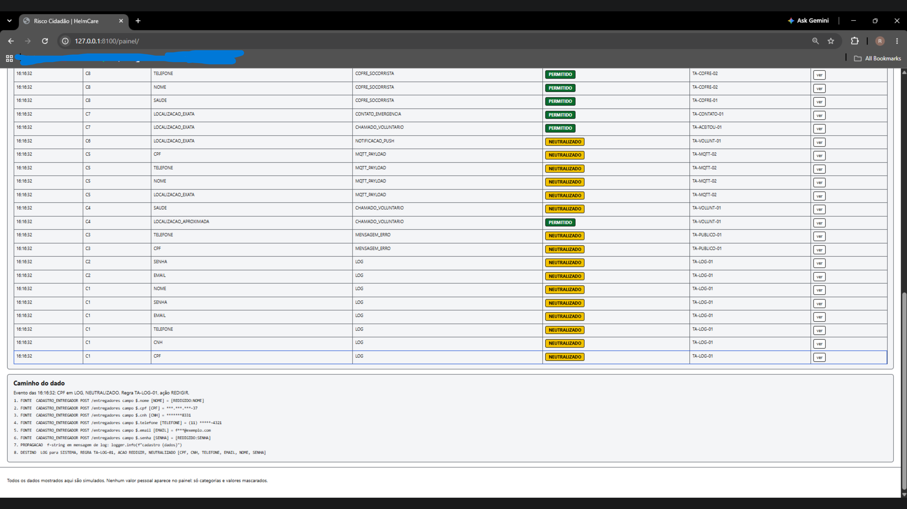

### 3.5 Cenários C1 a C11

Resultado de `python scripts/demo.py` (31 eventos de segurança em cada modo, todos os cenários "conforme o esperado"):

| Cenário | Rótulo | AUDITORIA | PROTEÇÃO | Regras aplicadas |
|---|---|---|---|---|
| C1 Cadastro em log por f-string | Simulado | EXPOSTO | NEUTRALIZADO | TA-LOG-01 |
| C2 Senha impressa no log de login | Simulado | EXPOSTO | NEUTRALIZADO | TA-LOG-01 |
| C3 Erro de validação repete CPF e telefone | Simulado | EXPOSTO | NEUTRALIZADO | TA-PUBLICO-01 |
| C4 Ficha médica no chamado ao voluntário | Simulado | EXPOSTO | NEUTRALIZADO | TA-VOLUNT-01 |
| C5 Identificação pessoal no payload MQTT | Simulado | EXPOSTO | NEUTRALIZADO | TA-MQTT-02 |
| C6 Push com localização exata antes do aceite | Simulado | EXPOSTO | NEUTRALIZADO | TA-VOLUNT-01 |
| C7 Localização exata nos canais autorizados | Simulado | PERMITIDO | PERMITIDO | TA-ACEITOU-01, TA-CONTATO-01 |
| C8 Cofre com medicamentos por engano | Simulado | EXPOSTO | NEUTRALIZADO | TA-COFRE-01, TA-COFRE-02, TA-COFRE-03 |
| C9 Cofre para socorrista não autorizado | Simulado | EXPOSTO | NEUTRALIZADO | TA-NEGADO-01 |
| C10 Senha em texto puro na persistência | Simulado | EXPOSTO | NEUTRALIZADO | TA-PERS-01, TA-PERS-02 |
| C11 qrToken em documentação pública | Real (reproduzido com token simulado) | EXPOSTO | NEUTRALIZADO | TA-NEGADO-01 |

## 4. Tradução dos alertas por IA

### 4.1 O que vai e o que não vai ao LLM

O LLM recebe só a classificação do evento, em cinco campos derivados de enums (`ConsultaTraducao`): categoria, destino, ação, estado e cor do semáforo. Cada campo vira um texto fixo em linguagem simples. Num evento EXPOSTO, a mensagem enviada é:

```text
Em risco: o código do QR do seu capacete
Onde apareceu de verdade: num documento público
O que o sistema fez: não conseguiu impedir: o dado chegou a aparecer de verdade, e o sistema só registrou o ocorrido
Cor do semáforo: amarelo, atenção
Tom da mensagem: séria, sem frases de tranquilização como fique tranquilo ou não se preocupe, e dizendo que a equipe vai corrigir o problema
```

Nunca vão ao LLM: o valor do dado (nem mascarado), o payload, o rastro, o caminho do campo, o id do evento ou qualquer dado do entregador. Os testes enviam os eventos dos 11 cenários nos dois modos e conferem que nenhum valor simulado aparece no que sai para o LLM. O prompt do sistema pede, para uma pessoa leiga de 60 anos, no máximo 2 frases curtas em tom calmo e acolhedor, sem termos técnicos, sem inventar fatos e sem travessões, em JSON `{"mensagem": "..."}`.

**Tom do estado EXPOSTO.** Nos estados NEUTRALIZADO e PERMITIDO, a segunda linha é "Onde poderia aparecer", não há linha de tom e vale o tom acolhedor do prompt do sistema. No EXPOSTO, a mensagem trata o vazamento como fato e pede tom sério: tranquilizar quem teve o dado exposto contradiria o alerta.

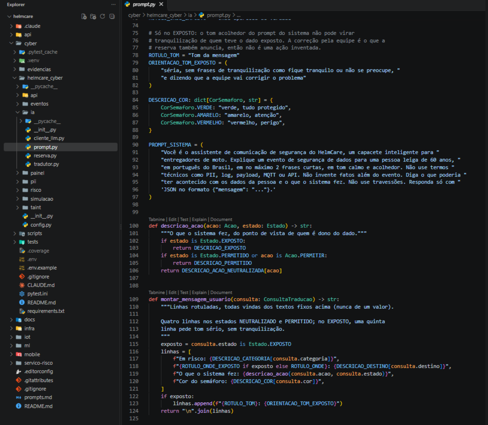

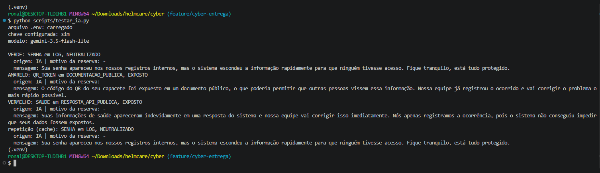

### 4.2 Validação da saída

A resposta do LLM é tratada como não confiável. `validar_mensagem` aceita só JSON com a chave `mensagem` (tolera a cerca ` ```json `) e recusa a mensagem vazia, com mais de 280 caracteres, com mais de 2 frases, com travessão, com termo técnico (PII, log, logs, payload, MQTT, API, token, hash, endpoint, JSON, taint, como palavra inteira) ou em que o motor de PII encontre qualquer dado pessoal. Uma resposta recusada não entra no cache.

### 4.3 Reserva por tabela

A reserva é uma força de resiliência do módulo, não um remendo: sem chave, sem rede, com o provedor fora do ar ou com uma resposta recusada, o painel continua explicando cada evento, com uma frase determinística montada com os mesmos textos da consulta. Ela vem sempre sinalizada com o selo **"modelo de reserva"**, para a pessoa saber que o texto não veio da IA.

| Motivo | Quando |
|---|---|
| `SEM_CHAVE` | Sem `GEMINI_API_KEY` ou sem `GEMINI_MODEL` no ambiente |
| `TIMEOUT` | O LLM passou do tempo limite de 8 s |
| `ERRO_HTTP` | Status diferente de 200, mesmo depois da nova tentativa; o motivo traz o código e a mensagem do Google, sem a chave |
| `ERRO_REDE` | Falha de conexão (ou falha inesperada do cliente) |
| `RESPOSTA_INVALIDA` | Resposta fora do formato ou recusada pela validação |
| `DISJUNTOR` | Falha recente: o disjuntor está aberto |

**Cache, nova tentativa e disjuntor.** As respostas válidas ficam em cache por consulta. Os status 429, 500, 502, 503 e 504 ganham uma nova tentativa depois de 1 s; erros do pedido (400, 401, 403 e 404), tempo esgotado e falha de conexão não repetem, então uma consulta nunca passa de 2 tentativas de 8 s mais 1 s de espera. Depois de um tempo esgotado, de uma falha de rede ou de um erro HTTP que continuou depois da nova tentativa, o disjuntor abre por 60 s, e as traduções vão direto para a reserva, para o painel não esperar o tempo limite a cada evento.

**Modelo e chave.** O modelo vem só de `GEMINI_MODEL`, sem valor padrão no código; o modelo testado foi o `gemini-3.5-flash-lite`. A chave vem só da variável de ambiente `GEMINI_API_KEY` e vai apenas no cabeçalho `x-goog-api-key`, nunca na URL nem no corpo, nunca no `repr` do cliente nem nas mensagens de erro.

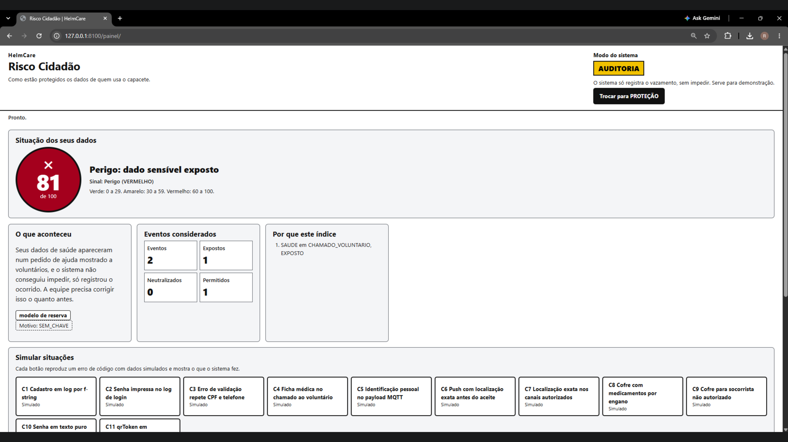

## 5. Painel Risco Cidadão

### 5.1 Fórmula

O Risco Cidadão (`risco/risco_cidadao.py`) resume os eventos da janela `RISCO_JANELA_MIN` (padrão 1440 minutos) num índice de 0 a 100. As contas usam `Decimal`.

```text
pontos de um evento = 10 x peso da categoria x fator do destino x fator do estado
volume = min(25, 2 x (N - 1)), N = pares (destino, fonte) distintos entre os eventos que não são PERMITIDO (0 sem nenhum)
índice = min(100, pior evento + volume), arredondado com 0,5 para cima
```

| Categoria | Peso |
|---|---|
| SENHA | 10 |
| SAUDE | 9 |
| TOKEN_ACESSO, SEGREDO_API | 8 |
| LOCALIZACAO_EXATA, CPF, CNH, RG | 7 |
| TELEFONE, EMAIL, NOME | 5 |
| QR_TOKEN | 4 |
| LOCALIZACAO_APROXIMADA | 2 |
| Sem categoria (erro interno do guarda) | 5 |

| Destino | Fator |
|---|---|
| RESPOSTA_API_PUBLICA, MENSAGEM_ERRO, MQTT_PAYLOAD, DOCUMENTACAO_PUBLICA | 1,0 |
| CHAMADO_VOLUNTARIO, NOTIFICACAO_PUSH, COFRE_SOCORRISTA, CONTATO_EMERGENCIA, RESPOSTA_PROPRIO_ENTREGADOR | 0,9 |
| AUDITORIA | 0,6 |
| LOG | 0,5 |
| PERSISTENCIA | 0,4 |

| Estado | Fator |
|---|---|
| EXPOSTO | 1,0 |
| NEUTRALIZADO | 0,3 |
| PERMITIDO | 0 (uso legítimo de canal autorizado: não pesa e não entra no volume) |

| Faixa | Cor | Rótulo | Ícone |
|---|---|---|---|
| 0 a 29 | VERDE | Seus dados estão protegidos | OK |
| 30 a 59 | AMARELO | Atenção: houve tentativa de vazamento | ATENCAO |
| 60 a 100 | VERMELHO | Perigo: dado sensível exposto | PERIGO |

### 5.2 Pontos de calibração

Todos obtidos por execução real (`scripts/demo_risco.py` e os mesmos cenários pelo guarda) e vistos no painel:

| Situação | Pior evento | Volume | Índice | Cor | Onde aparece |
|---|---|---|---|---|---|
| Sem eventos | 0 | 0 | 0 | VERDE | início do vídeo |
| C1 em PROTEÇÃO | 15 | 0 | 15 | VERDE | Figura 15 |
| C4 em AUDITORIA | 81 | 0 | 81 | VERMELHO | Figura 14 |
| C11 em AUDITORIA | 40 | 0 | 40 | AMARELO | `demo_risco.py` |
| C1 a C11 em PROTEÇÃO | 24,3 | 16 | 40 | AMARELO | Figura 16 e vídeo |
| C1 a C10 em PROTEÇÃO | 24,3 | 14 | 38 | AMARELO | `demo_risco.py` |
| C1 a C11 em AUDITORIA | 81 | 16 | 97 | VERMELHO | Figura 17 e vídeo |

O pior evento puxa o índice, porque um único vazamento de saúde já é perigo; o volume soma pouco e tem teto, para mostrar que o problema se espalhou por vários caminhos sem esconder a gravidade do pior.

### 5.3 Painel, acessibilidade e controles de segurança

O painel em `/painel/` é uma página só, em HTML, CSS e JavaScript puros, sem CDN e sem nenhum endereço externo: funciona sem internet. Mostra o modo atual, o semáforo com o índice, a mensagem para o cidadão com o selo de origem, os contadores, o "por que este índice", a tabela dos últimos eventos (escolher uma linha mostra o rastro) e um botão por cenário. A cor nunca aparece sozinha: vem sempre com o rótulo por extenso e o ícone. A página usa fonte grande, alto contraste, foco visível, rótulos para leitores de tela, um atalho para pular ao conteúdo, e todo texto vindo do servidor entra como texto (`textContent`), nunca como HTML.

Controles da API e do painel:

- corpo inválido responde 422 só com os caminhos dos campos, sem repetir o valor recebido (o padrão do FastAPI devolveria o valor e vazaria um CPF);
- erro interno vira 500 com `{"erro": "falha interna"}`, e o log registra só o tipo da exceção;
- limite de corpo de 64 KB (413), inclusive em corpo enviado em partes;
- `X-Content-Type-Options: nosniff`, `Referrer-Policy: no-referrer` e `X-Frame-Options: DENY` em toda resposta, `Cache-Control: no-store` na API e, no painel, `Content-Security-Policy` só com a própria origem, sem script nem estilo inline;
- sem CORS e escuta local por padrão (`127.0.0.1`).

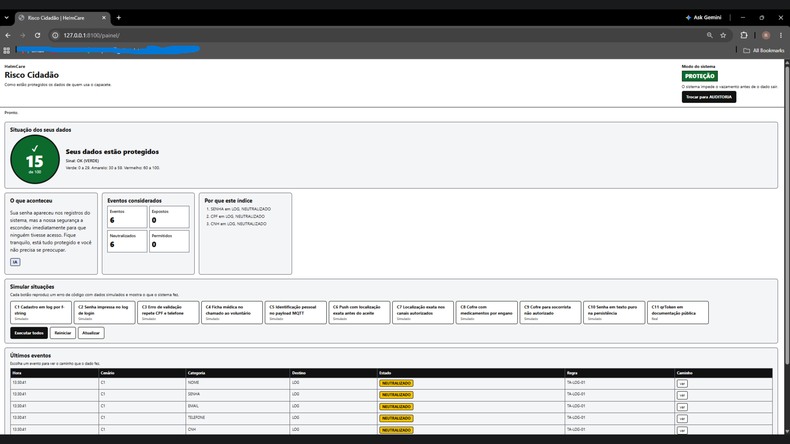

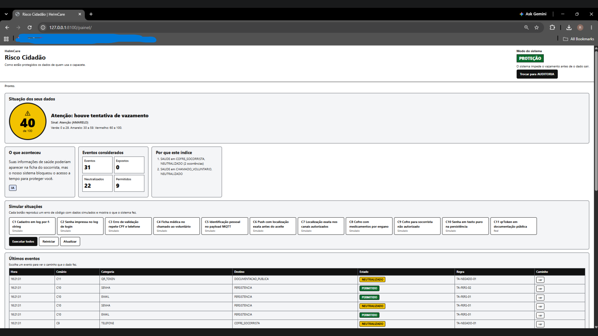

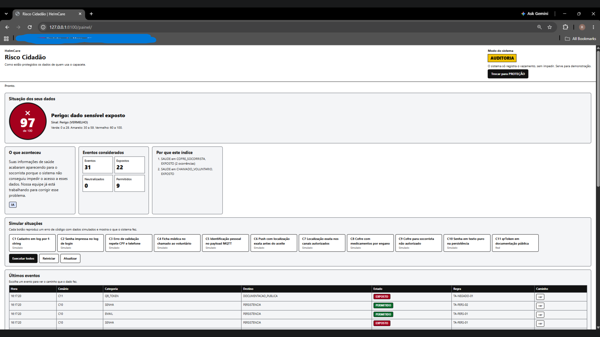

**Vídeo.** O vídeo do painel está publicado no YouTube, como não listado, em [https://youtu.be/PSRhGlnmjcI](https://youtu.be/PSRhGlnmjcI), e também no repositório, em `evidencias/video/video-dashboard.mp4`. Ele tem legendas que descrevem cada momento (modo AUDITORIA e C3, o vermelho com a mensagem e o porquê, o modo PROTEÇÃO, o rastro, os canais autorizados do C7 e do C8, o amarelo 40 de Executar todos, o selo IA e os testes) e a logo do HelmCare pequena no alto, numa faixa escura fora do painel. O vídeo não tem narração nem música.

## 6. Auditoria do protótipo

O documento completo está em `auditoria/auditoria-prototipo.md`. Em resumo:

- **Controles que a API C# já tem.** Os logs de requisição do ASP.NET Core ficam em `Warning` e sem escopos (o caminho, que pode levar o `qrToken`, não vai para o log); o tratador de exceções registra só o tipo, o status e o `traceId`; o `CaminhoSeguro.SemQrToken` troca o token por `{qrToken}` no `instance` do ProblemDetails; as máscaras do Contrato e os cabeçalhos da página do Cofre têm testes próprios. Os 12 testes de `QrTokenForaDasSaidasTests` passam (Figuras 19 e 20).
- **Achado real.** O print `mobile/docs/prints/14-qr-capacete.png`, publicado no README do Mobile, traz o `qrToken` de um capacete de desenvolvimento dentro do QR Code. O risco é baixo: os dados são simulados, banco e rede são locais e o QR sozinho não abre a ficha (exige socorrista verificado e uma janela de emergência com prazo). A correção é trocar a imagem por uma sem token; o histórico do Git continua com a imagem antiga, e limpá-lo é opcional dado o risco. Como prevenção, documentação e imagens devem ser varridas antes de publicar.
- **Real e Simulado.** Só o C11 é um achado real, reproduzido com token simulado; os demais mostram o que o módulo barraria se um desenvolvedor errasse.

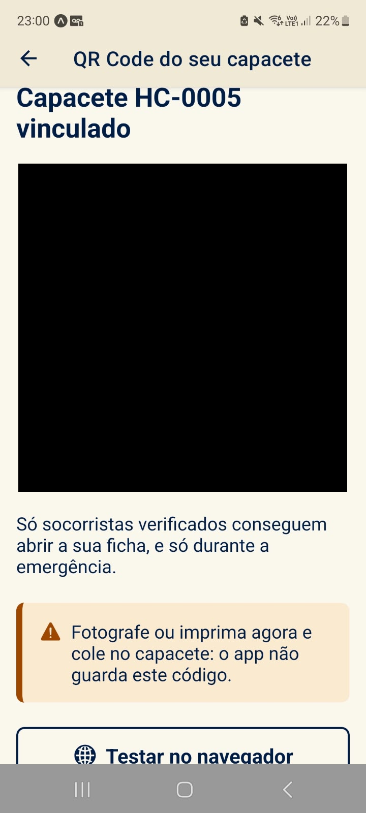

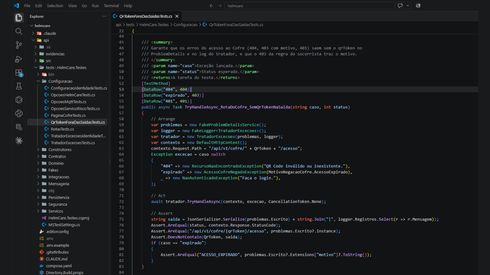

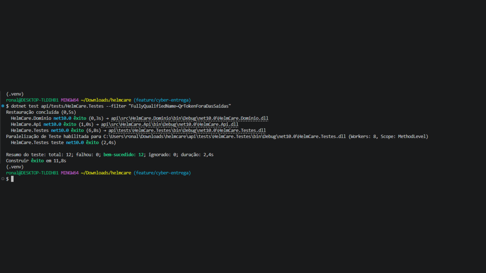

## 7. Testes e qualidade

Resultado de `python -m pytest -q --cov=helmcare_cyber`, sem as variáveis `GEMINI_*` no ambiente e sem nenhuma chamada de rede: **1482 testes passando**, cobertura total de **99%** (2380 instruções, 1 sem teste, em `pii/mascaras.py`).

| Pasta de testes | Testes | Cobertura do pacote |
|---|---|---|
| `tests/pii` | 614 | `pii`: 649 de 650 instruções |
| `tests/taint` | 411 | `taint`: 100% |
| `tests/eventos` | 38 | `eventos`: 100% |
| `tests/simulacao` | 59 | `simulacao`: 100% |
| `tests/risco` | 46 | `risco`: 100% |
| `tests/ia` | 150 | `ia`: 100% |
| `tests/api` | 95 | `api`: 100% |
| `tests/scripts` | 61 | scripts de PDF e ZIP, links de imagem dos documentos e cópia da marca (fora da medição do pacote) |
| `tests/test_config_dotenv.py` | 8 | `config`: 100% |

Os testes do cliente do Gemini usam `httpx.MockTransport`, os da API usam o `TestClient` com tradutor falso, e os de não vazamento percorrem todas as respostas de todas as rotas, nos dois modos, procurando cada valor simulado. O vídeo do painel mostra 1421 testes passando: a gravação é anterior aos testes dos scripts de PDF e ZIP, e a versão final tem 1482.

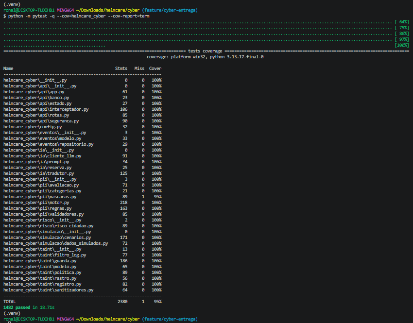

## 8. Como executar

Requer Python 3.13. No Git Bash, dentro de `cyber/`:

```bash
py -3.13 -m venv .venv
source .venv/Scripts/activate
python -m pip install -r requirements.txt
cp .env.example .env          # preencha GEMINI_API_KEY e GEMINI_MODEL para usar a IA

python -m pytest -q --cov=helmcare_cyber     # testes com cobertura
python scripts/avaliar_motor.py              # métricas do motor sobre o corpus
python scripts/demo.py                       # cenários C1 a C11 nos dois modos
python scripts/demo_risco.py                 # Risco Cidadão de cada situação (sem rede)
python scripts/servir.py                     # API e painel em 127.0.0.1:8100/painel/
python scripts/gerar_pdf.py                  # este relatório em PDF
python scripts/empacotar_zip.py              # ZIP da entrega em dist/
```

Sem o `.env`, tudo funciona e as mensagens saem da reserva. O `scripts/servir.py --sem-dotenv` sobe a API sem carregar o arquivo.

**Marca.** A logo do HelmCare vem de `docs/marca/` do repositório. O módulo guarda uma cópia idêntica em `cyber/assets/marca/` (`logo-horizontal.png` nos documentos e na capa deste PDF, `logo-horizontal-escuro.png` no vídeo) para ser autossuficiente: README, relatório, auditoria, PDF e ZIP não dependem de nenhum arquivo de fora de `cyber/`. Um teste confere que a cópia continua igual à original.

## 9. Limitações, uso de IA e referências

### 9.1 Limitações

- **Nome em texto livre** não é detectado pelo motor, porque exige NER; o registro de taint cobre o nome que entrou por uma fonte conhecida.
- **CPF e CNH em texto livre** só são marcados com dígito verificador válido ou palavra de contexto; por nome de campo, são sempre marcados, mesmo com DV errado.
- **Interceptador em Python, fora da API C#.** Por decisão de escopo, o interceptador e o guarda protegem as saídas do módulo de Cybersecurity e da sua API de demonstração; a API C# tem os próprios controles (seção 6) e não usa o guarda.
- **Cenários simulados.** C1 a C10 são erros de código reproduzidos para demonstração; só o C11 é um achado real.
- **Painel local sem autenticação**, escutando em `127.0.0.1`; as rotas que trocam o modo e reiniciam são abertas.
- **Dependência do provedor de LLM.** A tradução depende da disponibilidade do Gemini; a reserva por tabela mantém o painel funcionando quando ele falha.

### 9.2 Uso de IA no desenvolvimento

O módulo foi desenvolvido com o Claude Code como assistente de programação. As decisões, a revisão e os commits ficaram com o autor, e os prompts usados estão registrados no `prompts.md`, na raiz do repositório.

### 9.3 Referências

- BRASIL. Lei 13.709, de 14 de agosto de 2018. Lei Geral de Proteção de Dados Pessoais (LGPD).
- OWASP. Logging Cheat Sheet. OWASP Cheat Sheet Series.
- OWASP. OWASP Top 10 2021, A09: Security Logging and Monitoring Failures.
- Google. Gemini API, documentação do método generateContent.
- HelmCare. Contrato de Integração, seção 9 (regras de dados pessoais).
