

<h1>Testing, Compliance e Quality Assurance</h1>

HelmCare: plano de aceitação, Test Cases e rastreabilidade no Azure DevOps

Do risco ao resgate, cuidado em cada corrida.

<strong>Renan Dias Utida</strong>

RM 558540, turma 3ESPW

Disciplina: Testing, Compliance e Quality Assurance

Professor: Salatiel Marinho (perfil Project Administrators no projeto do Azure DevOps)

FIAP, Global Solution 2026.2 (CitizenTech)

<strong>Azure DevOps:</strong> <a href="https://dev.azure.com/RM558540-HelmCare-3ESPW/HelmCare">https://dev.azure.com/RM558540-HelmCare-3ESPW/HelmCare</a>

<strong>Pitch (YouTube):</strong> {{LINK_PITCH}}

<strong>Repositório:</strong> <a href="https://github.com/renan-utida/helmcare">https://github.com/renan-utida/helmcare</a>, pasta <a href="https://github.com/renan-utida/helmcare/tree/main/docs">docs/</a>

Entrega: 19/11/2026

<h2>Sumário</h2>
<ol>
<li><a href="#visao-geral">Visão geral</a></li>
<li><a href="#acesso">Acesso do professor</a></li>
<li><a href="#epics-features">Epics e Features</a></li>
<li><a href="#features">Detalhe das Features</a></li>
<li><a href="#estrategia">Estratégia de testes</a></li>
<li><a href="#test-cases">Test Cases</a></li>
<li><a href="#cobertura">Cobertura e rastreabilidade</a></li>
<li><a href="#limites">Limites assumidos</a></li>
<li><a href="#pitch">Pitch, links e uso de IA</a></li>
</ol>

## 1. Visão geral {#visao-geral}

O HelmCare é um capacete inteligente para entregadores de moto ligado a uma rede de socorro. Antes do turno, o app mostra o Índice de Risco do Turno (0 a 100), que combina o histórico de sinistros graves com a previsão de chuva e de calor. Na queda, o capacete detecta o impacto, observa o entregador e, se ele não cancelar, dispara um SOS escalonado: avisa o contato de emergência, mostra o botão Ligar 192 e chama voluntários a até 2 km, ampliando o chamado para toda a rede depois de 60 s. Pelo QR Code do capacete, o Cofre médico libera a ficha mínima só para socorristas verificados e só durante a emergência, com toda tentativa auditada. O indicador de impacto é o tempo entre a queda e o primeiro aceite, com a meta de ficar abaixo de 2 minutos.

### Como o backlog foi organizado no Azure DevOps

| Item | Como está no projeto |
|---|---|
| Processo | Scrum, no projeto HelmCare da organização RM558540-HelmCare-3ESPW |
| Epics | 4: Cadastro e turno, Prevenir, Socorrer e Proteger |
| Features | 13, de F01 Cadastro do entregador a F13 Conta e acesso |
| Product Backlog Items | 33, todos na Sprint 1 (HelmCare\Sprint 1) |
| Título do PBI | Padrão `[Feature] detalhe`, por exemplo `[Cadastro do entregador] Cadastrar entregador com validações` |
| Descrição do PBI | História de usuário: "Como [usuário], eu quero [meta] para que [benefício]" |
| Critérios de aceite | No campo próprio Acceptance Criteria, numerados CA1, CA2 e assim por diante |
| Testes | 1 Test Plan, 1 suite estática com os 30 Test Cases e 33 suites requirement-based, uma por PBI |

Neste relatório, os PBIs são citados pela numeração da Feature (PBI 1.1, PBI 1.2 e assim por diante), a mesma usada nos títulos dos Test Cases. As tabelas da seção 7 mostram o ID de cada PBI no Azure.

## 2. Acesso do professor {#acesso}

O professor Salatiel Marinho é membro do grupo Project Administrators do projeto HelmCare e tem o nível de acesso Basic + Test Plans na organização, o que permite abrir os Boards e os Test Plans. Nos prints desta seção, os e-mails foram cobertos; os nomes, o grupo e o nível de acesso continuam visíveis.

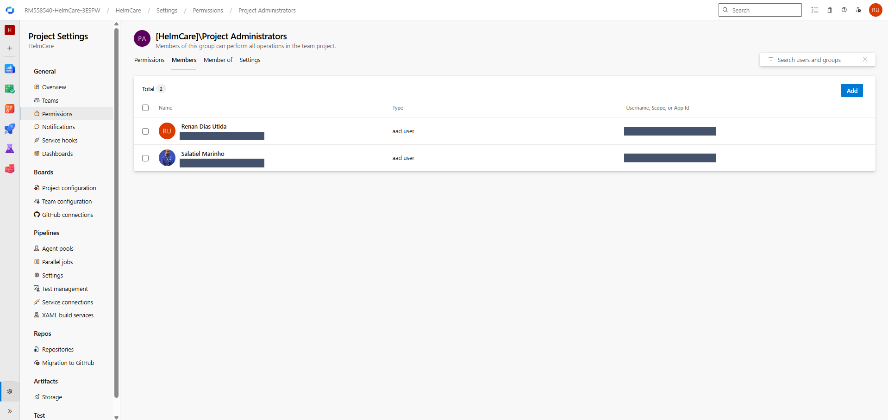

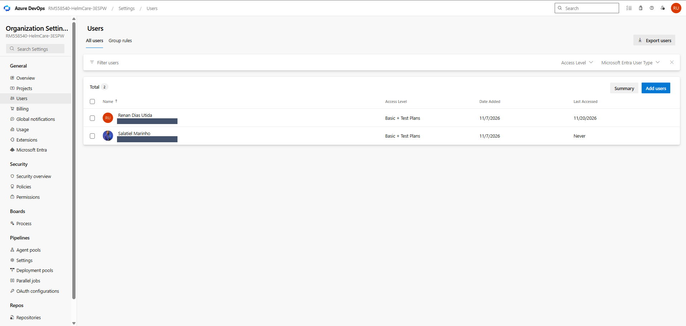

## 3. Epics e Features {#epics-features}

O backlog tem 4 Epics e 13 Features. A hierarquia Epic, Feature e PBI aparece expandida nos dois últimos prints, com os títulos dos PBIs no padrão `[Feature] detalhe`.

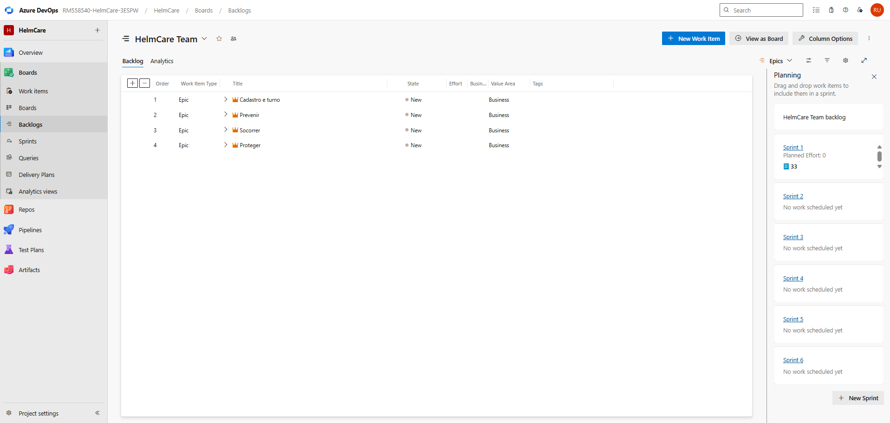

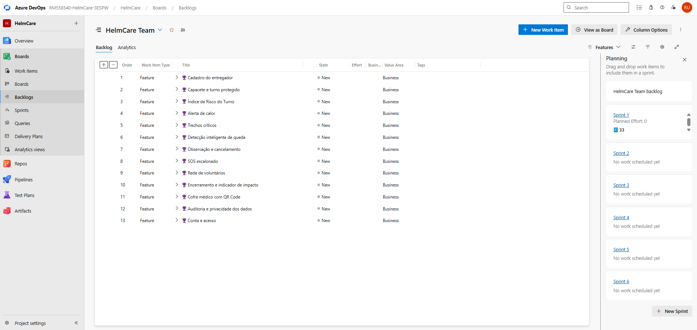

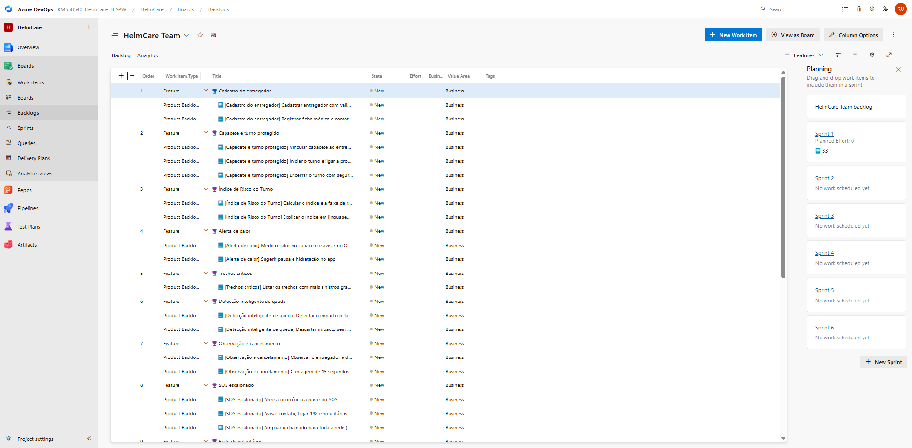

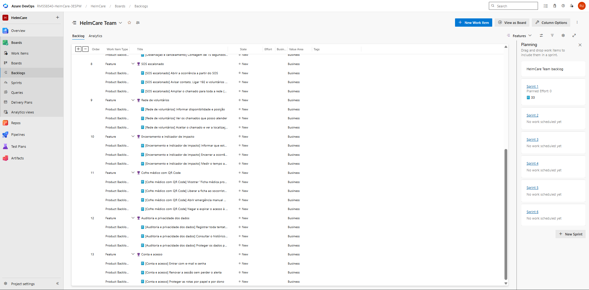

## 4. Detalhe das Features {#features .pagina}

Cada Feature tem descrição, critérios de aceite no campo Acceptance Criteria e os PBIs filhos. A ordem é a do backlog, de F01 a F13.

### F01 Cadastro do entregador

**Feature no Azure:** ID 2. **PBIs:** PBI 1.1 (ID 4), PBI 1.2 (ID 5). **Test Cases:** positivos TC01; negativos TC02.

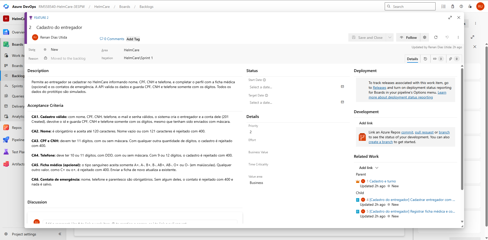

### F02 Capacete e turno protegido

**Feature no Azure:** ID 3. **PBIs:** PBI 2.1 (ID 6), PBI 2.2 (ID 7), PBI 2.3 (ID 8). **Test Cases:** positivos TC03; negativos TC04.

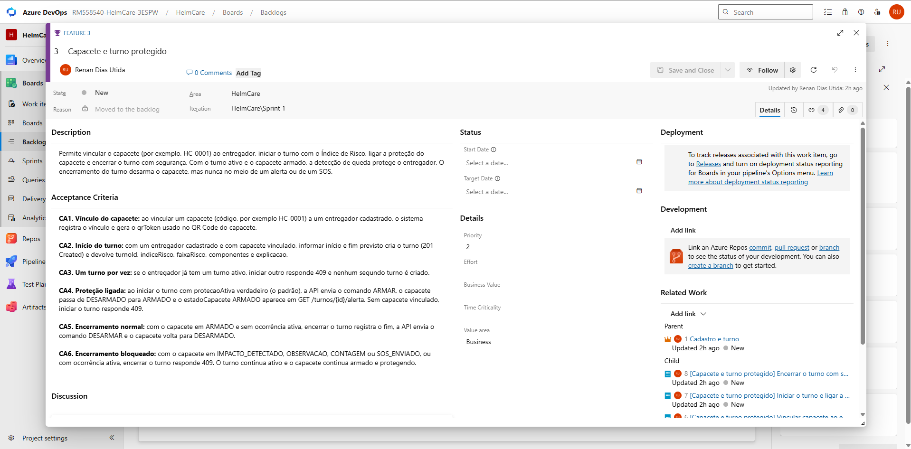

### F03 Índice de Risco do Turno

**Feature no Azure:** ID 10. **PBIs:** PBI 3.1 (ID 13), PBI 3.2 (ID 14). **Test Cases:** positivos TC05; negativos TC06.

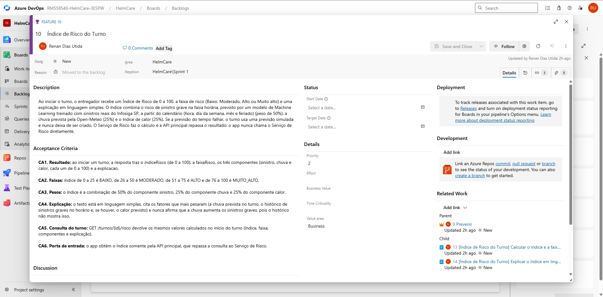

### F04 Alerta de calor

**Feature no Azure:** ID 11. **PBIs:** PBI 4.1 (ID 15), PBI 4.2 (ID 16). **Test Cases:** positivos TC07, TC09; negativos TC08.

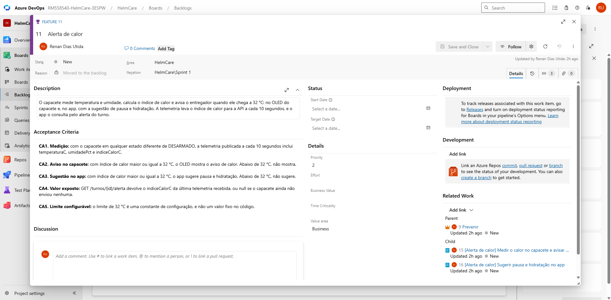

### F05 Trechos críticos

**Feature no Azure:** ID 12. **PBIs:** PBI 5.1 (ID 17). **Test Cases:** positivos TC10; negativos TC11.

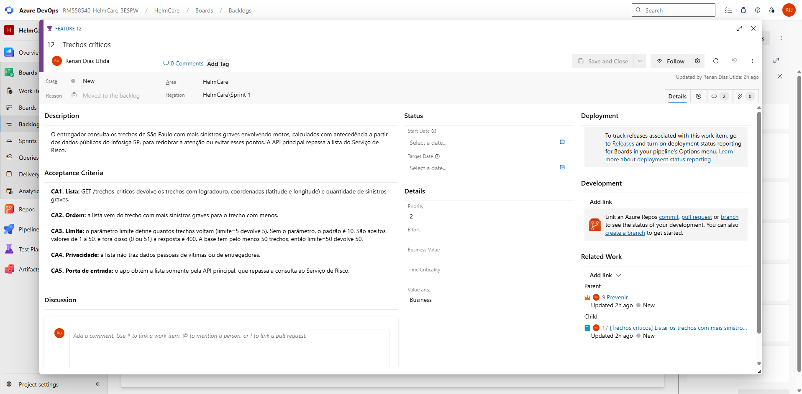

### F06 Detecção inteligente de queda

**Feature no Azure:** ID 19. **PBIs:** PBI 6.1 (ID 24), PBI 6.2 (ID 25). **Test Cases:** positivos TC12; negativos TC13.

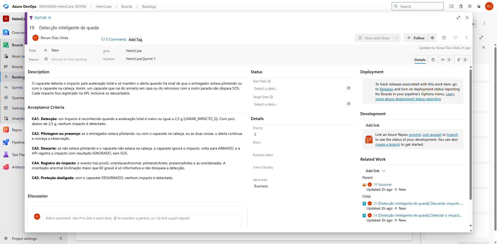

### F07 Observação e cancelamento

**Feature no Azure:** ID 20. **PBIs:** PBI 7.1 (ID 26), PBI 7.2 (ID 27). **Test Cases:** positivos TC14; negativos TC15.

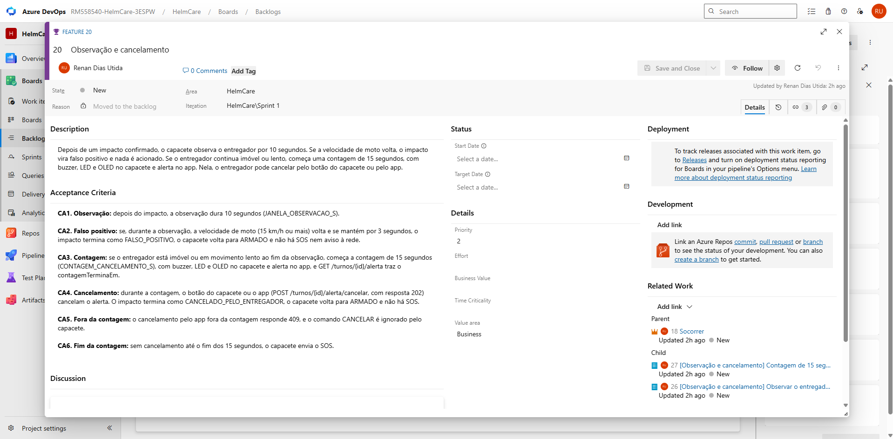

### F08 SOS escalonado

**Feature no Azure:** ID 21. **PBIs:** PBI 8.1 (ID 28), PBI 8.2 (ID 29), PBI 8.3 (ID 30). **Test Cases:** positivos TC16, TC18; negativos TC17.

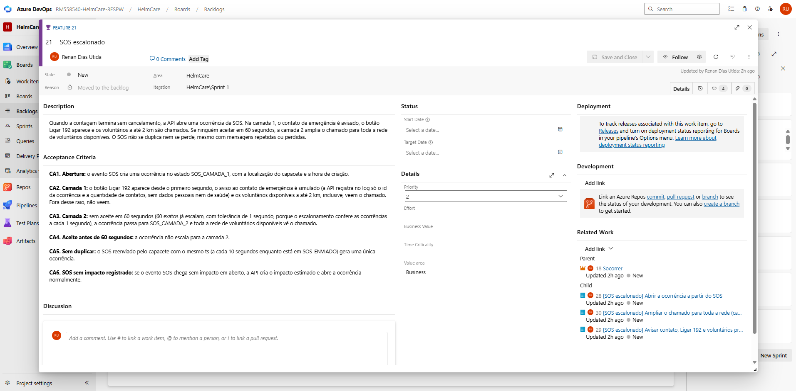

### F09 Rede de voluntários

**Feature no Azure:** ID 22. **PBIs:** PBI 9.1 (ID 31), PBI 9.2 (ID 32), PBI 9.3 (ID 33). **Test Cases:** positivos TC19; negativos TC20.

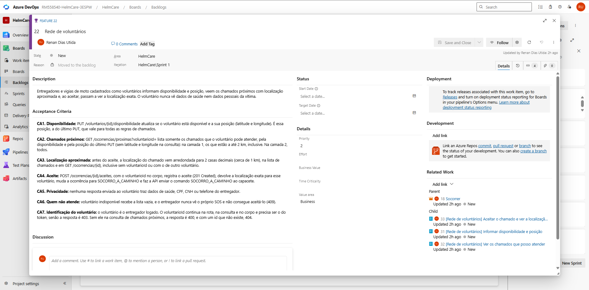

### F10 Encerramento e indicador de impacto

**Feature no Azure:** ID 23. **PBIs:** PBI 10.1 (ID 34), PBI 10.2 (ID 35), PBI 10.3 (ID 36). **Test Cases:** positivos TC21; negativos TC22.

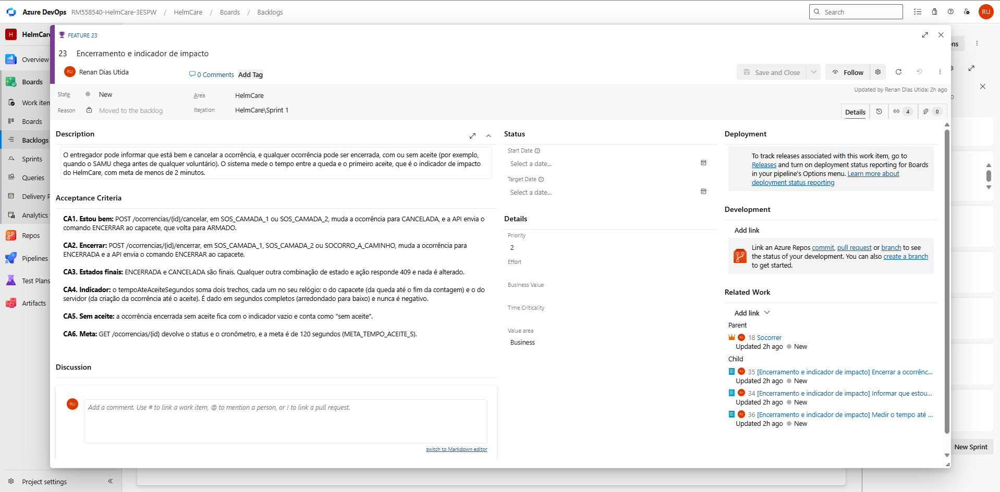

### F11 Cofre médico com QR Code

**Feature no Azure:** ID 38. **PBIs:** PBI 11.1 (ID 40), PBI 11.2 (ID 41), PBI 11.3 (ID 42), PBI 11.4 (ID 43). **Test Cases:** positivos TC23, TC24; negativos TC25.

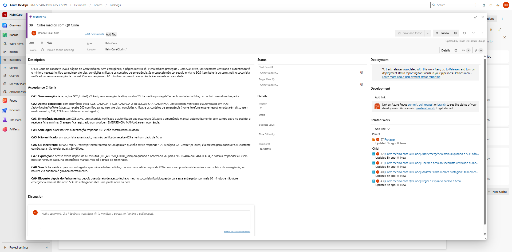

### F12 Auditoria e privacidade dos dados

**Feature no Azure:** ID 39. **PBIs:** PBI 12.1 (ID 44), PBI 12.2 (ID 45), PBI 12.3 (ID 46). **Test Cases:** positivos TC26; negativos TC27.

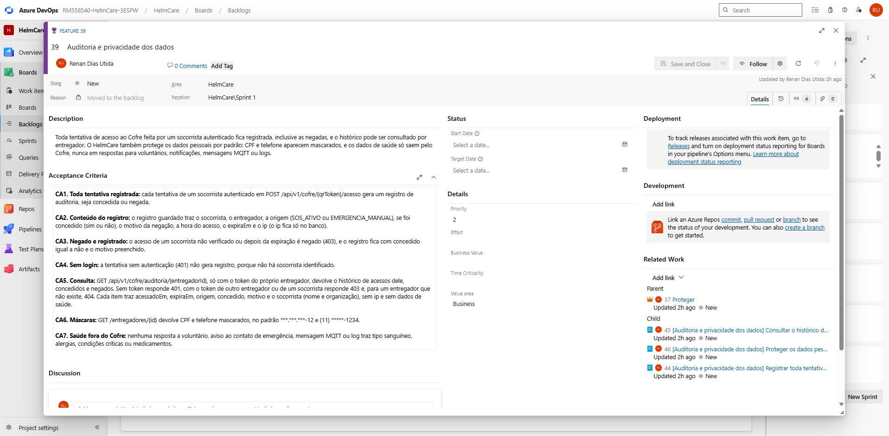

### F13 Conta e acesso

**Feature no Azure:** ID 48. **PBIs:** PBI 13.1 (ID 49), PBI 13.2 (ID 50), PBI 13.3 (ID 51). **Test Cases:** positivos TC28; negativos TC29, TC30.

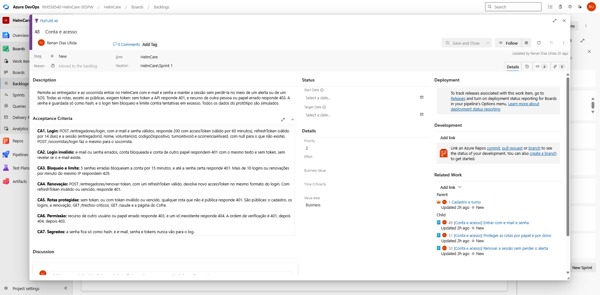

## 5. Estratégia de testes {#estrategia}

| Aspecto | Como foi feito |
|---|---|
| Plano | Test Plan "HelmCare · Plano de Aceitação" (ID 52), na iteração HelmCare\Sprint 1 |
| Suite estática | "Aceitação dos 13 Features (TC01 a TC30)" (ID 54), com os 30 Test Cases na ordem de execução |
| Tipo de teste | Funcional, de aceitação e caixa-preta: cada passo usa só a interface pública (rotas da API, app, capacete no Wokwi e broker MQTT) e compara a saída com o esperado |
| Polaridade | 15 positivos (o caminho esperado funciona) e 15 negativos (entradas inválidas, fronteiras e acessos indevidos são recusados) |
| Técnicas | Partição de equivalência e valor limite (2,5 g contra 2,4 g, 32,0 °C contra 31,9 °C, 2 km contra 2,1 km, limite de 1 a 50, escalada aos 60 s), transição de estados do capacete e da ocorrência, e matriz de acesso por papel e por dono (401, 403 e 404) |
| Estrutura de cada Test Case | O primeiro passo traz o objetivo e a preparação; os demais trazem a ação com as entradas e o resultado esperado |
| Rastreabilidade | Cada Test Case está ligado aos PBIs que cobre pelo vínculo Tested By: 61 vínculos de Test Case para PBI |
| Suites por requisito | Pasta "Por PBI (rastreabilidade)" com 33 suites requirement-based, uma por PBI, preenchidas pelo próprio vínculo Tested By |
| Dados | Sempre simulados: nomes inventados, CPF, CNH e telefones fictícios e e-mails no domínio reservado exemplo.com |

### Massa de dados e convenções

Convenção: toda rota que não é pública leva o cabeçalho Authorization: Bearer {accessToken} do usuário indicado (entregador E1, E2 ou socorrista S1, S2, S3). Base da API: http://localhost:5000/api/v1 (na VM, http://{ip}/api/v1). Use o Scalar ou o Postman. Dados sempre simulados.

| Item | Valor |
|---|---|
| E1 (vítima, dono do capacete HC-0001) | nome Entregador Simulado Um, CPF 123.456.789-09, CNH 12345678900, telefone (11) 98765-4321, e-mail entregador1@exemplo.com, senha Senha123 |
| E2 (voluntário) | nome Entregador Simulado Dois, CPF 987.654.321-00, CNH 22233344455, telefone (11) 98888-7777, e-mail entregador2@exemplo.com, senha Senha123 |
| E3 (conta descartável do TC29) | nome Entregador Simulado Três, CPF 111.222.333-44, CNH 33344455566, telefone (11) 97777-6666, e-mail entregador3@exemplo.com, senha Senha123 |
| S1 (socorrista verificado) | nome Socorrista Verificado, registro SAMU-0001, organização SAMU 192, e-mail socorrista1@exemplo.com, senha Senha123 |
| S2 (socorrista NÃO verificado) | nome Socorrista Nao Verificado, registro SAMU-0002, organização SAMU 192, e-mail socorrista2@exemplo.com, senha Senha123 |
| S3 (socorrista verificado, emergência manual) | nome Socorrista Manual, registro SAMU-0003, organização SAMU 192, e-mail socorrista3@exemplo.com, senha Senha123 |
| Posição da vítima (capacete no Wokwi) | latitude -23.5641, longitude -46.6525 |
| Posições do voluntário (mesma longitude -46.6525) | 1,0 km: latitude -23.5551; 1,9 km: -23.5470; 2,1 km: -23.5452; 3,0 km: -23.5371; 5,0 km: -23.5191 |
| Acelerômetro no Wokwi (X, Y, Z em g) | 3,0 g: X=2,00 Y=2,00 Z=1,00; 2,5 g: X=2,00 Y=1,12 Z=1,00; 2,4 g: X=2,00 Y=0,87 Z=1,00; repouso: X=0 Y=0 Z=1,00 |
| DHT22 no Wokwi | índice de calor 32,0 °C: 29,1 °C e 65%; índice 31,9 °C: 29,5 °C e 60% (fórmula NOAA, conferida) |
| Velocidade simulada | pilotando: 20 km/h; limite: 15 km/h; imóvel: 0 km/h |

**Execução:** na ordem TC01 a TC30. Há dependências (TC03 cria o turno e o qrToken, TC16 cria o voluntário, TC18 gera a ocorrência encerrada, TC19 deixa uma ocorrência aberta para o TC21, TC23 a TC25 alimentam a auditoria do TC26).

### Evidências do plano e da suite

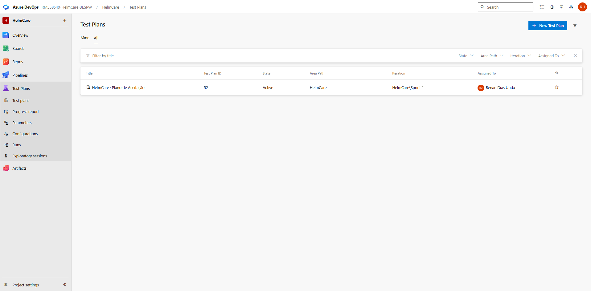

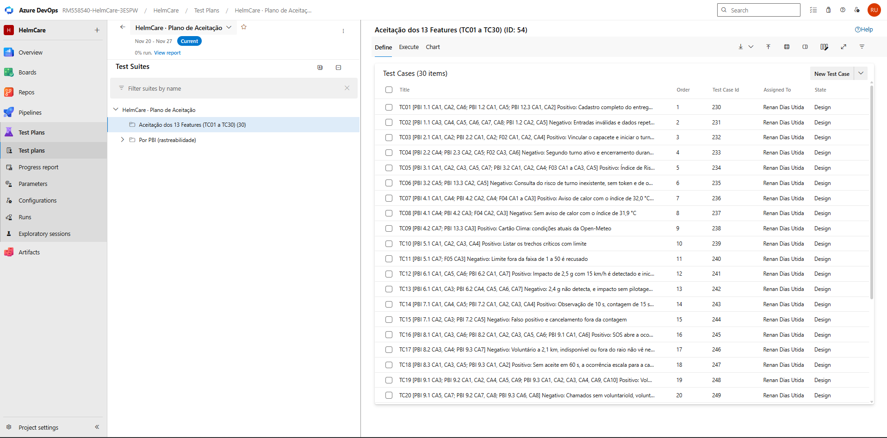

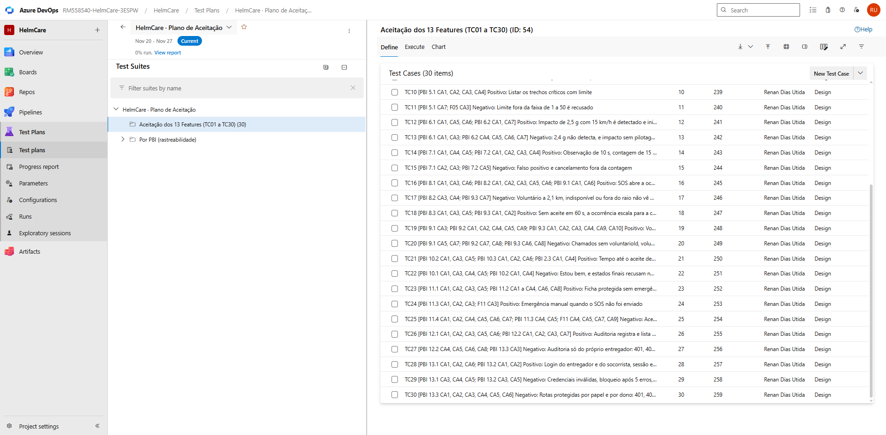

## 6. Test Cases {#test-cases .pagina}

### Tabela-resumo

| TC | ID | Feature | Polaridade | Título | PBIs e critérios cobertos |
|---|---|---|---|---|---|
| TC01 | 230 | F01 | Positivo | Cadastro completo do entregador com máscaras | PBI 1.1 CA1, CA2, CA6; PBI 1.2 CA1, CA5; PBI 12.3 CA1, CA2 |
| TC02 | 231 | F01 | Negativo | Entradas inválidas e dados repetidos são rejeitados | PBI 1.1 CA3, CA4, CA5, CA6, CA7, CA8; PBI 1.2 CA2, CA5 |
| TC03 | 232 | F02 | Positivo | Vincular o capacete e iniciar o turno com a proteção ligada | PBI 2.1 CA1, CA2; PBI 2.2 CA1, CA2; F02 CA1, CA2, CA4 |
| TC04 | 233 | F02 | Negativo | Segundo turno ativo e encerramento durante o alerta são recusados | PBI 2.2 CA4; PBI 2.3 CA2, CA5; F02 CA3, CA6 |
| TC05 | 234 | F03 | Positivo | Índice de Risco de referência (60, ALTO) e consulta com a mesma explicação | PBI 3.1 CA1, CA2, CA3, CA5, CA7; PBI 3.2 CA1, CA2, CA4; F03 CA1 a CA3, CA5 |
| TC06 | 235 | F03 | Negativo | Consulta do risco de turno inexistente, sem token e de outro entregador | PBI 3.2 CA5; PBI 13.3 CA2, CA5 |
| TC07 | 236 | F04 | Positivo | Aviso de calor com o índice de 32,0 °C no capacete e no app | PBI 4.1 CA1, CA4; PBI 4.2 CA2, CA4; F04 CA1 a CA3 |
| TC08 | 237 | F04 | Negativo | Sem aviso de calor com o índice de 31,9 °C | PBI 4.1 CA4; PBI 4.2 CA3; F04 CA2, CA3 |
| TC09 | 238 | F04 | Positivo | Cartão Clima: condições atuais da Open-Meteo | PBI 4.2 CA7; PBI 13.3 CA3 |
| TC10 | 239 | F05 | Positivo | Listar os trechos críticos com limite | PBI 5.1 CA1, CA2, CA3, CA4 |
| TC11 | 240 | F05 | Negativo | Limite fora da faixa de 1 a 50 é recusado | PBI 5.1 CA7; F05 CA3 |
| TC12 | 241 | F06 | Positivo | Impacto de 2,5 g com 15 km/h é detectado e inicia a observação | PBI 6.1 CA1, CA5, CA6; PBI 6.2 CA1, CA7 |
| TC13 | 242 | F06 | Negativo | 2,4 g não detecta, e impacto sem pilotagem nem presença é descartado | PBI 6.1 CA1, CA3; PBI 6.2 CA4, CA5, CA6, CA7 |
| TC14 | 243 | F07 | Positivo | Observação de 10 s, contagem de 15 s e cancelamento pelo app | PBI 7.1 CA1, CA4, CA5; PBI 7.2 CA1, CA2, CA3, CA4 |
| TC15 | 244 | F07 | Negativo | Falso positivo e cancelamento fora da contagem | PBI 7.1 CA2, CA3; PBI 7.2 CA5 |
| TC16 | 245 | F08 | Positivo | SOS abre a ocorrência na camada 1, sem duplicar, com Ligar 192 e voluntário a 1,9 km | PBI 8.1 CA1, CA3, CA6; PBI 8.2 CA1, CA2, CA3, CA5, CA6; PBI 9.1 CA1, CA6 |
| TC17 | 246 | F08 | Negativo | Voluntário a 2,1 km, indisponível ou fora do raio não vê nem aceita o chamado da camada 1 | PBI 8.2 CA3, CA4; PBI 9.3 CA7 |
| TC18 | 247 | F08 | Positivo | Sem aceite em 60 s, a ocorrência escala para a camada 2 e chega a voluntário a 5 km | PBI 8.3 CA1, CA3, CA5; PBI 9.3 CA1, CA2 |
| TC19 | 248 | F09 | Positivo | Voluntário vê o chamado aproximado, aceita e recebe a localização exata | PBI 9.1 CA3; PBI 9.2 CA1, CA2, CA4, CA5, CA9; PBI 9.3 CA1, CA2, CA3, CA4, CA9, CA10 |
| TC20 | 249 | F09 | Negativo | Chamados sem voluntarioId, voluntário inexistente e aceite de ocorrência encerrada | PBI 9.1 CA5, CA7; PBI 9.2 CA7, CA8; PBI 9.3 CA6, CA8 |
| TC21 | 250 | F10 | Positivo | Tempo até o aceite dentro da meta de 2 min, encerramento da ocorrência e do turno | PBI 10.2 CA1, CA3, CA5; PBI 10.3 CA1, CA2, CA6; PBI 2.3 CA1, CA4 |
| TC22 | 251 | F10 | Negativo | Estou bem, e estados finais recusam nova ação | PBI 10.1 CA1, CA3, CA4, CA5; PBI 10.2 CA1, CA4 |
| TC23 | 252 | F11 | Positivo | Ficha protegida sem emergência e ficha mínima ao socorrista verificado durante o SOS | PBI 11.1 CA1, CA2, CA3, CA5; PBI 11.2 CA1 a CA4, CA6, CA8 |
| TC24 | 253 | F11 | Positivo | Emergência manual quando o SOS não foi enviado | PBI 11.3 CA1, CA2, CA3; F11 CA3 |
| TC25 | 254 | F11 | Negativo | Acesso negado: sem login, não verificado, QR inexistente e janela fechada | PBI 11.4 CA1, CA2, CA4, CA5, CA6, CA7; PBI 11.3 CA4, CA5; F11 CA4, CA5, CA7, CA9 |
| TC26 | 255 | F12 | Positivo | Auditoria registra e lista os acessos concedidos e negados, sem ip e sem saúde | PBI 12.1 CA1, CA2, CA3, CA5, CA6; PBI 12.2 CA1, CA2, CA3, CA7 |
| TC27 | 256 | F12 | Negativo | Auditoria só do próprio entregador: 401, 403 e 404 | PBI 12.2 CA4, CA5, CA6, CA8; PBI 13.3 CA3 |
| TC28 | 257 | F13 | Positivo | Login do entregador e do socorrista, sessão e renovação do token | PBI 13.1 CA1, CA2, CA6; PBI 13.2 CA1, CA2 |
| TC29 | 258 | F13 | Negativo | Credenciais inválidas, bloqueio após 5 erros, 429 e refresh inválido | PBI 13.1 CA3, CA4, CA5; PBI 13.2 CA3, CA5 |
| TC30 | 259 | F13 | Negativo | Rotas protegidas por papel e por dono: 401, 403 e 404, e rotas públicas abertas | PBI 13.3 CA1, CA2, CA3, CA4, CA5, CA6 |

Cada Test Case aparece a seguir com o print da definição no Azure Test Plans e o texto de apoio: objetivo, preparação e os passos com entradas e saídas esperadas.

### TC01 Positivo: Cadastro completo do entregador com máscaras

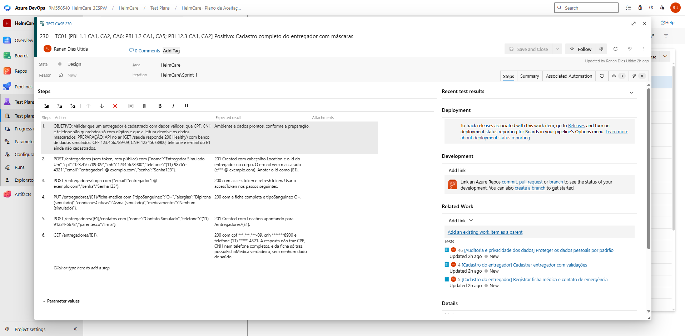

- **Test Case no Azure:** ID 230, Feature F01. **Referência:** PBI 1.1 CA1, CA2, CA6; PBI 1.2 CA1, CA5; PBI 12.3 CA1, CA2
- **Objetivo:** Validar que um entregador é cadastrado com dados válidos, que CPF, CNH e telefone são guardados só com dígitos e que a leitura devolve os dados mascarados.
- **Preparação:** API no ar (GET /saude responde 200 Healthy) com banco de dados simulados. CPF 123.456.789-09, CNH 12345678900, telefone e e-mail do E1 ainda não cadastrados.

| Passo | Ação e entradas | Resultado esperado |
|---|---|---|
| 1 | POST /entregadores (sem token, rota pública) com {"nome":"Entregador Simulado Um","cpf":"123.456.789-09","cnh":"12345678900","telefone":"(11) 98765-4321","email":"entregador1@exemplo.com","senha":"Senha123"}. | 201 Created com cabeçalho Location e o id do entregador no corpo. O e-mail vem mascarado (e\*\*\*@exemplo.com). Anotar o id como {E1}. |
| 2 | POST /entregadores/login com {"email":"entregador1@exemplo.com","senha":"Senha123"}. | 200 com accessToken e refreshToken. Usar o accessToken nos passos seguintes. |
| 3 | PUT /entregadores/{E1}/ficha-medica com {"tipoSanguineo":"O+","alergias":"Dipirona (simulado)","condicoesCriticas":"Asma (simulado)","medicamentos":"Nenhum (simulado)"}. | 200 com a ficha completa e tipoSanguineo O+. |
| 4 | POST /entregadores/{E1}/contatos com {"nome":"Contato Simulado","telefone":"(11) 91234-5678","parentesco":"Irmã"}. | 201 Created com Location apontando para /entregadores/{E1}. |
| 5 | GET /entregadores/{E1}. | 200 com cpf \*\*\*.\*\*\*.\*\*\*-09, cnh \*\*\*\*\*\*\*8900 e telefone (11) \*\*\*\*\*-4321. A resposta não traz CPF, CNH nem telefone completos, e da ficha só traz possuiFichaMedica verdadeiro, sem nenhum dado de saúde. |

### TC02 Negativo: Entradas inválidas e dados repetidos são rejeitados

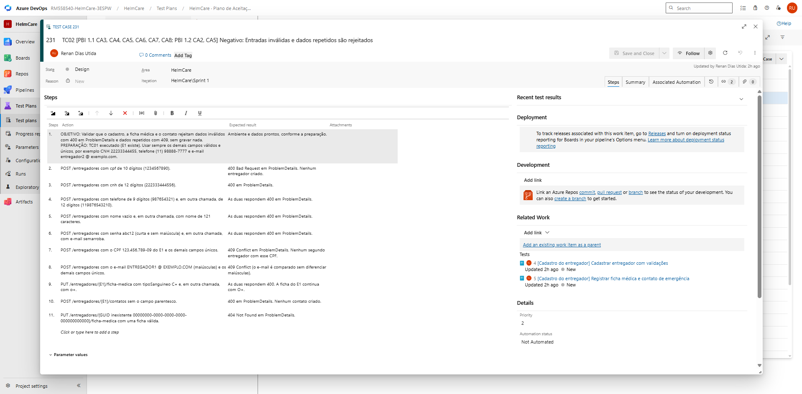

- **Test Case no Azure:** ID 231, Feature F01. **Referência:** PBI 1.1 CA3, CA4, CA5, CA6, CA7, CA8; PBI 1.2 CA2, CA5
- **Objetivo:** Validar que o cadastro, a ficha médica e o contato rejeitam dados inválidos com 400 em ProblemDetails e dados repetidos com 409, sem gravar nada.
- **Preparação:** TC01 executado (E1 existe). Usar sempre os demais campos válidos e únicos, por exemplo CNH 22233344455, telefone (11) 98888-7777 e e-mail entregador2@exemplo.com.

| Passo | Ação e entradas | Resultado esperado |
|---|---|---|
| 1 | POST /entregadores com cpf de 10 dígitos (1234567890). | 400 Bad Request em ProblemDetails. Nenhum entregador criado. |
| 2 | POST /entregadores com cnh de 12 dígitos (222333444556). | 400 em ProblemDetails. |
| 3 | POST /entregadores com telefone de 9 dígitos (987654321) e, em outra chamada, de 12 dígitos (119876543210). | As duas respondem 400 em ProblemDetails. |
| 4 | POST /entregadores com nome vazio e, em outra chamada, com nome de 121 caracteres. | As duas respondem 400 em ProblemDetails. |
| 5 | POST /entregadores com senha abc12 (curta e sem maiúscula) e, em outra chamada, com e-mail semarroba. | As duas respondem 400 em ProblemDetails. |
| 6 | POST /entregadores com o CPF 123.456.789-09 do E1 e os demais campos únicos. | 409 Conflict em ProblemDetails. Nenhum segundo entregador com esse CPF. |
| 7 | POST /entregadores com o e-mail ENTREGADOR1@EXEMPLO.COM (maiúsculas) e os demais campos únicos. | 409 Conflict (o e-mail é comparado sem diferenciar maiúsculas). |
| 8 | PUT /entregadores/{E1}/ficha-medica com tipoSanguineo C+ e, em outra chamada, com o+. | As duas respondem 400. A ficha do E1 continua com O+. |
| 9 | POST /entregadores/{E1}/contatos sem o campo parentesco. | 400 em ProblemDetails. Nenhum contato criado. |
| 10 | PUT /entregadores/{GUID inexistente 00000000-0000-0000-0000-000000000000}/ficha-medica com uma ficha válida. | 404 Not Found em ProblemDetails. |

### TC03 Positivo: Vincular o capacete e iniciar o turno com a proteção ligada

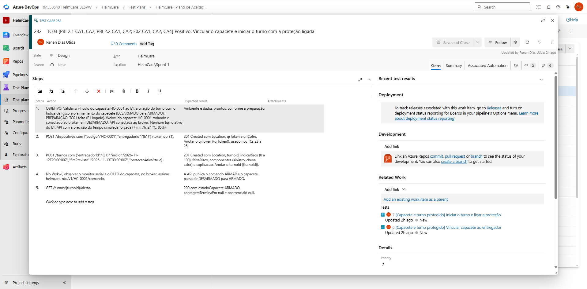

- **Test Case no Azure:** ID 232, Feature F02. **Referência:** PBI 2.1 CA1, CA2; PBI 2.2 CA1, CA2; F02 CA1, CA2, CA4
- **Objetivo:** Validar o vínculo do capacete HC-0001 ao E1, a criação do turno com o Índice de Risco e o armamento do capacete (DESARMADO para ARMADO).
- **Preparação:** TC01 feito (E1 logado). Wokwi do capacete HC-0001 rodando e conectado ao broker, em DESARMADO. API conectada ao broker. Nenhum turno ativo do E1. API com a previsão do tempo simulada forçada (7 mm/h, 24 °C, 85%).

| Passo | Ação e entradas | Resultado esperado |
|---|---|---|
| 1 | POST /dispositivos com {"codigo":"HC-0001","entregadorId":"{E1}"} (token do E1). | 201 Created com Location, qrToken e urlCofre. Anotar o qrToken ({qrToken}), usado nos TCs 23 a 25. |
| 2 | POST /turnos com {"entregadorId":"{E1}","inicio":"2026-11-12T20:00:00Z","fimPrevisto":"2026-11-13T00:00:00Z","protecaoAtiva":true}. | 201 Created com Location, turnoId, indiceRisco (0 a 100), faixaRisco, componentes (sinistro, chuva, calor) e explicacao. Anotar o turnoId ({turnoId}). |
| 3 | No Wokwi, observar o monitor serial e o OLED do capacete; no broker, assinar helmcare-rdu/v1/HC-0001/comando. | A API publica o comando ARMAR e o capacete passa de DESARMADO para ARMADO. |
| 4 | GET /turnos/{turnoId}/alerta. | 200 com estadoCapacete ARMADO, contagemTerminaEm null e ocorrenciaId null. |

### TC04 Negativo: Segundo turno ativo e encerramento durante o alerta são recusados

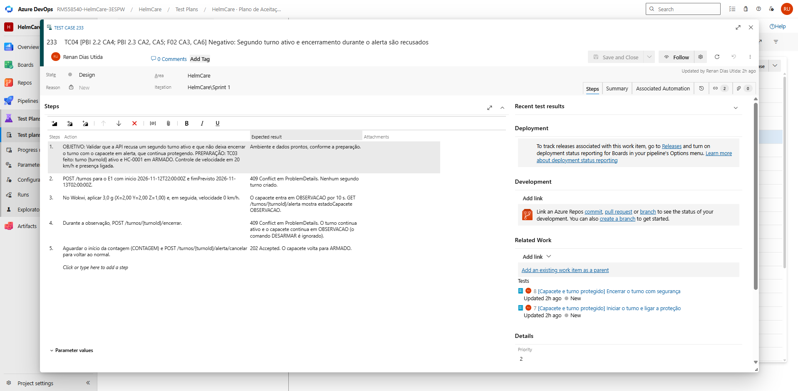

- **Test Case no Azure:** ID 233, Feature F02. **Referência:** PBI 2.2 CA4; PBI 2.3 CA2, CA5; F02 CA3, CA6
- **Objetivo:** Validar que a API recusa um segundo turno ativo e que não deixa encerrar o turno com o capacete em alerta, que continua protegendo.
- **Preparação:** TC03 feito: turno {turnoId} ativo e HC-0001 em ARMADO. Controle de velocidade em 20 km/h e presença ligada.

| Passo | Ação e entradas | Resultado esperado |
|---|---|---|
| 1 | POST /turnos para o E1 com inicio 2026-11-12T22:00:00Z e fimPrevisto 2026-11-13T02:00:00Z. | 409 Conflict em ProblemDetails. Nenhum segundo turno criado. |
| 2 | No Wokwi, aplicar 3,0 g (X=2,00 Y=2,00 Z=1,00) e, em seguida, velocidade 0 km/h. | O capacete entra em OBSERVACAO por 10 s. GET /turnos/{turnoId}/alerta mostra estadoCapacete OBSERVACAO. |
| 3 | Durante a observação, POST /turnos/{turnoId}/encerrar. | 409 Conflict em ProblemDetails. O turno continua ativo e o capacete continua em OBSERVACAO (o comando DESARMAR é ignorado). |
| 4 | Aguardar o início da contagem (CONTAGEM) e POST /turnos/{turnoId}/alerta/cancelar para voltar ao normal. | 202 Accepted. O capacete volta para ARMADO. |

### TC05 Positivo: Índice de Risco de referência (60, ALTO) e consulta com a mesma explicação

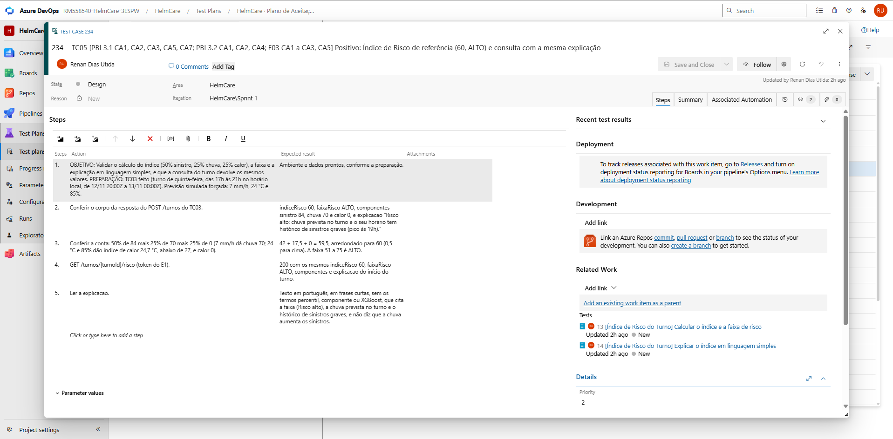

- **Test Case no Azure:** ID 234, Feature F03. **Referência:** PBI 3.1 CA1, CA2, CA3, CA5, CA7; PBI 3.2 CA1, CA2, CA4; F03 CA1 a CA3, CA5
- **Objetivo:** Validar o cálculo do índice (50% sinistro, 25% chuva, 25% calor), a faixa e a explicação em linguagem simples, e que a consulta do turno devolve os mesmos valores.
- **Preparação:** TC03 feito (turno de quinta-feira, das 17h às 21h no horário local, de 12/11 20:00Z a 13/11 00:00Z). Previsão simulada forçada: 7 mm/h, 24 °C e 85%.

| Passo | Ação e entradas | Resultado esperado |
|---|---|---|
| 1 | Conferir o corpo da resposta do POST /turnos do TC03. | indiceRisco 60, faixaRisco ALTO, componentes sinistro 84, chuva 70 e calor 0, e explicacao "Risco alto: chuva prevista no turno e o seu horário tem histórico de sinistros graves (pico às 19h)." |
| 2 | Conferir a conta: 50% de 84 mais 25% de 70 mais 25% de 0 (7 mm/h dá chuva 70; 24 °C e 85% dão índice de calor 24,7 °C, abaixo de 27, e calor 0). | 42 + 17,5 + 0 = 59,5, arredondado para 60 (0,5 para cima). A faixa 51 a 75 é ALTO. |
| 3 | GET /turnos/{turnoId}/risco (token do E1). | 200 com os mesmos indiceRisco 60, faixaRisco ALTO, componentes e explicacao do início do turno. |
| 4 | Ler a explicacao. | Texto em português, em frases curtas, sem os termos percentil, componente ou XGBoost, que cita a faixa (Risco alto), a chuva prevista no turno e o histórico de sinistros graves, e não diz que a chuva aumenta os sinistros. |

### TC06 Negativo: Consulta do risco de turno inexistente, sem token e de outro entregador

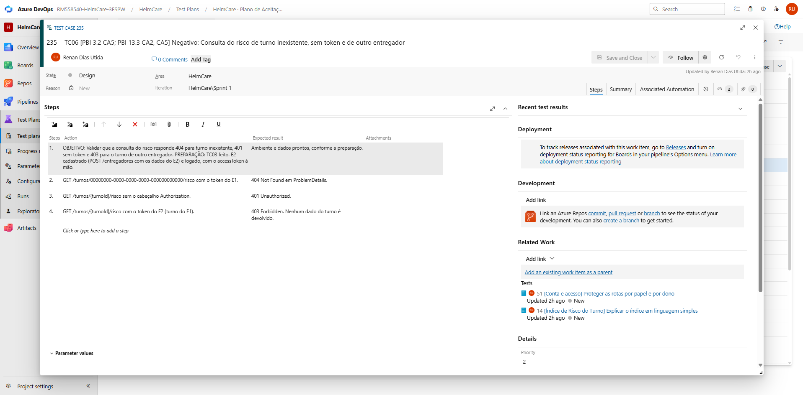

- **Test Case no Azure:** ID 235, Feature F03. **Referência:** PBI 3.2 CA5; PBI 13.3 CA2, CA5
- **Objetivo:** Validar que a consulta do risco responde 404 para turno inexistente, 401 sem token e 403 para o turno de outro entregador.
- **Preparação:** TC03 feito. E2 cadastrado (POST /entregadores com os dados do E2) e logado, com o accessToken à mão.

| Passo | Ação e entradas | Resultado esperado |
|---|---|---|
| 1 | GET /turnos/00000000-0000-0000-0000-000000000000/risco com o token do E1. | 404 Not Found em ProblemDetails. |
| 2 | GET /turnos/{turnoId}/risco sem o cabeçalho Authorization. | 401 Unauthorized. |
| 3 | GET /turnos/{turnoId}/risco com o token do E2 (turno do E1). | 403 Forbidden. Nenhum dado do turno é devolvido. |

### TC07 Positivo: Aviso de calor com o índice de 32,0 °C no capacete e no app

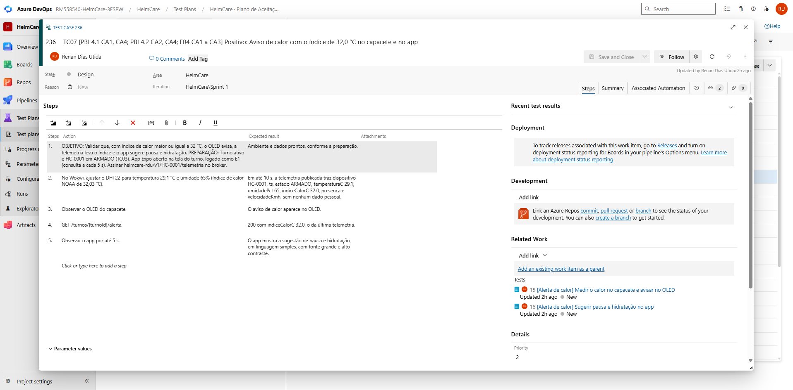

- **Test Case no Azure:** ID 236, Feature F04. **Referência:** PBI 4.1 CA1, CA4; PBI 4.2 CA2, CA4; F04 CA1 a CA3
- **Objetivo:** Validar que, com índice de calor maior ou igual a 32 °C, o OLED avisa, a telemetria leva o índice e o app sugere pausa e hidratação.
- **Preparação:** Turno ativo e HC-0001 em ARMADO (TC03). App Expo aberto na tela do turno, logado como E1 (consulta a cada 5 s). Assinar helmcare-rdu/v1/HC-0001/telemetria no broker.

| Passo | Ação e entradas | Resultado esperado |
|---|---|---|
| 1 | No Wokwi, ajustar o DHT22 para temperatura 29,1 °C e umidade 65% (índice de calor NOAA de 32,03 °C). | Em até 10 s, a telemetria publicada traz dispositivo HC-0001, ts, estado ARMADO, temperaturaC 29.1, umidadePct 65, indiceCalorC 32.0, presenca e velocidadeKmh, sem nenhum dado pessoal. |
| 2 | Observar o OLED do capacete. | O aviso de calor aparece no OLED. |
| 3 | GET /turnos/{turnoId}/alerta. | 200 com indiceCalorC 32.0, o da última telemetria. |
| 4 | Observar o app por até 5 s. | O app mostra a sugestão de pausa e hidratação, em linguagem simples, com fonte grande e alto contraste. |

### TC08 Negativo: Sem aviso de calor com o índice de 31,9 °C

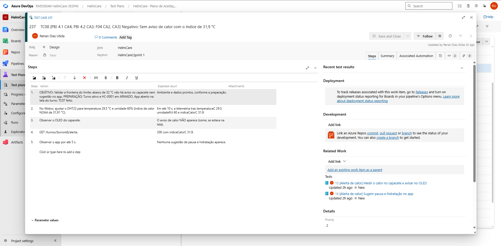

- **Test Case no Azure:** ID 237, Feature F04. **Referência:** PBI 4.1 CA4; PBI 4.2 CA3; F04 CA2, CA3
- **Objetivo:** Validar a fronteira do limite: abaixo de 32 °C não há aviso no capacete nem sugestão no app.
- **Preparação:** Turno ativo e HC-0001 em ARMADO. App aberto na tela do turno. TC07 feito.

| Passo | Ação e entradas | Resultado esperado |
|---|---|---|
| 1 | No Wokwi, ajustar o DHT22 para temperatura 29,5 °C e umidade 60% (índice de calor NOAA de 31,91 °C). | Em até 10 s, a telemetria traz temperaturaC 29.5, umidadePct 60 e indiceCalorC 31.9. |
| 2 | Observar o OLED do capacete. | O aviso de calor NÃO aparece (some, se estava na tela). |
| 3 | GET /turnos/{turnoId}/alerta. | 200 com indiceCalorC 31.9. |
| 4 | Observar o app por até 5 s. | Nenhuma sugestão de pausa e hidratação aparece. |

### TC09 Positivo: Cartão Clima: condições atuais da Open-Meteo

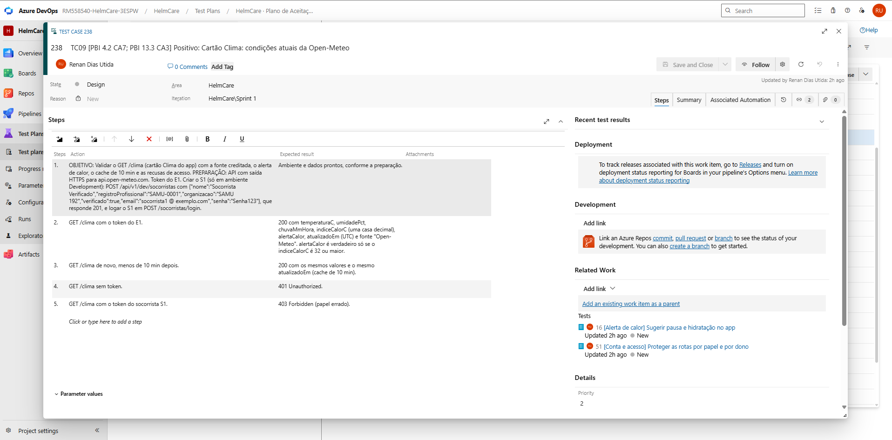

- **Test Case no Azure:** ID 238, Feature F04. **Referência:** PBI 4.2 CA7; PBI 13.3 CA3
- **Objetivo:** Validar o GET /clima (cartão Clima do app) com a fonte creditada, o alerta de calor, o cache de 10 min e as recusas de acesso.
- **Preparação:** API com saída HTTPS para api.open-meteo.com. Token do E1. Criar o S1 (só em ambiente Development): POST /api/v1/dev/socorristas com {"nome":"Socorrista Verificado","registroProfissional":"SAMU-0001","organizacao":"SAMU 192","verificado":true,"email":"socorrista1@exemplo.com","senha":"Senha123"}, que responde 201, e logar o S1 em POST /socorristas/login.

| Passo | Ação e entradas | Resultado esperado |
|---|---|---|
| 1 | GET /clima com o token do E1. | 200 com temperaturaC, umidadePct, chuvaMmHora, indiceCalorC (uma casa decimal), alertaCalor, atualizadoEm (UTC) e fonte "Open-Meteo". alertaCalor é verdadeiro só se o indiceCalorC é 32 ou maior. |
| 2 | GET /clima de novo, menos de 10 min depois. | 200 com os mesmos valores e o mesmo atualizadoEm (cache de 10 min). |
| 3 | GET /clima sem token. | 401 Unauthorized. |
| 4 | GET /clima com o token do socorrista S1. | 403 Forbidden (papel errado). |

### TC10 Positivo: Listar os trechos críticos com limite

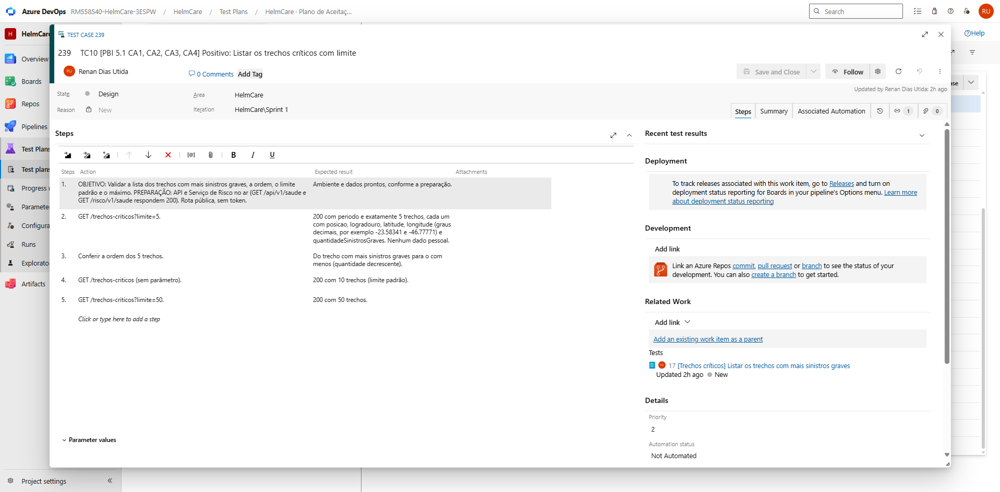

- **Test Case no Azure:** ID 239, Feature F05. **Referência:** PBI 5.1 CA1, CA2, CA3, CA4
- **Objetivo:** Validar a lista dos trechos com mais sinistros graves, a ordem, o limite padrão e o máximo.
- **Preparação:** API e Serviço de Risco no ar (GET /api/v1/saude e GET /risco/v1/saude respondem 200). Rota pública, sem token.

| Passo | Ação e entradas | Resultado esperado |
|---|---|---|
| 1 | GET /trechos-criticos?limite=5. | 200 com periodo e exatamente 5 trechos, cada um com posicao, logradouro, latitude, longitude (graus decimais, por exemplo -23.58341 e -46.77771) e quantidadeSinistrosGraves. Nenhum dado pessoal. |
| 2 | Conferir a ordem dos 5 trechos. | Do trecho com mais sinistros graves para o com menos (quantidade decrescente). |
| 3 | GET /trechos-criticos (sem parâmetro). | 200 com 10 trechos (limite padrão). |
| 4 | GET /trechos-criticos?limite=50. | 200 com 50 trechos. |

### TC11 Negativo: Limite fora da faixa de 1 a 50 é recusado

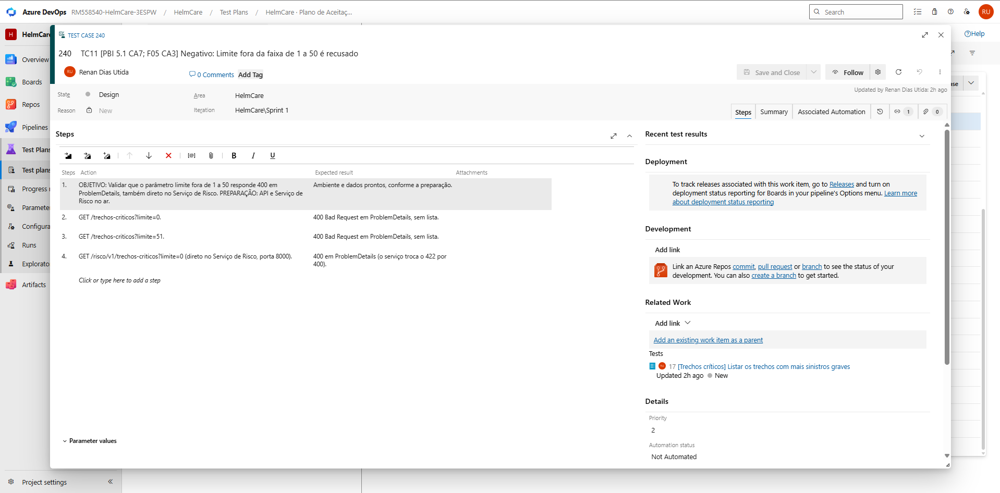

- **Test Case no Azure:** ID 240, Feature F05. **Referência:** PBI 5.1 CA7; F05 CA3
- **Objetivo:** Validar que o parâmetro limite fora de 1 a 50 responde 400 em ProblemDetails, também direto no Serviço de Risco.
- **Preparação:** API e Serviço de Risco no ar.

| Passo | Ação e entradas | Resultado esperado |
|---|---|---|
| 1 | GET /trechos-criticos?limite=0. | 400 Bad Request em ProblemDetails, sem lista. |
| 2 | GET /trechos-criticos?limite=51. | 400 Bad Request em ProblemDetails, sem lista. |
| 3 | GET /risco/v1/trechos-criticos?limite=0 (direto no Serviço de Risco, porta 8000). | 400 em ProblemDetails (o serviço troca o 422 por 400). |

### TC12 Positivo: Impacto de 2,5 g com 15 km/h é detectado e inicia a observação

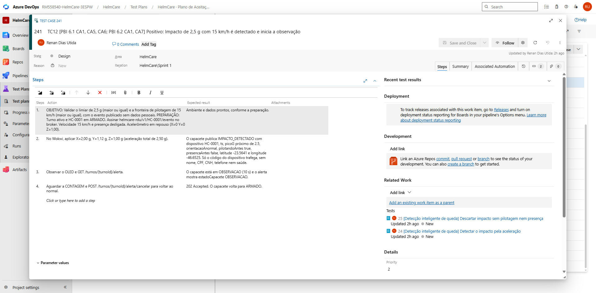

- **Test Case no Azure:** ID 241, Feature F06. **Referência:** PBI 6.1 CA1, CA5, CA6; PBI 6.2 CA1, CA7
- **Objetivo:** Validar o limiar de 2,5 g (maior ou igual) e a fronteira de pilotagem de 15 km/h (maior ou igual), com o evento publicado sem dados pessoais.
- **Preparação:** Turno ativo e HC-0001 em ARMADO. Assinar helmcare-rdu/v1/HC-0001/evento no broker. Velocidade 15 km/h e presença desligada. Acelerômetro em repouso (X=0 Y=0 Z=1,00).

| Passo | Ação e entradas | Resultado esperado |
|---|---|---|
| 1 | No Wokwi, aplicar X=2,00 g, Y=1,12 g, Z=1,00 g (aceleração total de 2,50 g). | O capacete publica IMPACTO_DETECTADO com dispositivo HC-0001, ts, picoG próximo de 2.5, orientacaoAnormal, pilotandoAntes true, presencaAntes false, latitude -23.5641 e longitude -46.6525. Só o código do dispositivo trafega, sem nome, CPF, CNH, telefone nem saúde. |
| 2 | Observar o OLED e GET /turnos/{turnoId}/alerta. | O capacete está em OBSERVACAO (10 s) e o alerta mostra estadoCapacete OBSERVACAO. |
| 3 | Aguardar a CONTAGEM e POST /turnos/{turnoId}/alerta/cancelar para voltar ao normal. | 202 Accepted. O capacete volta para ARMADO. |

### TC13 Negativo: 2,4 g não detecta, e impacto sem pilotagem nem presença é descartado

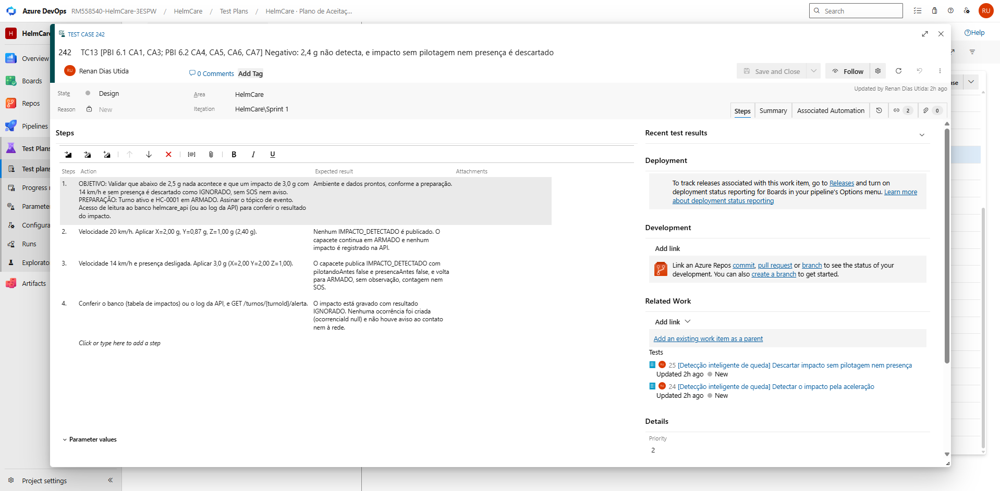

- **Test Case no Azure:** ID 242, Feature F06. **Referência:** PBI 6.1 CA1, CA3; PBI 6.2 CA4, CA5, CA6, CA7
- **Objetivo:** Validar que abaixo de 2,5 g nada acontece e que um impacto de 3,0 g com 14 km/h e sem presença é descartado como IGNORADO, sem SOS nem aviso.
- **Preparação:** Turno ativo e HC-0001 em ARMADO. Assinar o tópico de evento. Acesso de leitura ao banco helmcare_api (ou ao log da API) para conferir o resultado do impacto.

| Passo | Ação e entradas | Resultado esperado |
|---|---|---|
| 1 | Velocidade 20 km/h. Aplicar X=2,00 g, Y=0,87 g, Z=1,00 g (2,40 g). | Nenhum IMPACTO_DETECTADO é publicado. O capacete continua em ARMADO e nenhum impacto é registrado na API. |
| 2 | Velocidade 14 km/h e presença desligada. Aplicar 3,0 g (X=2,00 Y=2,00 Z=1,00). | O capacete publica IMPACTO_DETECTADO com pilotandoAntes false e presencaAntes false, e volta para ARMADO, sem observação, contagem nem SOS. |
| 3 | Conferir o banco (tabela de impactos) ou o log da API, e GET /turnos/{turnoId}/alerta. | O impacto está gravado com resultado IGNORADO. Nenhuma ocorrência foi criada (ocorrenciaId null) e não houve aviso ao contato nem à rede. |

### TC14 Positivo: Observação de 10 s, contagem de 15 s e cancelamento pelo app

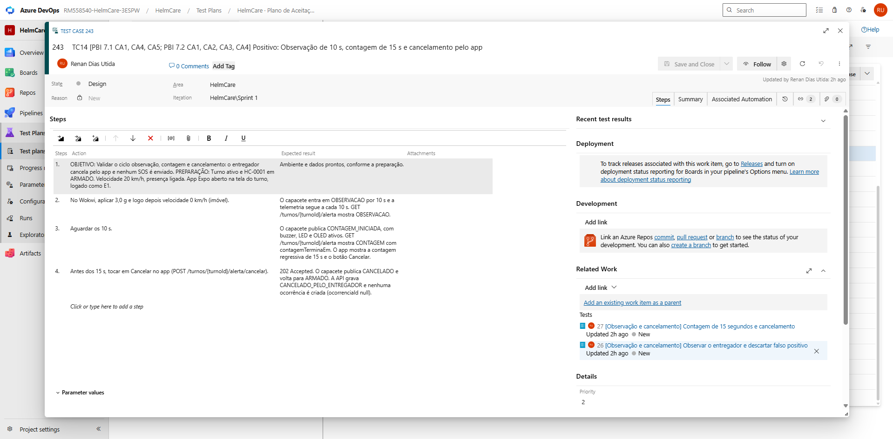

- **Test Case no Azure:** ID 243, Feature F07. **Referência:** PBI 7.1 CA1, CA4, CA5; PBI 7.2 CA1, CA2, CA3, CA4
- **Objetivo:** Validar o ciclo observação, contagem e cancelamento: o entregador cancela pelo app e nenhum SOS é enviado.
- **Preparação:** Turno ativo e HC-0001 em ARMADO. Velocidade 20 km/h, presença ligada. App Expo aberto na tela do turno, logado como E1.

| Passo | Ação e entradas | Resultado esperado |
|---|---|---|
| 1 | No Wokwi, aplicar 3,0 g e logo depois velocidade 0 km/h (imóvel). | O capacete entra em OBSERVACAO por 10 s e a telemetria segue a cada 10 s. GET /turnos/{turnoId}/alerta mostra OBSERVACAO. |
| 2 | Aguardar os 10 s. | O capacete publica CONTAGEM_INICIADA, com buzzer, LED e OLED ativos. GET /turnos/{turnoId}/alerta mostra CONTAGEM com contagemTerminaEm. O app mostra a contagem regressiva de 15 s e o botão Cancelar. |
| 3 | Antes dos 15 s, tocar em Cancelar no app (POST /turnos/{turnoId}/alerta/cancelar). | 202 Accepted. O capacete publica CANCELADO e volta para ARMADO. A API grava CANCELADO_PELO_ENTREGADOR e nenhuma ocorrência é criada (ocorrenciaId null). |

### TC15 Negativo: Falso positivo e cancelamento fora da contagem

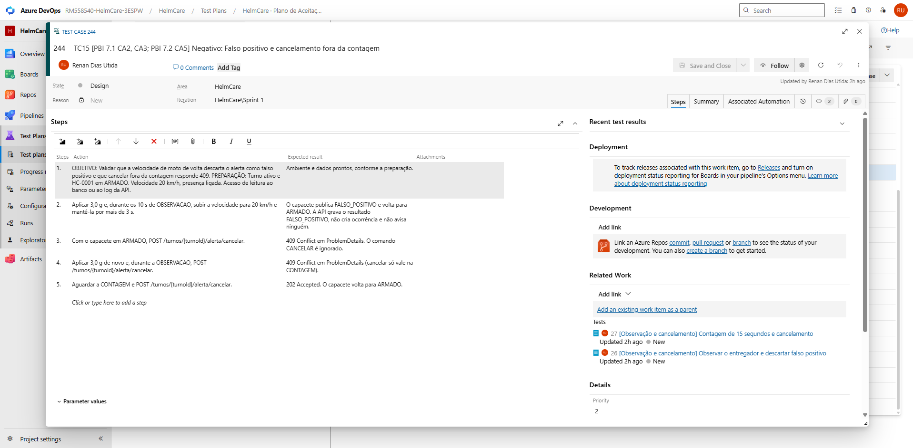

- **Test Case no Azure:** ID 244, Feature F07. **Referência:** PBI 7.1 CA2, CA3; PBI 7.2 CA5
- **Objetivo:** Validar que a velocidade de moto de volta descarta o alerta como falso positivo e que cancelar fora da contagem responde 409.
- **Preparação:** Turno ativo e HC-0001 em ARMADO. Velocidade 20 km/h, presença ligada. Acesso de leitura ao banco ou ao log da API.

| Passo | Ação e entradas | Resultado esperado |
|---|---|---|
| 1 | Aplicar 3,0 g e, durante os 10 s de OBSERVACAO, subir a velocidade para 20 km/h e mantê-la por mais de 3 s. | O capacete publica FALSO_POSITIVO e volta para ARMADO. A API grava o resultado FALSO_POSITIVO, não cria ocorrência e não avisa ninguém. |
| 2 | Com o capacete em ARMADO, POST /turnos/{turnoId}/alerta/cancelar. | 409 Conflict em ProblemDetails. O comando CANCELAR é ignorado. |
| 3 | Aplicar 3,0 g de novo e, durante a OBSERVACAO, POST /turnos/{turnoId}/alerta/cancelar. | 409 Conflict em ProblemDetails (cancelar só vale na CONTAGEM). |
| 4 | Aguardar a CONTAGEM e POST /turnos/{turnoId}/alerta/cancelar. | 202 Accepted. O capacete volta para ARMADO. |

### TC16 Positivo: SOS abre a ocorrência na camada 1, sem duplicar, com Ligar 192 e voluntário a 1,9 km

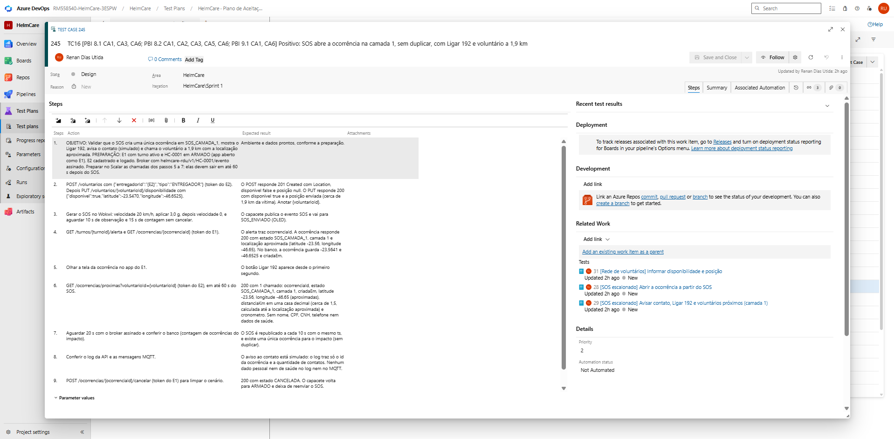

- **Test Case no Azure:** ID 245, Feature F08. **Referência:** PBI 8.1 CA1, CA3, CA6; PBI 8.2 CA1, CA2, CA3, CA5, CA6; PBI 9.1 CA1, CA6
- **Objetivo:** Validar que o SOS cria uma única ocorrência em SOS_CAMADA_1, mostra o Ligar 192, avisa o contato (simulado) e chama o voluntário a 1,9 km com a localização aproximada.
- **Preparação:** E1 com turno ativo e HC-0001 em ARMADO (app aberto como E1). E2 cadastrado e logado. Broker com helmcare-rdu/v1/HC-0001/evento assinado. Preparar no Scalar as chamadas dos passos 5 a 7: elas devem sair em até 60 s depois do SOS.

| Passo | Ação e entradas | Resultado esperado |
|---|---|---|
| 1 | POST /voluntarios com {"entregadorId":"{E2}","tipo":"ENTREGADOR"} (token do E2). Depois PUT /voluntarios/{voluntarioId}/disponibilidade com {"disponivel":true,"latitude":-23.5470,"longitude":-46.6525}. | O POST responde 201 Created com Location, disponivel false e posição null. O PUT responde 200 com disponivel true e a posição enviada (cerca de 1,9 km da vítima). Anotar {voluntarioId}. |
| 2 | Gerar o SOS no Wokwi: velocidade 20 km/h, aplicar 3,0 g, depois velocidade 0, e aguardar 10 s de observação e 15 s de contagem sem cancelar. | O capacete publica o evento SOS e vai para SOS_ENVIADO (OLED). |
| 3 | GET /turnos/{turnoId}/alerta e GET /ocorrencias/{ocorrenciaId} (token do E1). | O alerta traz ocorrenciaId. A ocorrência responde 200 com estado SOS_CAMADA_1, camada 1 e localização aproximada (latitude -23.56, longitude -46.65). No banco, a ocorrência guarda -23.5641 e -46.6525 e criadaEm. |
| 4 | Olhar a tela da ocorrência no app do E1. | O botão Ligar 192 aparece desde o primeiro segundo. |
| 5 | GET /ocorrencias/proximas?voluntarioId={voluntarioId} (token do E2), em até 60 s do SOS. | 200 com 1 chamado: ocorrenciaId, estado SOS_CAMADA_1, camada 1, criadaEm, latitude -23.56, longitude -46.65 (aproximadas), distanciaKm em uma casa decimal (cerca de 1,5, calculada até a localização aproximada) e cronometro. Sem nome, CPF, CNH, telefone nem dados de saúde. |
| 6 | Aguardar 20 s com o broker assinado e conferir o banco (contagem de ocorrências do impacto). | O SOS é republicado a cada 10 s com o mesmo ts, e existe uma única ocorrência para o impacto (sem duplicar). |
| 7 | Conferir o log da API e as mensagens MQTT. | O aviso ao contato está simulado: o log traz só o id da ocorrência e a quantidade de contatos. Nenhum dado pessoal nem de saúde no log nem no MQTT. |
| 8 | POST /ocorrencias/{ocorrenciaId}/cancelar (token do E1) para limpar o cenário. | 200 com estado CANCELADA. O capacete volta para ARMADO e deixa de reenviar o SOS. |

### TC17 Negativo: Voluntário a 2,1 km, indisponível ou fora do raio não vê nem aceita o chamado da camada 1

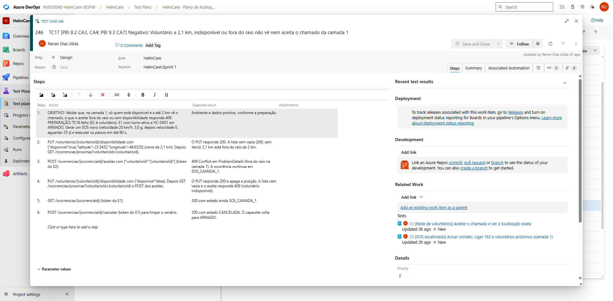

- **Test Case no Azure:** ID 246, Feature F08. **Referência:** PBI 8.2 CA3, CA4; PBI 9.3 CA7
- **Objetivo:** Validar que, na camada 1, só quem está disponível e a até 2 km vê o chamado, e que o aceite fora do raio ou sem disponibilidade responde 409.
- **Preparação:** TC16 feito (E2 é voluntário). E1 com turno ativo e HC-0001 em ARMADO. Gerar um SOS novo (velocidade 20 km/h, 3,0 g, depois velocidade 0, aguardar 25 s) e executar os passos em até 60 s.

| Passo | Ação e entradas | Resultado esperado |
|---|---|---|
| 1 | PUT /voluntarios/{voluntarioId}/disponibilidade com {"disponivel":true,"latitude":-23.5452,"longitude":-46.6525} (cerca de 2,1 km). Depois GET /ocorrencias/proximas?voluntarioId={voluntarioId}. | O PUT responde 200. A lista vem vazia (200, sem itens): 2,1 km está fora do raio de 2 km. |
| 2 | POST /ocorrencias/{ocorrenciaId}/aceites com {"voluntarioId":"{voluntarioId}"} (token do E2). | 409 Conflict em ProblemDetails (fora do raio na camada 1). A ocorrência continua em SOS_CAMADA_1. |
| 3 | PUT /voluntarios/{voluntarioId}/disponibilidade com {"disponivel":false}. Depois GET /ocorrencias/proximas?voluntarioId={voluntarioId} e POST dos aceites. | O PUT responde 200 e apaga a posição. A lista vem vazia e o aceite responde 409 (voluntário indisponível). |
| 4 | GET /ocorrencias/{ocorrenciaId} (token do E1). | 200 com estado ainda SOS_CAMADA_1. |
| 5 | POST /ocorrencias/{ocorrenciaId}/cancelar (token do E1) para limpar o cenário. | 200 com estado CANCELADA. O capacete volta para ARMADO. |

### TC18 Positivo: Sem aceite em 60 s, a ocorrência escala para a camada 2 e chega a voluntário a 5 km

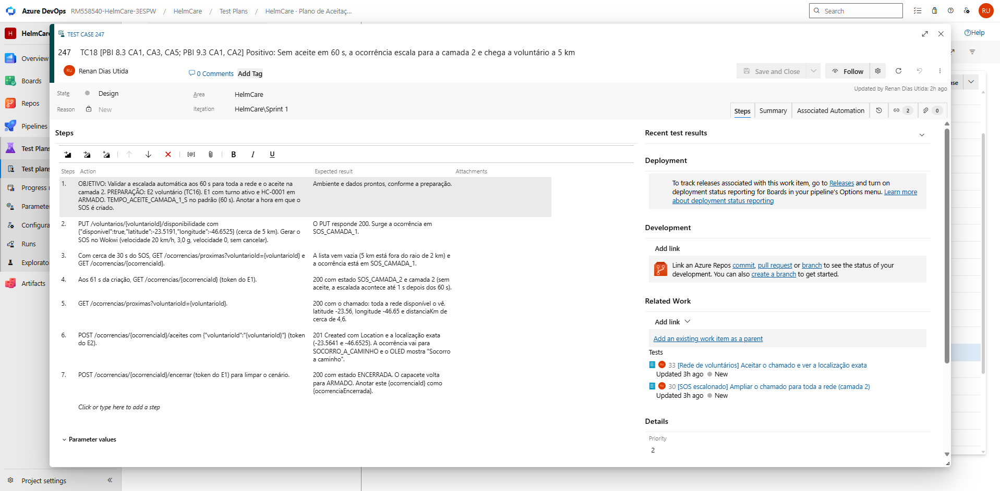

- **Test Case no Azure:** ID 247, Feature F08. **Referência:** PBI 8.3 CA1, CA3, CA5; PBI 9.3 CA1, CA2
- **Objetivo:** Validar a escalada automática aos 60 s para toda a rede e o aceite na camada 2.
- **Preparação:** E2 voluntário (TC16). E1 com turno ativo e HC-0001 em ARMADO. TEMPO_ACEITE_CAMADA_1_S no padrão (60 s). Anotar a hora em que o SOS é criado.

| Passo | Ação e entradas | Resultado esperado |
|---|---|---|
| 1 | PUT /voluntarios/{voluntarioId}/disponibilidade com {"disponivel":true,"latitude":-23.5191,"longitude":-46.6525} (cerca de 5 km). Gerar o SOS no Wokwi (velocidade 20 km/h, 3,0 g, velocidade 0, sem cancelar). | O PUT responde 200. Surge a ocorrência em SOS_CAMADA_1. |
| 2 | Com cerca de 30 s do SOS, GET /ocorrencias/proximas?voluntarioId={voluntarioId} e GET /ocorrencias/{ocorrenciaId}. | A lista vem vazia (5 km está fora do raio de 2 km) e a ocorrência está em SOS_CAMADA_1. |
| 3 | Aos 61 s da criação, GET /ocorrencias/{ocorrenciaId} (token do E1). | 200 com estado SOS_CAMADA_2 e camada 2 (sem aceite, a escalada acontece até 1 s depois dos 60 s). |
| 4 | GET /ocorrencias/proximas?voluntarioId={voluntarioId}. | 200 com o chamado: toda a rede disponível o vê. latitude -23.56, longitude -46.65 e distanciaKm de cerca de 4,6. |
| 5 | POST /ocorrencias/{ocorrenciaId}/aceites com {"voluntarioId":"{voluntarioId}"} (token do E2). | 201 Created com Location e a localização exata (-23.5641 e -46.6525). A ocorrência vai para SOCORRO_A_CAMINHO e o OLED mostra "Socorro a caminho". |
| 6 | POST /ocorrencias/{ocorrenciaId}/encerrar (token do E1) para limpar o cenário. | 200 com estado ENCERRADA. O capacete volta para ARMADO. Anotar este {ocorrenciaId} como {ocorrenciaEncerrada}. |

### TC19 Positivo: Voluntário vê o chamado aproximado, aceita e recebe a localização exata

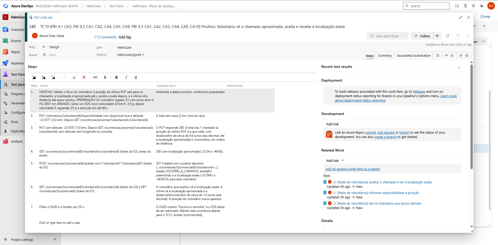

- **Test Case no Azure:** ID 248, Feature F09. **Referência:** PBI 9.1 CA3; PBI 9.2 CA1, CA2, CA4, CA5, CA9; PBI 9.3 CA1, CA2, CA3, CA4, CA9, CA10
- **Objetivo:** Validar o fluxo do voluntário: a posição do último PUT vale para os chamados, a localização é aproximada até o aceite e exata depois, e a vítima vê a distância até quem aceitou.
- **Preparação:** E2 voluntário logado. E1 com turno ativo e HC-0001 em ARMADO. Gerar um SOS novo (velocidade 20 km/h, 3,0 g, depois velocidade 0, aguardar 25 s) e executar em até 60 s.

| Passo | Ação e entradas | Resultado esperado |
|---|---|---|
| 1 | PUT /voluntarios/{voluntarioId}/disponibilidade com disponivel true e latitude -23.5371 (3,0 km). Depois GET /ocorrencias/proximas?voluntarioId={voluntarioId}. | A lista vem vazia (3 km, fora do raio). |
| 2 | PUT com latitude -23.5551 (1,0 km). Depois GET /ocorrencias/proximas?voluntarioId={voluntarioId}, sem latitude nem longitude na consulta. | O PUT responde 200. A lista traz 1 chamado (a posição do último PUT é a que vale), com distanciaKm de cerca de 0,6 (uma casa decimal, até a localização aproximada) e cronometro, em ordem de distância. |
| 3 | GET /ocorrencias/{ocorrenciaId}?voluntarioId={voluntarioId} (token do E2), antes do aceite. | 200 com localização aproximada (-23.56 e -46.65). |
| 4 | POST /ocorrencias/{ocorrenciaId}/aceites com {"voluntarioId":"{voluntarioId}"} (token do E2). | 201 Created com Location absoluto (.../ocorrencias/{ocorrenciaId}?voluntarioId=...), estado SOCORRO_A_CAMINHO, aceitaEm preenchido e a localização exata (-23.5641 e -46.6525) para este voluntário. |
| 5 | GET /ocorrencias/{ocorrenciaId}?voluntarioId={voluntarioId} (token do E2) e GET /ocorrencias/{ocorrenciaId} (token do E1). | O voluntário que aceitou vê a localização exata. A vítima vê a localização aproximada e a distanciaVoluntarioKm de cerca de 1,0 (uma casa decimal). A posição do voluntário nunca aparece. |
| 6 | Olhar o OLED e o broker por 20 s. | O OLED mostra "Socorro a caminho" e o SOS deixa de ser reenviado. Manter esta ocorrência aberta para o TC21. Anotar {ocorrenciaId}. |

### TC20 Negativo: Chamados sem voluntarioId, voluntário inexistente e aceite de ocorrência encerrada

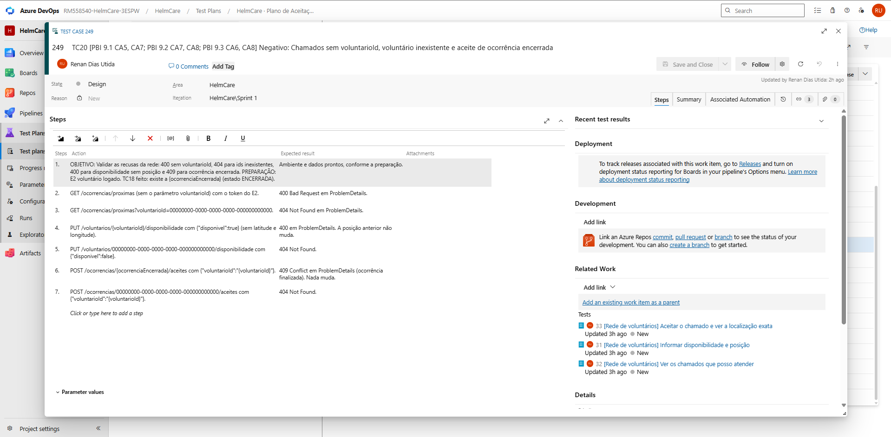

- **Test Case no Azure:** ID 249, Feature F09. **Referência:** PBI 9.1 CA5, CA7; PBI 9.2 CA7, CA8; PBI 9.3 CA6, CA8
- **Objetivo:** Validar as recusas da rede: 400 sem voluntarioId, 404 para ids inexistentes, 400 para disponibilidade sem posição e 409 para ocorrência encerrada.
- **Preparação:** E2 voluntário logado. TC18 feito: existe a {ocorrenciaEncerrada} (estado ENCERRADA).

| Passo | Ação e entradas | Resultado esperado |
|---|---|---|
| 1 | GET /ocorrencias/proximas (sem o parâmetro voluntarioId) com o token do E2. | 400 Bad Request em ProblemDetails. |
| 2 | GET /ocorrencias/proximas?voluntarioId=00000000-0000-0000-0000-000000000000. | 404 Not Found em ProblemDetails. |
| 3 | PUT /voluntarios/{voluntarioId}/disponibilidade com {"disponivel":true} (sem latitude e longitude). | 400 em ProblemDetails. A posição anterior não muda. |
| 4 | PUT /voluntarios/00000000-0000-0000-0000-000000000000/disponibilidade com {"disponivel":false}. | 404 Not Found. |
| 5 | POST /ocorrencias/{ocorrenciaEncerrada}/aceites com {"voluntarioId":"{voluntarioId}"}. | 409 Conflict em ProblemDetails (ocorrência finalizada). Nada muda. |
| 6 | POST /ocorrencias/00000000-0000-0000-0000-000000000000/aceites com {"voluntarioId":"{voluntarioId}"}. | 404 Not Found. |

### TC21 Positivo: Tempo até o aceite dentro da meta de 2 min, encerramento da ocorrência e do turno

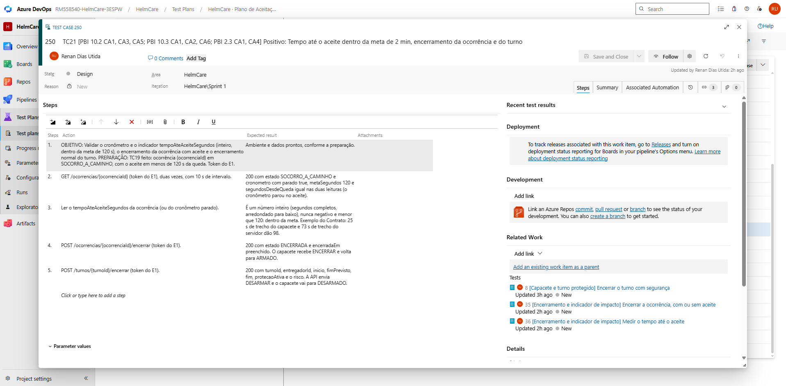

- **Test Case no Azure:** ID 250, Feature F10. **Referência:** PBI 10.2 CA1, CA3, CA5; PBI 10.3 CA1, CA2, CA6; PBI 2.3 CA1, CA4
- **Objetivo:** Validar o cronômetro e o indicador tempoAteAceiteSegundos (inteiro, dentro da meta de 120 s), o encerramento da ocorrência com aceite e o encerramento normal do turno.
- **Preparação:** TC19 feito: ocorrência {ocorrenciaId} em SOCORRO_A_CAMINHO, com o aceite em menos de 120 s da queda. Token do E1.

| Passo | Ação e entradas | Resultado esperado |
|---|---|---|
| 1 | GET /ocorrencias/{ocorrenciaId} (token do E1), duas vezes, com 10 s de intervalo. | 200 com estado SOCORRO_A_CAMINHO e cronometro com parado true, metaSegundos 120 e segundosDesdeQueda igual nas duas leituras (o cronômetro parou no aceite). |
| 2 | Ler o tempoAteAceiteSegundos da ocorrência (ou do cronômetro parado). | É um número inteiro (segundos completos, arredondado para baixo), nunca negativo e menor que 120: dentro da meta. Exemplo do Contrato: 25 s de trecho do capacete e 73 s de trecho do servidor dão 98. |
| 3 | POST /ocorrencias/{ocorrenciaId}/encerrar (token do E1). | 200 com estado ENCERRADA e encerradaEm preenchido. O capacete recebe ENCERRAR e volta para ARMADO. |
| 4 | POST /turnos/{turnoId}/encerrar (token do E1). | 200 com turnoId, entregadorId, inicio, fimPrevisto, fim, protecaoAtiva e o risco. A API envia DESARMAR e o capacete vai para DESARMADO. |

### TC22 Negativo: Estou bem, e estados finais recusam nova ação

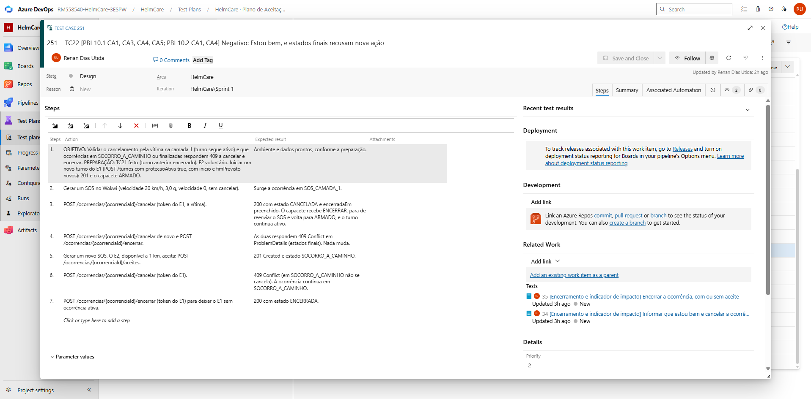

- **Test Case no Azure:** ID 251, Feature F10. **Referência:** PBI 10.1 CA1, CA3, CA4, CA5; PBI 10.2 CA1, CA4
- **Objetivo:** Validar o cancelamento pela vítima na camada 1 (turno segue ativo) e que ocorrências em SOCORRO_A_CAMINHO ou finalizadas respondem 409 a cancelar e encerrar.
- **Preparação:** TC21 feito (turno anterior encerrado). E2 voluntário. Iniciar um novo turno do E1 (POST /turnos com protecaoAtiva true, com inicio e fimPrevisto novos): 201 e o capacete ARMADO.

| Passo | Ação e entradas | Resultado esperado |
|---|---|---|
| 1 | Gerar um SOS no Wokwi (velocidade 20 km/h, 3,0 g, velocidade 0, sem cancelar). | Surge a ocorrência em SOS_CAMADA_1. |
| 2 | POST /ocorrencias/{ocorrenciaId}/cancelar (token do E1, a vítima). | 200 com estado CANCELADA e encerradaEm preenchido. O capacete recebe ENCERRAR, para de reenviar o SOS e volta para ARMADO, e o turno continua ativo. |
| 3 | POST /ocorrencias/{ocorrenciaId}/cancelar de novo e POST /ocorrencias/{ocorrenciaId}/encerrar. | As duas respondem 409 Conflict em ProblemDetails (estados finais). Nada muda. |
| 4 | Gerar um novo SOS. O E2, disponível a 1 km, aceita: POST /ocorrencias/{ocorrenciaId}/aceites. | 201 Created e estado SOCORRO_A_CAMINHO. |
| 5 | POST /ocorrencias/{ocorrenciaId}/cancelar (token do E1). | 409 Conflict (em SOCORRO_A_CAMINHO não se cancela). A ocorrência continua em SOCORRO_A_CAMINHO. |
| 6 | POST /ocorrencias/{ocorrenciaId}/encerrar (token do E1) para deixar o E1 sem ocorrência ativa. | 200 com estado ENCERRADA. |

### TC23 Positivo: Ficha protegida sem emergência e ficha mínima ao socorrista verificado durante o SOS

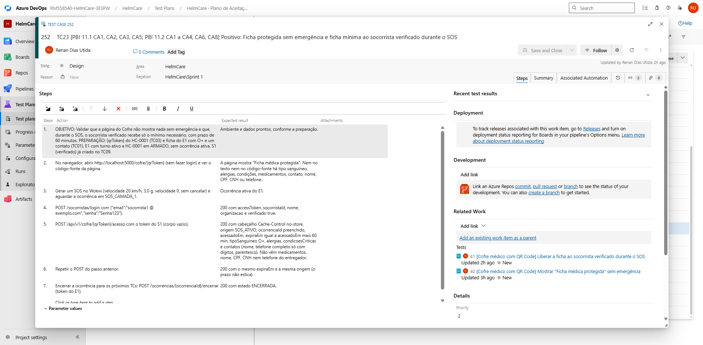

- **Test Case no Azure:** ID 252, Feature F11. **Referência:** PBI 11.1 CA1, CA2, CA3, CA5; PBI 11.2 CA1 a CA4, CA6, CA8
- **Objetivo:** Validar que a página do Cofre não mostra nada sem emergência e que, durante o SOS, o socorrista verificado recebe só o mínimo necessário, com prazo de 60 minutos.
- **Preparação:** {qrToken} do HC-0001 (TC03) e ficha do E1 com O+ e um contato (TC01). E1 com turno ativo e HC-0001 em ARMADO, sem ocorrência ativa. S1 (verificado) já criado no TC09.

| Passo | Ação e entradas | Resultado esperado |
|---|---|---|
| 1 | No navegador, abrir http://localhost:5000/cofre/{qrToken} (sem fazer login) e ver o código-fonte da página. | A página mostra "Ficha médica protegida". Nem no texto nem no código-fonte há tipo sanguíneo, alergias, condições, medicamentos, contato, nome, CPF, CNH ou telefone. |
| 2 | Gerar um SOS no Wokwi (velocidade 20 km/h, 3,0 g, velocidade 0, sem cancelar) e aguardar a ocorrência em SOS_CAMADA_1. | Ocorrência ativa do E1. |
| 3 | POST /socorristas/login com {"email":"socorrista1@exemplo.com","senha":"Senha123"}. | 200 com accessToken, socorristaId, nome, organizacao e verificado true. |
| 4 | POST /api/v1/cofre/{qrToken}/acesso com o token do S1 (corpo vazio). | 200 com cabeçalho Cache-Control no-store, origem SOS_ATIVO, ocorrenciaId preenchido, acessadoEm, expiraEm igual a acessadoEm mais 60 min, tipoSanguineo O+, alergias, condicoesCriticas e contatos (nome, telefone completo só com dígitos, parentesco). Não vêm medicamentos, nome, CPF, CNH nem telefone do entregador. |
| 5 | Repetir o POST do passo anterior. | 200 com o mesmo expiraEm e a mesma origem (o prazo não estica). |
| 6 | Encerrar a ocorrência para os próximos TCs: POST /ocorrencias/{ocorrenciaId}/encerrar (token do E1). | 200 com estado ENCERRADA. |

### TC24 Positivo: Emergência manual quando o SOS não foi enviado

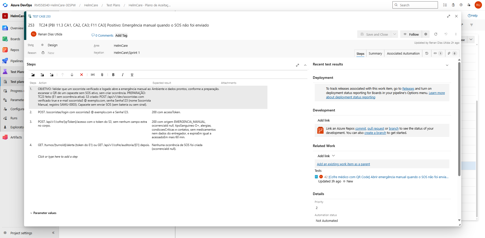

- **Test Case no Azure:** ID 253, Feature F11. **Referência:** PBI 11.3 CA1, CA2, CA3; F11 CA3
- **Objetivo:** Validar que um socorrista verificado e logado abre a emergência manual ao escanear o QR de um capacete sem SOS ativo, sem criar ocorrência.
- **Preparação:** TC23 feito (E1 sem ocorrência ativa). S3 criado: POST /api/v1/dev/socorristas com verificado true e e-mail socorrista3@exemplo.com, senha Senha123 (nome Socorrista Manual, registro SAMU-0003). Capacete sem enviar SOS (sem bateria ou sem sinal).

| Passo | Ação e entradas | Resultado esperado |
|---|---|---|
| 1 | POST /socorristas/login com socorrista3@exemplo.com e Senha123. | 200 com accessToken. |
| 2 | POST /api/v1/cofre/{qrToken}/acesso com o token do S3, sem nenhum campo extra no corpo. | 200 com origem EMERGENCIA_MANUAL, ocorrenciaId null, tipoSanguineo O+, alergias, condicoesCriticas e contatos, sem medicamentos nem dados do entregador, e expiraEm igual a acessadoEm mais 60 min. |
| 3 | GET /turnos/{turnoId}/alerta (token do E1) ou GET /api/v1/cofre/auditoria/{E1} depois. | Nenhuma ocorrência de SOS foi criada (ocorrenciaId null). |

### TC25 Negativo: Acesso negado: sem login, não verificado, QR inexistente e janela fechada

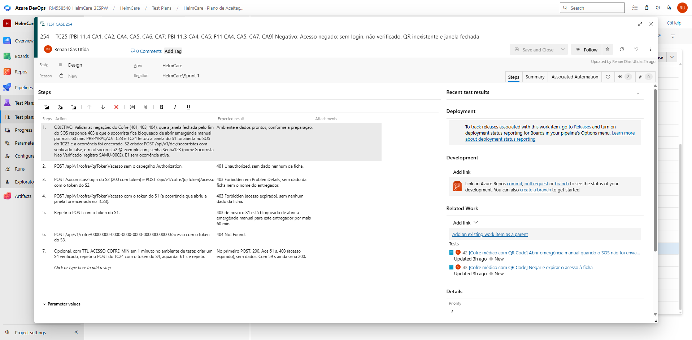

- **Test Case no Azure:** ID 254, Feature F11. **Referência:** PBI 11.4 CA1, CA2, CA4, CA5, CA6, CA7; PBI 11.3 CA4, CA5; F11 CA4, CA5, CA7, CA9
- **Objetivo:** Validar as negações do Cofre (401, 403, 404), que a janela fechada pelo fim do SOS responde 403 e que o socorrista fica bloqueado de abrir emergência manual por mais 60 min.
- **Preparação:** TC23 e TC24 feitos: a janela do S1 foi aberta no SOS do TC23 e a ocorrência foi encerrada. S2 criado: POST /api/v1/dev/socorristas com verificado false, e-mail socorrista2@exemplo.com, senha Senha123 (nome Socorrista Nao Verificado, registro SAMU-0002). E1 sem ocorrência ativa.

| Passo | Ação e entradas | Resultado esperado |
|---|---|---|
| 1 | POST /api/v1/cofre/{qrToken}/acesso sem o cabeçalho Authorization. | 401 Unauthorized, sem dado nenhum da ficha. |
| 2 | POST /socorristas/login do S2 (200 com token) e POST /api/v1/cofre/{qrToken}/acesso com o token do S2. | 403 Forbidden em ProblemDetails, sem dado da ficha nem o nome do entregador. |
| 3 | POST /api/v1/cofre/{qrToken}/acesso com o token do S1 (a ocorrência que abriu a janela foi encerrada no TC23). | 403 Forbidden (acesso expirado), sem nenhum dado da ficha. |
| 4 | Repetir o POST com o token do S1. | 403 de novo: o S1 está bloqueado de abrir a emergência manual para este entregador por mais 60 min. |
| 5 | POST /api/v1/cofre/00000000-0000-0000-0000-000000000000/acesso com o token do S3. | 404 Not Found. |
| 6 | Opcional, com TTL_ACESSO_COFRE_MIN em 1 minuto no ambiente de teste: criar um S4 verificado, repetir o POST do TC24 com o token do S4, aguardar 61 s e repetir. | No primeiro POST, 200. Aos 61 s, 403 (acesso expirado), sem dados. Com 59 s ainda seria 200. |

### TC26 Positivo: Auditoria registra e lista os acessos concedidos e negados, sem ip e sem saúde

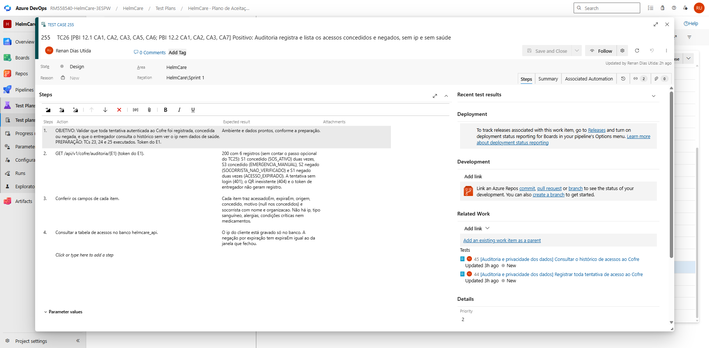

- **Test Case no Azure:** ID 255, Feature F12. **Referência:** PBI 12.1 CA1, CA2, CA3, CA5, CA6; PBI 12.2 CA1, CA2, CA3, CA7
- **Objetivo:** Validar que toda tentativa autenticada ao Cofre foi registrada, concedida ou negada, e que o entregador consulta o histórico sem ver o ip nem dados de saúde.
- **Preparação:** TCs 23, 24 e 25 executados. Token do E1.

| Passo | Ação e entradas | Resultado esperado |
|---|---|---|
| 1 | GET /api/v1/cofre/auditoria/{E1} (token do E1). | 200 com 6 registros (sem contar o passo opcional do TC25): S1 concedido (SOS_ATIVO) duas vezes, S3 concedido (EMERGENCIA_MANUAL), S2 negado (SOCORRISTA_NAO_VERIFICADO) e S1 negado duas vezes (ACESSO_EXPIRADO). A tentativa sem login (401), o QR inexistente (404) e o token de entregador não geram registro. |
| 2 | Conferir os campos de cada item. | Cada item traz acessadoEm, expiraEm, origem, concedido, motivo (null nos concedidos) e socorrista com nome e organizacao. Não há ip, tipo sanguíneo, alergias, condições críticas nem medicamentos. |
| 3 | Consultar a tabela de acessos no banco helmcare_api. | O ip do cliente está gravado só no banco. A negação por expiração tem expiraEm igual ao da janela que fechou. |

### TC27 Negativo: Auditoria só do próprio entregador: 401, 403 e 404

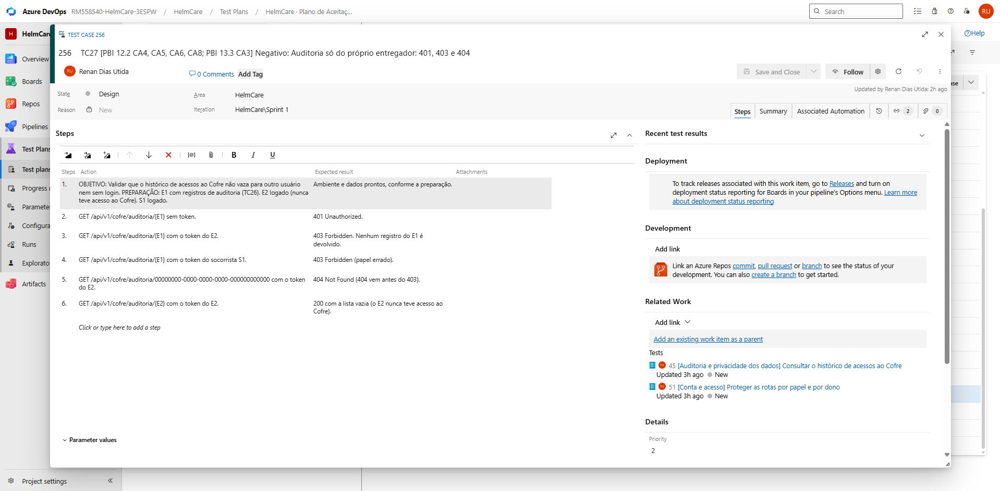

- **Test Case no Azure:** ID 256, Feature F12. **Referência:** PBI 12.2 CA4, CA5, CA6, CA8; PBI 13.3 CA3
- **Objetivo:** Validar que o histórico de acessos ao Cofre não vaza para outro usuário nem sem login.
- **Preparação:** E1 com registros de auditoria (TC26). E2 logado (nunca teve acesso ao Cofre). S1 logado.

| Passo | Ação e entradas | Resultado esperado |
|---|---|---|
| 1 | GET /api/v1/cofre/auditoria/{E1} sem token. | 401 Unauthorized. |
| 2 | GET /api/v1/cofre/auditoria/{E1} com o token do E2. | 403 Forbidden. Nenhum registro do E1 é devolvido. |
| 3 | GET /api/v1/cofre/auditoria/{E1} com o token do socorrista S1. | 403 Forbidden (papel errado). |
| 4 | GET /api/v1/cofre/auditoria/00000000-0000-0000-0000-000000000000 com o token do E2. | 404 Not Found (404 vem antes do 403). |
| 5 | GET /api/v1/cofre/auditoria/{E2} com o token do E2. | 200 com a lista vazia (o E2 nunca teve acesso ao Cofre). |

### TC28 Positivo: Login do entregador e do socorrista, sessão e renovação do token

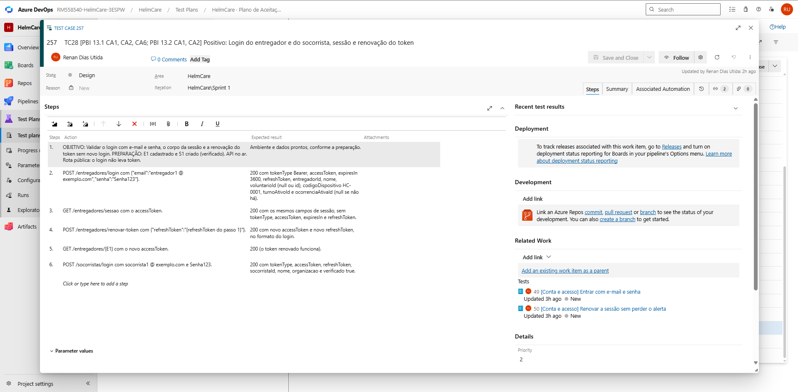

- **Test Case no Azure:** ID 257, Feature F13. **Referência:** PBI 13.1 CA1, CA2, CA6; PBI 13.2 CA1, CA2
- **Objetivo:** Validar o login com e-mail e senha, o corpo da sessão e a renovação do token sem novo login.
- **Preparação:** E1 cadastrado e S1 criado (verificado). API no ar. Rota pública: o login não leva token.

| Passo | Ação e entradas | Resultado esperado |
|---|---|---|
| 1 | POST /entregadores/login com {"email":"entregador1@exemplo.com","senha":"Senha123"}. | 200 com tokenType Bearer, accessToken, expiresIn 3600, refreshToken, entregadorId, nome, voluntarioId (null ou id), codigoDispositivo HC-0001, turnoAtivoId e ocorrenciaAtivaId (null se não há). |
| 2 | GET /entregadores/sessao com o accessToken. | 200 com os mesmos campos de sessão, sem tokenType, accessToken, expiresIn e refreshToken. |
| 3 | POST /entregadores/renovar-token com {"refreshToken":"{refreshToken do passo 1}"}. | 200 com novo accessToken e novo refreshToken, no formato do login. |
| 4 | GET /entregadores/{E1} com o novo accessToken. | 200 (o token renovado funciona). |
| 5 | POST /socorristas/login com socorrista1@exemplo.com e Senha123. | 200 com tokenType, accessToken, refreshToken, socorristaId, nome, organizacao e verificado true. |

### TC29 Negativo: Credenciais inválidas, bloqueio após 5 erros, 429 e refresh inválido

- **Test Case no Azure:** ID 258, Feature F13. **Referência:** PBI 13.1 CA3, CA4, CA5; PBI 13.2 CA3, CA5
- **Objetivo:** Validar que o login recusa credenciais erradas sem revelar o e-mail, bloqueia a conta após 5 senhas erradas por 15 min, limita 10 logins por minuto por IP e recusa refresh inválido.
- **Preparação:** Criar o E3 (POST /entregadores com os dados do E3) para não bloquear o E1. S1 existe. Ter um script ou o Postman Runner para enviar 11 logins em menos de 1 minuto.

| Passo | Ação e entradas | Resultado esperado |
|---|---|---|
| 1 | POST /entregadores/login do E3 com a senha Errada123 e, em outra chamada, com o e-mail inexistente nada@exemplo.com. | As duas respondem 401 em ProblemDetails, com o mesmo texto e sem token (não revela se o e-mail existe). |
| 2 | POST /entregadores/login com o e-mail do socorrista (socorrista1@exemplo.com) e a senha certa. | 401 com o mesmo texto e sem token (conta de outro papel). |
| 3 | Errar a senha do E3 até completar 5 tentativas erradas. Na sexta, enviar a senha CERTA (Senha123). | 401 mesmo com a senha certa, com o mesmo texto: conta bloqueada por 15 min. |
| 4 | POST /entregadores/renovar-token com {"refreshToken":"abc"} e, em outra chamada, com um refreshToken de socorrista. | As duas respondem 401 e nenhum token novo é devolvido. |
| 5 | Esperar 60 s sem logins. Enviar 11 POST /entregadores/login seguidos em menos de 1 minuto (do E1, com a senha certa). | Os 10 primeiros respondem 200 e o 11º responde 429 Too Many Requests. |

### TC30 Negativo: Rotas protegidas por papel e por dono: 401, 403 e 404, e rotas públicas abertas

- **Test Case no Azure:** ID 259, Feature F13. **Referência:** PBI 13.3 CA1, CA2, CA3, CA4, CA5, CA6
- **Objetivo:** Validar que sem token a API responde 401, com recurso de outro usuário ou papel errado responde 403, com id inexistente 404, e que as rotas públicas funcionam sem token.
- **Preparação:** E1 (com turno {turnoId}), E2 e S1 logados, com os tokens à mão. {qrToken} do HC-0001.

| Passo | Ação e entradas | Resultado esperado |
|---|---|---|
| 1 | GET /entregadores/{E1} sem token e, em outra chamada, com o token abc. | As duas respondem 401 Unauthorized. |
| 2 | GET /entregadores/{E1} e GET /entregadores/{E1}/ficha-medica com o token do E2. | As duas respondem 403 Forbidden, sem dados. |
| 3 | GET /entregadores/00000000-0000-0000-0000-000000000000 com o token do E2. | 404 Not Found (a ordem é 401, 404 e 403). |
| 4 | GET /entregadores/{E1} com o token do socorrista S1. | 403 Forbidden (papel errado). |
| 5 | POST /api/v1/cofre/{qrToken}/acesso com o token do entregador E2. | 403 Forbidden (token de entregador no Cofre). |
| 6 | POST /turnos com {"entregadorId":"{E1}",...} usando o token do E2. | 403 Forbidden (o entregadorId do corpo precisa ser o do token). Nenhum turno é criado. |
| 7 | Sem token: GET /saude, GET /trechos-criticos?limite=1 e POST /entregadores com dados novos e válidos. | Respondem 200, 200 e 201: as rotas públicas funcionam sem token. |

## 7. Cobertura e rastreabilidade {#cobertura .pagina}

### Cobertura por Feature

| Feature | ID no Azure | Test Cases | Positivos | Negativos |
|---|---|---|---|---|
| F01 Cadastro do entregador | 2 | 2 | TC01 | TC02 |
| F02 Capacete e turno protegido | 3 | 2 | TC03 | TC04 |
| F03 Índice de Risco do Turno | 10 | 2 | TC05 | TC06 |
| F04 Alerta de calor | 11 | 3 | TC07, TC09 | TC08 |
| F05 Trechos críticos | 12 | 2 | TC10 | TC11 |
| F06 Detecção inteligente de queda | 19 | 2 | TC12 | TC13 |
| F07 Observação e cancelamento | 20 | 2 | TC14 | TC15 |
| F08 SOS escalonado | 21 | 3 | TC16, TC18 | TC17 |
| F09 Rede de voluntários | 22 | 2 | TC19 | TC20 |
| F10 Encerramento e indicador de impacto | 23 | 2 | TC21 | TC22 |
| F11 Cofre médico com QR Code | 38 | 3 | TC23, TC24 | TC25 |
| F12 Auditoria e privacidade dos dados | 39 | 2 | TC26 | TC27 |
| F13 Conta e acesso | 48 | 3 | TC28 | TC29, TC30 |
| **Total** | | **30** | **15** | **15** |

### Rastreabilidade PBI para Test Case

Cada linha é uma suite requirement-based da pasta "Por PBI (rastreabilidade)". No total são 61 vínculos Tested By.

| PBI | ID no Azure | Test Cases | Vínculos |
|---|---|---|---|
| PBI 1.1 | 4 | TC01, TC02 | 2 |
| PBI 1.2 | 5 | TC01, TC02 | 2 |
| PBI 2.1 | 6 | TC03 | 1 |
| PBI 2.2 | 7 | TC03, TC04 | 2 |
| PBI 2.3 | 8 | TC04, TC21 | 2 |
| PBI 3.1 | 13 | TC05 | 1 |
| PBI 3.2 | 14 | TC05, TC06 | 2 |
| PBI 4.1 | 15 | TC07, TC08 | 2 |
| PBI 4.2 | 16 | TC07, TC08, TC09 | 3 |
| PBI 5.1 | 17 | TC10, TC11 | 2 |
| PBI 6.1 | 24 | TC12, TC13 | 2 |
| PBI 6.2 | 25 | TC12, TC13 | 2 |
| PBI 7.1 | 26 | TC14, TC15 | 2 |
| PBI 7.2 | 27 | TC14, TC15 | 2 |
| PBI 8.1 | 28 | TC16 | 1 |
| PBI 8.2 | 29 | TC16, TC17 | 2 |
| PBI 8.3 | 30 | TC18 | 1 |
| PBI 9.1 | 31 | TC16, TC19, TC20 | 3 |
| PBI 9.2 | 32 | TC19, TC20 | 2 |
| PBI 9.3 | 33 | TC17, TC18, TC19, TC20 | 4 |
| PBI 10.1 | 34 | TC22 | 1 |
| PBI 10.2 | 35 | TC21, TC22 | 2 |
| PBI 10.3 | 36 | TC21 | 1 |
| PBI 11.1 | 40 | TC23 | 1 |
| PBI 11.2 | 41 | TC23 | 1 |
| PBI 11.3 | 42 | TC24, TC25 | 2 |
| PBI 11.4 | 43 | TC25 | 1 |
| PBI 12.1 | 44 | TC26 | 1 |
| PBI 12.2 | 45 | TC26, TC27 | 2 |
| PBI 12.3 | 46 | TC01 | 1 |
| PBI 13.1 | 49 | TC28, TC29 | 2 |
| PBI 13.2 | 50 | TC28, TC29 | 2 |
| PBI 13.3 | 51 | TC06, TC09, TC27, TC30 | 4 |
| **Total** | | | **61** |

### Evidências da rastreabilidade

O vínculo Tested By aparece no próprio PBI: o PBI 1.1 (ID 4) é testado pelo TC01 e pelo TC02, e o PBI 9.3 (ID 33) pelos TC17, TC18, TC19 e TC20. Na pasta "Por PBI (rastreabilidade)", a suite requirement-based do PBI 9.3 (ID 33) aparece aberta com esses mesmos quatro Test Cases, e a visão geral mostra as 33 suites, cada uma com a quantidade de Test Cases entre parênteses. A aba Chart da suite estática resume o estado dos 30 Test Cases e o responsável por eles.

## 8. Limites assumidos {#limites}

Os 30 Test Cases estão definidos no Azure Test Plans e permanecem no estado Not run, pois a entrega pede a definição dos casos de teste e não a sua execução.

## 9. Pitch, links e uso de IA {#pitch}

| Item | Link |
|---|---|
| Pitch (YouTube) | {{LINK_PITCH}} |
| Azure DevOps | <https://dev.azure.com/RM558540-HelmCare-3ESPW/HelmCare> |
| Repositório | <https://github.com/renan-utida/helmcare> |
| Pasta docs/ | <https://github.com/renan-utida/helmcare/tree/main/docs> |
| Test Cases em texto | [test-cases/test-cases-leitura.md](test-cases/test-cases-leitura.md) |
| Prints deste relatório | [evidencias/](evidencias/) |
| Uso de IA generativa | [prompts.md](../prompts.md), na raiz do repositório, com a data, o objetivo e o prompt resumido de cada uso |
