# HelmCare: módulo do capacete

> **Do risco ao resgate, cuidado em cada corrida.**
> Circuito com ESP32 no Wokwi que detecta a queda do entregador de moto e dispara o SOS do HelmCare por MQTT.

| | |
|---|---|
| **Integrante** | Renan Dias Utida |
| **RM** | 558540 |
| **Turma** | 3ESPW |
| **Curso** | Engenharia de Software, FIAP Paulista |
| **Disciplina** | Physical Computing: IoT & IoB |
| **Professor** | Yan Gabriel Coelho |
| **Global Solution** | 2026.2, CitizenTech |
| **Projeto no Wokwi** | https://wokwi.com/projects/480131497227238401 |

---

## Sumário

1. [Visão geral](#1-visão-geral)
2. [Onde o capacete entra no HelmCare](#2-onde-o-capacete-entra-no-helmcare)
3. [Circuito](#3-circuito)
4. [Sinais do capacete (LED, buzzer e OLED)](#4-sinais-do-capacete-led-buzzer-e-oled)
5. [Arquivos e bibliotecas](#5-arquivos-e-bibliotecas)
6. [Como rodar](#6-como-rodar)
7. [Máquina de estados](#7-máquina-de-estados)
8. [MQTT: tópicos, payloads e comandos](#8-mqtt-tópicos-payloads-e-comandos)
    - [Horários: tudo em UTC](#horários-tudo-em-utc)
9. [Constantes](#9-constantes)
10. [Como simular no Wokwi e no HiveMQ](#10-como-simular-no-wokwi-e-no-hivemq)
11. [Testes realizados, com evidências](#11-testes-realizados-com-evidências)
    - [Etapa 1: leitura dos sensores e calibração do MPU6050](#etapa-1-leitura-dos-sensores-e-calibração-do-mpu6050)
    - [Teste 1: impacto ignorado](#teste-1-impacto-ignorado)
    - [Teste 2: falso positivo](#teste-2-falso-positivo)
    - [Teste 3A: cancelado pelo botão do capacete](#teste-3a-cancelado-pelo-botão-do-capacete)
    - [Teste 3B: cancelado pelo app (comando CANCELAR)](#teste-3b-cancelado-pelo-app-comando-cancelar)
    - [Teste 4: queda real, SOS e socorro a caminho](#teste-4-queda-real-sos-e-socorro-a-caminho)
    - [Outros cenários para conferir](#outros-cenários-para-conferir)
12. [Resumo dos resultados](#12-resumo-dos-resultados)
13. [Problemas encontrados e decisões de projeto](#13-problemas-encontrados-e-decisões-de-projeto)
14. [Limitações da simulação](#14-limitações-da-simulação)

---

## 1. Visão geral

O entregador de moto é a principal vítima fatal do trânsito de São Paulo e, quando cai, depende da sorte de alguém ver e chamar ajuda. O capacete do HelmCare resolve a primeira parte desse problema: **ele percebe a queda sozinho**.

Um ESP32 com sensores:

1. detecta o impacto pelo acelerômetro (MPU6050);
2. confere se a pessoa **estava pilotando** ou **com o capacete na cabeça** antes do impacto, para não disparar quando o capacete só caiu do armário;
3. observa por 10 s se a pessoa voltou a andar (falso positivo);
4. faz uma contagem de 15 s em que o entregador pode cancelar, no botão do capacete ou no app;
5. envia o **SOS** por MQTT para a API do HelmCare, que avisa a rede de voluntários, o contato de emergência e mostra o botão "Ligar 192".

**Por que é IoT e IoB:**

- **IoT (Internet of Things):** o capacete conversa com a API pela internet nos dois sentidos. Ele publica telemetria e eventos e recebe comandos.
- **IoB (Internet of Bodies):** é um dispositivo vestível que lê o estado do corpo de quem o usa: a queda, a imobilidade depois dela, a presença do capacete na cabeça e o calor a que o entregador está exposto.

[Voltar ao sumário](#sumário)

---

## 2. Onde o capacete entra no HelmCare

O capacete é o ponto de partida de toda a solução: **sem a queda detectada aqui, não existe SOS**. Ele não é um projeto paralelo; os tópicos, os payloads e as regras seguem o Contrato de Integração do HelmCare, o mesmo usado pela API em C#, pelo app e pelas outras partes.

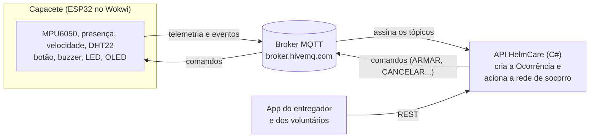

| Momento | O que o capacete faz | O que acontece no resto do HelmCare |
|---|---|---|
| Início do turno | Recebe `ARMAR` e passa a proteger | O entregador liga a proteção no app |
| Durante o turno | Publica telemetria a cada 10 s, com o índice de calor | O app sugere pausa quando o índice de calor passa de 32 °C |
| Queda | Detecta, observa, conta 15 s e envia o `SOS` | A API cria a Ocorrência e avisa os voluntários a até 2 km |
| Socorro | Recebe `SOCORRO_A_CAMINHO` e mostra no OLED | Um voluntário aceitou o chamado |
| Fim | Recebe `ENCERRAR` e volta a proteger | A ocorrência é encerrada e o turno continua |

[Voltar ao sumário](#sumário)

---

## 3. Circuito

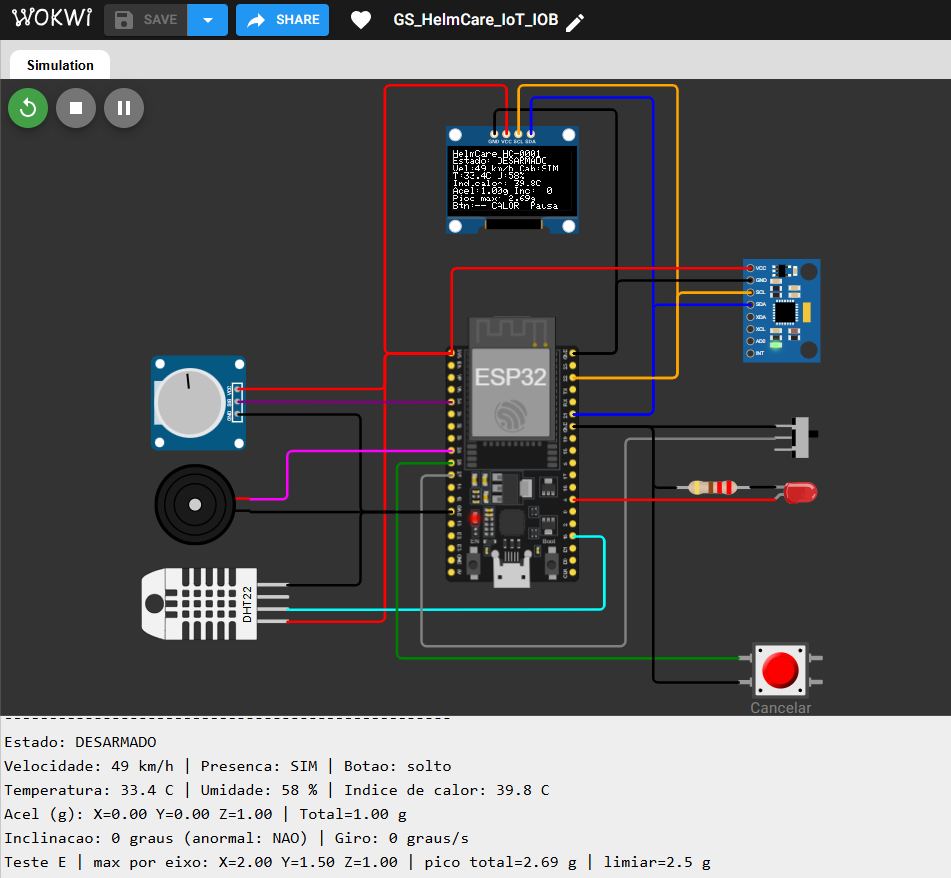

| Componente | Função no capacete | Pino do componente | ESP32 |
|---|---|---|---|
| MPU6050 (acelerômetro e giroscópio) | Impacto, inclinação e imobilidade | SDA / SCL / VCC / GND | 21 / 22 / 3V3 / GND |
| OLED SSD1306 128x64 | Estado, contagem regressiva e avisos | SDA / SCL / VCC / GND | 21 / 22 / 3V3 / GND |
| DHT22 | Temperatura, umidade e índice de calor | SDA / VCC / GND | 15 / 3V3 / GND |
| Potenciômetro | Velocidade simulada, de 0 a 60 km/h (no lugar do GPS do celular) | SIG / VCC / GND | 34 / 3V3 / GND |
| Slide switch | Sensor IR de presença na espuma interna | pino 2 (comum) / pino 1 | 27 / GND |
| Botão vermelho "Cancelar" | Cancela o alerta durante a contagem | 1.l / 2.l | 26 / GND |
| Buzzer | Bipes da contagem e alarme do SOS | 2 / 1 | 25 / GND |
| LED vermelho + resistor de 220 Ω | Sinal visual de cada estado | A / C (pelo resistor) | 4 / GND |

**Detalhes de ligação:**

- O MPU6050 (endereço 0x68) e o OLED (endereço 0x3C) dividem o mesmo barramento I2C.
- O potenciômetro usa o GPIO 34, do ADC1, porque o ADC2 do ESP32 não funciona com o WiFi ligado.
- Botão e slide switch usam `INPUT_PULLUP`, então não precisam de resistor externo.
- O DHT22 está no GPIO 15, o mesmo da aula de MQTT do Prof. Yan.

> **Slide switch (presença na cabeça):** para o lado do **fio preto** (GND) = capacete **na cabeça** (`Cab:SIM`). Para o lado **sem fio** = capacete **fora da cabeça** (`Cab:NAO`).

[Voltar ao sumário](#sumário)

---

## 4. Sinais do capacete (LED, buzzer e OLED)

| Estado | LED | Buzzer | OLED |
|---|---|---|---|
| `DESARMADO` | Apagado | Mudo | "Ligue a protecao" e as leituras dos sensores |
| `ARMADO` | Piscada curta a cada 2 s | Mudo | "Protegendo o turno", leituras e aviso de calor |
| `IMPACTO_DETECTADO` | Pisca a cada 1 s | Um bipe no impacto | Pico em g, "Pilotava" e "Cabeca" |
| `OBSERVACAO` | Pisca a cada 1 s | Mudo | Tempo restante, velocidade e se está imóvel |
| `CONTAGEM` | Pisca rápido | Bipe a cada segundo | "SOS em 15" em letra grande e como cancelar |
| `SOS_ENVIADO` | Aceso fixo | Alarme a cada segundo | "SOS ATIVO", "Ligue 192 (SAMU)" e o status do socorro |
| `CANCELADO` | Apagado | Um bipe grave | "Alerta cancelado. Que bom que esta bem!" por 3 s |
| `FALSO_POSITIVO` | Apagado | Um bipe grave | "Falso positivo: voce voltou a andar." por 3 s |

- A primeira linha do OLED mostra o código do capacete e a rede: `HC-0001 W:ok M:ok` (WiFi e MQTT).
- O aviso **"CALOR! Pausa e agua"** aparece quando o índice de calor é maior ou igual a 32 °C.
- O OLED não mostra acentos porque a fonte do display não tem esses caracteres.

[Voltar ao sumário](#sumário)

---

## 5. Arquivos e bibliotecas

| Arquivo | Conteúdo |
|---|---|
| `sketch.ino` | Leitura dos sensores, máquina de estados, MQTT, OLED, LED e buzzer |
| `config.h` | Pinos e todas as constantes, separando as do Contrato das que só valem no capacete |
| `diagram.json` | Circuito do Wokwi |
| `libraries.txt` | Bibliotecas que o Wokwi instala |
| `wokwi.txt` | Link público do projeto |
| `integrantes.txt` | Nome e RM |
| `evidencias/` | Prints do circuito, do Serial e de cada teste |

| Biblioteca | Para quê |
|---|---|
| Adafruit MPU6050 + Adafruit Unified Sensor | Leitura do acelerômetro e do giroscópio |
| Adafruit SSD1306 + Adafruit GFX Library | Desenho no OLED |
| DHT sensor library | Leitura do DHT22 e cálculo do índice de calor |
| PubSubClient | Cliente MQTT (a mesma das aulas) |
| ArduinoJson | Montagem e leitura dos payloads em JSON |

WiFi e NTP (hora) já vêm no núcleo do ESP32, sem biblioteca extra.

[Voltar ao sumário](#sumário)

---

## 6. Como rodar

1. Abra o projeto no Wokwi: https://wokwi.com/projects/480131497227238401
2. Clique em **Start the simulation** (o botão verde).
3. Espere esta sequência no Serial, na parte de baixo da tela:
   ```
   HelmCare: etapa 2, deteccao de queda e MQTT
   Conectando ao WiFi........
   WiFi conectado
   Sincronizando a hora (NTP)..........
   Hora sincronizada: 2026-11-11T01:38:26Z
   Conectando ao MQTT broker.hivemq.com como helmcare-rdu-HC-0001...
   MQTT conectado. Assinando helmcare-rdu/v1/HC-0001/comando (QoS 1)
   Capacete DESARMADO. Aguardando o comando ARMAR.
   ```
   A hora do Serial está em **UTC**: `01:38:26Z` é 22:38:26 no horário de Brasília (veja [Horários: tudo em UTC](#horários-tudo-em-utc)).
4. O capacete começa `DESARMADO`. Ele só passa a proteger quando recebe o comando `ARMAR`, que a API publica quando o entregador inicia o turno com a proteção ligada. Para testar sem a API, use o cliente web do HiveMQ, como na [seção 10](#10-como-simular-no-wokwi-e-no-hivemq).

> **Atenção:** o capacete usa um `clientId` fixo (`helmcare-rdu-HC-0001`). **Nunca rode duas simulações ao mesmo tempo** (duas abas do Wokwi, por exemplo): dois clientes com o mesmo `clientId` se derrubam no broker e ficam se reconectando. A API e o dashboard Node-RED usam `clientId` próprios.

[Voltar ao sumário](#sumário)

---

## 7. Máquina de estados

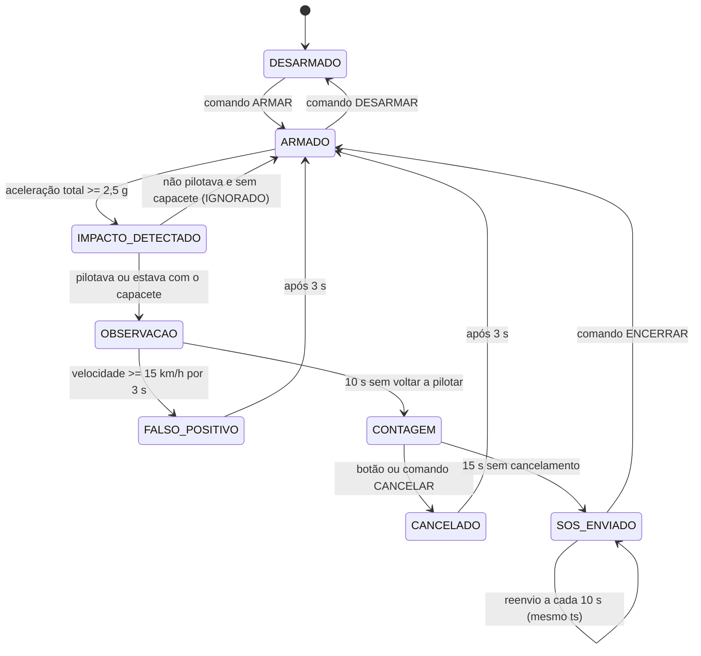

**Regras de cada etapa:**

| Etapa | Regra |
|---|---|
| Detecção | Só pelo pico: aceleração total (módulo do vetor X, Y, Z) **maior ou igual** a 2,5 g. A orientação anormal (inclinação maior que 60°) vai no evento, mas é só informativa, porque uma queda real pode terminar com o capacete de pé |
| Detecção na subida | Um novo impacto só conta depois que a aceleração voltar abaixo do limiar. Sem isso, um sensor parado acima de 2,5 g geraria quedas em sequência |
| Pico | Depois de cruzar o limiar, o capacete fica 1 s em `IMPACTO_DETECTADO` guardando o maior valor (`picoG`). O `ts` do evento é o instante em que o limiar foi cruzado |
| Antes do impacto | O capacete guarda os últimos 5 s de velocidade e presença numa fila circular (uma amostra a cada 250 ms). `pilotandoAntes` é verdadeiro se a velocidade foi **maior ou igual** a 15 km/h em alguma amostra; `presencaAntes`, se o capacete esteve na cabeça |
| Ignorado | Se os dois forem falsos, o impacto é publicado e descartado, e o capacete volta para `ARMADO` |
| Observação | 10 s. Se a velocidade ficar em 15 km/h ou mais por 3 s seguidos, é `FALSO_POSITIVO` |
| Contagem | 15 s. O botão do capacete ou o comando `CANCELAR` cancelam |
| SOS | Publicado no fim da contagem e reenviado a cada 10 s, com o **mesmo** `ts`, até chegar `SOCORRO_A_CAMINHO` ou `ENCERRAR` |
| Sem travar | Cada tarefa roda no seu ritmo com `millis()`, sem `delay()` longo no `loop()` (só uma pausa de 5 ms no fim de cada volta, para a simulação andar mais rápido). A detecção e a contagem funcionam mesmo sem rede, e a reconexão ao MQTT é tentada a cada 5 s |

[Voltar ao sumário](#sumário)

---

## 8. MQTT: tópicos, payloads e comandos

Broker público `broker.hivemq.com`, porta 1883. Raiz dos tópicos: `helmcare-rdu/v1/HC-0001`. **Nenhum dado pessoal trafega no MQTT**: só o código do capacete e as coordenadas simuladas da região da Av. Paulista.

| Tópico | Sentido | Quando | QoS |
|---|---|---|---|
| `helmcare-rdu/v1/HC-0001/telemetria` | Capacete para a API | A cada 10 s em todo estado diferente de `DESARMADO`, e na hora em que volta para `ARMADO` | 0 |
| `helmcare-rdu/v1/HC-0001/evento` | Capacete para a API | A cada mudança de estado: `IMPACTO_DETECTADO`, `FALSO_POSITIVO`, `CONTAGEM_INICIADA`, `CANCELADO` e `SOS` | 0 |
| `helmcare-rdu/v1/HC-0001/comando` | API para o capacete | `ARMAR`, `DESARMAR`, `CANCELAR`, `SOCORRO_A_CAMINHO` e `ENCERRAR` | 1 |

**Telemetria** (exemplo real do teste):

```json
{
  "dispositivo": "HC-0001",
  "ts": "2026-11-11T01:38:30Z",
  "estado": "ARMADO",
  "temperaturaC": 33.4,
  "umidadePct": 58,
  "indiceCalorC": 39.8,
  "presenca": true,
  "velocidadeKmh": 0
}
```

**Evento** (o `SOS` do teste 4). Todos os eventos de um mesmo impacto repetem `picoG`, `orientacaoAnormal`, `pilotandoAntes`, `presencaAntes`, `latitude` e `longitude`; só mudam o `tipo` e o `ts`:

```json
{
  "dispositivo": "HC-0001",
  "ts": "2026-11-11T01:39:02Z",
  "tipo": "SOS",
  "picoG": 2.54,
  "orientacaoAnormal": true,
  "pilotandoAntes": false,
  "presencaAntes": true,
  "latitude": -23.5641,
  "longitude": -46.6525
}
```

**Comando** (publicado pela API ou, nos testes, pelo HiveMQ):

```json
{ "tipo": "ARMAR", "ts": "2026-11-11T22:00:00Z" }
```

| Comando | Efeito no capacete |
|---|---|
| `ARMAR` | De `DESARMADO` para `ARMADO` |
| `DESARMAR` | Só em `ARMADO`. Nos outros estados é ignorado: não se desliga a proteção no meio de uma possível queda |
| `CANCELAR` | Só em `CONTAGEM`: publica `CANCELADO` e volta para `ARMADO`. Fora da contagem, é ignorado |
| `SOCORRO_A_CAMINHO` | Em `SOS_ENVIADO`: mostra "Socorro a caminho!" e para o reenvio e o alarme |
| `ENCERRAR` | Em `SOS_ENVIADO`: para o reenvio e volta para `ARMADO`, porque o turno continua |

Todo comando fora do estado certo aparece no Serial como `[COMANDO] X ignorado no estado Y`.

**Por que o SOS é reenviado:** a PubSubClient (a biblioteca das aulas) só publica em QoS 0, que não garante a entrega. Para o evento mais importante não se perder, o capacete republica o `SOS` com o mesmo `ts` a cada 10 s até receber `SOCORRO_A_CAMINHO` ou `ENCERRAR`, e a API trata eventos com o mesmo dispositivo, tipo e `ts` como um só.

**Sessão persistente:** o capacete conecta com `clientId` fixo e `cleanSession = false`. Se ele cair da rede por alguns segundos, os comandos em QoS 1 ficam guardados no broker e chegam quando ele voltar.

### Horários: tudo em UTC

Como manda o Contrato, **todos os horários do capacete estão em UTC** (ISO 8601, com o `Z` no final). No horário de Brasília, são **3 horas a menos**.

| Onde aparece | Exemplo | Em Brasília |
|---|---|---|
| `ts` da telemetria e dos eventos | `"ts":"2026-11-11T23:04:14Z"` | 11/11, 20:04:14 |
| Serial, na sincronização | `Hora sincronizada: 2026-11-11T01:38:26Z` | 10/11, 22:38:26 (passou da meia-noite em UTC, mas ainda era dia 10 em Brasília) |
| Última linha do OLED | `UTC 23:04:14` | 20:04:14 |
| Payload no HiveMQ | O mesmo `ts` do capacete | 3 horas a menos |

**Cuidado com o cabeçalho das mensagens no HiveMQ:** a data e a hora que o cliente web mostra acima de cada mensagem (por exemplo, `2026-11-11 20:06:38`) são a hora **local do seu computador**, em que a mensagem chegou, e não o `ts`. No print do [teste 3B](#teste-3b-cancelado-pelo-app-comando-cancelar), a mensagem chegou às 20:06:38 de Brasília com `ts` 23:04:14 UTC (20:04:14 em Brasília). Os 2 minutos e 24 segundos de diferença são o atraso do relógio do capacete no Wokwi, explicado nas [limitações da simulação](#14-limitações-da-simulação).

[Voltar ao sumário](#sumário)

---

## 9. Constantes

Todas ficam em `config.h`, num só lugar.

| Constante | Valor | Origem |
|---|---|---|
| `LIMIAR_IMPACTO_G` | 2,5 g (maior ou igual) | Contrato |
| `VELOCIDADE_PILOTAGEM_KMH` | 15 km/h (maior ou igual) | Contrato |
| `JANELA_OBSERVACAO_S` | 10 s | Contrato |
| `CONTAGEM_CANCELAMENTO_S` | 15 s | Contrato |
| `INTERVALO_TELEMETRIA_S` | 10 s (telemetria e reenvio do SOS) | Contrato |
| `ALERTA_CALOR_C` | 32 °C (maior ou igual) | Contrato |
| Coordenadas simuladas | -23.5641, -46.6525 (Av. Paulista) | Contrato |
| `JANELA_PRE_IMPACTO_S` | 5 s | Só do capacete |
| `JANELA_PICO_MS` | 1 s | Só do capacete |
| `VELOCIDADE_SUSTENTADA_S` | 3 s (imita o atraso do GPS) | Só do capacete |
| `INCLINACAO_ANORMAL_GRAUS` | 60° | Só do capacete |
| `TEMPO_MENSAGEM_MS` | 3 s | Só do capacete |
| `MQTT_KEEPALIVE_BROKER_S` / `MQTT_PING_S` | 120 s / 15 s | Só do capacete (ver a [seção 13](#13-problemas-encontrados-e-decisões-de-projeto)) |
| `PAUSA_LOOP_MS` | 5 ms (pausa no fim de cada volta do `loop()`) | Só do capacete (desempenho no Wokwi) |
| `I2C_FREQUENCIA_HZ` | 400 kHz | Só do capacete (desempenho no Wokwi) |

[Voltar ao sumário](#sumário)

---

## 10. Como simular no Wokwi e no HiveMQ

### 10.1 Conectar o HiveMQ (faz o papel da API nos testes)

1. Abra https://www.hivemq.com/demos/websocket-client/ e clique em **Connect**. O `clientId` aleatório dele já é diferente do capacete.
2. Em **Subscriptions**, clique em **Add New Topic Subscription** e assine `helmcare-rdu/v1/HC-0001/#`. O `#` recebe todos os tópicos do capacete: telemetria, eventos e os próprios comandos.
3. Em **Publish**, coloque o tópico `helmcare-rdu/v1/HC-0001/comando` e QoS **1**.
4. No campo **Message**, escreva o comando e clique em **Publish**:
   ```json
   { "tipo": "ARMAR", "ts": "2026-11-11T22:00:00Z" }
   ```
5. No Serial deve aparecer `[COMANDO] Recebido: ARMAR (estado DESARMADO)` e `[ESTADO] DESARMADO -> ARMADO`.

Os outros comandos seguem o mesmo formato, trocando o `tipo`: `DESARMAR`, `CANCELAR`, `SOCORRO_A_CAMINHO` e `ENCERRAR`.

### 10.2 Os controles do Wokwi

| Controle | Como mexer | O que representa |
|---|---|---|
| MPU6050 | Clique nele durante a simulação; abre um painel com X, Y e Z de aceleração | O movimento do capacete |
| Potenciômetro | Clique e arraste o botão giratório | A velocidade da moto (GPS do celular) |
| Slide switch | Clique para trocar de lado | O capacete na cabeça ou fora |
| Botão vermelho | Clique uma vez | O botão de cancelar do capacete |
| DHT22 | Clique nele para mudar temperatura e umidade | O calor do ambiente |

### 10.3 Posições do MPU6050

| Posição | X | Y | Z | Aceleração total | Inclinação |
|---|---|---|---|---|---|
| **Repouso** (capacete de pé) | 0 | 0 | 1 | 1,00 g | 0° |
| **Impacto** (a partir do repouso) | 2 | 1,5 | 1 | 2,69 g | 68° (anormal) |
| **Deitado** (caído e imóvel) | 1 | 0 | 0 | 1,00 g | 90° |

- No Wokwi, cada eixo vai só de -2 g a +2 g, então a aceleração total máxima é 3,46 g. Por isso o limiar foi calibrado em 2,5 g.
- **Comece todo teste com o MPU6050 em repouso.** A partir do capacete deitado, o mesmo impacto dá só 2,50 g, exatamente no limite.

### 10.4 Dicas para testar e tirar prints

- **Os segundos são os do cronômetro do Wokwi**, no canto superior direito da simulação. Ao lado dele fica a velocidade da simulação (por exemplo, `89%`). Depois dos ajustes de desempenho, a simulação roda perto da velocidade real (cerca de 89%) e a contagem de 15 s leva cerca de 16 s no relógio de parede. Antes deles, rodava a 47%, e a contagem levava de 30 a 45 s.
- **Para tirar um print com calma, clique em pausar** (o botão ⏸ da simulação). A tela congela com o OLED e o Serial parados; depois clique em ▶ para continuar.
- **Para gravar**, deixe o Wokwi em tela cheia ou dê zoom no navegador (Ctrl e +). O OLED é pequeno e fica ilegível em gravações reduzidas.
- Antes de cada teste, **espere 5 s** depois de mudar a chave ou a velocidade: é o tempo de o capacete registrar o que aconteceu antes do impacto.

[Voltar ao sumário](#sumário)

---

## 11. Testes realizados, com evidências

Todos os testes abaixo foram feitos no Wokwi, com o HiveMQ no lugar da API. O capacete começa cada teste em `ARMADO` e termina de volta em `ARMADO`, então não precisa armar de novo entre eles.

### Etapa 1: leitura dos sensores e calibração do MPU6050

**Objetivo:** conferir que todos os sensores e atuadores respondem antes de qualquer lógica de rede.

**Como simular:** inicie a simulação e mexa em cada controle: o potenciômetro vai de 0 a 60 km/h, o slide switch alterna `Cab:SIM` e `Cab:NAO`, o DHT22 em 33,4 °C e 58% mostra o índice de calor de 39,8 °C, e o botão acende o LED e bipa.

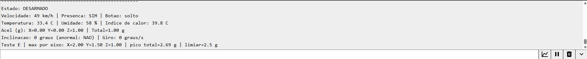

**Calibração do MPU6050:** cada eixo foi levado ao máximo para descobrir até onde o Wokwi deixa a aceleração ir. O resultado definiu o `LIMIAR_IMPACTO_G` de 2,5 g.

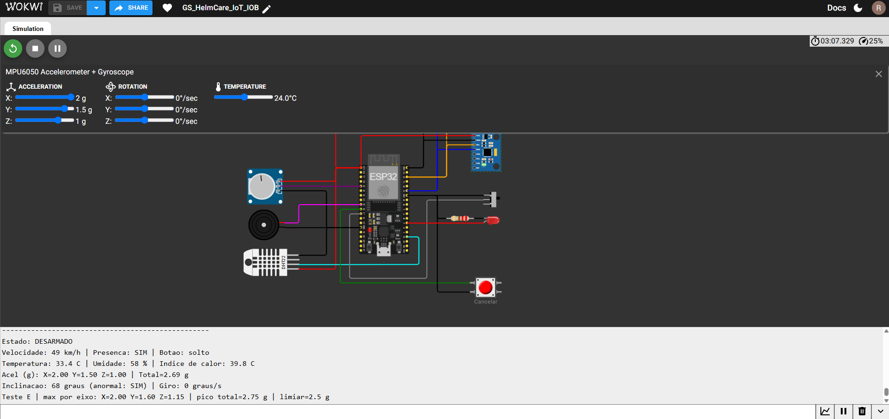

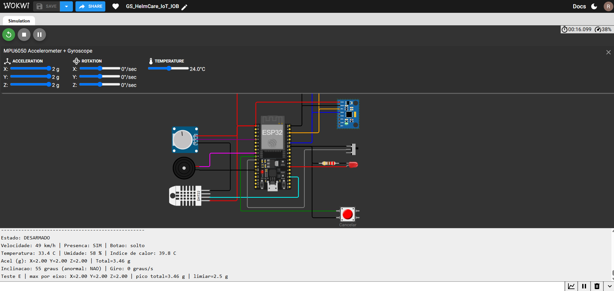

---

### Teste 1: impacto ignorado

**A história:** o capacete está pendurado em casa. Ninguém pilota e ninguém está com ele na cabeça. Ele cai no chão, e o alerta **não** pode disparar.

**Como simular:**

1. Potenciômetro em **0 km/h** e slide switch para o lado **sem fio** (`Cab:NAO`).
2. MPU6050 em **repouso** (X = 0, Y = 0, Z = 1).
3. Espere **5 s** no cronômetro do Wokwi.
4. Faça o **impacto**: X = 2 e depois Y = 1,5.

**Resultado esperado:**

- Um bipe e, por 1 s, `IMPACTO_DETECTADO` no OLED, com "Pilotava: NAO" e "Cabeca: NAO".
- Volta para `ARMADO`, com a linha "Impacto ignorado" por 3 s.
- No Serial e no HiveMQ, o evento `IMPACTO_DETECTADO` com `pilotandoAntes` e `presencaAntes` falsos. Com isso, a API grava o impacto como `IGNORADO`.

```
[IMPACTO] 2.61 g | pilotava antes: NAO | capacete antes: NAO
[ESTADO] ARMADO -> IMPACTO_DETECTADO
[MQTT] Publicado em helmcare-rdu/v1/HC-0001/evento ... "tipo":"IMPACTO_DETECTADO" ... "pilotandoAntes":false,"presencaAntes":false ...
[IMPACTO] Ignorado: nao pilotava e nao estava com o capacete
[ESTADO] IMPACTO_DETECTADO -> ARMADO
```

**Evidência:**

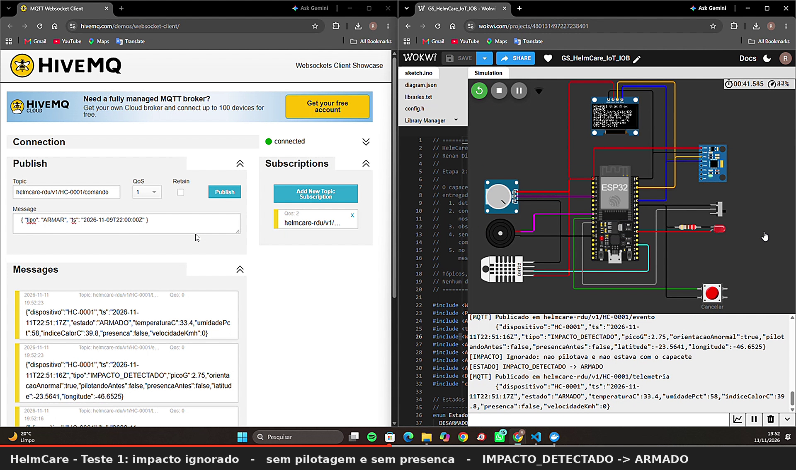

---

### Teste 2: falso positivo

**A história:** o entregador pilota a 40 km/h, passa num buraco forte (o pico de aceleração) e segue viagem. Não houve queda, então o alerta tem que se cancelar sozinho.

**Como simular:**

1. Potenciômetro em **cerca de 40 km/h**. O slide switch pode ficar em qualquer lado.
2. MPU6050 em **repouso** e espere **5 s**.
3. Faça o **impacto**: X = 2 e depois Y = 1,5.
4. **Não mexa no potenciômetro:** ele continua em 40 km/h.

**Resultado esperado:**

- `IMPACTO_DETECTADO` com "Pilotava: SIM" e depois `OBSERVACAO`.
- Depois de 3 s com a velocidade em 15 km/h ou mais, o evento `FALSO_POSITIVO` e o OLED "Falso positivo: voce voltou a andar." por 3 s.
- Volta para `ARMADO`. Os dois eventos (`IMPACTO_DETECTADO` e `FALSO_POSITIVO`) têm o mesmo `picoG`.

```
[IMPACTO] 2.54 g | pilotava antes: SIM | capacete antes: NAO
[ESTADO] IMPACTO_DETECTADO -> OBSERVACAO
[OBSERVACAO] Velocidade de moto voltou: falso positivo
[MQTT] Publicado em helmcare-rdu/v1/HC-0001/evento ... "tipo":"FALSO_POSITIVO","picoG":2.69 ...
[ESTADO] OBSERVACAO -> FALSO_POSITIVO
[ESTADO] FALSO_POSITIVO -> ARMADO
```

**Evidência:**

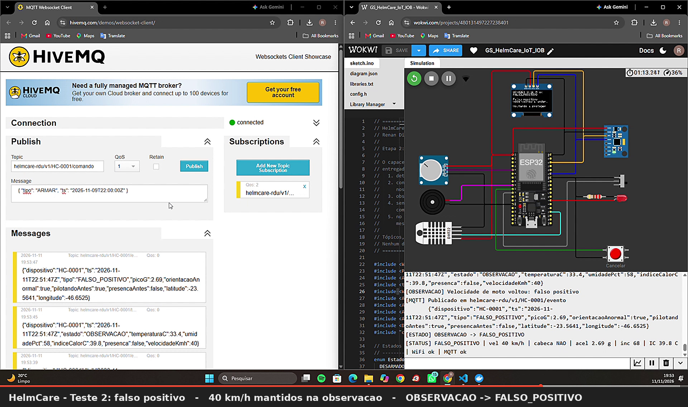

---

### Teste 3A: cancelado pelo botão do capacete

**A história:** o entregador cai, mas está bem. Quando o capacete começa a contagem, ele aperta o botão para não acionar a rede à toa.

**Como simular:**

1. Potenciômetro em **0 km/h** e slide switch do lado do **fio preto** (`Cab:SIM`).
2. MPU6050 em **repouso** e espere **5 s**.
3. Faça o **impacto**: X = 2 e depois Y = 1,5.
4. **Deite o capacete**: X = 1, Y = 0, Z = 0. O OLED mostra "Observando: 10 s" descendo.
5. Espere a contagem começar: "SOS em 15" em letra grande, bipe a cada segundo e LED piscando rápido.
6. **Clique uma vez no botão vermelho "Cancelar"** antes de a contagem chegar a 0.

**Resultado esperado:**

- Bipe grave, fim dos bipes da contagem e o OLED "Alerta cancelado. Que bom que esta bem!".
- Eventos `CONTAGEM_INICIADA` e `CANCELADO`, e a volta para `ARMADO` em 3 s.

```
[ESTADO] OBSERVACAO -> CONTAGEM
[MQTT] Publicado em helmcare-rdu/v1/HC-0001/evento ... "tipo":"CONTAGEM_INICIADA" ...
[CONTAGEM] Cancelada pelo botao do capacete
[MQTT] Publicado em helmcare-rdu/v1/HC-0001/evento ... "tipo":"CANCELADO" ...
[ESTADO] CONTAGEM -> CANCELADO
```

**Evidência:**

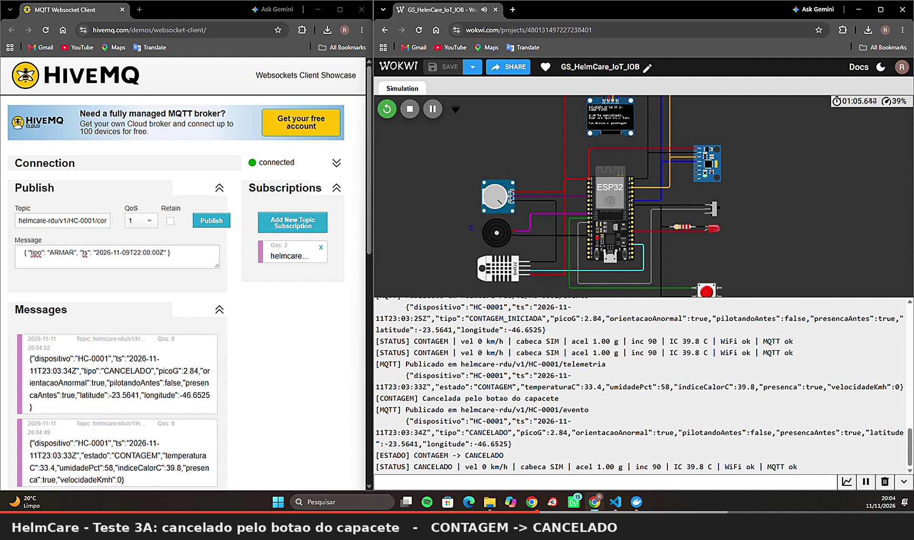

---

### Teste 3B: cancelado pelo app (comando CANCELAR)

**A história:** a mesma queda, mas o entregador cancela pelo celular. No HelmCare, o app chama a API (`POST /turnos/{id}/alerta/cancelar`), e a API publica o comando `CANCELAR`. Aqui, o HiveMQ faz o papel da API.

**Como simular:**

1. **Antes de começar**, deixe pronto no HiveMQ, no campo Message (tópico `.../comando`, QoS 1):
   ```json
   { "tipo": "CANCELAR", "ts": "2026-11-11T22:00:00Z" }
   ```
2. Repita os passos 1 a 5 do teste 3A.
3. Quando aparecer "SOS em 15", **não aperte o botão do capacete**: clique em **Publish** no HiveMQ. A contagem dura cerca de 40 s reais, então dá tempo.

**Resultado esperado:** o mesmo do teste 3A. A diferença está no Serial, que mostra o comando recebido:

```
[COMANDO] Recebido: CANCELAR (estado CONTAGEM)
[CONTAGEM] Cancelada pelo comando CANCELAR (app)
[MQTT] Publicado em helmcare-rdu/v1/HC-0001/evento ... "tipo":"CANCELADO" ...
[ESTADO] CONTAGEM -> CANCELADO
```

**Evidência:**

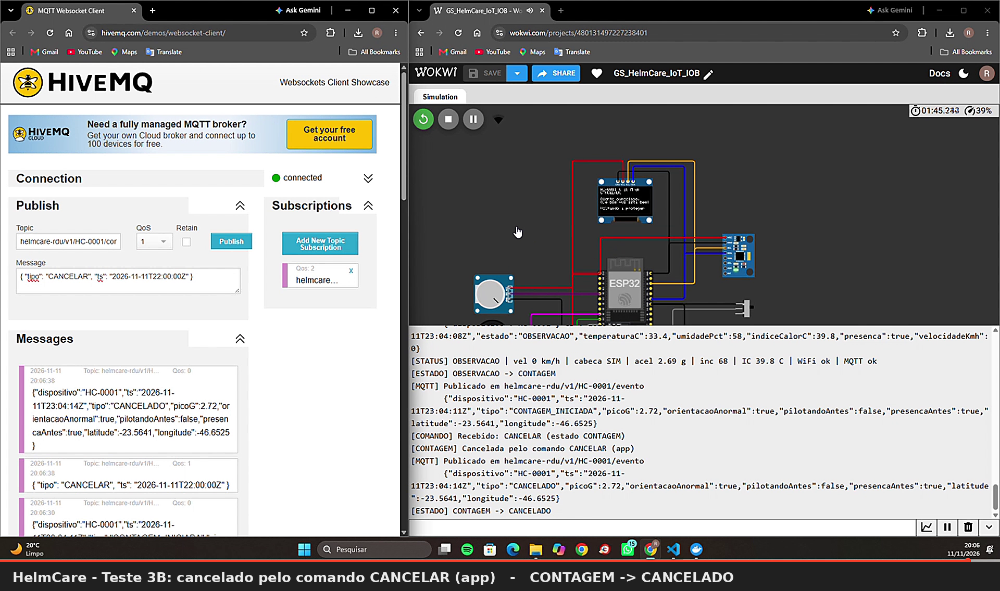

Neste teste, o MPU6050 ficou na posição do impacto (2,69 g), e o capacete **não** disparou uma nova queda ao voltar para `ARMADO`. É a detecção na subida do limiar funcionando.

---

### Teste 4: queda real, SOS e socorro a caminho

**A história:** o entregador cai e fica desacordado. Ninguém cancela, o capacete envia o SOS e o reenvia até alguém confirmar o socorro.

**Como simular:**

1. Potenciômetro em **0 km/h**, slide switch do lado do **fio preto** (`Cab:SIM`) e MPU6050 em **repouso**. Espere **5 s**.
2. Faça o **impacto** (X = 2 e depois Y = 1,5) e **deite o capacete** (X = 1, Y = 0, Z = 0).
3. **Não aperte nada.** Espere os 10 s de observação e os 15 s de contagem.
4. Confira o SOS e espere pelo menos um reenvio (10 s).
5. No HiveMQ, publique `{ "tipo": "SOCORRO_A_CAMINHO", "ts": "2026-11-11T22:00:00Z" }`.
6. Depois, publique `{ "tipo": "ENCERRAR", "ts": "2026-11-11T22:00:00Z" }`.

**Passo a passo das evidências:**

**1. Impacto detectado:** 2,54 g com o capacete na cabeça. O painel do MPU6050 mostra os controles na posição do impacto.

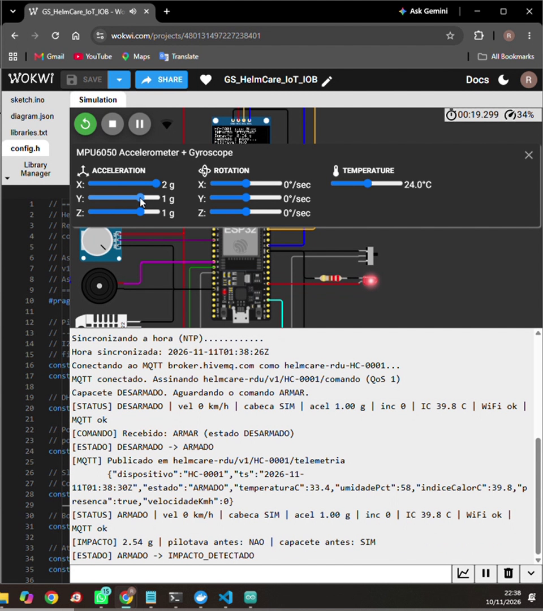

**2. Contagem:** depois de 10 s de observação, o evento `CONTAGEM_INICIADA` e "SOS em 13" no OLED.

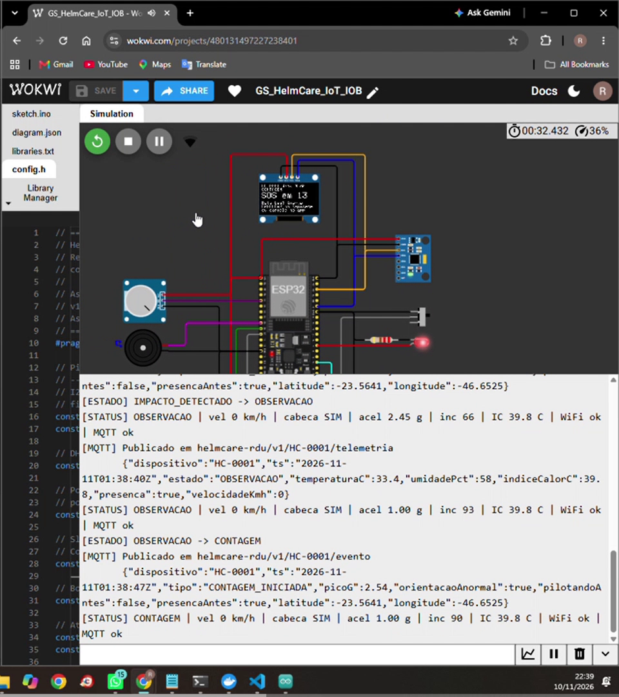

**3. SOS enviado:** no fim dos 15 s, "SOS ATIVO" no OLED, LED aceso fixo e o evento `SOS`.

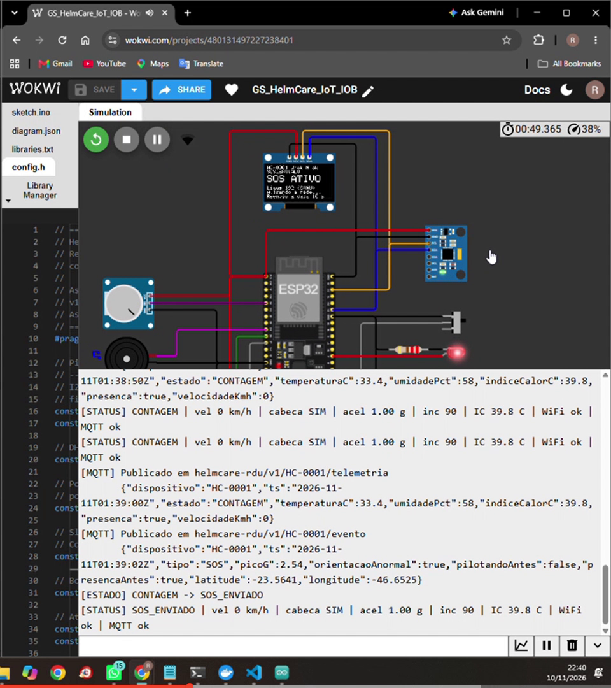

**4. Reenvio com o mesmo `ts`:** a cada 10 s, `[SOS] Reenvio (mesmo ts)`, sempre com `"ts":"2026-11-11T01:39:02Z"`.

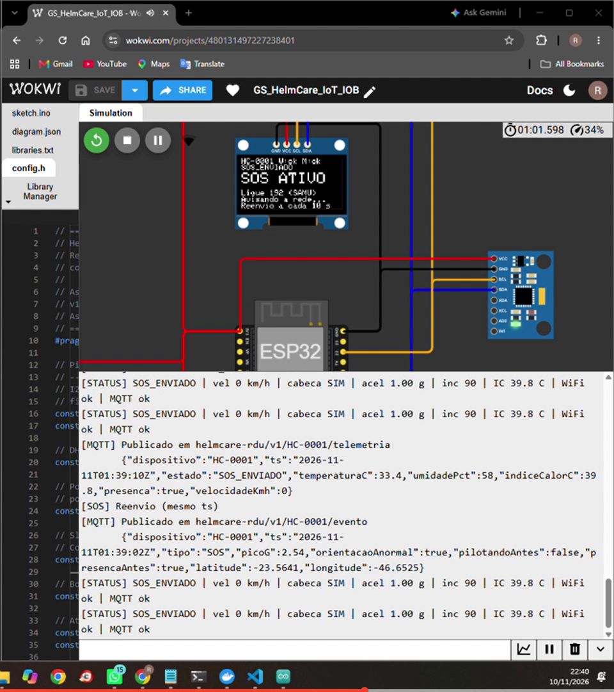

**5. Socorro a caminho:** o comando `SOCORRO_A_CAMINHO` muda o OLED para "Socorro a caminho!" e para o reenvio e o alarme.

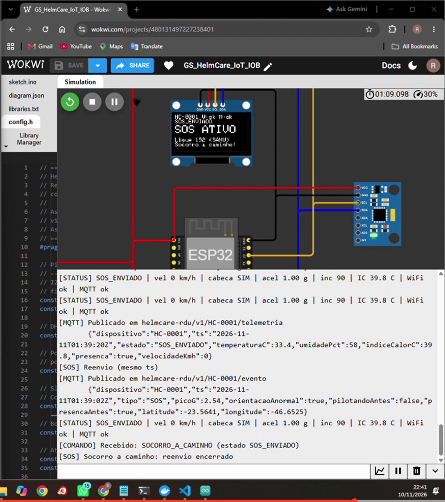

**6. Encerrar:** o comando `ENCERRAR` volta o capacete para `ARMADO`, com uma telemetria imediata.

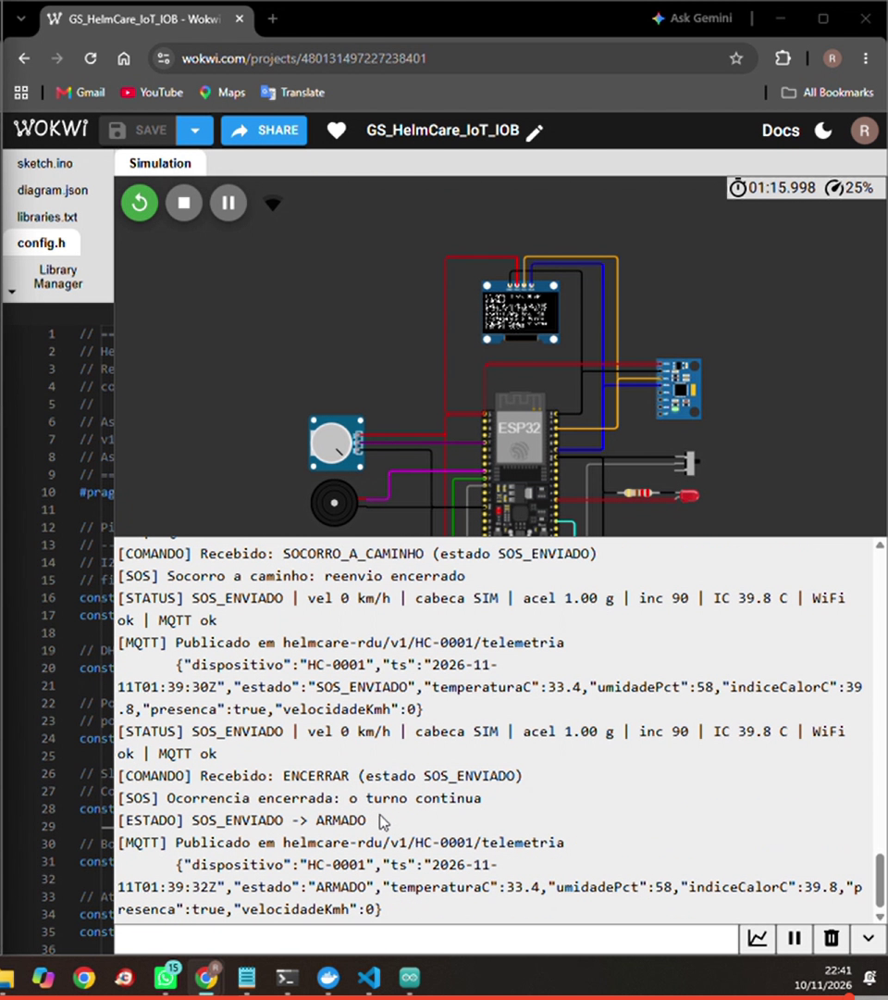

**7. O mesmo fluxo visto no HiveMQ:** o `SOS`, o comando `SOCORRO_A_CAMINHO` e a telemetria em `SOS_ENVIADO`.

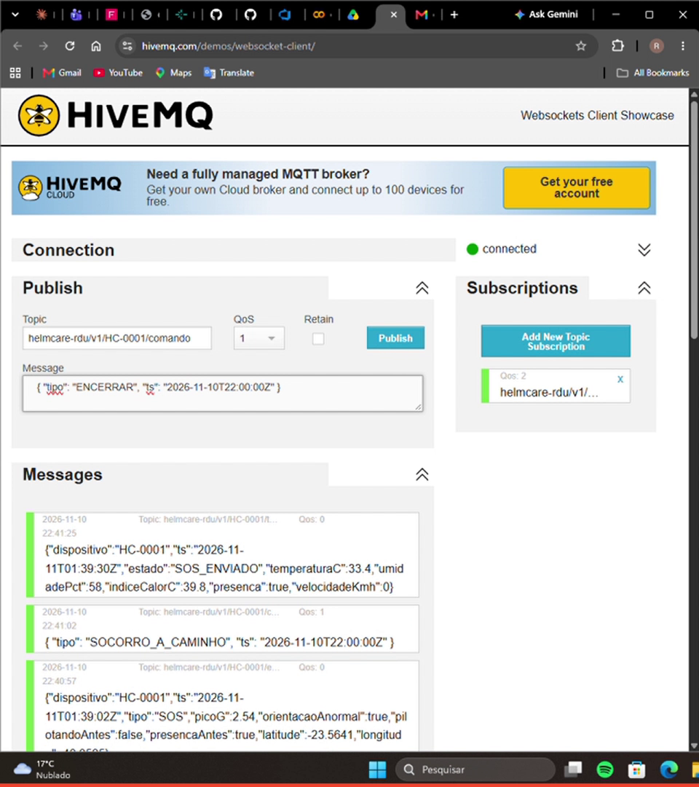

---

### Outros cenários para conferir

| Cenário | Como simular | Resultado esperado |
|---|---|---|
| Queda com o capacete no cotovelo | `Cab:NAO`, velocidade em 40 km/h, impacto e velocidade a 0 em até 3 s | Segue para a contagem, porque pilotava antes |
| Desarmar no meio da queda | Publicar `DESARMAR` na `OBSERVACAO` ou na `CONTAGEM` | `DESARMAR ignorado no estado ...` e o alerta continua |
| Cancelar fora da contagem | Publicar `CANCELAR` em `ARMADO` | `CANCELAR ignorado no estado ARMADO` |
| Aviso de calor | DHT22 com índice de calor de 32 °C ou mais (por exemplo, 33,4 °C e 58%) | "CALOR! Pausa e agua" no OLED e `indiceCalorC` na telemetria |
| Desarmar | Publicar `DESARMAR` em `ARMADO` | Volta para `DESARMADO` e a telemetria para |

[Voltar ao sumário](#sumário)

---

## 12. Resumo dos resultados

| Teste | Cenário | Esperado | Resultado |
|---|---|---|---|
| Etapa 1 | Leitura dos sensores e atuadores | Todos respondem | Passou |
| Etapa 1 | Calibração do MPU6050 | Descobrir o teto do Wokwi | Passou (±2 g por eixo, 3,46 g no total) |
| Teste 1 | Capacete cai sem pilotagem e sem presença | `IMPACTO_DETECTADO` com os dois campos falsos e volta para `ARMADO` | Passou |
| Teste 2 | Impacto e velocidade mantida | `FALSO_POSITIVO` e volta para `ARMADO` | Passou |
| Teste 3A | Botão durante a contagem | `CANCELADO` e volta para `ARMADO` | Passou |
| Teste 3B | Comando `CANCELAR` durante a contagem | `CANCELADO` e volta para `ARMADO` | Passou |
| Teste 4 | Queda real sem cancelamento | `SOS`, reenvio com o mesmo `ts`, `SOCORRO_A_CAMINHO` e `ENCERRAR` | Passou |
| Rede | Conexão estável com a simulação lenta | Sem quedas do MQTT | Passou (depois do ajuste do keepalive) |
| Desempenho | Simulação mais próxima da velocidade real | Ganho visível de velocidade | Passou (de 47% para cerca de 89%) |

[Voltar ao sumário](#sumário)

---

## 13. Problemas encontrados e decisões de projeto

| Problema | Causa | Solução |
|---|---|---|
| O MQTT caía e reconectava de tempos em tempos | O Wokwi roda a cerca de 40% da velocidade real, então o ping do ESP32 (a cada keepalive no relógio dele) chegava ao broker depois do prazo de 1,5 x keepalive em tempo real. Com um keepalive só, isso acontece com qualquer valor abaixo de 67% de velocidade | O capacete combina **120 s** no CONNECT (o broker tolera 180 s reais) e, depois de conectado, manda ping a cada **15 s** do próprio relógio (cerca de 40 s reais). O MQTT permite mandar ping antes do prazo |
| Teto de aceleração do Wokwi | Cada eixo do MPU6050 vai só até ±2 g | Calibração do `LIMIAR_IMPACTO_G` em 2,5 g, com folga até o teto de 3,46 g |
| Falso positivo imediato na demonstração | Com a velocidade em 40 km/h antes da queda, a observação via a velocidade alta no mesmo instante | A velocidade só conta como "voltou" se ficar em 15 km/h ou mais por **3 s seguidos**, o que também imita o atraso do GPS |
| Quedas em sequência | Com os controles do MPU6050 parados acima do limiar, cada volta do `loop()` via um novo impacto | **Detecção na subida:** um novo impacto só conta depois que a aceleração volta abaixo do limiar |
| QoS 0 na publicação | A PubSubClient não publica em QoS 1 | **Reenvio do SOS** com o mesmo `ts` até a confirmação, com idempotência na API |
| Desligar a proteção no meio de uma queda | Um `DESARMAR` durante a contagem deixaria o impacto sem desfecho | `DESARMAR` só vale em `ARMADO`; durante a contagem, quem quer parar usa `CANCELAR` |
| OLED pesando na simulação | A tela era reenviada inteira (1 KB pelo I2C) 4 vezes por segundo, mesmo sem nada mudar | O capacete desenha na memória e só manda o quadro quando ele muda (na contagem, uma vez por segundo). O `[STATUS]` do Serial mostra quantos quadros foram enviados a cada 5 s |
| `loop()` girando sem parar | Sem nenhuma pausa, o Wokwi simula cada instrução do `loop()`, mesmo quando não há nada a fazer | Pausa de 5 ms no fim de cada volta e I2C a 400 kHz. Nada muda na lógica: a tarefa mais rápida roda a cada 50 ms |

### Desempenho no Wokwi: antes e depois

Os dois últimos ajustes da tabela (OLED só quando muda e pausa de 5 ms no `loop()`, com o I2C a 400 kHz) foram medidos em 12/11, no mesmo fluxo de queda com SOS:

| Medição | Antes | Depois |
|---|---|---|
| Velocidade da simulação | 47% | **cerca de 89%** (88,8 s de cronômetro do Wokwi em 100 s reais) |
| Percentual mostrado pelo Wokwi | 25% a 50% | 81% a 104% |
| Contagem de 15 s, no relógio de parede | 30 a 45 s | **cerca de 16 s** |
| Quadros enviados ao OLED a cada 5 s | cerca de 20 (4 por segundo, sempre) | 5 em `ARMADO` e na contagem (1 por segundo), 0 com a tela parada |

Na prática, os tempos do capacete ficaram quase iguais aos reais, o que deixa a demonstração e o vídeo muito mais naturais. A velocidade exata depende do computador e do que mais está aberto.

[Voltar ao sumário](#sumário)

---

## 14. Limitações da simulação

- **Velocidade do Wokwi:** a simulação pode rodar abaixo da velocidade real, conforme o computador e o que mais está aberto. No teste ponta a ponta de 12/11, antes dos ajustes de desempenho, ela rodou a **47%**, e a contagem de 15 s levou **de 30 a 45 s** no relógio de parede. Depois dos ajustes, subiu para **cerca de 89%**, e a contagem passou a levar cerca de 16 s (veja [Desempenho no Wokwi: antes e depois](#desempenho-no-wokwi-antes-e-depois)). Os tempos do capacete (10 s de observação, 15 s de contagem, 10 s de telemetria) valem sempre no cronômetro da simulação.
- **Relógio do capacete:** o `ts` vem do NTP só no início da simulação. Depois, o relógio do ESP32 anda na velocidade da simulação e fica cada vez mais atrasado em relação à hora real. No teste de 12/11, a 47%, ele estava **1 min 55 s atrás da hora real depois de cerca de 2 min** de simulação. Com a simulação a cerca de 89%, o atraso cresce bem mais devagar, mas continua existindo. Num capacete real, o relógio anda certo e esse atraso não existe.
- **Como a API lida com esse atraso:** a API nunca compara o `ts` do capacete com o relógio do servidor. Pelo Contrato v1.7, o indicador de impacto (tempo da queda até o primeiro aceite) é medido em **dois trechos, cada um no próprio relógio**: o trecho do capacete (da queda ao fim da contagem, os dois no relógio do capacete) e o trecho do servidor (da criação da ocorrência ao aceite, os dois no relógio do servidor). Assim, o atraso do Wokwi nunca entra no indicador.
- **Sensores simulados:** o potenciômetro faz o papel do GPS do celular, e o slide switch, do sensor IR de presença na espuma. Na solução real, o capacete usaria o celular por Bluetooth e teria um chip de IoT próprio como canal reserva.
- **Coordenadas fixas:** o capacete envia sempre a região da Av. Paulista (-23.5641, -46.6525), como define o Contrato.

---

Renan Dias Utida - RM 558540 - 3ESPW - FIAP

[Voltar ao topo](#helmcare-módulo-do-capacete)
