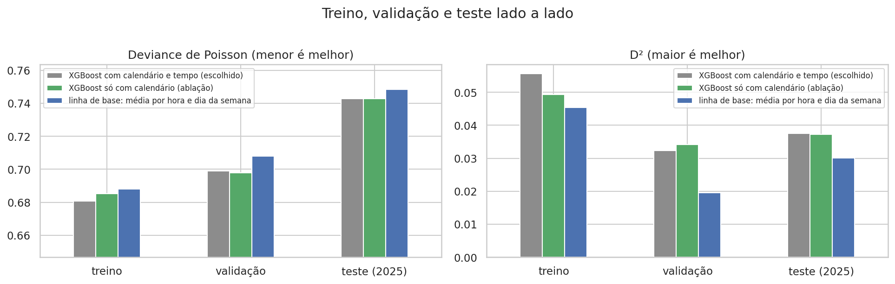
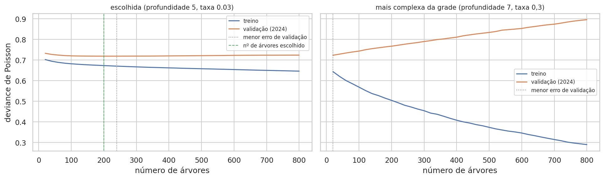
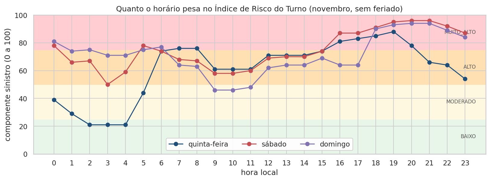

# Relatório de Inteligência Artificial e Machine Learning

**HelmCare: sinistros graves com moto esperados por hora em São Paulo**

**Renan Dias Utida**, RM 558540, turma 3ESPW | Disciplina: Inteligência Artificial e Machine Learning | Professor: Danilo Rodrigues de Assis Elias | FIAP, Global Solution 2026.2 (CitizenTech)

Notebook executado: [GS_HelmCare_IA_and_ML.ipynb](GS_HelmCare_IA_and_ML.ipynb), de onde saem todos os números.

## 1. Problema e pergunta de ML

Em 2025, a cidade de São Paulo teve 1.034 mortes no trânsito, e os motociclistas foram o maior grupo de vítimas (475). O HelmCare protege o entregador de moto e, antes de cada turno, mostra o **Índice de Risco do Turno** (0 a 100): 50% vêm deste modelo (componente sinistro), 25% da chuva prevista e 25% do calor.

> **Pergunta de ML:** quantos sinistros graves com moto são esperados em cada hora local da cidade de São Paulo, segundo o calendário? E as condições do tempo medidas pelo INMET mudam essa expectativa?

É uma regressão de contagem: o alvo é um número inteiro, pequeno e não negativo em cada hora.

## 2. Dados reais

| Dado | Fonte | Link | Período |
|---|---|---|---|
| Sinistros, pessoas e veículos (versão 3.1, atualizada em 19/10/2026) | Infosiga SP (Detran-SP), CC BY 4.0 | <https://infosiga.detran.sp.gov.br/> | 2019 a 2025 |
| Tempo horário da estação A701 (Mirante de Santana) | INMET | <https://portal.inmet.gov.br/dadoshistoricos> | 2019 a 2025 |

Os dados foram baixados em 07/11/2026. O período começa em 2019, quando o Infosiga passa a registrar os sinistros não fatais, e termina em 2025, porque 2026 está incompleto.

**Funil:** 1.450.961 registros do estado, 1.303.472 de 2019 a 2025, 306.392 na capital e **120.621 com moto (39,4%)**.

**Alvo:** sinistro com pelo menos 1 moto e pelo menos 1 vítima grave ou fatal. Em 88,6% deles a vítima grave estava na moto, acima do limiar de 80% definido antes de olhar. Dos 13.117 sinistros do alvo, 89 não têm hora e ficaram fora: entram **13.028 eventos**.

**Validação com os números oficiais:** em 2025, a base tem 1.038 mortes (divulgado: 1.034) e 477 motociclistas mortos (divulgado: 475), diferença compatível com a atualização posterior da base.

**Base horária:** 61.368 horas locais, com média de 0,212 sinistro grave por hora. Delas, 60.645 (98,82%) têm o tempo completo e entram na avaliação.

**Tratamentos principais:** fuso `America/Sao_Paulo` (UTC-2 até 16/02/2019), ajuste de 1 hora no INMET (o registro de h+1 resume a hora h), hora duplicada resolvida pela média, nenhum valor fora das faixas físicas e base sem dados pessoais. Detalhes em [dados/README.md](dados/README.md).

## 3. Escolha do modelo

**XGBoost com objetivo `count:poisson`.** O alvo se comporta como Poisson (variância / média = 1,04 no treino), as árvores captam a interação entre hora e dia da semana sem one-hot, e o formato JSON nativo é o arquivo que o Serviço de Risco carrega.

**Linhas de base:** média geral, média por hora e média por hora e dia da semana. A última é a mais forte e é a referência de todo o estudo.

**Métrica principal: deviance de Poisson média** (quanto menor, melhor), a perda natural de uma contagem. **A armadilha do MAE:** prever sempre 0 teria MAE de 0,2325 no teste, melhor que o da melhor linha de base (0,3487), mas deviance infinita e viés de -100%. Na grade, a combinação com o menor MAE (0,2905) foi justamente a de pior deviance. O MAE premia quem prevê para baixo, e o índice precisa da quantidade esperada.

## 4. Preparação e divisão treino e teste

- **Variáveis:** hora, dia da semana, mês e feriado (calendário), mais chuva, temperatura e umidade no modelo de 7 variáveis. O ano fica fora: não existe no uso real e as árvores não extrapolam.
- **Divisão temporal:** treino de 2019 a 2024 (51.936 horas, 0,209 por hora) e teste em 2025 (8.709 horas, 0,233 por hora), avaliado uma única vez.
- **Validação cruzada só no treino:** 5 dobras anuais expansivas (treina 2019 e valida 2020, até treinar 2019 a 2023 e validar 2024), sem nunca usar o futuro para prever o passado.

## 5. Treino com diferentes parâmetros

**Grade 1 (7 variáveis):** 27 combinações de `max_depth` (3, 5, 7), `learning_rate` (0,03, 0,1, 0,3) e `n_estimators` (200, 400, 800), com `GridSearchCV` nas 5 dobras. A melhor foi **profundidade 5, taxa 0,03 e 200 árvores**, com deviance de validação de 0,6990. Só 10 das 27 superaram a linha de base (0,7081). A pior, 7, 0,3 e 800, chegou a 0,9648 na validação, com gap de 0,7770 entre treino e validação.

**Grade 2 (só calendário):** as mesmas 27 combinações e dobras. A melhor combinação foi a mesma, com validação de **0,6977**. O calendário ficou melhor em 21 das 27 combinações e teve gap menor em todas as 27.

## 6. Resultados em treino e teste

| Deviance de Poisson | Treino | Validação | Teste (2025) |
|---|---|---|---|
| **Modelo exportado (calendário)** | **0,6852** | **0,6977** | **0,7429** |
| XGBoost com 7 variáveis | 0,6807 | 0,6990 | 0,7427 |
| Linha de base (média por hora e dia da semana) | 0,6880 | 0,7081 | 0,7485 |

O modelo exportado ganha 1,46% sobre a linha de base na validação e 0,75% no teste. O ganho é pequeno porque cada hora tem poucos casos e muito acaso, e a linha de base já captura o principal padrão.

**Overfitting.** Na curva de profundidade, a validação é mínima com profundidade 4 (0,6989); com profundidade 1 o modelo sub-ajusta (0,7089, pior que a linha de base). Na curva de aprendizado da combinação mais complexa, a validação sobe de 0,7236 para 0,8962 enquanto o treino cai a 0,2902: o modelo decora o acaso.

**A decisão do calendário.** Na ablação, o tempo mudou a deviance de validação em -0,18% na média das dobras (uma pequena piora), e a permutação da chuva no teste não alterou a deviance. Com o mesmo desempenho no teste (0,7429 contra 0,7427), o modelo exportado usa **só o calendário**: menos overfitting, menos entradas e nenhuma dependência de uma previsão do tempo, que também erra. No diagnóstico do Item 9, feito com o modelo de 7 variáveis, a calibração teve correlação de 0,972 entre previsto e observado; o modelo só com calendário teve viés de nível de -10,1% em 2025 (o ano ficou acima do previsto).

## 7. Do modelo ao HelmCare

O notebook exporta 4 arquivos para `ml/modelo/`, que o Serviço de Risco (FastAPI) carrega:

- `modelo_sinistros_xgb.json`: o modelo de calendário, retreinado de 2019 a 2025;
- `metadados_modelo.json`: a ordem das variáveis, a conversão de UTC para hora local e os feriados;
- `p95_sinistros_graves.json`: o **P95 único de 0,322927**. Cada hora vale min(100, 100 × previsão / P95). O P95 por hora foi descartado porque inverte a ordem do risco (9h com 99 pontos, acima das 18h com 76);
- `trechos_criticos.json`: os 100 trechos críticos.

O serviço calcula o componente de cada hora do turno e agrega pela **média ponderada** pelo tempo de cada hora dentro do turno. No **exemplo de referência** do Contrato (quinta-feira, das 17h às 21h locais, 7 mm/h, 24 °C e 85%), os componentes são sinistro 84, chuva 70 e calor 0, e o índice fica em **60, ALTO**, com pico às 19h. A chuva e o calor entram como exposição direta, e a explicação nunca diz que a chuva aumenta os sinistros graves.

**Trechos críticos:** 12.436 sinistros localizados (95,5%) formam 7.168 trechos de cerca de 550 m. Os 100 exportados têm de 46 a 8 sinistros cada e concentram 10,3% do total; 9 dos 11 primeiros estão na SP 270 (Raposo Tavares). A conferência mostrou que os sinistros da rodovia são registrados no ponto do quilômetro: a contagem é real, mas a localização tem precisão de cerca de 1 km, e um trecho de rodovia pode aparecer com até cerca de 2 vezes a contagem de um trecho de rua equivalente. Mesmo pela metade, o trecho 1 seguiria entre os 10 primeiros; a lista do Contrato foi mantida, e agrupar por quilômetro fica como melhoria futura.

## 8. Conclusão para o cidadão e limites

**O horário é o que mais pesa.** Numa quinta-feira de novembro, a hora mais arriscada é a das 19h (0,283 sinistro grave esperado) e a menos arriscada a das 2h (0,068), 4,2 vezes; as 18h têm 4,0 vezes o risco das 3h, e o componente vai de 21 a 88 pontos. No fim de semana, o risco fica alto também de madrugada (0h: 39 pontos na quinta, 78 no sábado e 81 no domingo), com máximo de 96 às 20h e às 21h do sábado.

**O tempo não mudou a expectativa.** Hora a hora, a chuva, a temperatura e a umidade do INMET não melhoraram a previsão. Uma hipótese, não uma causa, vem das conversas com entregadores: eles redobram a cautela na chuva.

**Limites:**

- não há dado de exposição (quantas motos circulam em cada hora), então o modelo mede quando os sinistros acontecem, não o perigo de cada viagem;
- a previsão é a média da cidade, sem distinguir bairros;
- o nível de 2025 ficou acima da média histórica, e o modelo sem o ano o subestima.
