<p align="center"></p>

# HelmCare: app do entregador

> **Do risco ao resgate, cuidado em cada corrida.**

App Android do HelmCare para o entregador de moto, feito em **React Native com TypeScript, Expo (SDK 58) e Expo Router**. Disciplina **Mobile Development & IoT**, Global Solution 2026.2 da FIAP.

## Sumário

1. [HelmCare e a Ficha CitizenTech](#1-helmcare-e-a-ficha-citizentech)
2. [Funcionalidades por tela](#2-funcionalidades-por-tela)
3. [Critérios da disciplina](#3-critérios-da-disciplina)
4. [Arquitetura](#4-arquitetura)
5. [Endpoints consumidos](#5-endpoints-consumidos)
6. [Como rodar](#6-como-rodar)
7. [Telas](#7-telas)
8. [Vídeo](#8-vídeo)
9. [Decisões técnicas](#9-decisões-técnicas)
10. [Limitações conhecidas](#10-limitações-conhecidas)
11. [Melhorias futuras](#11-melhorias-futuras)
12. [Autor](#12-autor)

---

## 1. HelmCare e a Ficha CitizenTech

A Ficha completa, com o problema, os dados, as entrevistas e as fontes, está no [README principal](../README.md#ficha-da-citizentech). O resumo abaixo segue a Ficha e o [contrato de integração](../docs/contrato-integracao.md).

| Campo | Resposta |
|---|---|
| **Nome** | HelmCare |
| **Slogan** | Do risco ao resgate, cuidado em cada corrida. |
| **Problema** | O entregador de moto é a principal vítima fatal do trânsito paulistano e, quando cai, depende da sorte de alguém ver e chamar ajuda, sem nunca ter sido avisado do risco antes de sair. Os números e as fontes (Infosiga SP, Detran-SP) estão na seção [O problema](../README.md#o-problema) do README principal. |
| **Público** | Motociclistas que trabalham com entregas por aplicativo (entregadores e motoboys) na cidade de São Paulo. |
| **Solução** | Um módulo no capacete detecta a queda e, se o entregador não cancelar, dispara um SOS para a rede de entregadores mais próximos e para o contato de emergência, com o "Ligar 192" desde o primeiro segundo. Antes do turno, o app mostra o Índice de Risco do Turno. Um QR Code no capacete libera a ficha médica só para socorristas verificados, só durante a emergência. |
| **Pilares** | **Prevenir** (Índice de Risco do Turno, alerta de calor e trechos críticos), **Socorrer** (detecção de queda, contagem para cancelar e rede de socorro escalonada) e **Proteger** (Cofre médico no capacete e privacidade por padrão). |
| **Indicador de impacto** | Tempo entre a queda e o primeiro aceite humano de socorro. Meta: menos de 2 minutos. |

### O que o app mobile entrega

O app é a porta de entrada do entregador no HelmCare. Ele cadastra a pessoa com e-mail e senha, guarda o contato de emergência e a ficha médica na API, mostra o Índice de Risco antes do turno, liga a proteção do capacete, acompanha o alerta de queda com a contagem para cancelar, abre a ocorrência com o cronômetro da meta de 2 minutos, transforma o entregador em voluntário da rede de socorro e guarda o histórico no celular, para funcionar mesmo sem internet. Todo dado pessoal usado no protótipo é fictício.

---

## 2. Funcionalidades por tela

### Abertura, login e cadastro
- **Abertura:** o logo fica na tela pelo menos 2 segundos. Se houver conta salva, o app restaura a sessão pela API: assume o turno aberto e, se houver um SOS em andamento, abre direto a ocorrência.
- **Login:** e-mail e senha, com o botão de olho dentro do campo de senha. O erro de login é sempre "E-mail ou senha incorretos." e a tela avisa que 5 tentativas erradas bloqueiam a conta por 15 minutos.
- **Cadastro em 3 passos:** dados e acesso (com a lista das regras da senha marcada enquanto a pessoa digita), contato de emergência e capacete. Logo depois do cadastro, o app faz o login sozinho.
- **Contas neste aparelho:** até 3 contas logadas, com troca rápida, sem digitar a senha de novo. A confirmação da troca avisa de turno aberto, de alerta ou SOS em andamento e de atendimento aceito como voluntário.

### Início
- Saudação pelo horário do aparelho ("Bom dia", "Boa tarde" ou "Boa noite") com o primeiro nome.
- Cartão **Clima agora**: temperatura, sensação pelo índice de calor, umidade, chuva, horário da medição, destaque de calor forte e o crédito "Dados: Open-Meteo".
- Cartão do turno: "Vamos começar seu turno de hoje?" ou o resumo do turno em andamento (capacete, faixa e Índice).
- Atalhos para o Histórico, os contatos de emergência, a ficha médica e a rede de socorro.

### Turno
- **Começar turno:** duração em botões (4, 8 ou 12 horas), a chave da proteção contra quedas e "Ver meu risco e começar". No primeiro turno, o app explica e pede a permissão de notificação.
- **Turno em andamento:** resumo com o estado do capacete ("Protegendo você"), a faixa e o Índice; horários; o **Índice de Risco em palavras** (acidentes graves no horário, chuva e calor previstos, cada um com a barra e a escala); o aviso de calor medido pelo capacete; os **trechos críticos** ("Mais perigosos de São Paulo" e "Perto de você", pelo GPS do celular) e "Encerrar turno".

### Alerta de queda
- Abre sozinho de qualquer tela. Anel de 10 segundos na verificação ("Verificando se você está bem") e anel de 15 segundos na contagem, com vibração, anúncios para o leitor de tela e o botão grande "Estou bem, cancelar alerta". Quando a contagem acaba, mostra "Enviando SOS...".

### Ocorrência (o SOS)
- **Vítima:** status do socorro em destaque, aviso de que o contato de emergência foi avisado, cronômetro com a barra da meta de 2 minutos, "Voluntário a 0,5 km" depois do aceite, "Ligar 192 (SAMU)" fixo no rodapé, "Estou bem, cancelar o SOS" antes do aceite e "Já fui atendido, encerrar" depois.
- **Voluntário:** localização exata só depois do aceite, com "Abrir no mapa"; "Você aceitou em mm:ss" com a meta; "Ligar 192" e "Encerrar atendimento".

### Rede (chamados)
- "Fazer parte da rede de socorro", a chave "Disponível para ajudar" e a escolha da posição simulada (V1 MASP, V2 Consolação e V3 Pinheiros).
- Lista dos chamados próximos a cada 5 segundos ("Alguém caiu a cerca de 0,6 km", "Primeiros voluntários" ou "Toda a rede", cronômetro e "Aceitar e ir ajudar"), com vibração, anúncio e o número de chamados no ícone da aba.

### Histórico
- Lido só do SQLite do celular: funciona com a API desligada.
- Resumo com os turnos, as ocorrências e o tempo médio até o aceite (o indicador de impacto, meta de 2 minutos).
- Seções Turnos, Alertas e Ocorrências com os 3 mais recentes, "Ver mais (n)" e "Ver menos".

### Perfil
- **Seus dados** como a API devolve: nome inteiro e CPF, CNH, telefone e e-mail mascarados. "Trocar telefone" pede o telefone atual (conferido pelo DDD e pelos 4 últimos números) e o novo.
- **Capacete:** vincular o capacete e, logo depois, a tela do **QR Code** com "Testar no navegador".
- **Ficha médica:** leitura e edição, e **Quem acessou minha ficha** (cada tentativa de um socorrista, liberada ou negada).
- **Rede de socorro** e **Contatos de emergência:** o primeiro contato, com o olho para mostrar os dados, e "Ver todos os contatos"; editar troca só o telefone, e excluir pede confirmação.

### Ajustes e menu da conta
- **Ajustes:** teste de conexão com a API, endereço manual da API, **Aparência** (modo Claro ou Escuro e 3 paletas por modo: HelmCare, Alto contraste e Areia ou Grafite), contas do aparelho e a versão do app.
- **Menu da conta** (ícone de pessoa no cabeçalho): nome, capacete, situação na rede, "Trocar de conta", "Ver meu perfil", "Sair" e os códigos para suporte.

### Notificações locais
- Turno começou (com a faixa do Índice), alerta de queda, SOS enviado, socorro a caminho, ocorrência encerrada, novo chamado de socorro e calor forte. Tocar na notificação abre a tela certa. Nenhum dado pessoal vai no texto.

---

## 3. Critérios da disciplina

| Critério | Onde aparece no app | Arquivos principais |
|---|---|---|
| **Telas e navegação** | 5 abas (Início, Rede, Histórico, Perfil e Ajustes), telas da pilha (turno, alerta, ocorrência, contas, QR, ficha) e modais, com Expo Router e rotas tipadas. O alerta abre sozinho de qualquer tela, e a pilha é refeita ao entrar e ao sair, para o voltar do Android não reabrir o login | `app/_layout.tsx`, `app/(abas)/_layout.tsx`, `app/turno/`, `app/ocorrencia/[id].tsx`, `src/utils/navegacao.ts` |
| **Consumo de dados** | 28 rotas da API principal com uma instância única do axios, token Bearer, renovação automática, erros pelo status HTTP e polling de 5 segundos para o alerta, os chamados e a ocorrência | `src/servicos/`, `src/servicos/api.ts`, `src/hooks/usePolling.ts`, `src/contextos/` |
| **Banco de dados** | SQLite local com migrações versionadas: turnos, mudanças do capacete, ocorrências, cache dos trechos críticos e preferências. O histórico abre sem internet | `src/banco/migracoes.ts`, `src/banco/*Repositorio.ts`, `app/(abas)/historico.tsx` |
| **Acessibilidade** | Texto que cresce com a fonte do sistema, áreas de toque de 48 dp ou mais, 6 paletas conferidas no contraste WCAG, cor nunca como única informação, rótulos e estados para o TalkBack, anúncios das mudanças importantes, vibração e o "remover animações" respeitado | `src/tema/`, `src/componentes/`, `src/contextos/TemaContext.tsx`, `src/hooks/useReduzirMovimento.ts` |
| **Aderência ao problema** | Índice de Risco antes do turno, alerta de queda com contagem, SOS com "Ligar 192" desde o primeiro segundo, rede de voluntários em camadas, cronômetro da meta de 2 minutos, Cofre médico pelo QR e privacidade por padrão | `app/turno/`, `app/alerta.tsx`, `app/ocorrencia/[id].tsx`, `app/(abas)/chamados.tsx`, `app/qr-capacete.tsx` |
| **Documentação** | Este README e os comentários em português em todo o código, que explicam cada função e a regra do contrato que ela cumpre | `README.md`, `../docs/contrato-integracao.md`, `src/` |

---

## 4. Arquitetura

### Pastas

```
mobile/
├── app/                      rotas do Expo Router (telas e layouts)
│   ├── _layout.tsx           pilha raiz e provedores
│   ├── index.tsx             abertura e restauração da sessão
│   ├── login.tsx, cadastro.tsx
│   ├── (abas)/               inicio, chamados (Rede), historico, perfil e ajustes
│   ├── turno/novo.tsx, turno/ativo.tsx
│   ├── alerta.tsx, ocorrencia/[id].tsx
│   └── contas, contato, contatos, telefone, ficha-medica, qr-capacete e acessos-ficha
└── src/
    ├── config/               constantes do contrato e resolução da URL da API
    ├── tipos/                contrato.ts (DTOs e enums com os nomes do contrato)
    ├── servicos/             api.ts, erros.ts, armazenamentoSeguro.ts, notificacoes.ts e um serviço por recurso
    ├── banco/                migrações e repositórios do SQLite
    ├── contextos/            Sessao, Tema, Turno e Chamados
    ├── hooks/                polling, contagem, cronômetro, ocorrência, histórico, clima e posição
    ├── componentes/          componentes reutilizáveis e acessíveis
    ├── tema/                 6 paletas, tipografia e espaçamentos
    └── utils/                datas, validação, distância, navegação e posições simuladas
```

### Navegação (Expo Router)

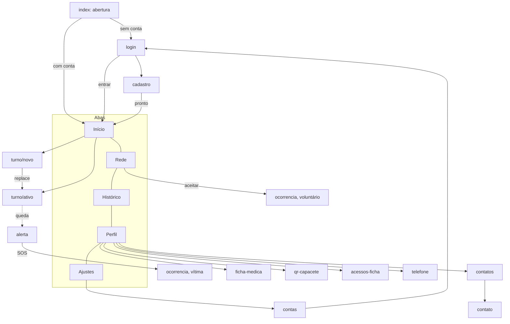

### Sessão e contas

- Até **3 contas** ficam no `expo-secure-store` (Keystore do Android), com uma chave por token, porque o secure-store recomenda valores curtos: `helmcare.contas` (só a lista de ids), `helmcare.contaAtiva` e `helmcare.<id>.acesso` e `helmcare.<id>.renovacao`. Nada de nome, e-mail ou senha no aparelho.
- A identidade é o token. A sessão (nome, voluntário, capacete, turno e ocorrência ativos) vem do `GET /entregadores/sessao` e fica só em memória.
- O interceptor de requisição do axios põe `Authorization: Bearer` da conta que fez a chamada. O interceptor de resposta, no primeiro 401, faz **uma renovação só por conta** (as chamadas que levam 401 juntas esperam a mesma) e repete a chamada uma vez. A sessão só termina com o 401 da própria renovação: no alerta e na ocorrência, aparece a faixa "Entre de novo" e o "Ligar 192" continua visível; nas outras telas, o app vai para o login.

### Banco local (SQLite)

| Tabela | O que guarda |
|---|---|
| `preferencia` | URL manual da API, modo de cor e a paleta de cada modo |
| `turno` | Turnos da conta, com o último Índice de Risco recebido |
| `alerta` | Cada mudança de estado do capacete durante os turnos |
| `ocorrencia` | Ocorrências vistas pela conta (vítima ou voluntário), sem localização |
| `trecho_cache` | Lista dos trechos críticos (dado público), com a data |

As migrações ficam em `src/banco/migracoes.ts`, controladas por `PRAGMA user_version`:

1. as tabelas iniciais;
2. a chave da `ocorrencia` passa a ser `(id, entregador_id)`, porque a vítima e o voluntário podem ser duas contas do mesmo celular;
3. a identidade passa a ser o token: sai a tabela de perfis, e a ocorrência ganha `encerrada_automaticamente`.

O SQLite nunca guarda nome, e-mail, documentos, telefones, contatos, ficha médica, localização de pessoas, senha, tokens nem o QR do capacete.

### Contextos

| Contexto | Papel |
|---|---|
| `SessaoContext` | Contas do aparelho, conta ativa, sessão em memória, troca, sair e o fim da sessão |
| `TemaContext` | Modo claro ou escuro e a paleta de cada modo |
| `TurnoContext` | Turno da conta, conciliado com a sessão, e o polling do alerta do capacete, que abre o alerta e a ocorrência sozinho |
| `ChamadosContext` | Rede de voluntários: disponibilidade e posição em memória, chamados próximos e aceite |

---

## 5. Endpoints consumidos

Todos na API principal, com a base `/api/v1`. O app nunca chama o Serviço de Risco nem o broker MQTT direto.

| Método | Rota | Uso no app |
|---|---|---|
| POST | `/entregadores` | Cadastro |
| POST | `/entregadores/login` | Login e cada conta adicionada |
| POST | `/entregadores/renovar-token` | Renovação automática no primeiro 401 |
| GET | `/entregadores/sessao` | Restaurar a sessão e mostrar o nome de cada conta |
| GET | `/entregadores/{id}` | Perfil, contatos e telefone mascarado |
| GET | `/entregadores/{id}/ficha-medica` | Ler a ficha médica |
| PUT | `/entregadores/{id}/ficha-medica` | Cadastrar ou editar a ficha |
| PUT | `/entregadores/{id}/telefone` | Trocar o telefone |
| POST | `/entregadores/{id}/contatos` | Adicionar contato de emergência |
| PUT | `/entregadores/{id}/contatos/{contatoId}` | Trocar o telefone do contato |
| DELETE | `/entregadores/{id}/contatos/{contatoId}` | Excluir contato |
| POST | `/dispositivos` | Vincular o capacete e mostrar o QR Code |
| POST | `/turnos` | Começar o turno e receber o Índice de Risco |
| GET | `/turnos/{id}/risco` | Atualizar o Índice do turno |
| GET | `/turnos/{id}/alerta` | Estado do capacete a cada 5 segundos |
| POST | `/turnos/{id}/alerta/cancelar` | "Estou bem, cancelar alerta" |
| POST | `/turnos/{id}/encerrar` | Encerrar o turno |
| GET | `/trechos-criticos?limite=50` | Trechos críticos (uma vez por dia, com cache) |
| GET | `/clima` | Cartão "Clima agora" da Início |
| POST | `/voluntarios` | Fazer parte da rede de socorro |
| PUT | `/voluntarios/{id}/disponibilidade` | Disponibilidade e posição simulada |
| GET | `/ocorrencias/proximas?voluntarioId=` | Chamados próximos |
| GET | `/ocorrencias/{id}?voluntarioId=` | Ocorrência da vítima ou do voluntário |
| POST | `/ocorrencias/{id}/aceites` | Aceitar o chamado |
| POST | `/ocorrencias/{id}/cancelar` | "Estou bem, cancelar o SOS" |
| POST | `/ocorrencias/{id}/encerrar` | "Já fui atendido" (vítima) e "Encerrar atendimento" (voluntário) |
| GET | `/cofre/auditoria/{entregadorId}` | Quem acessou minha ficha |
| GET | `/saude` | Teste de conexão nos Ajustes |

A página do Cofre (`GET /cofre/{qrToken}`, fora do `/api/v1`) é aberta no navegador pelo botão "Testar no navegador" da tela do QR Code.

---

## 6. Como rodar

Comandos para o **Git Bash no Windows**, a partir da raiz do repositório.

### Pré-requisitos
- Node 22.13 ou mais novo e npm.
- Um celular Android com o **Expo Go do SDK 58**, na mesma rede Wi-Fi do computador.
- A API principal (pasta [`api/`](../api/)) e o Serviço de Risco (pasta [`servico-risco/`](../servico-risco/)) configurados no computador, cada um com o seu banco PostgreSQL.

### 1. Subir o Serviço de Risco e a API
O Serviço de Risco sobe como explica o [README dele](../servico-risco/README.md#como-executar). A API precisa ouvir em todas as interfaces, para o celular chegar até ela:

```shell
cd api
dotnet run --project src/HelmCare.Api -- --urls "http://0.0.0.0:5000"
```

### 2. Descobrir o IP do computador

```shell
ipconfig | grep -i "IPv4"
```

Use o endereço da placa do Wi-Fi (por exemplo, `192.168.15.2`).

### 3. Iniciar o Expo

```shell
cd mobile
npm install
REACT_NATIVE_PACKAGER_HOSTNAME=192.168.15.2 npx expo start --clear
```

O `REACT_NATIVE_PACKAGER_HOSTNAME` faz o QR Code usar o IP do Wi-Fi. O app descobre sozinho a API nesse mesmo IP, na porta 5000. Se precisar, o endereço pode ser trocado na aba Ajustes ou no `.env` (veja o `.env.example`).

### 4. Abrir no Expo Go
Leia o QR Code do terminal com o Expo Go.

### 5. Capacete
O capacete pode ser o do Wokwi (pasta [`iot/`](../iot/), link no `wokwi.txt`) ou o simulador do capacete, uma ferramenta de teste em Node mantida fora deste repositório, que fala com a API pelo mesmo broker MQTT. Nunca rode os dois juntos: eles usam os mesmos tópicos.

```shell
node simulador.mjs --armado
```

No simulador, `q` e Enter simulam uma queda, `b` cancela pelo botão do capacete e `s` mostra o estado. O `--armado` serve para quando o turno já estava aberto; para começar um turno pelo app, rode só `node simulador.mjs` antes, e ele recebe o comando de armar.

### Contas de demonstração
No banco de desenvolvimento usado na demonstração, estas contas já existem, todas com a senha `Senha123` e com dados fictícios:

| Conta | Para quê |
|---|---|
| `hc0001@exemplo.com` | Entregador com o capacete HC-0001, também voluntário |
| `voluntario1@exemplo.com` a `voluntario10@exemplo.com` | Voluntários da rede (começam indisponíveis) |
| `teste.app@exemplo.com` | Conta para testar a ficha, os contatos e o capacete |
| `socorrista.a@exemplo.com` | Socorrista verificado, para abrir a página do Cofre |
| `socorrista.pendente@exemplo.com` | Socorrista não verificado (o Cofre nega o acesso) |

Para criar uma conta nova, use "Criar conta" no login, sempre com dados fictícios.

### Solução de problemas
- **Erro do ExpoSQLite ao abrir o app:** feche o Expo Go por completo (tire ele dos apps recentes) e abra de novo pelo QR Code.
- **Notificações não aparecem:** libere a permissão do Expo Go em Configurações > Aplicativos > Expo Go > Notificações. O modo "Não perturbe" também bloqueia as notificações do app.
- **"Sem conexão com a API":** confira se o celular e o computador estão na mesma rede, se a API subiu com `--urls "http://0.0.0.0:5000"` e se o firewall do Windows libera a porta 5000. Nos Ajustes, "Testar conexão" mostra o resultado na hora.
- **Cinco senhas erradas:** a conta fica bloqueada por 15 minutos.

---

## 7. Telas

<table>
  <tr>
    <td align="center">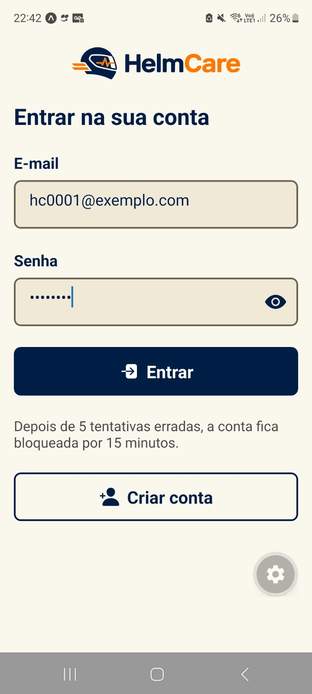<br>Login com e-mail e senha</td>
    <td align="center">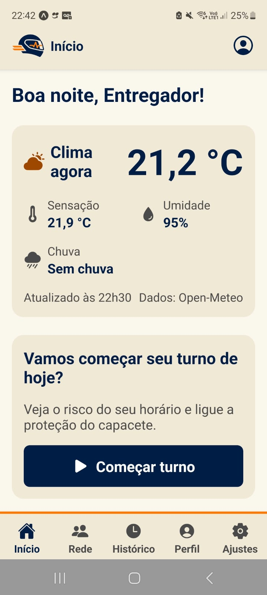<br>Início com saudação e clima</td>
    <td align="center">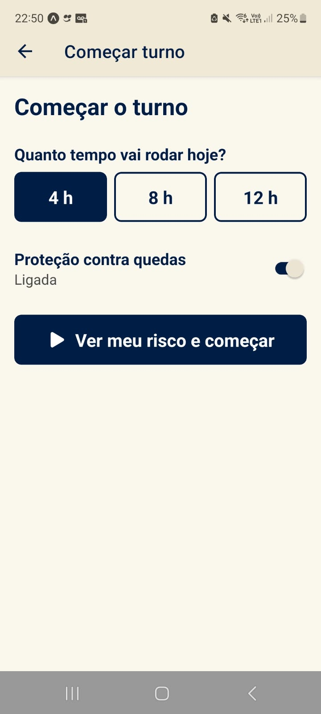<br>Começar o turno</td>
  </tr>
  <tr>
    <td align="center">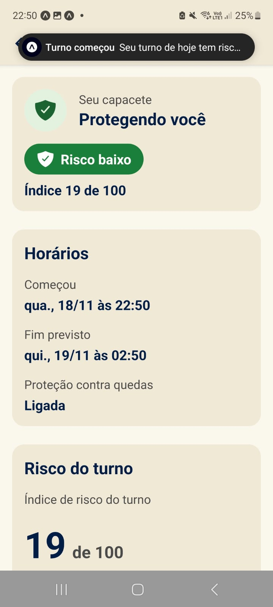<br>Turno em andamento</td>
    <td align="center">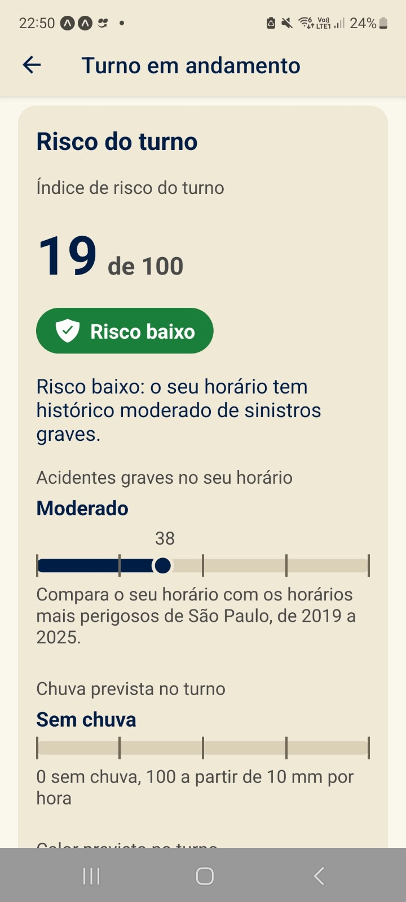<br>Índice de Risco em palavras</td>
    <td align="center">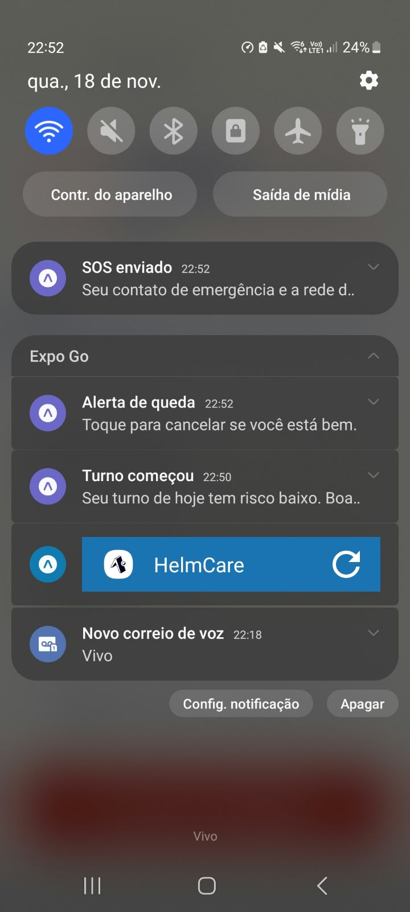<br>Notificações do HelmCare</td>
  </tr>
  <tr>
    <td align="center">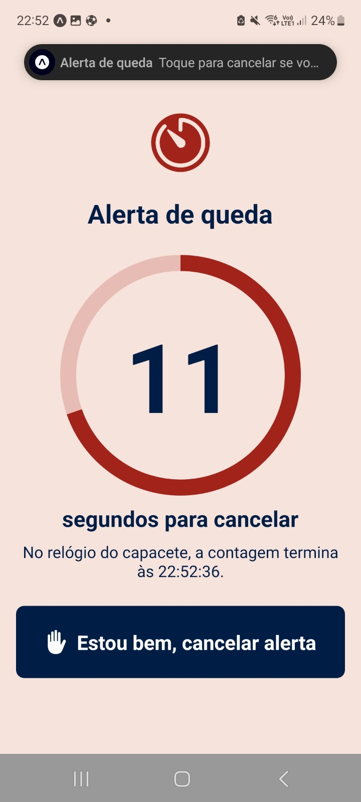<br>Alerta com a contagem</td>
    <td align="center">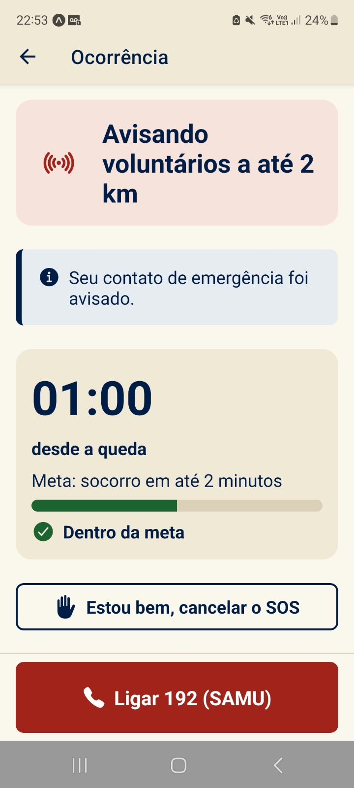<br>SOS da vítima</td>
    <td align="center">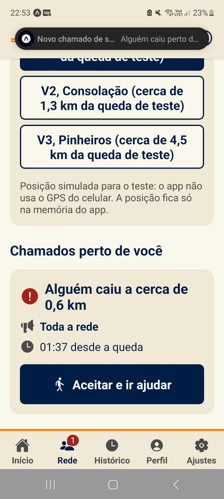<br>Chamado na rede</td>
  </tr>
  <tr>
    <td align="center">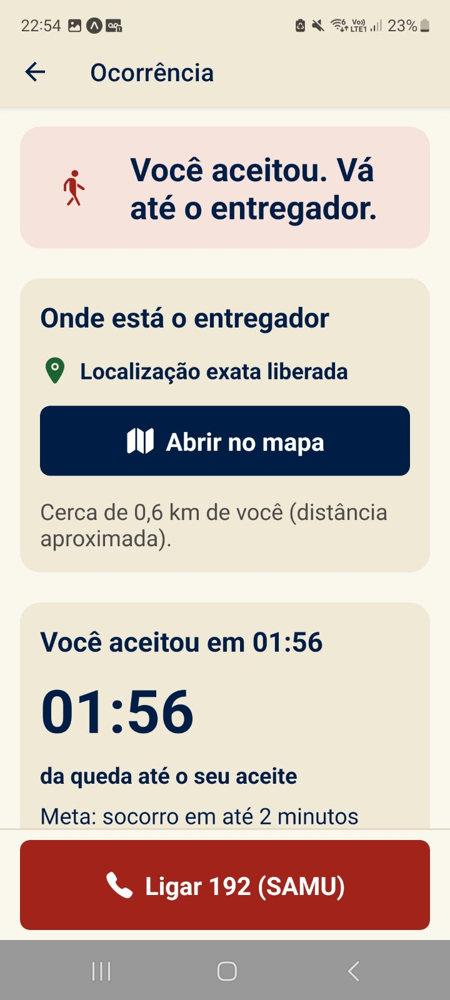<br>Voluntário a caminho</td>
    <td align="center">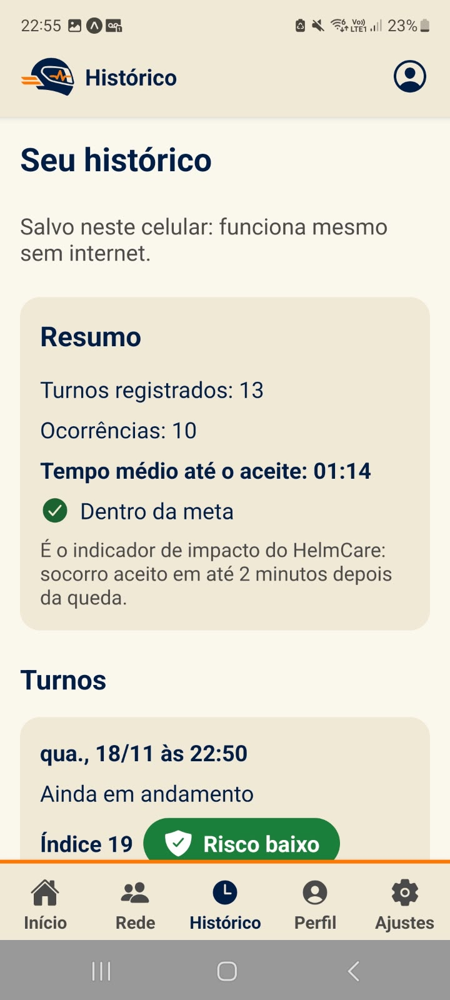<br>Histórico no celular</td>
    <td align="center">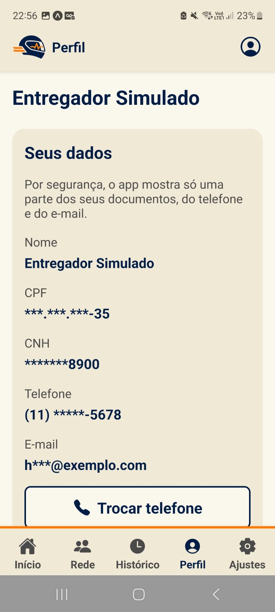<br>Perfil com dados mascarados</td>
  </tr>
  <tr>
    <td align="center">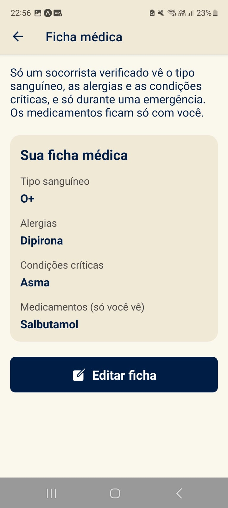<br>Ficha médica</td>
    <td align="center">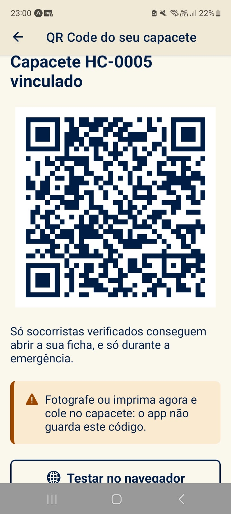<br>QR Code do capacete</td>
    <td align="center">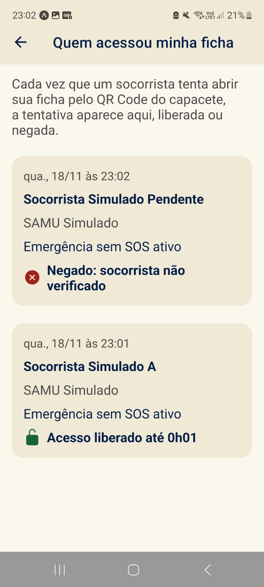<br>Quem acessou minha ficha</td>
  </tr>
  <tr>
    <td align="center">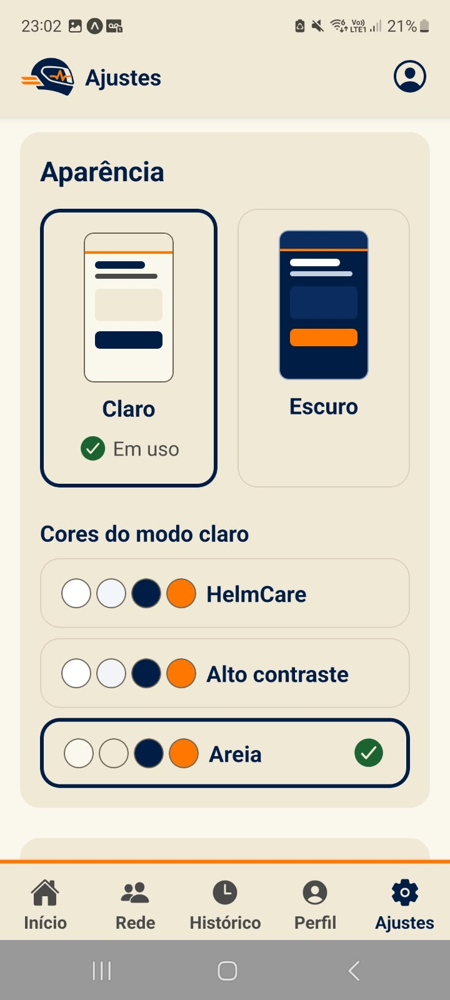<br>Aparência e paletas</td>
    <td></td>
    <td></td>
  </tr>
</table>

---

## 8. Vídeo

Vídeo de até 3 minutos com o app rodando no celular: **[youtu.be/qUZFudiXW_Q](https://youtu.be/qUZFudiXW_Q)**

Cópia no repositório: [docs/video/helmcare-app-mobile.mp4](docs/video/helmcare-app-mobile.mp4) (2:58, 1920x1080, com legendas curtas sobre cada etapa).

---

## 9. Decisões técnicas

| Decisão | Por quê |
|---|---|
| **Expo Router com rotas tipadas** | As telas são arquivos, a navegação fica legível e um link para uma rota que não existe vira erro de compilação |
| **Uma instância do axios com interceptores** | Um ponto só para o token, a renovação e a conversão dos erros: as telas decidem pelo tipo do erro (status HTTP), nunca pelo texto da API |
| **Uma renovação por conta e repetição única** | O polling do alerta, do turno e dos chamados leva 401 ao mesmo tempo; esperar uma renovação só evita derrubar a sessão no meio de um alerta ou de um SOS |
| **Até 3 contas no secure-store, uma chave por token** | Um celular só faz a vítima e o voluntário no teste. Os tokens são longos, e o secure-store recomenda valores curtos |
| **SQLite só com o que não é dado pessoal** | O histórico funciona sem internet, e nada de nome, documentos, telefones, ficha ou localização fica no aparelho |
| **Polling de 5 segundos com `setTimeout` encadeado** | A próxima consulta só começa quando a anterior termina e pausa com o app em segundo plano. Só o alerta do turno continua minimizado, para a queda virar notificação |
| **Contagem do alerta no relógio do app** | O relógio do capacete no Wokwi atrasa; o app conta os 10 e os 15 segundos a partir da primeira leitura, e quem decide o cancelamento é a API |
| **Posição do voluntário simulada (V1, V2 e V3)** | A demonstração precisa de distâncias previsíveis até a queda. Só os trechos "Perto de você" usam o GPS, e a posição fica só em memória |
| **QR Code só logo depois de vincular** | O `qrToken` é credencial: ele chega pela memória do fluxo, fica só no estado da tela e some ao sair, sem SQLite, log ou parâmetro de rota |
| **Notificações locais** | O push remoto não funciona no Expo Go; o app notifica a partir do que o polling lê |
| **6 paletas com teste de contraste** | Cada combinação passa 4,5 : 1 no texto (7 : 1 no Alto contraste) e 3 : 1 em ícones e bordas |
| **Pilha nova ao entrar e ao sair** | O voltar do Android nunca reabre o login nem as abas de uma conta que saiu |

---

## 10. Limitações conhecidas

- **Canal de notificação no Expo Go:** o canal "alertas" não é criado no Expo Go (a chamada falha com `ERR_UNEXPECTED`), e as notificações saem pelo canal padrão. Num build próprio do app, o canal é criado normalmente.
- **Dados mascarados:** CPF, CNH, telefone e e-mail chegam mascarados pela API, por regra de dados pessoais, e o app nunca desmascara.
- **"Sair" não revoga no servidor:** o "Sair" apaga os tokens do celular, mas o contrato não tem rota de logout, então o token de renovação continua válido até vencer.
- **Histórico depois do "Sair":** o histórico local da conta continua no celular e volta quando a mesma conta entra de novo (ele não tem dado pessoal).
- **Só notificação local:** não há push remoto. Com o app minimizado, só o alerta do turno continua sendo consultado, como melhor esforço, porque o Android pode pausar o app.

---

## 11. Melhorias futuras

- Ver os dados completos com uma nova autenticação.
- Confirmar a troca de telefone com um código por SMS ou e-mail.
- Push remoto.
- Build próprio do app (APK), com o canal de notificação próprio.

---

## 12. Autor

**Renan Dias Utida**, RM 558540, turma 3ESPW, FIAP.
