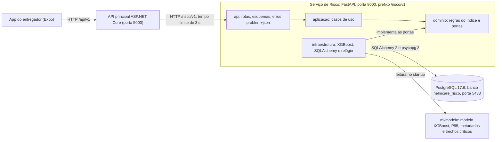
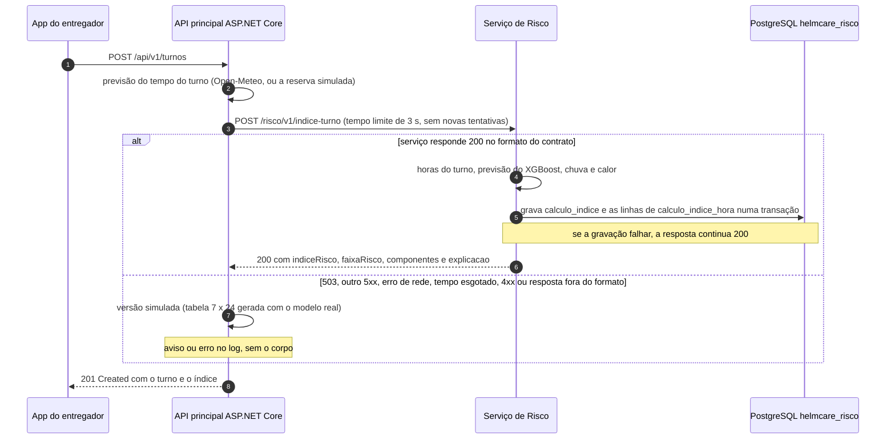
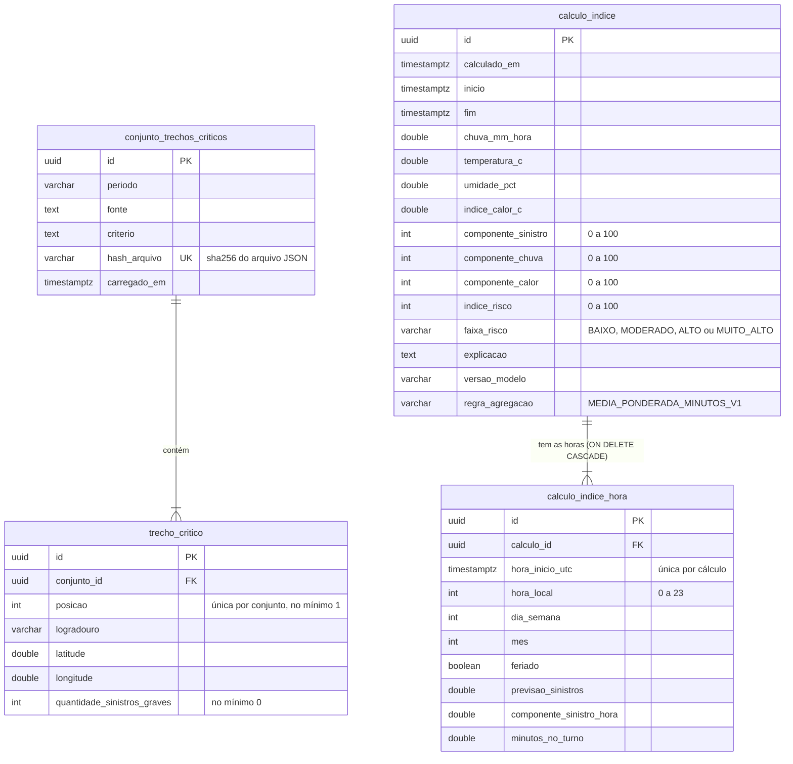
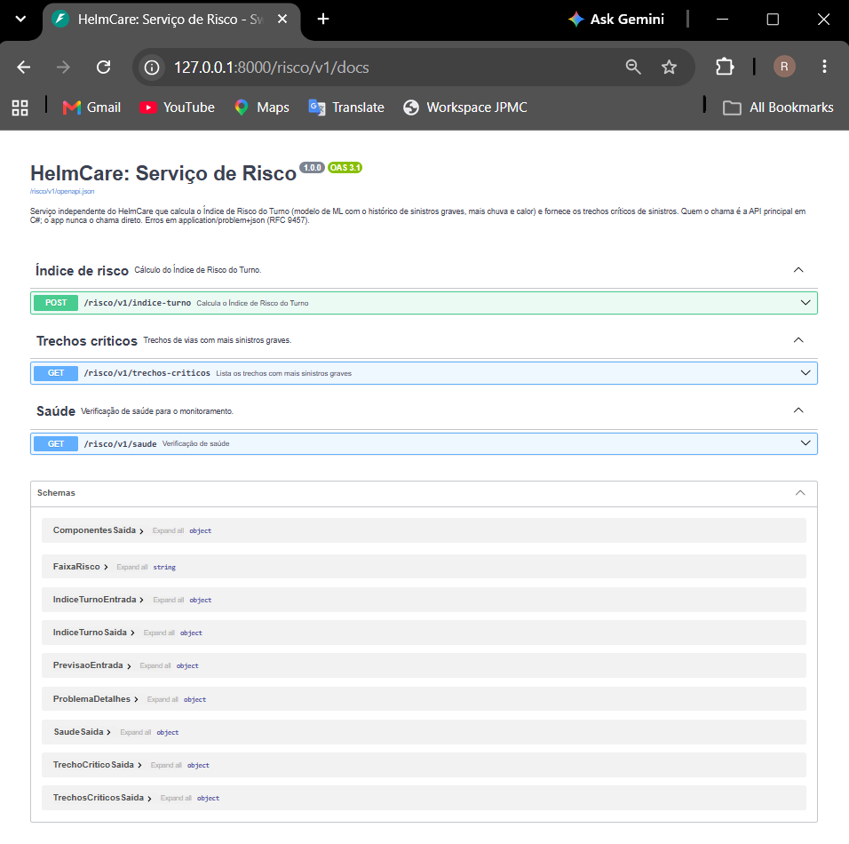
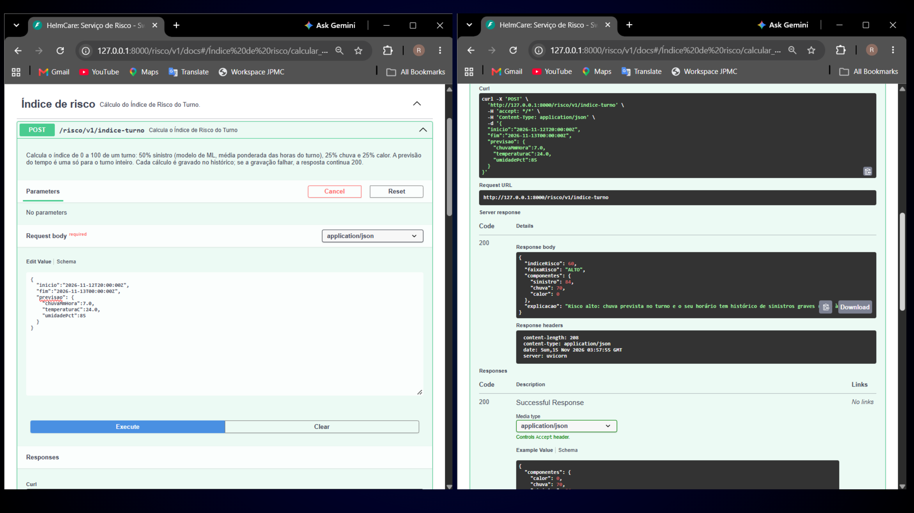

<p align="center"></p>

# Arquitetura Orientada a Serviços (SOA) e Web Services: Serviço de Risco do HelmCare

Esta é a entrega da disciplina Arquitetura Orientada a Serviços (SOA) e Web Services, do Prof. Thiago Dourado, na Global Solution 2026.2 da FIAP (Engenharia de Software, turma 3ESPW, tema CitizenTech), feita individualmente por Renan Dias Utida (RM 558540), dentro do projeto HelmCare.

O Serviço de Risco é um serviço web independente, em Python e FastAPI, que calcula o Índice de Risco do Turno do entregador de moto e fornece os trechos críticos de sinistros graves da cidade de São Paulo. Faz parte da arquitetura orientada a serviços do HelmCare: a API principal em C# é a porta de entrada, e o app do entregador nunca chama este serviço direto.

## Sumário

- [Identificação](#identificação)
- [O problema e a solução](#o-problema-e-a-solução)
  - [O problema](#o-problema)
  - [A solução HelmCare](#a-solução-helmcare)
  - [O que o entregador recebe](#o-que-o-entregador-recebe)
  - [Como o índice é calculado](#como-o-índice-é-calculado)
  - [Por que um serviço separado](#por-que-um-serviço-separado)
  - [Papel na SOA do HelmCare](#papel-na-soa-do-helmcare)
- [Arquitetura](#arquitetura)
- [Como executar](#como-executar)
- [Endpoints e documentação](#endpoints-e-documentação)
- [Banco e migrações](#banco-e-migrações)
- [Resiliência e degradação](#resiliência-e-degradação)
- [Integração de ponta a ponta com a API em C#](#integração-de-ponta-a-ponta-com-a-api-em-c)
- [Matriz de princípios de SOA](#matriz-de-princípios-de-soa)
- [Testes e cobertura](#testes-e-cobertura)
- [Mapa da rubrica de avaliação](#mapa-da-rubrica-de-avaliação)
- [Decisões de arquitetura e limitações conhecidas](#decisões-de-arquitetura-e-limitações-conhecidas)

## Identificação

| Item | Valor |
|---|---|
| Integrante | Renan Dias Utida, RM 558540, turma 3ESPW |
| Curso | FIAP, Engenharia de Software |
| Disciplina | Arquitetura Orientada a Serviços (SOA) e Web Services |
| Professor | Prof. Thiago Dourado |
| Entrega | Global Solution 2026.2, tema CitizenTech |
| Projeto | HelmCare |
| Repositório | https://github.com/renan-utida/helmcare (este serviço fica na pasta `servico-risco/`) |
| Contrato | [`docs/contrato-integracao.md`](../docs/contrato-integracao.md), versão 1.17 (a seção 8, do Serviço de Risco, não muda desde a 1.12) |

**Tecnologias:** Python 3.13.17, FastAPI 0.163, Uvicorn 0.54, Pydantic 2.14 e pydantic-settings 2.16, SQLAlchemy 2.1 (síncrono), psycopg 3.3, Alembic 1.20, PostgreSQL 17.6 (Docker), XGBoost 3.4.1, NumPy 2.4.6, holidays 0.108, pytest 9.2 com pytest-cov e httpx, ruff 0.17. As versões exatas estão em `requirements.txt` e `requirements-dev.txt`.

## O problema e a solução

### O problema

A cidade de São Paulo registrou **1.034 mortes no trânsito em 2025**, o maior número desde 2015. Os motociclistas formam o maior grupo de vítimas, com **475 mortes** no ano. Entre janeiro e agosto de 2026, as motos estiveram envolvidas em **dois de cada três (67,3%)** dos acidentes graves ou fatais da cidade (dados do Infosiga SP, Detran-SP).

Por trás desses números está o entregador de moto, que passa o dia exposto à chuva, ao calor e ao trânsito sem nenhuma informação sobre o risco do seu turno. Ele decide sair sem nenhuma medida do risco que vai correr naquele horário.

Em novembro de 2026, o autor conversou com dois entregadores que rodam ou rodavam na região da Paulista, identificados só pelas iniciais (LSU e RCD). As conversas foram informais, e as respostas foram registradas de memória. Os dois evitam horários específicos (picos de trânsito, almoço nos dias quentes), redobram a cautela na chuva e disseram que usariam um alerta de risco antes do turno. Ressalva: foram só duas conversas, com pessoas próximas do autor, e um dos entrevistados já não trabalha como entregador. Os resultados orientam o desenho do HelmCare, mas não representam todos os entregadores de São Paulo.

### A solução HelmCare

O HelmCare atua em três momentos, com três pilares:

- **Prevenir (antes da queda):** antes de sair, o entregador vê o risco do seu turno e os trechos com mais sinistros graves. **Este serviço é o pilar Prevenir.**
- **Socorrer (durante):** o capacete detecta a queda e, se o entregador não cancelar, dispara um SOS para a rede de entregadores mais próxima e para o contato de emergência, com a orientação de ligar para o SAMU 192.
- **Proteger (depois):** o QR Code do capacete libera a ficha médica só para socorristas verificados, durante a emergência, com expiração e auditoria.

### O que o entregador recebe

O HelmCare devolve, na abertura do turno, um **Índice de Risco do Turno** de 0 a 100, com a faixa e uma explicação curta em português. Ao abrir um turno de quinta-feira, das 17h às 21h, com 7 mm/h de chuva, 24 °C e 85% de umidade previstos, o entregador vê:

> **Índice 60, faixa ALTO.** "Risco alto: chuva prevista no turno e o seu horário tem histórico de sinistros graves (pico às 19h)."

Com isso, ele decide antes de sair, com a explicação em linguagem simples. Pode evitar os horários de mais risco, como os dois entregadores ouvidos já fazem por conta própria, e redobrar a cautela na chuva.

O serviço também guarda e expõe os **100 trechos críticos** (logradouros com mais sinistros graves com moto de 2019 a 2025), que o app mostra ao entregador.

### Como o índice é calculado

O Serviço de Risco calcula o índice com três componentes, cada um de 0 a 100:

| Componente | Peso | Como é calculado |
|---|---|---|
| `sinistro` | 50% | Modelo **XGBoost** (regressão de contagem, `count:poisson`) treinado com os sinistros graves com motocicleta do **Infosiga SP** na cidade de São Paulo, de 2019 a 2025. Ele prevê, para cada hora local do turno, a quantidade esperada de sinistros graves pelo calendário (`hora`, `dia_semana`, `mes`, `feriado`). Cada hora vira `100 × previsão ÷ P95` (P95 = 0,322927, limitado a 100), e o componente é a média ponderada pelos segundos de cada hora dentro do turno |
| `chuva` | 25% | Chuva prevista: 0 mm/h dá 0 e 10 mm/h ou mais dá 100, linear entre eles |
| `calor` | 25% | **Índice de calor da NOAA** a partir da temperatura e da umidade: 27 °C dá 0 e 41 °C ou mais dá 100, linear entre eles |

O índice é `0,5 × sinistro + 0,25 × chuva + 0,25 × calor`, sempre com arredondamento de 0,5 para cima. As faixas são 0 a 25 `BAIXO`, 26 a 50 `MODERADO`, 51 a 75 `ALTO` e 76 a 100 `MUITO_ALTO`. A explicação é uma frase só e nunca diz que a chuva aumenta os sinistros, porque o histórico não mostra isso.

**Fontes de dados:**

| Dado | Fonte | Uso |
|---|---|---|
| Sinistros de trânsito com motocicletas na capital, de 2019 a 2025 | Infosiga SP, Detran-SP (dados abertos, públicos) | Treino do modelo do componente `sinistro` e cálculo dos trechos críticos |
| Dados meteorológicos horários (chuva, temperatura e umidade) | INMET, estação A701, Mirante de Santana | Testados no notebook de ML. Não melhoraram as previsões e ficaram fora do modelo final; a chuva e o calor entram só pelos seus componentes, a partir da previsão do tempo do turno |

### Por que um serviço separado

- **Tecnologia própria:** o modelo de ML foi treinado em Python com XGBoost, e o serviço o carrega no mesmo ecossistema, sem converter o modelo para outra linguagem.
- **Banco e implantação independentes:** o serviço tem PostgreSQL próprio (`helmcare_risco`), migrações, dependências e processo próprios. Ele pode ser atualizado, por exemplo com uma nova versão do modelo, sem reimplantar a API.
- **A API continua respondendo:** se o serviço cair, a API abre o turno com a versão simulada do índice (veja [Resiliência e degradação](#resiliência-e-degradação)).

### Papel na SOA do HelmCare

É um serviço autônomo, com processo, banco, dependências e migrações próprios, consumido pela API principal em C# por HTTP e JSON. A API usa o serviço em duas rotas (`POST /api/v1/turnos` e `GET /api/v1/trechos-criticos`) e tem uma versão simulada de reserva para o índice, de modo que o turno nunca falha por causa dele. O app do entregador fala só com a API.

## Arquitetura

### Visão de estrutura



### Sequência do `POST /api/v1/turnos`



### Modelo de dados



### Camadas

As dependências apontam sempre para dentro: `api` e `infraestrutura` dependem de `aplicacao`, que depende de `dominio`.

| Camada | Pasta | O que faz | O que não pode importar |
|---|---|---|---|
| Domínio | `app/dominio/` | Regras puras: horas do turno, calendário de feriados, componentes, agregação, faixas, índice de calor, explicação, trechos críticos, exceções e as portas (`typing.Protocol`) | FastAPI, Pydantic, SQLAlchemy, xgboost, numpy e `app.config` |
| Aplicação | `app/aplicacao/` | Casos de uso finos: `ServicoIndiceTurno`, `ServicoTrechosCriticos` e `ServicoSaude`. Orquestram o domínio pelas portas e decidem o 503 | FastAPI e SQLAlchemy (recebem as portas prontas) |
| Infraestrutura | `app/infraestrutura/` | Implementa as portas: `PrevisorXgboost` (`ml/`), repositórios SQL, sessão, modelos e carga dos trechos (`persistencia/`) e `RelogioSistema` | A camada `api` |
| API | `app/api/` | Rotas `def` finas, esquemas Pydantic em camelCase, erros em problem+json e injeção de dependências | Regra de negócio e SQL (ficam no domínio e na infraestrutura) |
| Composição | `app/main.py` | Startup (`lifespan`), montagem dos recursos, OpenAPI e registro das rotas | |

O teste `tests/dominio/test_dependencias_dominio.py` lê a árvore sintática de cada arquivo de `app/dominio/` e falha se algum deles importar `fastapi`, `pydantic`, `sqlalchemy`, `xgboost`, `numpy` ou `app.config`.

```
servico-risco/
  app/
    main.py  config.py
    dominio/           agregacao, calculadora_indice, calendario, componentes, excecoes,
                       explicacao, faixa_risco, horas_turno, indice_calor, portas, trecho_critico
    aplicacao/         excecoes, servico_indice_turno, servico_trechos_criticos, servico_saude
    infraestrutura/
      ml/              artefatos, previsor_xgboost
      persistencia/    base, modelos, sessao, repositorios, semeador_trechos
      relogio.py
    api/               rotas_risco, esquemas, erros, dependencias
  migrations/          env.py, script.py.mako, versions/ (0001 e 0002)
  tests/               dominio, aplicacao, api, infraestrutura, integracao, fakes
  evidencias/          saídas reais e prints (veja evidencias/README.md)
  alembic.ini  compose.yaml  pyproject.toml  requirements.txt  requirements-dev.txt  .env.example
```

## Como executar

Roteiro testado no Windows com Git Bash. Pré-requisitos: Python 3.13 (`py --version`) e Docker Desktop. Os comandos chamam o Python do ambiente virtual direto (`.venv/Scripts/python -m ...`), então não dependem de ativação. Se o console mostrar acentos errados, ponha `PYTHONUTF8=1` na frente do comando.

> **Linux e macOS (não testados):** troque `.venv/Scripts/python` por `.venv/bin/python` e `py -3.13` por `python3.13`. O restante dos comandos não muda.

```shell
# 1. Ambiente virtual (uma vez, a partir da raiz do repositório)
py -3.13 -m venv servico-risco/.venv
cd servico-risco

# 2. Dependências (execução, testes e linter)
.venv/Scripts/python -m pip install -r requirements-dev.txt

# 3. Configuração local: copie o modelo e preencha os três valores (o .env nunca é versionado)
cp .env.example .env
#   POSTGRES_PASSWORD           senha do PostgreSQL local (gere com: openssl rand -hex 16)
#   RISCO_DATABASE_URL          postgresql+psycopg://helmcare:<senha>@127.0.0.1:5433/helmcare_risco
#   RISCO_TESTES_DATABASE_URL   postgresql+psycopg://helmcare:<senha>@127.0.0.1:5433/helmcare_risco_teste

# 4. PostgreSQL próprio na porta 5433 (separado do banco da API, na 5432)
docker compose up -d
docker compose exec postgres createdb -U helmcare helmcare_risco_teste   # banco dos testes, uma vez

# 5. Migrações
.venv/Scripts/python -m alembic upgrade head                  # banco principal helmcare_risco
.venv/Scripts/python -m alembic -x banco=teste upgrade head   # banco de testes helmcare_risco_teste

# 6. Serviço (carrega o modelo e os trechos críticos no startup)
.venv/Scripts/python -m uvicorn app.main:app --host 127.0.0.1 --port 8000
```

A carga dos trechos críticos roda no startup e também pela linha de comando. Ela é idempotente: na segunda vez, responde "já estavam carregados".

```shell
.venv/Scripts/python -m app.infraestrutura.persistencia.semeador_trechos
```

Testes e linter:

```shell
.venv/Scripts/python -m pytest                                      # todos (unitários, API e integração)
.venv/Scripts/python -m pytest --cov=app --cov-report=term-missing  # com cobertura
.venv/Scripts/python -m pytest -m "not integracao"                  # só os que não usam banco
.venv/Scripts/python -m ruff check .
.venv/Scripts/python -m ruff format --check .
```

**Configuração** (`app/config.py`, prefixo `RISCO_`, lida do ambiente ou do `servico-risco/.env`):

| Variável | Padrão | Uso |
|---|---|---|
| `RISCO_DATABASE_URL` | vazio | URL do banco `helmcare_risco` |
| `RISCO_TESTES_DATABASE_URL` | vazio | URL do banco dos testes de integração |
| `RISCO_MODELO_DIR` | `ml/modelo` do repositório | Pasta dos artefatos do modelo |
| `RISCO_CARREGAR_TRECHOS_NA_INICIALIZACAO` | `true` | Carga dos trechos críticos no startup |

As URLs são `SecretStr`: não aparecem em log, nem no `alembic.ini`. O `.env` também guarda a `POSTGRES_PASSWORD`, lida pelo `docker compose`.

## Endpoints e documentação

Base local: `http://127.0.0.1:8000/risco/v1`. As regras completas estão na seção 8 do [Contrato 1.17](../docs/contrato-integracao.md).

| Método | Rota | Respostas |
|---|---|---|
| POST | `/risco/v1/indice-turno` | `200` com o índice; `400` em problem+json; `503` se o modelo não estiver carregado |
| GET | `/risco/v1/trechos-criticos?limite=10` | `200` com `periodo` e `trechos` em ordem decrescente de `quantidadeSinistrosGraves`; `400` se `limite` estiver fora de 1 a 50; `503` se o banco falhar ou não houver trechos carregados |
| GET | `/risco/v1/saude` | `200` `{"status":"Healthy"}` ou `503` `{"status":"Unhealthy"}` (modelo carregado e `SELECT 1` no banco) |

**Documentação automática:** Swagger em [`/risco/v1/docs`](http://127.0.0.1:8000/risco/v1/docs) e esquema OpenAPI 3.1 em [`/risco/v1/openapi.json`](http://127.0.0.1:8000/risco/v1/openapi.json), com título, descrição, tags, resumo de cada rota, o exemplo de referência na requisição e na resposta e as respostas de erro em `application/problem+json`. O caminho fica sob `/risco/v1` porque o nginx repassa `/risco` sem remover o prefixo. Cópia do esquema: [`evidencias/06-openapi.json`](evidencias/06-openapi.json).





### `POST /risco/v1/indice-turno`

Exemplo de referência do contrato: quinta-feira, das 17h às 21h no horário de Brasília (20h às 0h em UTC), com 7 mm/h de chuva, 24 °C e 85% de umidade.

```shell
curl -s -i -X POST http://127.0.0.1:8000/risco/v1/indice-turno \
  -H "Content-Type: application/json" \
  -d '{"inicio":"2026-11-12T20:00:00Z","fim":"2026-11-13T00:00:00Z","previsao":{"chuvaMmHora":7.0,"temperaturaC":24.0,"umidadePct":85}}'
```

Resposta `200 OK` (`application/json`), saída real em [`evidencias/05-chamada-real-servico.txt`](evidencias/05-chamada-real-servico.txt):

```json
{
  "indiceRisco": 60,
  "faixaRisco": "ALTO",
  "componentes": { "sinistro": 84, "chuva": 70, "calor": 0 },
  "explicacao": "Risco alto: chuva prevista no turno e o seu horário tem histórico de sinistros graves (pico às 19h)."
}
```

As horas locais são 17h, 18h, 19h e 20h, com previsões de 0,26925, 0,27508, 0,28257 e 0,25319. A média ponderada é 83,62, e o `sinistro` fica em 84. A chuva de 7 mm/h dá 70, e o índice de calor de 24,7 °C fica abaixo de 27, então o calor é 0. O índice é 0,5 × 84 + 0,25 × 70 + 0,25 × 0 = 59,5, arredondado para **60** (`ALTO`).

`400 Bad Request` (`application/problem+json`), com o `fim` antes do `inicio`:

```json
{
  "type": "https://tools.ietf.org/html/rfc9110#section-15.5.1",
  "title": "Requisição inválida",
  "status": 400,
  "detail": "Um ou mais campos da requisição são inválidos.",
  "errors": { "fim": ["O fim do turno deve ser depois do início."] }
}
```

`503 Service Unavailable` (`application/problem+json`), com o modelo não carregado:

```json
{
  "type": "https://tools.ietf.org/html/rfc9110#section-15.6.4",
  "title": "Serviço indisponível",
  "status": 503,
  "detail": "O modelo de ML não está carregado."
}
```

As mensagens de validação não repetem o valor recebido, e o `500` é genérico, sem stack trace. Erros de rota inexistente (`404`) e de método não permitido (`405`, com o cabeçalho `Allow`) também saem em problem+json.

### `GET /risco/v1/trechos-criticos?limite=2`

```shell
curl -s -i "http://127.0.0.1:8000/risco/v1/trechos-criticos?limite=2"
```

```json
{
  "periodo": "2019 a 2025",
  "trechos": [
    { "posicao": 1, "logradouro": "SP 270 (RODOVIA RAPOSO TAVARES)", "latitude": -23.58341, "longitude": -46.77771, "quantidadeSinistrosGraves": 46 },
    { "posicao": 2, "logradouro": "SP 270 (RODOVIA RAPOSO TAVARES)", "latitude": -23.58481, "longitude": -46.78738, "quantidadeSinistrosGraves": 38 }
  ]
}
```

Com `limite=51`, a resposta é `400` com `"errors": {"limite": ["Deve ser menor ou igual a 50."]}`. Sem banco, é `503` com o detalhe "Não foi possível ler os trechos críticos." (banco fora do ar) ou "O banco de dados não está configurado." (sem URL).

### `GET /risco/v1/saude`

```shell
curl -s -i http://127.0.0.1:8000/risco/v1/saude
```

`200` com `{"status":"Healthy"}` quando o modelo está carregado e o banco responde ao `SELECT 1`. Se faltar qualquer um dos dois, `503` com `{"status":"Unhealthy"}`. O monitoramento olha o status HTTP.

## Banco e migrações

**Conexão:** SQLAlchemy 2 síncrono com psycopg 3 (`app/infraestrutura/persistencia/sessao.py`). O `create_engine` usa:

- `pool_pre_ping=True`, que testa a conexão antes de usar;
- `connect_timeout=3`, para o banco fora do ar não travar a requisição;
- `hide_parameters=True`, para um erro do banco no log não levar os valores da requisição.

A sessão é aberta e fechada por requisição (`obter_sessao` em `app/api/dependencias.py`), e o repositório faz o commit de forma explícita.

**Tabelas** (diagrama em [Modelo de dados](#modelo-de-dados)). Nenhuma delas guarda dado pessoal: a requisição nem tem identificador de entregador.

| Tabela | Conteúdo | Constraints |
|---|---|---|
| `conjunto_trechos_criticos` | Uma carga do `trechos_criticos.json` | `hash_arquivo` único (sha256 do arquivo) |
| `trecho_critico` | Os trechos de cada carga | Única em (`conjunto_id`, `posicao`); CHECK `posicao >= 1` e `quantidade_sinistros_graves >= 0`; FK para o conjunto |
| `calculo_indice` | Cada cálculo: entradas, componentes, índice, faixa, explicação, versão do modelo e regra de agregação | CHECK de 0 a 100 nos três componentes e no índice; CHECK da `faixa_risco` entre as 4 do contrato |
| `calculo_indice_hora` | As horas de cada cálculo: variáveis do modelo, previsão, valor normalizado sem arredondar e minutos no turno | Única em (`calculo_id`, `hora_inicio_utc`); CHECK `hora_local` de 0 a 23; FK com `ON DELETE CASCADE` |

**Migrações Alembic**, escritas à mão em `migrations/versions/`, com `upgrade` e `downgrade`:

| Revisão | Anterior | O que cria |
|---|---|---|
| `0001_criar_trechos_criticos` | nenhuma | `conjunto_trechos_criticos` e `trecho_critico` |
| `0002_criar_historico_calculos` | `0001` | `calculo_indice` e `calculo_indice_hora` |

- O `alembic.ini` não tem URL. O `migrations/env.py` lê a URL da configuração do serviço: por padrão a `RISCO_DATABASE_URL`, e com `-x banco=teste` a `RISCO_TESTES_DATABASE_URL`.
- O `MetaData` usa uma `naming_convention` (`app/infraestrutura/persistencia/base.py`), então os nomes das constraints são previsíveis, como `pk_trecho_critico`, `uq_trecho_critico_conjunto_id_posicao` e `ck_calculo_indice_indice_risco_0_a_100`.
- O `alembic check` responde "No new upgrade operations detected." nos dois bancos, o que prova que os modelos e as migrações batem. As saídas estão em [`evidencias/03-alembic.txt`](evidencias/03-alembic.txt), e o SQL gerado, em [`evidencias/03b-migracoes.sql`](evidencias/03b-migracoes.sql).

**Carga dos trechos** (`semeador_trechos.py`):

- Lê o `ml/modelo/trechos_criticos.json` e valida: a quantidade declarada bate com a lista, há pelo menos 50 trechos, as posições vão de 1 a N e a ordem é decrescente.
- Grava o conjunto e os 100 trechos numa só transação.
- É idempotente pelo sha256 do arquivo: se o hash já existe, não faz nada. Se duas instâncias tentarem ao mesmo tempo, a constraint única barra a segunda, e isso conta como "já carregado".
- O repositório lê o conjunto mais recente, pelo `carregado_em`.

**Histórico dos cálculos:** cada `POST /indice-turno` grava `calculo_indice` e as linhas de `calculo_indice_hora` (4 no exemplo de referência) num só commit (`RepositorioCalculosSql.salvar`). Em caso de erro, há rollback. Se a gravação falhar, a resposta continua `200`, e o log registra o id do cálculo e o tipo do erro, nunca o corpo. A consulta real ao banco está em [`evidencias/04-banco-tabelas.txt`](evidencias/04-banco-tabelas.txt).

## Resiliência e degradação

Transcrição da seção 8 do Contrato 1.17 (sem mudanças desde a 1.12), partes "Degradação" e "Na API principal".

O serviço sobe mesmo que o modelo ou o banco falhem na inicialização, e cada rota responde conforme o que falta:

| Falha | `POST /indice-turno` | `GET /trechos-criticos` | `GET /saude` |
|---|---|---|---|
| Modelo não carregou | `503` em ProblemDetails | `200` | `503` |
| Banco fora do ar | `200`, sem gravar o histórico | `503` em ProblemDetails | `503` |

No `POST /turnos` da API principal, qualquer falha do Serviço de Risco leva à versão simulada, e o turno nunca falha por causa dele:

| Falha na chamada ao Serviço de Risco | Log da API | Resultado |
|---|---|---|
| `503`, outro `5xx`, erro de rede ou tempo esgotado | Aviso | Versão simulada |
| `4xx` ou resposta fora do formato (JSON inválido, campo faltando, índice ou componente fora de 0 a 100, faixa desconhecida, explicação vazia) | Erro (é erro de integração) | Versão simulada |
| Requisição cancelada pelo próprio cliente | Nenhum | Não é falha do serviço: o cancelamento sobe e a simulada não é usada |

- **Tempo limite:** a API chama o serviço com tempo limite de 3 s (`ServicoRisco:TempoLimiteS`, de 1 a 30), sem novas tentativas (seção 1 do contrato).
- **Trechos críticos:** no `GET /api/v1/trechos-criticos`, as mesmas falhas dão `503`, com o título "Serviço de Risco indisponível". Não há lista simulada (seção 7).
- **Logs:** os logs da API levam só o motivo, o status HTTP e o tempo, nunca o corpo da requisição ou da resposta.
- **Limitação da versão simulada:** ela usa uma tabela de 7 dias × 24 horas com o componente `sinistro` de cada hora local, gerada com o modelo real (versão 1.0.0) para novembro e sem feriado. Para turnos de novembro em dias sem feriado, dá o mesmo resultado do serviço. Em feriados (como 15/11 e 20/11) e em outros meses, pode diferir.

Do lado do serviço, o startup (`inicializar_recursos` em `app/main.py`) trata cada falha separadamente:

- modelo que não carrega: registra um erro crítico;
- URL do banco ausente ou inválida: registra o tipo do erro, sem a URL;
- carga dos trechos que falha: registra no log.

Em nenhum desses casos o processo cai. Os testes de `tests/api/test_inicializacao.py` sobem a aplicação sem modelo e com o banco fora do ar, e conferem que o log não leva a senha.

## Integração de ponta a ponta com a API em C#

Em 14/11/2026, a API principal chamou este serviço de verdade. A seção completa do `api/README.md` está copiada em [`evidencias/07-integracao-api-csharp.md`](evidencias/07-integracao-api-csharp.md), e o log do uvicorn dessas chamadas aparece no print [`evidencias/08-print-uvicorn-chamadas-da-api.png`](evidencias/08-print-uvicorn-chamadas-da-api.png). A evidência é de 14/11/2026, quando a previsão do tempo da API ainda era fixa. Desde o Contrato 1.17, ela vem da Open-Meteo, sem mudar o formato da requisição ao serviço.

| Passo | Situação | Resultado |
|---|---|---|
| 4 | Serviço no ar; `POST /api/v1/turnos` com o turno do exemplo do contrato | `201 Created` com índice 60, `ALTO`, componentes 84, 70 e 0 e a explicação do serviço. Log da API: "Índice de Risco calculado pelo Serviço de Risco em 298 ms." |
| 9 | Serviço parado; o mesmo pedido | `201 Created` com o mesmo índice, calculado pela versão simulada. Log da API: aviso com motivo `ErroDeRede`, sem status, em 2154 ms |
| 10 | Serviço ainda parado; `GET /api/v1/trechos-criticos?limite=2` e encerramento do turno | Trechos: `503` em problem+json com "Serviço de Risco indisponível". O `POST /api/v1/turnos/{id}/encerrar` responde `200` normalmente |

**Por que 87 ms no serviço e 298 ms na API:** as duas medidas cobrem trechos diferentes.

- O log do uvicorn ("Cálculo ... concluído em 87.1 ms", no print 08) é medido em `ServicoIndiceTurno.calcular` com `time.perf_counter`. Cobre só a geração das horas, a previsão do XGBoost e o cálculo do índice.
- Os 298 ms do log da API cobrem a chamada HTTP inteira, vista do C#:
  - a abertura da primeira conexão TCP do `HttpClient`;
  - o envio e a validação do corpo pelo FastAPI;
  - o cálculo;
  - a gravação do histórico no PostgreSQL (sessão com `pool_pre_ping` e commit de 5 linhas);
  - a serialização da resposta e a volta pela rede.
- Com o serviço já aquecido, o mesmo cálculo levou 5,6 ms na chamada da [`evidencias/05-chamada-real-servico.txt`](evidencias/05-chamada-real-servico.txt).

Os 2154 ms do passo 9 são o tempo até a conexão recusada no Windows, abaixo do tempo limite de 3 s.

## Matriz de princípios de SOA

| Princípio | Onde aparece no projeto | Evidência |
|---|---|---|
| Contrato padronizado | Rotas, campos, enums e erros seguem a seção 8 do Contrato 1.17. Os esquemas Pydantic de `app/api/esquemas.py` publicam o JSON em camelCase (`alias_generator=to_camel`), e `app/api/erros.py` padroniza os erros em `application/problem+json` (RFC 9457), com `type` apontando para a seção do RFC 9110, como no ASP.NET. O OpenAPI 3.1 é gerado a partir do código | `tests/api/test_erros_e_openapi.py` (`test_openapi_tres_rotas_sob_risco_v1`, `test_openapi_campos_em_camel_case`, `test_openapi_erros_em_problem_json_e_sem_422`, `test_openapi_exemplo_de_referencia_na_requisicao_e_resposta`); `evidencias/06-openapi.json` |
| Baixo acoplamento | O domínio declara as portas em `app/dominio/portas.py` (`PrevisorSinistros`, `Relogio`, `RepositorioTrechosCriticos`, `RepositorioCalculos`, todas `typing.Protocol`), e a infraestrutura as implementa sem herança. A API em C# conhece só a URL base e o contrato HTTP, não o Python, o modelo ou o banco | `tests/dominio/test_dependencias_dominio.py`; os fakes de `tests/fakes/` substituem as implementações reais sem mudar o domínio nem a aplicação |
| Abstração | A resposta expõe só `indiceRisco`, `faixaRisco`, `componentes` e `explicacao` (`IndiceTurnoSaida`). As previsões por hora, o P95 e a versão do modelo ficam só no histórico. O `500` é genérico, e a validação não repete o valor recebido | `test_erro_inesperado_500_generico_sem_stack_trace`, `test_indice_turno_json_invalido_400_sem_ecoar_corpo`; `evidencias/05-chamada-real-servico.txt` |
| Reuso | O mesmo serviço atende o índice do `POST /api/v1/turnos` e a lista do `GET /api/v1/trechos-criticos`. A regra `validar_turno` do domínio (`app/dominio/horas_turno.py`) é usada pelo esquema da requisição (`IndiceTurnoEntrada`) e pelo `ServicoIndiceTurno` | `evidencias/07-integracao-api-csharp.md` (as duas rotas da API chamando o serviço); `test_indice_turno_*` em `tests/api/test_rota_indice_turno.py` |
| Autonomia | Processo próprio (uvicorn na porta 8000), banco próprio (`helmcare_risco` num `compose.yaml` separado, na porta 5433, com volume próprio), venv, dependências e migrações próprios. O serviço sobe e calcula o índice mesmo com o banco ou o modelo fora (degradação) | `tests/api/test_inicializacao.py` (`test_inicializar_modelo_ausente_e_sem_banco_sobe_degradado`, `test_inicializar_banco_fora_do_ar_sobe_e_carga_falha_sem_vazar_senha`); `test_indice_turno_historico_falha_continua_200` |
| Ausência de estado | Não há sessão de usuário. O modelo é carregado uma vez no startup (`lifespan` em `app/main.py`) e depois só é lido. A sessão do banco é aberta e fechada por requisição (`obter_sessao`). O histórico só é escrito e nunca é lido para responder | `test_obter_sessao_com_fabrica_abre_sessao_e_monta_repositorios_sql`; `evidencias/04-banco-tabelas.txt` |
| Descoberta | Swagger em `/risco/v1/docs`, esquema em `/risco/v1/openapi.json`, `/risco/v1/saude` para o monitoramento, prefixo versionado `/risco/v1` e URL base configurável na API (`ServicoRisco:UrlBase`) | `test_docs_swagger_disponivel_sob_prefixo`; `evidencias/06-openapi.json`, `09-swagger-visao-geral.png` e `10-swagger-post-executado.png` |
| Composição | A API em C# compõe três partes no `POST /api/v1/turnos`: a previsão do tempo (`IPrevisaoTempo`, vinda da Open-Meteo pela `PrevisaoTempoOpenMeteo`, com a `PrevisaoTempoSimulada` como reserva pela `PrevisaoTempoComReserva`), este serviço e a reserva simulada do índice (`ServicoRiscoComReserva`). Dentro do serviço, o índice compõe o modelo (50%), a chuva (25%) e o calor (25%) | `evidencias/07-integracao-api-csharp.md`; `test_calcular_resultado_indice_exemplo_referencia_84_70_0_60_alto` |

## Testes e cobertura

| Tipo | Pasta | Quantidade | O que usa |
|---|---|---|---|
| Unitários do domínio | `tests/dominio/` | 138 | Só o domínio; inclui o teste das camadas |
| Configuração | `tests/test_config.py` | 5 | `Configuracoes` sem ler o `.env` |
| ML e conversão da carga | `tests/infraestrutura/` | 25 | Modelo real (paridade com as 4 previsões do notebook, tolerância de 1e-5) e o JSON dos trechos |
| Aplicação | `tests/aplicacao/` | 16 | Fakes escritos à mão em `tests/fakes/`: previsor falso, relógio fixo e repositórios em memória com opção de falha |
| API | `tests/api/` | 55 | `TestClient` do FastAPI com as dependências trocadas por fakes; o exemplo de referência usa o modelo real |
| Integração | `tests/integracao/` | 15 | PostgreSQL de testes (`helmcare_risco_teste`), marcador `integracao` |

- Os testes de integração recriam o esquema pelas migrações (`downgrade base` e `upgrade head`) e rodam o `alembic check`.
- Também cobrem a carga idempotente (inclusive a corrida entre duas cargas, simulada forçando o `IntegrityError` do hash repetido, sem duas instâncias de verdade), os repositórios, o rollback, uma CHECK que recusa componente 101 e a aplicação inteira com o startup real gravando o cálculo e as 4 horas.
- Sem a `RISCO_TESTES_DATABASE_URL`, eles são ignorados com o motivo.
- Por segurança, só rodam se o banco terminar em `_teste` e for diferente do banco principal.

**Última execução** (saída completa em [`evidencias/01-pytest-cobertura.txt`](evidencias/01-pytest-cobertura.txt)):

```
TOTAL                                                  1017      2    99%
============================ 254 passed in 16.56s =============================
```

O domínio está com 100% de cobertura. O `ruff check .` e o `ruff format --check .` passam sem avisos ([`evidencias/02-ruff.txt`](evidencias/02-ruff.txt)). Sem os testes de integração (`-m "not integracao"`), passam 239 testes e a cobertura total cai para 96%, porque os repositórios SQL e a carga só rodam contra o banco.

**Linhas que ficam descobertas, e por quê:** das 1017 instruções de `app/`, 2 ficam sem cobertura, e as duas são de propósito.

| Arquivo e linha | Código | Motivo |
|---|---|---|
| `app/config.py`, linha 48 | `return Configuracoes()` em `obter_configuracoes()` | Executar essa linha lê o `.env` real do desenvolvedor. Os testes montam `Configuracoes(_env_file=None, ...)` direto, para nunca dependerem dos segredos da máquina. Cobrir exigiria ler o `.env` ou mudar o código |
| `app/infraestrutura/persistencia/semeador_trechos.py`, linha 153 | `sys.exit(main())` dentro de `if __name__ == "__main__":` | Só roda quando o módulo é executado por `python -m`. A função `main()` em si está coberta por `test_semeador_main_carrega_no_banco_configurado`. Cobrir a linha exigiria um subprocesso com a configuração real e a medição de cobertura em subprocessos |

**Linhas que já foram cobertas:**

- `app/infraestrutura/ml/previsor_xgboost.py`, linha 43: o erro de um modelo com nomes de variáveis diferentes, coberto por `test_previsor_modelo_com_outras_variaveis_erro_claro`.
- `app/infraestrutura/persistencia/semeador_trechos.py`, linhas 114 a 119: a corrida entre duas cargas, tratada pela constraint única do hash, coberta por `test_semeador_corrida_hash_repetido_devolve_nao_carregado_sem_duplicar`.

## Mapa da rubrica de avaliação

| Critério | Peso | Onde está | Evidência |
|---|---|---|---|
| Estruturação do domínio | 3,0 | `app/dominio/` (11 módulos e portas), camadas `aplicacao`, `infraestrutura` e `api`; seções [Arquitetura](#arquitetura) e [Matriz de princípios de SOA](#matriz-de-princípios-de-soa) | `tests/dominio/` (138 testes, 100% de cobertura do domínio), `test_dependencias_dominio.py`, `evidencias/01-pytest-cobertura.txt` |
| Conexão com banco | 3,0 | `app/infraestrutura/persistencia/` (`sessao`, `modelos`, `repositorios`, `semeador_trechos`), `obter_sessao` em `app/api/dependencias.py`, `compose.yaml` | `evidencias/04-banco-tabelas.txt`, `evidencias/05-chamada-real-servico.txt`, `tests/integracao/test_persistencia.py` e `test_api_banco.py` |
| Migrações | 1,5 | `alembic.ini`, `migrations/env.py`, `migrations/versions/0001_criar_trechos_criticos.py` e `0002_criar_historico_calculos.py` | `evidencias/03-alembic.txt`, `evidencias/03b-migracoes.sql`, `tests/integracao/test_migracoes.py` |
| Documentação automática | 1,5 | `/risco/v1/docs` e `/risco/v1/openapi.json`; `gerar_openapi` em `app/main.py`; exemplos e respostas de erro nos esquemas e nas rotas | `evidencias/06-openapi.json`, `09-swagger-visao-geral.png`, `10-swagger-post-executado.png`, `tests/api/test_erros_e_openapi.py` |
| Testes automatizados | 1,0 | `tests/` (unitários, aplicação, API e integração) | `evidencias/01-pytest-cobertura.txt` (254 testes, 99%), `evidencias/02-ruff.txt` |
| Entregável: repositório | | https://github.com/renan-utida/helmcare, pasta `servico-risco/` | |
| Entregável: README com execução, descrição e integrante | | Este arquivo: [Identificação](#identificação), [O problema e a solução](#o-problema-e-a-solução) e [Como executar](#como-executar) | |
| Entregável: documentação dos endpoints | | [Endpoints e documentação](#endpoints-e-documentação) e o Swagger | `evidencias/06-openapi.json`, prints 09 e 10 |
| Entregável: evidências | | [`evidencias/`](evidencias/) | [`evidencias/README.md`](evidencias/README.md) (o que cada arquivo prova) |

## Decisões de arquitetura e limitações conhecidas

**Decisões**

- **SQLAlchemy síncrono e rotas `def`:** a previsão do XGBoost usa CPU e bloqueia. Com rotas `def`, o FastAPI roda cada requisição num pool de threads, sem travar o servidor. O driver síncrono (psycopg 3) deixa o código mais simples do que a versão assíncrona, sem perda para este volume.
- **Degradação com 503 em vez de não subir:** o serviço sobe sem modelo ou sem banco e responde 503 só nas rotas que dependem do que falta (seção 8 do Contrato 1.17). A API em C# trata o 503 como falha e usa a versão simulada.
- **Histórico que não bloqueia:** o entregador precisa do índice mais do que o serviço precisa do histórico. Se a gravação falhar, a resposta continua 200.
- **400 no lugar de 422:** o tratador de validação do FastAPI foi substituído, e o OpenAPI não lista 422, para seguir o quadro de códigos do contrato.
- **Média ponderada das horas do turno**, com um único arredondamento no fim (seção 8.1 do contrato). O pico não se perde: a explicação cita a hora de maior risco.
- **Arredondamento de 0,5 para cima** (`arredondar_meio_para_cima`), e não o `round()` do Python, que é bancário (64,5 viraria 64).
- **Relógio como porta:** o domínio e os serviços nunca chamam `datetime.now()`. Nos testes, um relógio fixo deixa tudo repetível.
- **Modelo só com o calendário:** as variáveis do tempo não melhoraram as previsões no notebook de ML, então a chuva e o calor entram só pelos seus componentes.

**Limitações**

- **Sem autenticação no protótipo**, porque só a API na mesma máquina chama o serviço (nginx e rede local). Em produção entrariam mTLS ou JWT entre serviços, limite de requisições e rede restrita.
- **Versão simulada da API** com a tabela de novembro sem feriado: em feriados e em outros meses, o índice simulado pode diferir do serviço.
- **Previsão de reserva fixa na API:** a API busca a previsão real na Open-Meteo. Só quando ela falha, demora mais de 3 s, responde algo inválido ou não cobre as horas do turno (ou na configuração de previsão simulada forçada, usada em testes e demonstração), a API usa a `PrevisaoTempoSimulada` (7 mm/h, 24 °C e 85%). Nesse caso, o índice muda só pelo horário.
- **XGBoost síncrono em rotas `def`:** o limite de requisições simultâneas é o do pool de threads do servidor. Não houve teste de carga.
- **Sem rota de consulta do histórico:** o histórico serve à auditoria no banco, conforme o contrato.
- **Feriados fora de 2019 a 2030** seguem a regra da biblioteca `holidays` mais as datas municipais, não a lista conferida do notebook.
- **Modelo carregado só no startup:** trocar a versão do modelo exige reiniciar o serviço.
